# Paperfact

*The perfect way to read papers, take notes, and share ideas.*

Paperfact does the groundwork: what each paper builds on, what it claims, and what
came after, with explanations linked back to the original passage. You read, check
and decide, and your understanding becomes notes, slides and collections others can
verify.

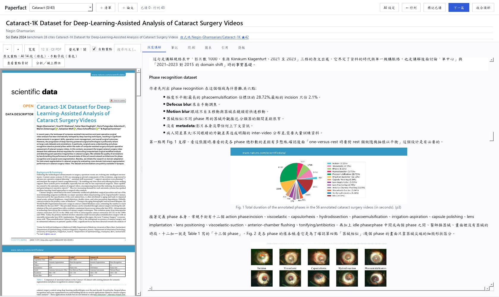

**Read → understand → present → share.** Keep the PDF and your research side by side.

## See what you can do

| Build your reading list | Explore the research around a paper |
|---|---|
| 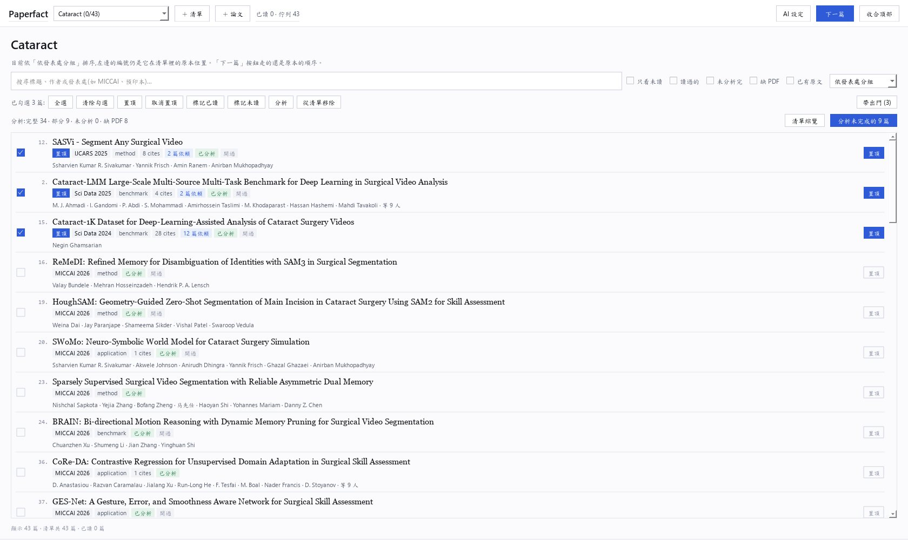 | 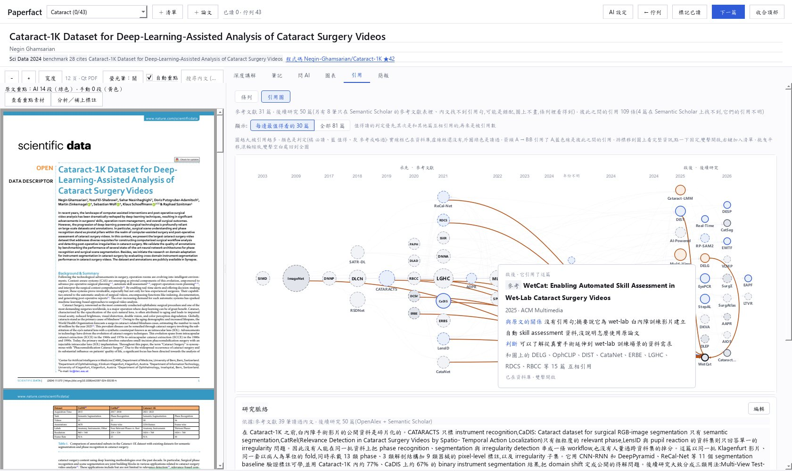 |
| Paste references, describe a topic, or start empty. | Follow references and later work back to their sources. |

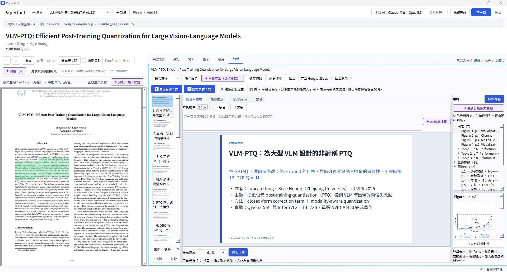

**Make a guide worth sharing.** Edit slides, ask AI to rewrite one page, check its
sources, export a PDF, or create an editable Google Slides copy. [Slides guide →](docs/presentations.md)

## Your accounts. Your models.

| Choose your everyday AI | Override only the features you want |
|---|---|
| 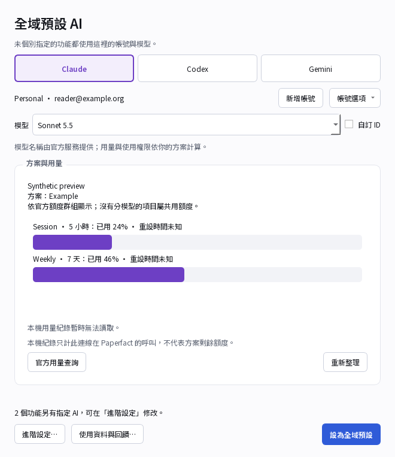 | 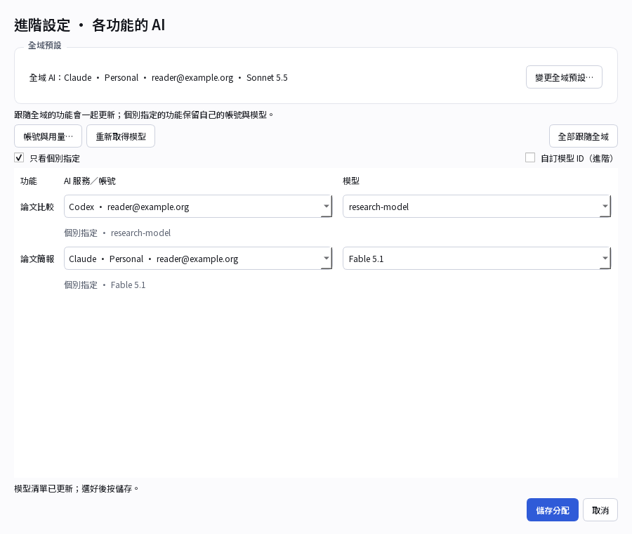 |
| **全域 AI → 全域預設 → account → model → 設為全域預設** | **全域 AI → 各功能的 AI → feature → account + model → 儲存分配** |

AI screenshots use demo accounts and simulated usage; model access depends on your
provider. Reading saved research needs no AI login.

**Three kinds of source:** **Claude** and **Codex** use your subscription sign-in;
**API 端點** adds any key or address (Anthropic, an OpenAI-compatible service, local
Ollama), billed by that service. **Gemini subscriptions** are used from agy, which
calls Paperfact's MCP tools, because Google does not allow third-party tools to use
Antigravity's subscription login ([AI access policy](docs/ai-access-policy.md)).
[Account and model help](docs/ai-setup.md)

For an enrolled v0.5 workspace, replacing an original with `repdf` keeps prior
PDF versions and their source references. First-original background downloads also
use verified versioned storage. Reader and analysis intake share that route in the
current source. Adding a PDF to a list preserves an existing original, including
when that paper joins another list. Supplying the exact known missing PDF keeps
its version and citations; choosing different bytes through explicit replacement
creates a new version. Supplying a PDF does not start AI analysis. Explicit
attachment retries also restore missing saved-deck bytes while keeping the same
editable revision; corrupt existing files remain protected.
See [PDF replacement and downloads](docs/sync-operations.md#observed-native-pdf-replacement).

## Start here

**Use a released preview:** choose the file for your computer from
[Releases](https://github.com/puddings-world/Paperfact/releases).

| Windows x64 | Mac with Apple silicon | Linux x86-64 |
|---|---|---|
| `*-windows-x64-setup.exe` | `*-macos-arm64.dmg` | `*-linux-x86_64.AppImage` |
| Install, then open from Start. | Copy the app to Applications. | Make executable, then open. |

Installers include Python and Qt. Builds are unsigned previews; see
[installation details and platform limits](docs/install.md).
Candidate validation separates frozen startup from isolated Windows
install/reinstall/uninstall and actual device upgrades; see the
[release checks and remaining gates](docs/releasing.md).


**Run the current source:** choose your terminal below. Git and internet access
are required; setup prepares Python, dependencies, fonts and rendering assets.

<details>
<summary>Windows · PowerShell</summary>

```powershell
git clone https://github.com/puddings-world/Paperfact.git
cd Paperfact
.\scripts\setup.ps1
.\scripts\dev.ps1 app
```

After the first setup, only `.\scripts\dev.ps1 app` is needed to open the app.

</details>

<details>
<summary>macOS / Linux · Terminal</summary>

```bash
git clone https://github.com/puddings-world/Paperfact.git
cd Paperfact
bash scripts/setup.sh
bash scripts/dev.sh app
```

After the first setup, only `bash scripts/dev.sh app` is needed to open the app.

</details>

| | Release installer | Git checkout |
|---|---|---|
| Best for | Reading and research | Development and trying current source changes |
| Code | One published, tagged snapshot | The commit you checked out; `git pull` brings newer commits |
| Runtime | Python and Qt included | Prepared by the setup script |
| Update | In-app release notice and platform installer | Save local work, `git pull --ff-only`, rerun setup, restart |

The app checks GitHub Releases in the background at launch and revisits the cache
hourly while open; successful network checks are limited to once per day for a
version/channel. Current 0.x previews include published beta releases. The notice
rotates between the new-version summary and update instructions, pauses while
hovered or keyboard-focused, and **稍後** dismisses that version for the day.
It never runs `git pull` or installs an update without your action. New commits
without a published release do not trigger a release notice.

Source and installed copies have separate default workspaces; set `PAPERFACT_DATA`
to the same absolute data folder to share one. A release contains its tagged code,
so it may not include newer source features. Existing v0.3.0 and older installers
skip beta notices; install a build containing this fix manually once to receive
future beta notices. [Update details](docs/install.md#update-notices)
To match an installer exactly, developers can check out its tag, for example
`git switch --detach v0.4.3`, then rerun setup. Use a separate copied workspace
for0.5 development and upgrade tests; do not point an older app at a newer enrolled
database. Research packages remain the supported snapshot-sharing path.
New AI work additionally needs your own supported provider account and CLI/API
connection; [AI setup](docs/ai-setup.md) explains those separate prerequisites.

| 1 · Open | 2 · Bring papers | 3 · Continue research |
|---|---|---|
| Start with an empty **清單總覽**. | **建立清單** or **匯入研究資料包**. | Read saved work, or select your AI to analyse more. |

Use **↑ / ↓** to select, **Enter** to open, **Alt + ←** to go back.
The ML conference workflow is optional; your lists can cover any field.

Start from a research question, even without paper titles. Choose a survey depth,
review the suggested branches and selection reasons, then keep the papers you want.
The route is saved in the list overview and travels with research bundles.
The overview identifies its recorded workflow and any manual edits; its paper
count does not certify original-source coverage. [Evidence scope](docs/analysis-audit.md).
[Topic research and its limits →](docs/topic-research.md)

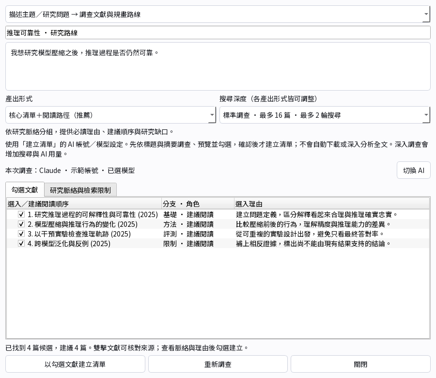

## Sync a desktop and laptop (v0.5 preview)

Install the same current build on both devices before syncing a large bibliography. Paperfact publishes large bibliographies in verified pages and marks the private directory as v8 when the extended format is needed. Earlier builds cannot open a v8 directory. Each bibliography history supports up to 256 pages and 64 MiB of serialized metadata. PDFs use a separate transfer.

Use the same preview on both computers. [Apple Silicon download and offline acceptance steps](docs/testing/mac-acceptance-0.5.md#start-here-on-apple-silicon).

1. On Windows, open **Sync**, sign in to Google, check the lists to exchange and choose **Save this device's list selection**. This publishes your local list names to your private directory. After creating a list, save the selection again to publish its name. If the Mac already has Sync open, choose **Refresh list names** there. Save any changed checkboxes before refreshing.
2. On the Mac, open **Sync** and sign in to the same Google account. Check the lists you want on this device and save its selection. Each computer remembers its own choices. For a two-way transfer, select the list on both.
3. Highlight a saved list on each device and enable the content you want from the table below. Update both devices before granting transfers. The first published PDF upgrades the private directory to v5 and the first published explanation upgrades it to v6.
4. Choose **Sync saved lists now** on Windows, then on the Mac. After editing on the Mac, sync the Mac and then Windows to receive the change. For automatic exchange while reading, enable **Sync saved lists while Paperfact is open** on both. It checks every 30 seconds during that session. If a connection drops during Google token renewal, the app retries automatically with increasing delays up to five minutes. If the Google account, Drive folder or directory file changes during the session, syncing pauses for review. To reuse your sign-in, save your list selection, then open the arrow beside **Sign in / switch Google account** and choose **Remember list sign-in on this device**. For manual reconnect after restarting, choose **Reconnect saved library** and enable background sync. To resume automatically, select **Sync selected lists when Paperfact starts** on each device. Uncheck it to disable startup sync. Starting a new Google sign-in also clears this preference so you can choose it for the new session. When offline, Paperfact opens locally and retries the connection in the background. Your device keeps its list selection. The same menu lets you remove the saved authorization.

If a device reports that the Drive library uses a newer format, update Paperfact on that device and reconnect. Background sync pauses until a compatible client can read the directory.

| To bring along | Control on each device | What to check offline |
|---|---|---|
| Paper list | Save the list selection | Open the list and find a paper added on the other computer. Concurrent additions from both devices merge on sync. For a list with a received Drive bibliography, Paperfact records explicit removals locally with the observed revision. Adding the paper back to that list withdraws its pending removal. A later addition on another device preserves the removal record when the verified history still contains its original membership. Removing several papers from a list is one local transaction and preserves their research and other memberships. Removing a previously synced paper currently pauses sync for review and preserves the membership on the other computer. If the same paper is added back with a new membership date, sync also requests review before exchanging its reading progress. |
| Remove a paper from a list | **Sync paper removals** | On an older Drive library, sync the selected list after removing a paper. When every missing paper has an explicit removal record, this button appears for that list. Update all devices before confirming the library-wide format upgrade. Older clients cannot sync the upgraded directory. The paper, its notes and other lists are preserved. Select a marked list to see which paper stopped the exchange and why its local membership needs review. If both copies already lack the entry, choose **Confirm removal from this list** to acknowledge it and resume sync. If the paper is still present, choose **Keep in this list** to restore it across synced devices or **Remove from this list** to accept the removal here. Update each device before confirming the first restoration. Keeping an entry preserves its local position and reading status. A later change to the entry or its pin requires a fresh review. |
| PDF page numbers | **Sync PDF page numbers** | Select a saved list and enable on each participating device. This grants access to exchange page suggestions for matching originals. Automatic capture and opening suggestions in the reader are still in development. |
| List reading status | **Sync reading status** | Enable on both updated devices. Read, delivered, skipped and deferred states and their recorded timestamps travel per list. An open reader updates its read button while keeping the current page and drafts. Use **Compare reading status** to review competing offline edits and keep the local or Drive version. After a progress exchange, this device remembers when a tracked membership is removed. Re-adding the same paper with the same timestamp prompts review before the previous reading state can be reused. Publishing progress upgrades the private directory to v7. |
| List name and description | Select the list | Under **Compare list details**, compare the common version with this device and Drive. Your choice applies to the conflicting fields together. Independent edits are preserved. You can decide later. Other selected lists keep syncing in the background. |
| Paper notes | **Sync notes for this list** | Open a note and check its text and page. Conflicting edits can be reviewed under **Compare conflicting notes**. For older grants covering only new cards, toggle note sync off and on to allow edits. |
| Recorded PDF page | Export a list package with original PDFs | Use **Remember page** in the PDF reader, export the package, then import it on the other device. Open the matching original and choose **Resume page**. Personal Drive list-status sync currently carries the status and timestamps only. |
| Original PDFs | **Allow PDF sync for this list** | Open a received original and turn a page. Select a list in Sync to see which papers had different PDFs at the last exchange. Both originals are retained while other PDFs, notes and guides continue syncing. |
| Saved deep guides | **Sync saved explanations** | Open a received guide before its PDF arrives. The retry link reloads saved text locally. Use **編輯講解** on the guide to edit its Markdown offline. Open **Compare conflicting guides** to read both edits and their common version. Keep either version or decide later while other papers continue syncing. |

Selected lists exchange their names and descriptions independently. A rename on one device can merge with a description edit on the other, including after an interrupted upload. Competing edits to the same field pause that list for review.

For figures, highlights, slides or handing a colleague an independent copy, export a research package.
**Existing workspace sync** opens the earlier workflow for a separate workspace copy.
[Sync architecture and coverage](docs/sync-architecture.md#desktop-drive-pilot-2026-11-18).

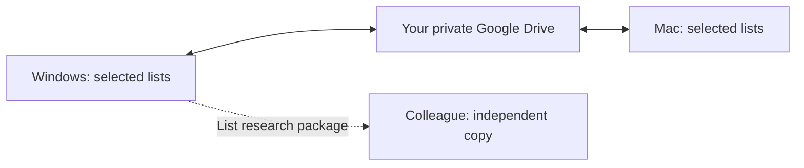

### Read and edit on a phone

The mobile web app pairs with a desktop workspace on a Paperfact sync service. Open the web app on the same HTTPS origin as that service and use the desktop's device-pairing details. After pairing, a saved note can be edited offline and sent back after reconnecting. The Windows/Mac personal Drive directory has no mobile connector in this preview. A portable reading export is available for viewing papers on a phone. [Mobile pairing and offline reconnection](docs/mobile-0.5.md#browser-pairing-and-offline-reconnection).

## Share the research, not your account

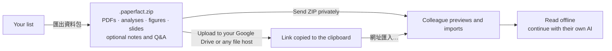

Use **研究資料 → 匯出目前清單資料包…** (or **清單總覽 → 匯出選取清單…**).
The open list also offers **匯出此清單…** beside its title.
The recipient uses **匯入研究資料包…** on either list page or under **研究資料**.
All these controls use the same transfer flow. These are list research
packages; **簡報 → 匯出簡報…** separately exports a presentation. Older
preview installers may place package actions under **＋ 新增**.
Available PDF files travel with the research; missing files are reported. AI settings
and login tokens stay out. This transfers a snapshot; it is not live synchronization.
**Share through Google Drive:** in the export dialog, enter your colleagues'
emails (or allow anyone with the link) and choose **上傳到我的 Google Drive
並複製連結**. Paperfact uploads the package to your own Drive with a progress
bar, grants read access and copies the link. Sharing the list again updates the
same file, so the link keeps working. Paperfact can only see the files it uploaded.
Any other file host still works: save the ZIP, upload it, and use
**製作並複製分享連結…**. Your colleague chooses **網址匯入…**, previews the
package, and confirms the import.
In v0.5 development, a reviewed import can restore missing cached PDF/figure
bytes from its verified included files; list descriptions retain their exact
values. Preview still does not save research.
[Enrolled import contract](docs/enrolled-package-import.md).
[Share by link →](docs/sharing.md) · [Package contents →](docs/colleague-handoff.md)

| Read on your phone | Take the slides with you |
|---|---|
| 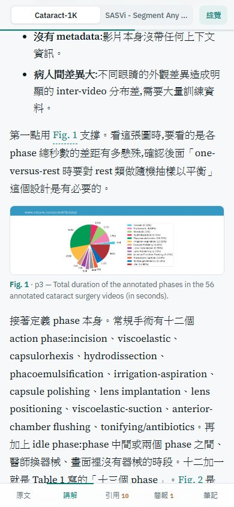 | 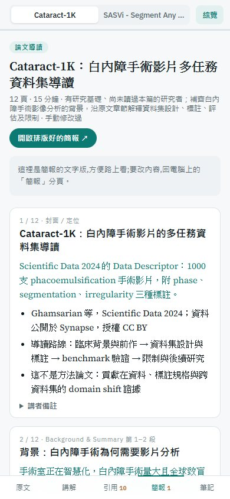 |
| Carry a reading page and notes. | Review the deck away from your desk. |

Your workspace stays local. A source checkout stores it in `data/`, or wherever
`PAPERFACT_DATA` in an optional `.env` points (see `.env.example`); back up that
folder privately. Optional improvement statistics require separate consent and have
no automatic uploader. [Data choices →](docs/feedback-privacy.md)

## Connect your projects and agents

**Available in 0.3.0:** connect a local agent through MCP, or use the JSON CLI.
Both share the desktop's structured import: **preview papers → select → save a
reading list**, with retry-safe writes and automatic desktop list refresh.

Open **研究資料 → 本地整合 · 連接 agent…** to copy launch settings for your workspace,
or paste an agent-prepared JSON list directly. Saving papers uses no AI tokens.
[Setup, examples and tool reference →](docs/local-integration.md)

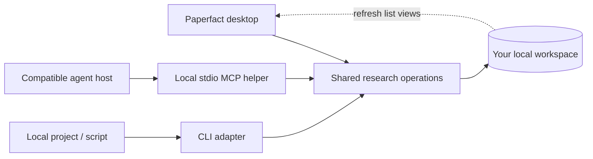

The helper starts with your agent host; no cloud service or open port is needed.
Additional AI analysis is a separate action. The older `import-list` command still
uses Paperfact's configured AI to parse rough references.
[How MCP works here, with a call-flow diagram →](docs/local-integration.md)

### Who runs the model

The same analysis can be produced in two ways. Either way the result passes the
same checks and is stored in the same place.

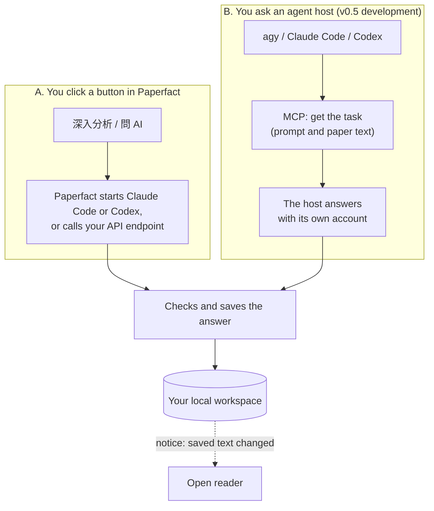

| | A. In the app | B. From an agent host |
|---|---|---|
| Who starts it | You, with a button | You, by asking the agent, or the agent's own scheduler |
| Whose account answers | The one chosen in Paperfact's AI settings | The agent host's own sign-in |
| When the result appears | In the open paper when the job ends | A notice in the open paper; **載入已存更新** shows it |
| Available for | Every AI feature | Deep dive, reference analysis, Q&A |

Use B when a subscription may only be used from its own program, such as a Gemini
subscription in agy ([AI access policy](docs/ai-access-policy.md)).

## Version, updates and support

Click the bottom-right version label to copy build details, check for updates,
or preview a diagnostic report. Reports stay local until you choose to share them.
See [troubleshooting](SUPPORT.md) and the [0.4.4 candidate scope](docs/maintenance-0.4.4.md).

## Next milestone: v0.5.0 (in development)

In current development source, open a list's **Report & sources** tab and choose
**Generate with sources**. It uses your selected Survey AI account/model, the
captured research goal and available originals. Progress appears in the existing
activity area; repeated clicks do not start another job.

Reports retain source excerpts and their exact original versions. Opening a saved
report does not call AI. Regeneration asks for confirmation and keeps prior versions
and the separately editable overview. Completed output is retained before
publication; a changed target stays untouched. The [CLI reference](docs/cli-reference.md#source-aware-list-reports)
also explains how to read a retained result without AI. In current source,
**Completed AI results** opens retained reports in the app without another AI
call. **Current report** returns to the saved version; retained results are
read-only until you choose **Use this report...** and confirm a prepared review.
This preserves previous report versions and the list's current goal, without AI.
**Open original** verifies the retained PDF, even if today's primary PDF changed.
**Finish saved report** completes an interrupted local save without rerunning AI.

List packages preserve saved reports and original bytes for enrolled and local-only
receivers. First-enrollment copies use fresh source mappings and retain private
history. [Reader guide](docs/reader-guide.md) ? [Evidence and limits](docs/analysis-audit.md).

This is source preview functionality. Installed Mac/Windows, physical mobile,
hosted synchronization, installed recovery flows and runtime adoption remain
acceptance gates; it is not a public v0.5 release.

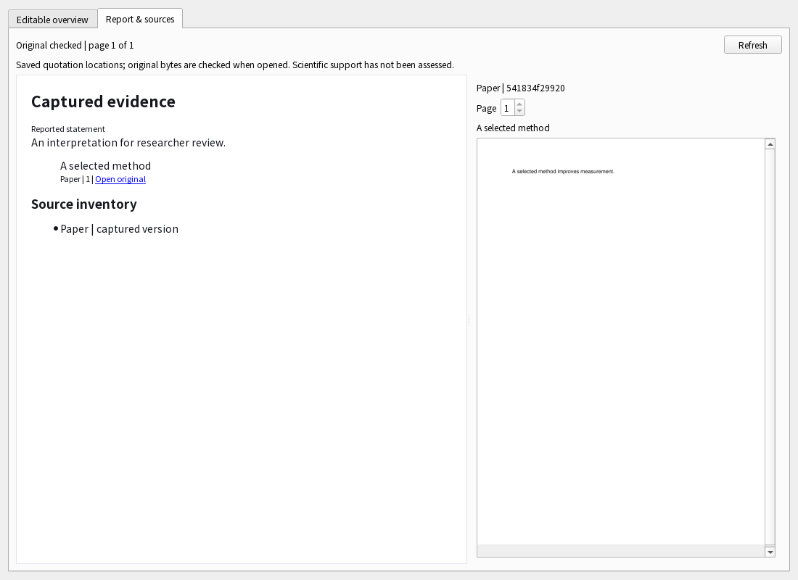

- Continue research across desktop, Mac, and a private mobile reader.
- Work offline; synchronize changes with recoverable conflicts and version history.
- Prepare selected papers offline with the exact originals used by saved annotations
  and research lineage.
- Prepare existing CLI/MCP-created research for sync while archiving old import requests safely.
  Claim cards and reader edits are retained; [old local regeneration maps](docs/workspace-enrollment.md#explicit-blockers-and-remaining-work)
  stay inactive instead of authorizing deletion on another device.
- Preserve known reading-text caches privately in reviewed copies and backups, without treating them as verified originals.
- Verify received and newer acknowledged history before uploading; pin the service execution during transfers and preserve local work if it changes. Desktop, mobile and service must support the same continuity handshake.
- Development desktop and mobile sync now verify durable received/acknowledged history, store proofs with local transactions, reject completed tails older than known acknowledgments, and check research pushes inside the authority write. Mobile shell v31 retains proof observations in private v3 recovery; attachment writes verify history again at the server transaction; device controls and invitation redemption also verify retained history; see [API, migration and limits](docs/sync-http.md#verified-desktop-flow-and-wire-contract).
- Retain authenticated authority-control prefixes on each device; reject service rollback while preserving offline research. [Recovery review](docs/device-recovery-review.md#device-held-access-history-in-recovery-review) distinguishes access history from backed-up research. See [source-preview protocol and limits](docs/sync-http.md#device-retained-authority-control-checkpoints).
- Keep local use and personal AI accounts independent of optional sync.
- Pair another desktop and optionally enable automatic sync for its new workspace in the same joining flow.
- Give each list a reading goal, so its papers open with the depth and background
  work that goal needs.
- See where every explanation comes from: each claim links to a passage, or says no
  source was found.
- Understand why a paper exists: the gap it fills in earlier work and how later work
  built on it, quoted from the papers themselves.

These are planned capabilities, not features in v0.4.x releases.
[Development test installers](docs/testing/mac-acceptance-0.5.md#latest-tested-downloads)
list the exact source for each platform. Use an isolated workspace and list-package
transfer; hosted continuous sync and physical-device acceptance remain open.

The development sync dialog supports [explicit saved reconnection](docs/remembered-sync-connection.md):
verify this device in one click, then choose manual, session-only or explicitly
remembered startup sync. The [desktop pairing flow](docs/sync-device-management.md#desktop-pairing-and-retry)
lets a connected device create private pairing details for another desktop. Paste,
pair and join in a separate folder; the new device keeps its own credential in
the system store. A [same-origin browser-session adapter](docs/sync-http.md#same-origin-browser-adapter-development)
and cookie-only mobile transport now power the [mobile pairing screen](docs/mobile-0.5.md#browser-pairing-and-offline-reconnection).
Pair, reopen cached research offline and explicitly reconnect from the same browser.
Operators can now [create a private signing key and explicitly enable browser pairing](docs/sync-service-admin.md#enable-browser-pairing-explicitly)
with `paperfact sync-admin create-browser-key --output FILE` and
`paperfact sync-admin serve --state DIR --browser-origin URL --browser-key-file FILE`. HTTPS/static hosting and
installed-device acceptance remain open.
The [private deployment review](docs/gcp-sync-pilot-plan.md#a-domain-is-optional-for-the-private-pilot)
can use an owned hostname or a reserved public IPv4 with trusted HTTPS; a domain
purchase is not required. Its renderer does not create resources or certificates.
Long mobile lists show 50 papers per page. Returning from a paper restores its row, including after an offline restart on the same device. The mobile list shows a verified offline PDF count and marks which originals are saved on this device.
The [PWA deployment artifact](docs/sync-service-admin.md#build-and-verify-the-public-pwa-artifact)
is built with `node scripts/build_mobile.mjs --output DIR`; verify using
`node scripts/build_mobile.mjs --verify DIR --expect SHA256` (`--help` lists options).
Exported cache identities follow asset content, with first-party LF/CRLF checkouts
producing the same bytes; vendor assets stay exact. Older artifacts remain readable.
This does not deploy a website or change research data.
The mobile PDF view now offers [explicit browser storage protection](docs/mobile-0.5.md#browser-offline-storage-protection)
with current status, denied/unsupported states and no automatic permission request.
This is separate from downloading verified files and is newer than the1875db5 mobile artifact.
[Release scope](docs/roadmap-0.5.0.md) ·
[Proposed sync architecture](docs/sync-architecture.md) ·
[Implementation plan](docs/implementation-0.5.0.md) |
[Current development status](docs/status-0.5.0.md) |
[Test explanations](docs/testing/README.md)

Desktop and CLI now share source-aware generation, checked local/native saving
and retained-result reading. In-app retained-result reapplication and full
cross-device acceptance remain in development; see the implementation plan.
Survey prompts now use the captured list research goal. Saved source-aware reports
retain that historical goal; old reports show when it was not recorded.


## Go further

[Installation](docs/install.md) · [Handbook](docs/handbook.md) · [Reader](docs/reader-guide.md) ·
[AI settings](docs/ai-setup.md) · [Google Slides setup](docs/google-release.md) ·
[CLI](docs/cli-reference.md) · [Optional ML workflow](docs/ml-daily.md) ·
[Architecture](docs/architecture.md) · [Development](docs/development.md) ·
[Building installers](docs/releasing.md)

Licensed under [AGPL-3.0-or-later](LICENSE). Third-party code and research materials
retain their own terms; see [notices](THIRD_PARTY_NOTICES.md).

## Help and support

Having trouble on another computer? [Create a reviewed diagnostic report](SUPPORT.md)
and [open a bug report](https://github.com/puddings-world/Paperfact/issues/new?template=bug_report.yml).
Older releases have a separate troubleshooting path; no diagnostic data is uploaded automatically.
For an Apple Silicon candidate, select `platform=macos` in **Actions > Release > Run workflow**;
see [candidate downloads](docs/releasing.md#cutting-a-release). This builds without publishing.
For candidate installers, [packaged acceptance](docs/testing/mac-acceptance-0.5.md#automated-packaged-app-checks-maintainer)
records which check passed or failed, even when the app cannot start.
Its synthetic research package includes a three-paper lineage and exact originals;
[generate or reuse the fixture](docs/testing/mac-acceptance-0.5.md#synthetic-research-material)
for cross-device checks without AI accounts or private research.
[Evidence checks](docs/analysis-audit.md) keep each Lineage quotation attached to
its actual paper and PDF version, even when two papers have identical PDF bytes.
In **Research lineage**, select a current analysis and choose **Check all originals**
for per-quotation findings and exact-original viewing, without AI calls.
CLI/MCP use the same check through `analysis.audit` and its optional `corpus_key`;
see the linked guide.

If Paperfact helps, [star this repository](https://github.com/puddings-world/Paperfact)
or [follow the organization and explore its pinned projects](https://github.com/puddings-world).
Support is voluntary; installing or reading this repo never authorizes GitHub account actions.


The v0.5 reader uses F11 when the desktop provides no native fullscreen shortcut.

The [v0.5 graph-operation library](docs/sync-operations.md) preserves source creation
times for new intake notes; existing CLI/MCP entry points and limits stay separate.

Development checks: `python scripts/check.py` runs the curated critical journeys;
use `--profile focused --python tests/test_name.py` for a scoped change and
`--profile release` for curated release requirements. Historical exhaustive
checks remain opt-in through `--profile full`. On Windows,
`python scripts/check_bounded.py` adds a five-minute, low-CPU budget.
See [development checks](docs/development.md#development) for scope and limits.
Preview the named requirements and exact selection without running tests:
`python scripts/check.py --profile release --plan`. The preview leaves result reports unchanged.


Prepared and restored workspaces open in separate windows without replacing
current drafts. Reviewed copies leave personal accounts, schedules, usage and
sharing controls and HTTP response caches on the source; refreshing a
synchronized copy does not create extra lists from old queue history. Supported citation-neighbour graphs now
retain their paper mapping through sync, research packages and reviewed backups. Workspace focus is bound to the exact destination database;
case-distinct Mac/Linux data roots remain separate. Close older app processes
before installing a test build; this is not an installed-upgrade guarantee.
New candidate acceptance also checks that a second launch uses the existing
workspace window, in addition to import/read/export and PDF preservation.

The recovery review compares saved and current research before confirmation:

- Keep or restore supported list/reading state and copy notes or manual highlights
  with their verified original, preserving existing selections and later edits.
- Confirm a recorded deletion of a claim report, deep explanation or section
  reading; preserve the original, notes, other analyses and history. Retries
  retain later restores; removing an input does not rewrite existing claim reports.
- Confirm a recorded note deletion after comparing its current text and position;
  native history and PDFs stay, and retry preserves later restores.
- Confirm a recorded manual-highlight deletion after comparing the current mark;
  its native history stays, and retries preserve a later restored mark. Restore a
  known deleted mark under its original identity after checking the exact owned
  PDF and selected text; active marks are protected.
- Restore or retire a retained original's source association with confirmation;
  cached PDFs, notes and history stay intact, and restored sources get fresh versions.
  Restoring a PDF alone does not revive old lineage claims: explicitly recheck the
  retained report and its quotations before linking it to the new source versions.
- Restore complete claim, highlight, explanation-link, lineage and editable-deck groups
  with exact inputs, originals and assets. Known historical native versions remain
  inspectable; missing old explanations require explicit confirmation before clearing
  their corresponding current content. Recorded lineage deletions also need
  confirmation; they synchronize report retirement while retaining originals,
  independent notes and report history. Recovery can also verify a retired old
  source for notes, claims, highlights, explanations and decks when its native
  ownership and exact PDF remain intact; this never silently restores a retired
  source association in the receiving workspace.

See the [recovery workflow and API](docs/device-recovery-review.md),
[deck provenance](docs/sync-files.md) and [saved-evidence audit](docs/deck-audit.md).
Foreign-workspace/legacy mappings, remaining research groups, hosted HTTPS and
installed-device acceptance remain explicit v0.5 gates.

Candidate verification also starts the packaged loopback sync service, checks an
authenticated pull, restarts it and verifies stale execution refusal plus explicit
reconnection. This uses synthetic device state, not hosted or physical-device
acceptance; see [the packaged check](docs/toolchain.md#packaged-local-acceptance).

Recorded recovery deletions also support a paper's context summary and background
reading suggestions, with explicit confirmation and exact current-content checks.
Other saved analyses, notes and originals remain available; see the
[recovery flow](docs/device-recovery-review.md#confirm-a-recorded-claim-analysis-removal).

Packaged sync acceptance also verifies exact citation-graph content, idempotent
retry and persistence across listener restart; see [toolchain](docs/toolchain.md).

In the development mobile reader, **Original PDF > Prepare offline reading** saves
this PDF, declared source originals and current slide decks together; incomplete
source declarations remain partial. **Save PDF offline** is still available.
See [scope and acceptance limits](docs/mobile-0.5.md#prepare-one-paper-for-offline-reading).
A focused browser journey is available through `PAPERFACT_TEST_JOURNEY=offline-reading`;
see [reproducible options](docs/mobile-0.5.md#reproduce-the-focused-offline-reading-browser-journey).

The mobile overview includes collapsible saved reference analyses and citation
passages, with explicit original-version scope; see [mobile reader](docs/mobile-0.5.md).

First-sync preparation retains validated citation, related-work and resource history
privately, including verified legacy text inputs, while publishing current research rows; see [enrollment history](docs/initial-enrollment-history.md).


The development sync service refuses a second local listener for the same authority
and pins newly initialized database identity across restarts. Replaced/missing
files and same-file device/pairing rollback against the retained local checkpoint
are refused. Legacy v1/v2 services require explicit backup/fresh restore, not
automatic marker repair. The 0a64ec7 native candidate includes these guards. See
[ownership, shutdown and recovery limits](docs/sync-http.md#local-listener-ownership-and-database-lifetime).
Current Windows/Mac1875db5 candidates include v4 transactional control history:
actual controls and their journal commit together, with replay-checked checkpoints,
device-retained knowledge and explicit legacy backup/fresh recovery.
[Contract and limits](docs/sync-http.md#official-authority-lifetime-and-transactional-control-history).
Independent anchoring/fencing and physical-device acceptance remain open.
The existing source-report package check now also exercises private desktop-to-CLI
AI routing against a deliberately disabled child disk configuration; see
[acceptance scope](docs/toolchain.md#source-aware-report-package-acceptance).
Latest native downloads (30b5776) pass the extended frozen CLI acceptance,
including saved list-report audit and all15 control/research sync protocol flags; [downloads and exact scope](docs/testing/mac-acceptance-0.5.md).
Legacy storage cleanup also preserves saved SQL research, citation/reference
owners, device-local offline selections and retained managed-original owners,
with current-state checks before deletion; see
[storage retention](docs/toolchain.md#caching-and-disk).
Legacy cleanup rechecks claims under a per-target writer reservation. It keeps
remaining files when a paper gains a claim and preserves caller-owned transactions.
A late pause reports earlier completed cleanup accurately; see [storage behavior](docs/toolchain.md#caching-and-disk).
The 30b5776 candidates retain the saved-research/import fixes and pass actual
Mac DMG mount/copy/detach acceptance. The frozen research workflow runs from
the verified copy; [native acceptance scope](docs/toolchain.md#packaged-local-acceptance).
Physical-device and older-installed-release upgrade checks remain separate.
Selected-file offline checks now revalidate their native observations at desktop
delivery, rejecting files or research changed after background verification;
[behavior and limits](docs/workspace-offline-verification.md).
Local exact-original supply also checks cancellation/workspace lifetime between
hash-read chunks, retaining interrupted staging for explicit retry;
[attachment behavior](docs/sync-attachments.md#api).
Newer source also distinguishes unreadable research formats from history-integrity
failures in desktop and mobile sync, preserving pending work;
[compatibility behavior](docs/sync-client.md#unreadable-research-formats).


The1875db5 Windows/Mac candidates verify guarded-history sync and duplicate-listener
refusal inside the packaged CLI, plus45 source authority/control/recovery/offline cases per OS. See
[the exact acceptance contract](docs/toolchain.md); physical device acceptance
remains separate.


After a legacy sync-history warning, the development desktop can **Review saved
sync history**, then explicitly **Use verified history** with a default-No
confirmation. Research, pending edits and the received cursor are preserved;
[workflow and limits](docs/workspace-sync-connection.md#explicit-review-of-legacy-acknowledgments).
The current Windows/Mac candidates include this UI; full frozen-dialog and
physical-device acceptance remains separate from its source/widget evidence.


The official development sync service now accepts only history-verified mutations
and new pairing grants; existing research reads remain available. Low-level local
prototype compatibility is separate. [Service policy and limits](docs/sync-http.md#verified-only-service-policy).


Native candidate acceptance now includes a pinned0.4.3-to-current data-format
probe: retained notes/Q&A/highlights, renamed list/order, exact PDF and editable
slide layout before and after schema initialization. This found and fixed export
of old databases without new optional research tables. [Exact upgrade scope](docs/toolchain.md#pinned-old-source-upgrade-preservation).

Sync listener shutdown interrupts incomplete network reads while keeping admitted
backend work and its authority lock alive until completion. Fragmented requests
retain the normal read timeout.

Saved reading views reprepare boundedly if an asynchronous renderer callback
finds intervening writes in the same live workspace; stale content stays refused.

The first saved reading body replaces the blank document directly; subsequent
nonempty updates keep the existing incremental rendering and scroll behavior.


Source after the0a64ec7 test build adds **Check all sources** to saved list reports.
The same read-only CLI/MCP action accepts `analysis.audit` with `{"list_id":"LIST_ID"}`.
Queued desktop results recheck the report and original observations at display time.
It checks owned originals and recorded quote locations without AI or downloads;
scientific support remains unassessed. [Usage and limits](docs/analysis-audit.md#saved-list-report-source-audit).


Deployment operators can prepare existing GCP pilot templates entirely offline:
`python deploy/gcp/prepare.py --config deploy/gcp/pilot.example.json --output build/pilot-review-example`.
This creates review files only, never resources or credentials. [All flags, fields and remaining gates](docs/gcp-sync-pilot-plan.md#prepare-one-offline-configuration-review).
