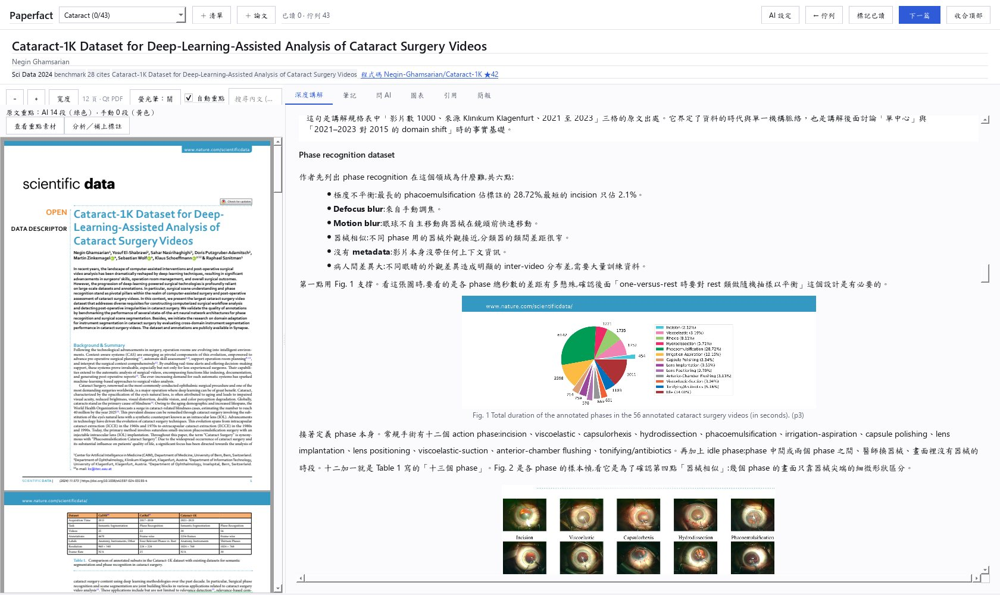
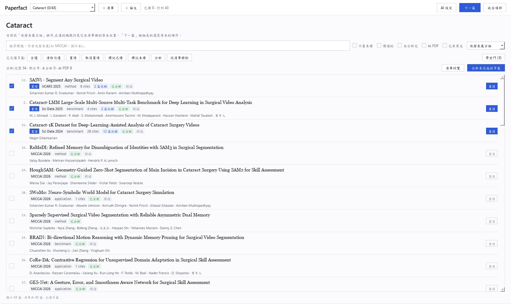
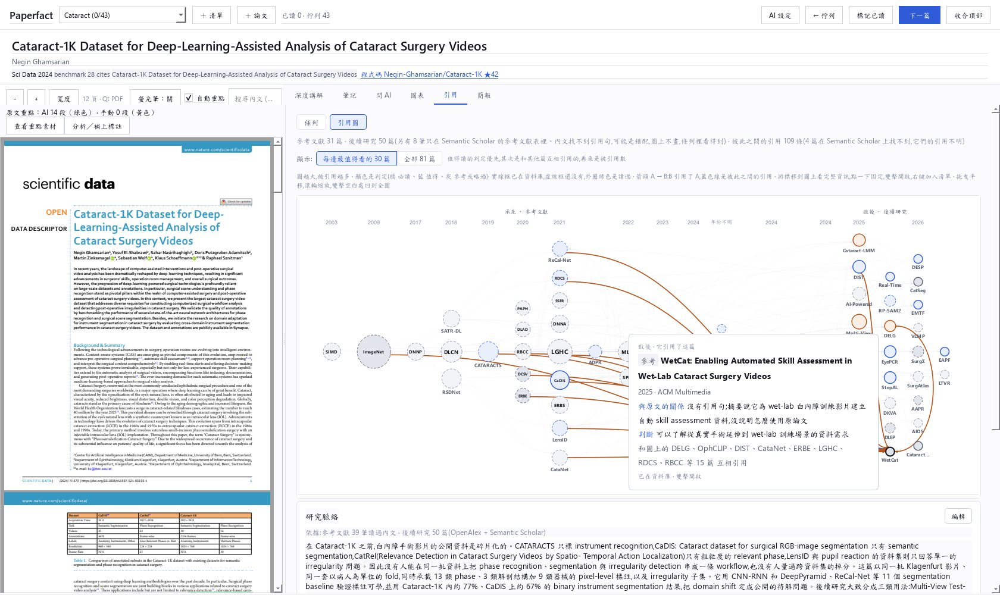
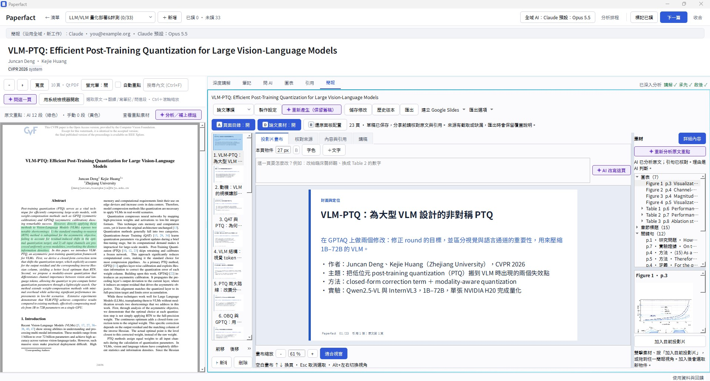
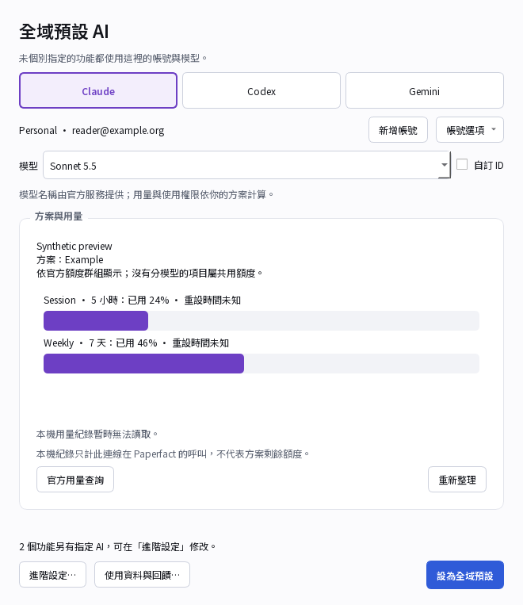
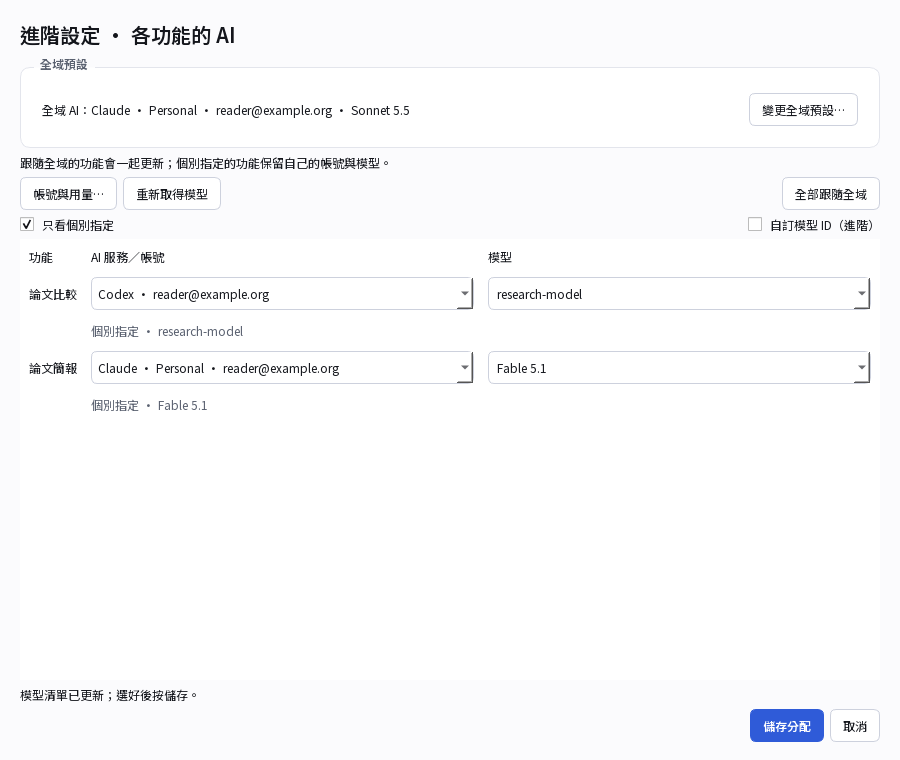
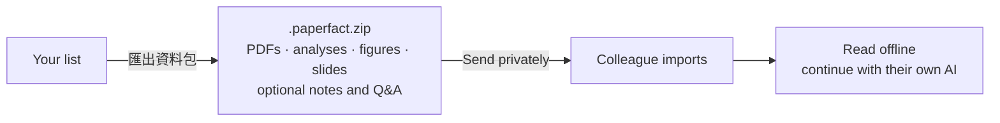
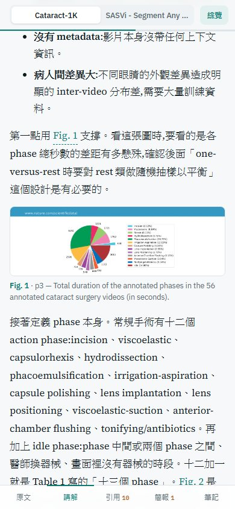
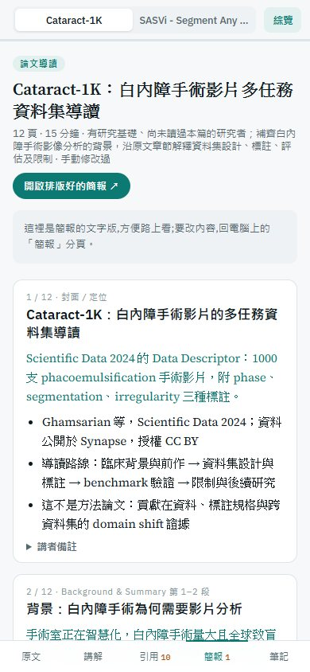

# Paperfact

*The perfect way to read papers, take notes, and share ideas.*

Your research workspace: bring papers from any field, read alongside the original,
and turn your understanding into notes, slides, and a collection you can share.



**Read → understand → present → share.** Keep the PDF and your research side by side.

## See what you can do

| Build your reading list | Explore the research around a paper |
|---|---|
|  |  |
| Paste references, describe a topic, or start empty. | Follow references and later work back to their sources. |



**Make a guide worth sharing.** Edit slides, ask AI to rewrite one page, check its
sources, and export a PDF. [Slides guide →](docs/presentations.md)

## Your accounts. Your models.

| Choose your everyday AI | Override only the features you want |
|---|---|
|  |  |
| **全域 AI → account → model → 設為全域預設** | **進階設定 → feature → account + model → 儲存分配** |

AI screenshots use demo accounts and simulated usage; model access depends on your
provider. Reading saved research needs no AI login.

**Gemini status:** Google ended Gemini CLI access for individual Google accounts
(free, AI Pro and AI Ultra). Paperfact has not yet integrated Antigravity. Use
Claude or Codex for the personal-account workflow for now.
[Google's notice](https://developers.google.com/gemini-code-assist/docs/deprecations/code-assist-individuals)
· [Account and model help](docs/ai-setup.md)

## Start here

**Preview-stage software.** Download the Windows, macOS or Linux installer from the
[releases page](https://github.com/puddings-world/Paperfact/releases) (builds are
unsigned, so your system warns on first launch), or run from source:
[release status and remaining checks →](docs/release-readiness.md)

```powershell
git clone https://github.com/puddings-world/Paperfact.git
cd Paperfact
.\scripts\setup.ps1          # macOS / Linux: ./scripts/setup.sh
.\scripts\dev.ps1 app        # macOS / Linux: ./scripts/dev.sh app
```

Setup downloads Python dependencies, fonts and offline rendering assets. AI calls
also require the selected provider's official CLI and your own eligible account;
the account picker links to setup instructions.

| 1 · Open | 2 · Bring papers | 3 · Continue research |
|---|---|---|
| Start with an empty **清單總覽**. | **建立清單** or **匯入研究資料包**. | Read saved work, or select your AI to analyse more. |

Use **↑ / ↓** to select, **Enter** to open, **Alt + ←** to go back.
The ML conference workflow is optional; your lists can cover any field.

## Share the research, not your account



Export from **清單總覽 → 匯出資料包…**. The recipient uses **匯入研究資料包**.
Available PDF files travel with the research; missing files are reported. AI settings
and login tokens stay out. This transfers a snapshot; it is not live synchronization.
[Sharing and import details →](docs/colleague-handoff.md)

| Read on your phone | Take the slides with you |
|---|---|
|  |  |
| Carry a reading page and notes. | Review the deck away from your desk. |

Your workspace stays local. A source checkout stores it in `data/`, or wherever
`PAPERFACT_DATA` in an optional `.env` points (see `.env.example`); back up that
folder privately. Optional improvement statistics require separate consent and have
no automatic uploader. [Data choices →](docs/feedback-privacy.md)

## Go further

[Handbook](docs/handbook.md) · [Reader](docs/reader-guide.md) ·
[AI settings](docs/ai-setup.md) · [Google Slides setup](docs/google-release.md) ·
[CLI](docs/cli-reference.md) · [Optional ML workflow](docs/ml-daily.md) ·
[Architecture](docs/architecture.md) · [Development](docs/development.md) ·
[Building installers](docs/releasing.md)

Licensed under [AGPL-3.0-or-later](LICENSE). Third-party code and research materials
retain their own terms; see [notices](THIRD_PARTY_NOTICES.md).
