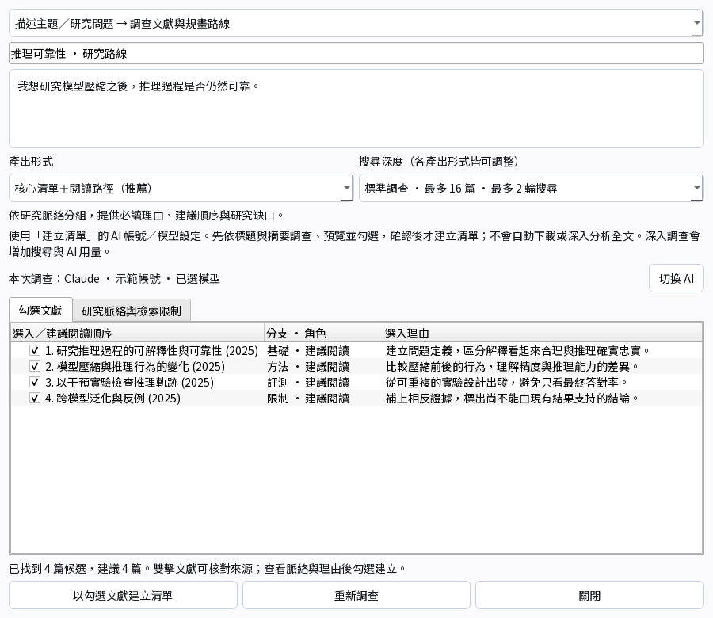
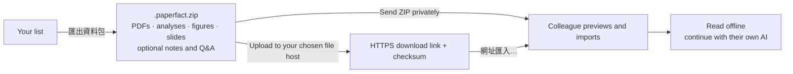
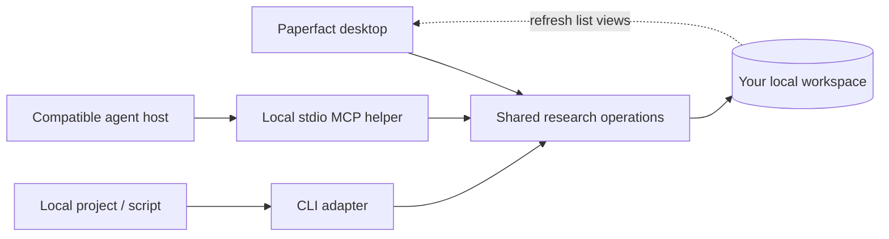

# Paperfact

*The perfect way to read papers, take notes, and share ideas.*

Your research workspace: bring papers from any field, read alongside the original,
and turn your understanding into notes, slides, and a collection you can share.


**Read → understand → present → share.** Keep the PDF and your research side by side.

## See what you can do

| Build your reading list | Explore the research around a paper |
|---|---|
|  |  |
| Paste references, describe a topic, or start empty. | Follow references and later work back to their sources. |


**Make a guide worth sharing.** Edit slides, ask AI to rewrite one page, check its
sources, export a PDF, or create an editable Google Slides copy. [Slides guide →](docs/presentations.md)

## Your accounts. Your models.

| Choose your everyday AI | Override only the features you want |
|---|---|
|  |  |
| **全域 AI → account → model → 設為全域預設** | **進階設定 → feature → account + model → 儲存分配** |

AI screenshots use demo accounts and simulated usage; model access depends on your
provider. Reading saved research needs no AI login.

**Gemini status:** Google ended Gemini CLI access for individual Google accounts
(free, AI Pro and AI Ultra). Paperfact has not yet integrated Antigravity. Use
Claude or Codex for the personal-account workflow for now.
[Google's notice](https://developers.google.com/gemini-code-assist/docs/deprecations/code-assist-individuals)
· [Account and model help](docs/ai-setup.md)

## Start here

**Use a released preview:** choose the file for your computer from
[Releases](https://github.com/puddings-world/Paperfact/releases).

| Windows x64 | Mac with Apple silicon | Linux x86-64 |
|---|---|---|
| `*-windows-x64-setup.exe` | `*-macos-arm64.dmg` | `*-linux-x86_64.AppImage` |
| Install, then open from Start. | Copy the app to Applications. | Make executable, then open. |

Installers include Python and Qt. Builds are unsigned previews; see
[installation details and platform limits](docs/install.md).

**Run the current source:** choose your terminal below. Git and internet access
are required; setup prepares Python, dependencies, fonts and rendering assets.

<details>
<summary>Windows · PowerShell</summary>

```powershell
git clone https://github.com/puddings-world/Paperfact.git
cd Paperfact
.\scripts\setup.ps1
.\scripts\dev.ps1 app
```

After the first setup, only `.\scripts\dev.ps1 app` is needed to open the app.

</details>

<details>
<summary>macOS / Linux · Terminal</summary>

```bash
git clone https://github.com/puddings-world/Paperfact.git
cd Paperfact
bash scripts/setup.sh
bash scripts/dev.sh app
```

After the first setup, only `bash scripts/dev.sh app` is needed to open the app.

</details>

| | Release installer | Git checkout |
|---|---|---|
| Best for | Reading and research | Development and trying current source changes |
| Code | One published, tagged snapshot | The commit you checked out; `git pull` brings newer commits |
| Runtime | Python and Qt included | Prepared by the setup script |
| Update | In-app release notice and platform installer | Save local work, `git pull --ff-only`, rerun setup, restart |

The app checks GitHub Releases in the background at launch and revisits the cache
hourly while open; successful network checks are limited to once per day for a
version/channel. Current 0.x previews include published beta releases. The notice
rotates between the new-version summary and update instructions, pauses while
hovered or keyboard-focused, and **稍後** dismisses that version for the day.
It never runs `git pull` or installs an update without your action. New commits
without a published release do not trigger a release notice.

Source and installed copies have separate default workspaces; set `PAPERFACT_DATA`
to the same absolute data folder to share one. A release contains its tagged code,
so it may not include newer source features. Existing v0.3.0 and older installers
skip beta notices; install a build containing this fix manually once to receive
future beta notices. [Update details](docs/install.md#update-notices)
To match an installer exactly, developers can check out its tag, for example
`git switch --detach v0.4.0`, then rerun setup. Both use the same research
operations and account-routing code; platform packaging differs.
New AI work additionally needs your own supported provider account and CLI/API
connection; [AI setup](docs/ai-setup.md) explains those separate prerequisites.

| 1 · Open | 2 · Bring papers | 3 · Continue research |
|---|---|---|
| Start with an empty **清單總覽**. | **建立清單** or **匯入研究資料包**. | Read saved work, or select your AI to analyse more. |

Use **↑ / ↓** to select, **Enter** to open, **Alt + ←** to go back.
The ML conference workflow is optional; your lists can cover any field.

Start from a research question, even without paper titles. Choose a survey depth,
review the suggested branches and selection reasons, then keep the papers you want.
The route is saved in the list overview and travels with research bundles.
[Topic research and its limits →](docs/topic-research.md)



## Share the research, not your account



Use **研究資料 → 匯出目前清單資料包…** (or **清單總覽 → 匯出選取清單…**).
The open list also offers **匯出此清單…** beside its title.
The recipient uses **匯入研究資料包…** on either list page or under **研究資料**.
All these controls use the same transfer flow. These are list research
packages; **簡報 → 匯出簡報…** separately exports a presentation. Older
preview installers may place package actions under **＋ 新增**.
Available PDF files travel with the research; missing files are reported. AI settings
and login tokens stay out. This transfers a snapshot; it is not live synchronization.
**New in 0.4.0:** export a list, upload its ZIP to a file host you choose, then
use **製作並複製分享連結…**. Your colleague chooses **網址匯入…** on either
list page, previews the package, and confirms the import. Direct HTTPS downloads
are supported; for cloud login/preview pages, download in the browser first.
Paperfact does not upload your research or change sharing permissions.
[Share by link →](docs/sharing.md) · [Package contents →](docs/colleague-handoff.md)

| Read on your phone | Take the slides with you |
|---|---|
|  |  |
| Carry a reading page and notes. | Review the deck away from your desk. |

Your workspace stays local. A source checkout stores it in `data/`, or wherever
`PAPERFACT_DATA` in an optional `.env` points (see `.env.example`); back up that
folder privately. Optional improvement statistics require separate consent and have
no automatic uploader. [Data choices →](docs/feedback-privacy.md)

## Connect your projects and agents

**Available in 0.3.0:** connect a local agent through MCP, or use the JSON CLI.
Both share the desktop's structured import: **preview papers → select → save a
reading list**, with retry-safe writes and automatic desktop list refresh.

Open **研究資料 → 本地整合 · 連接 agent…** to copy launch settings for your workspace,
or paste an agent-prepared JSON list directly. Saving papers uses no AI tokens.
[Setup, examples and tool reference →](docs/local-integration.md)



The helper starts with your agent host; no cloud service or open port is needed.
Additional AI analysis is a separate action. The older `import-list` command still
uses Paperfact's configured AI to parse rough references.
[How MCP works here, with a call-flow diagram →](docs/local-integration.md)

## Go further

[Installation](docs/install.md) · [Handbook](docs/handbook.md) · [Reader](docs/reader-guide.md) ·
[AI settings](docs/ai-setup.md) · [Google Slides setup](docs/google-release.md) ·
[CLI](docs/cli-reference.md) · [Optional ML workflow](docs/ml-daily.md) ·
[Architecture](docs/architecture.md) · [Development](docs/development.md) ·
[Building installers](docs/releasing.md)

Licensed under [AGPL-3.0-or-later](LICENSE). Third-party code and research materials
retain their own terms; see [notices](THIRD_PARTY_NOTICES.md).
