# Paperfact

*The perfect way to read papers, take notes, and share ideas.*

Paperfact does the groundwork: what each paper builds on, what it claims, and what
came after, with explanations linked back to the original passage. You read, check
and decide, and your understanding becomes notes, slides and collections others can
verify.

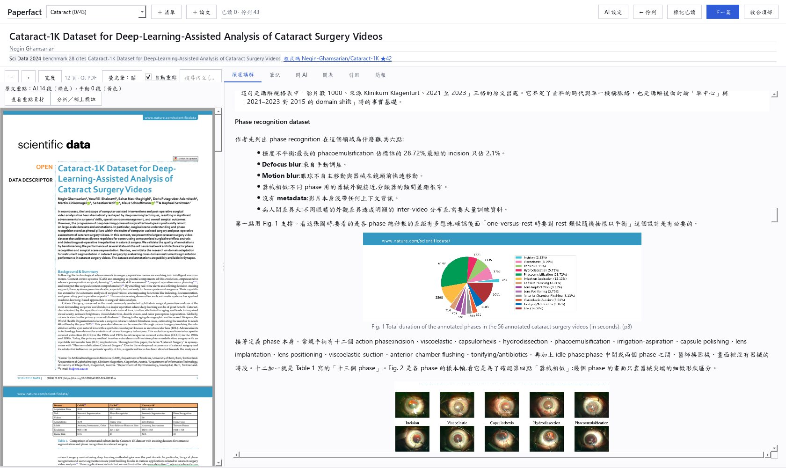

**Read → understand → present → share.** Keep the PDF and your research side by side.

## See what you can do

| Build your reading list | Explore the research around a paper |
|---|---|
| 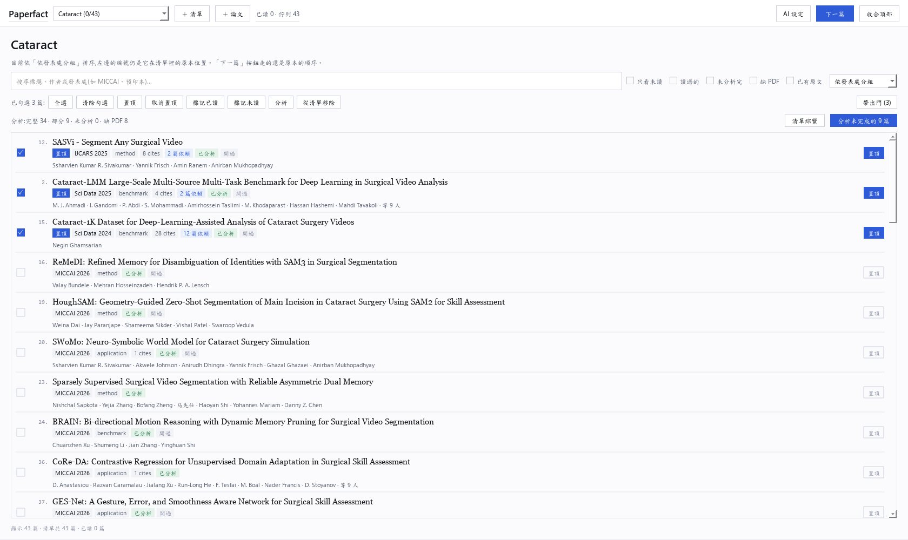 | 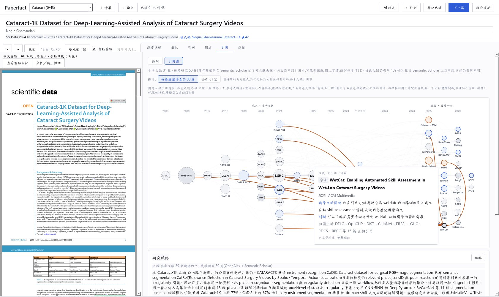 |
| Paste references, describe a topic, or start empty. | Follow references and later work back to their sources. |

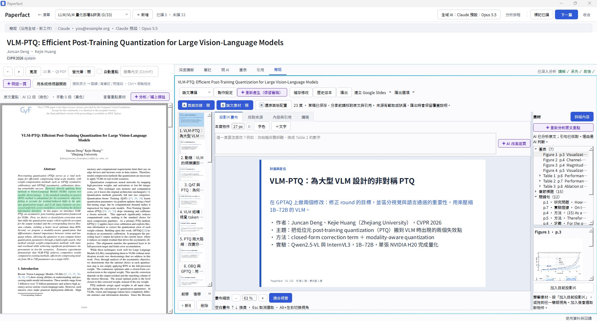

**Make a guide worth sharing.** Edit slides, ask AI to rewrite one page, check its
sources, export a PDF, or create an editable Google Slides copy. [Slides guide →](docs/presentations.md)

## Your accounts. Your models.

| Choose your everyday AI | Override only the features you want |
|---|---|
| 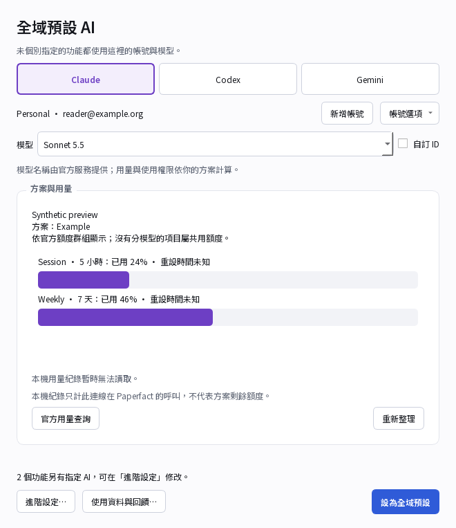 | 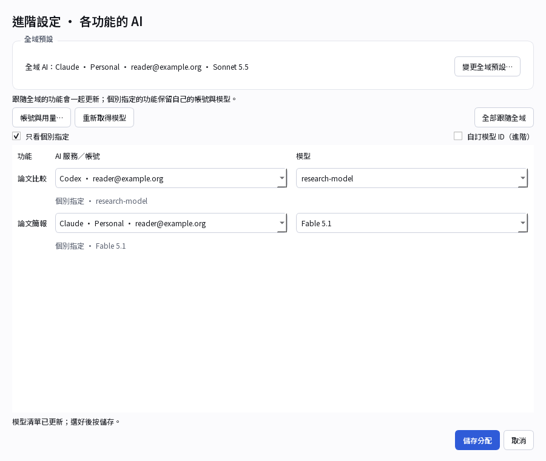 |
| **全域 AI → account → model → 設為全域預設** | **進階設定 → feature → account + model → 儲存分配** |

AI screenshots use demo accounts and simulated usage; model access depends on your
provider. Reading saved research needs no AI login.

**Gemini:** choose **Gemini → 輸入 API 金鑰…** and paste a key from
[Google AI Studio](https://aistudio.google.com/app/apikey); Gemini 4 Argon is offered when
your key's tier includes it. Keys are billed per use; an AI Pro or Ultra subscription
does not cover them, because Google ended Gemini CLI for personal accounts and does
not allow third-party tools to use Antigravity's subscription login.
[Account and model help](docs/ai-setup.md)

## Start here

**Use a released preview:** choose the file for your computer from
[Releases](https://github.com/puddings-world/Paperfact/releases).

| Windows x64 | Mac with Apple silicon | Linux x86-64 |
|---|---|---|
| `*-windows-x64-setup.exe` | `*-macos-arm64.dmg` | `*-linux-x86_64.AppImage` |
| Install, then open from Start. | Copy the app to Applications. | Make executable, then open. |

Installers include Python and Qt. Builds are unsigned previews; see
[installation details and platform limits](docs/install.md).

**Run the current source:** choose your terminal below. Git and internet access
are required; setup prepares Python, dependencies, fonts and rendering assets.

<details>
<summary>Windows · PowerShell</summary>

```powershell
git clone https://github.com/puddings-world/Paperfact.git
cd Paperfact
.\scripts\setup.ps1
.\scripts\dev.ps1 app
```

After the first setup, only `.\scripts\dev.ps1 app` is needed to open the app.

</details>

<details>
<summary>macOS / Linux · Terminal</summary>

```bash
git clone https://github.com/puddings-world/Paperfact.git
cd Paperfact
bash scripts/setup.sh
bash scripts/dev.sh app
```

After the first setup, only `bash scripts/dev.sh app` is needed to open the app.

</details>

| | Release installer | Git checkout |
|---|---|---|
| Best for | Reading and research | Development and trying current source changes |
| Code | One published, tagged snapshot | The commit you checked out; `git pull` brings newer commits |
| Runtime | Python and Qt included | Prepared by the setup script |
| Update | In-app release notice and platform installer | Save local work, `git pull --ff-only`, rerun setup, restart |

The app checks GitHub Releases in the background at launch and revisits the cache
hourly while open; successful network checks are limited to once per day for a
version/channel. Current 0.x previews include published beta releases. The notice
rotates between the new-version summary and update instructions, pauses while
hovered or keyboard-focused, and **稍後** dismisses that version for the day.
It never runs `git pull` or installs an update without your action. New commits
without a published release do not trigger a release notice.

Source and installed copies have separate default workspaces; set `PAPERFACT_DATA`
to the same absolute data folder to share one. A release contains its tagged code,
so it may not include newer source features. Existing v0.3.0 and older installers
skip beta notices; install a build containing this fix manually once to receive
future beta notices. [Update details](docs/install.md#update-notices)
To match an installer exactly, developers can check out its tag, for example
`git switch --detach v0.4.1`, then rerun setup. Both use the same research
operations and account-routing code; platform packaging differs.
New AI work additionally needs your own supported provider account and CLI/API
connection; [AI setup](docs/ai-setup.md) explains those separate prerequisites.

| 1 · Open | 2 · Bring papers | 3 · Continue research |
|---|---|---|
| Start with an empty **清單總覽**. | **建立清單** or **匯入研究資料包**. | Read saved work, or select your AI to analyse more. |

Use **↑ / ↓** to select, **Enter** to open, **Alt + ←** to go back.
The ML conference workflow is optional; your lists can cover any field.

Start from a research question, even without paper titles. Choose a survey depth,
review the suggested branches and selection reasons, then keep the papers you want.
The route is saved in the list overview and travels with research bundles.
[Topic research and its limits →](docs/topic-research.md)

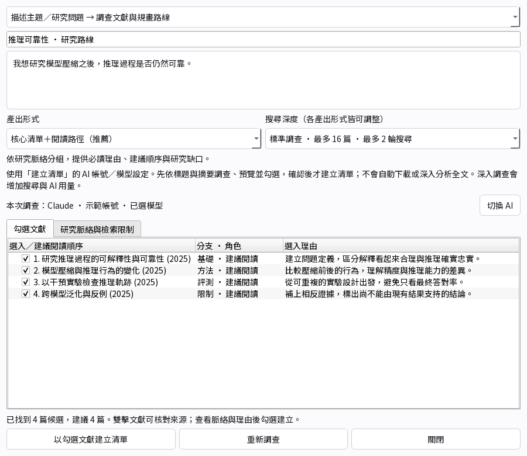

## Share the research, not your account

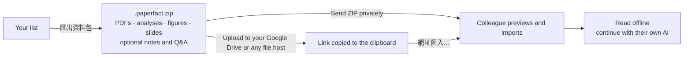

Use **研究資料 → 匯出目前清單資料包…** (or **清單總覽 → 匯出選取清單…**).
The open list also offers **匯出此清單…** beside its title.
The recipient uses **匯入研究資料包…** on either list page or under **研究資料**.
All these controls use the same transfer flow. These are list research
packages; **簡報 → 匯出簡報…** separately exports a presentation. Older
preview installers may place package actions under **＋ 新增**.
Available PDF files travel with the research; missing files are reported. AI settings
and login tokens stay out. This transfers a snapshot; it is not live synchronization.
**Share through Google Drive:** in the export dialog, enter your colleagues'
emails (or allow anyone with the link) and choose **上傳到我的 Google Drive
並複製連結**. Paperfact uploads the package to your own Drive with a progress
bar, grants read access and copies the link. Sharing the list again updates the
same file, so the link keeps working. Paperfact can only see the files it uploaded.
Any other file host still works: save the ZIP, upload it, and use
**製作並複製分享連結…**. Your colleague chooses **網址匯入…**, previews the
package, and confirms the import.
[Share by link →](docs/sharing.md) · [Package contents →](docs/colleague-handoff.md)

| Read on your phone | Take the slides with you |
|---|---|
| 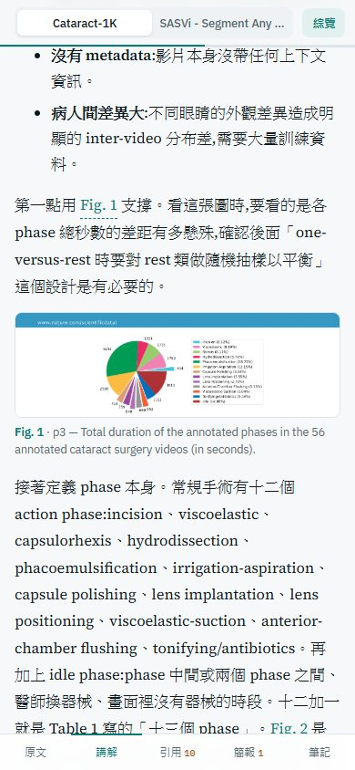 | 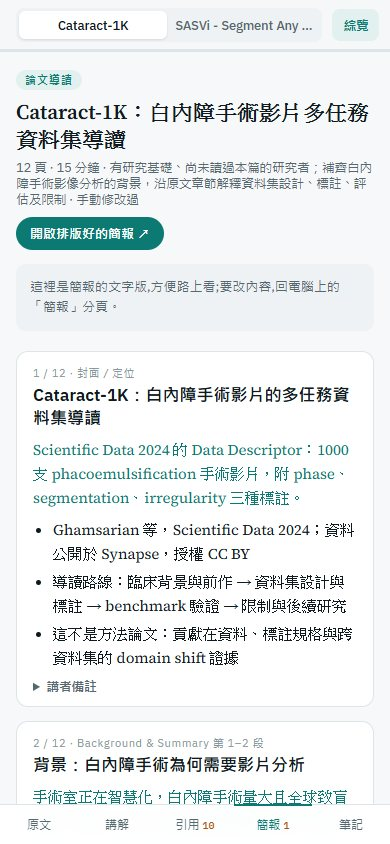 |
| Carry a reading page and notes. | Review the deck away from your desk. |

Your workspace stays local. A source checkout stores it in `data/`, or wherever
`PAPERFACT_DATA` in an optional `.env` points (see `.env.example`); back up that
folder privately. Optional improvement statistics require separate consent and have
no automatic uploader. [Data choices →](docs/feedback-privacy.md)

## Connect your projects and agents

**Available in 0.3.0:** connect a local agent through MCP, or use the JSON CLI.
Both share the desktop's structured import: **preview papers → select → save a
reading list**, with retry-safe writes and automatic desktop list refresh.

Open **研究資料 → 本地整合 · 連接 agent…** to copy launch settings for your workspace,
or paste an agent-prepared JSON list directly. Saving papers uses no AI tokens.
[Setup, examples and tool reference →](docs/local-integration.md)

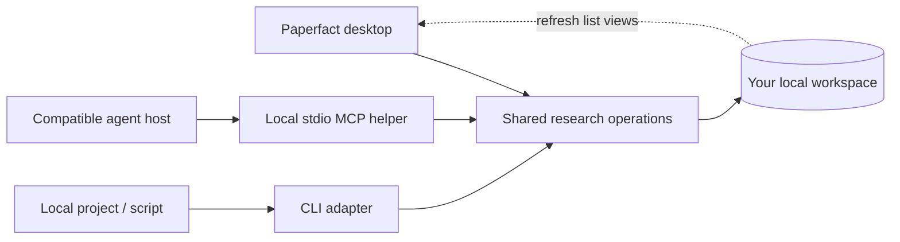

The helper starts with your agent host; no cloud service or open port is needed.
Additional AI analysis is a separate action. The older `import-list` command still
uses Paperfact's configured AI to parse rough references.
[How MCP works here, with a call-flow diagram →](docs/local-integration.md)

## Version, updates and support

Click the bottom-right version label to copy build details, check for updates,
or preview a diagnostic report. Reports stay local until you choose to share them.
See [troubleshooting](SUPPORT.md) and the [0.4.4 candidate scope](docs/maintenance-0.4.4.md).

## Next milestone: v0.5.0 (planned)

- Continue research across desktop, Mac, and a private mobile reader.
- Work offline; synchronize changes with recoverable conflicts and version history.
- Keep local use and personal AI accounts independent of optional sync.
- Give each list a reading goal, so its papers open with the depth and background
  work that goal needs.
- See where every explanation comes from: each claim links to a passage, or says no
  source was found.
- Understand why a paper exists: the gap it fills in earlier work and how later work
  built on it, quoted from the papers themselves.

These are planned capabilities, not features in v0.4.x releases.

The development sync dialog supports [explicit saved reconnection](docs/remembered-sync-connection.md):
verify this device in one click, then choose manual, session-only or explicitly
remembered startup sync. The [desktop pairing flow](docs/sync-device-management.md#desktop-pairing-and-retry)
lets a connected device create private pairing details for another desktop. Paste,
pair and join in a separate folder; the new device keeps its own credential in
the system store. A [same-origin browser-session adapter](docs/sync-http.md#same-origin-browser-adapter-development)
and cookie-only mobile transport now power the [mobile pairing screen](docs/mobile-0.5.md#browser-pairing-and-offline-reconnection).
Pair, reopen cached research offline and explicitly reconnect from the same browser.
Operators can now [create a private signing key and explicitly enable browser pairing](docs/sync-service-admin.md#enable-browser-pairing-explicitly)
with `paperfact sync-admin create-browser-key --output FILE` and
`paperfact sync-admin serve --state DIR --browser-origin URL --browser-key-file FILE`. HTTPS/static hosting and
installed-device acceptance remain open.
The [PWA deployment artifact](docs/sync-service-admin.md#build-and-verify-the-public-pwa-artifact)
is built with `node scripts/build_mobile.mjs --output DIR`; verify using
`node scripts/build_mobile.mjs --verify DIR --expect SHA256` (`--help` lists options).
[Release scope](docs/roadmap-0.5.0.md) ·
[Proposed sync architecture](docs/sync-architecture.md) ·
[Implementation plan](docs/implementation-0.5.0.md) |
[Current development status](docs/status-0.5.0.md) |
[Test explanations](docs/testing/README.md)

## Go further

[Installation](docs/install.md) · [Handbook](docs/handbook.md) · [Reader](docs/reader-guide.md) ·
[AI settings](docs/ai-setup.md) · [Google Slides setup](docs/google-release.md) ·
[CLI](docs/cli-reference.md) · [Optional ML workflow](docs/ml-daily.md) ·
[Architecture](docs/architecture.md) · [Development](docs/development.md) ·
[Building installers](docs/releasing.md)

Licensed under [AGPL-3.0-or-later](LICENSE). Third-party code and research materials
retain their own terms; see [notices](THIRD_PARTY_NOTICES.md).

## Help and support

Having trouble on another computer? [Create a reviewed diagnostic report](SUPPORT.md)
and [open a bug report](https://github.com/puddings-world/Paperfact/issues/new?template=bug_report.yml).
Older releases have a separate troubleshooting path; no diagnostic data is uploaded automatically.

If Paperfact helps, [star this repository](https://github.com/puddings-world/Paperfact)
or [follow the organization and explore its pinned projects](https://github.com/puddings-world).
Support is voluntary; installing or reading this repo never authorizes GitHub account actions.


Development checks: `python scripts/check.py` runs the curated critical journeys;
use `--profile focused --python tests/test_name.py` for a scoped change and
`--profile release` for curated release requirements. Historical exhaustive
checks remain opt-in through `--profile full`. On Windows,
`python scripts/check_bounded.py` adds a five-minute, low-CPU budget.
See [development checks](docs/development.md#development) for scope and limits.

Internal per-change recovery APIs are documented in the
[recovery guide](docs/device-recovery-review.md#per-change-recovery-core).
Desktop comparison offers explicit keep/add/replace/restore for supported
content and copy-as-new notes. Positioned notes keep their page, passage and
source hash after exact-original verification. If its PDF is missing there,
explicitly copy the note and the old device's verified original atomically;
[see the recovery workflow](docs/sync-device-management.md#recover-a-note-tied-to-a-pdf-position).
Complete portable claim sets can also recover with their exact deep/close analysis
inputs and original PDF in one confirmed transaction; [review the whole group](docs/sync-device-management.md#recover-a-complete-claim-group).
Exact input pins can resolve older native journal or accepted peer versions, even
after a source-side analysis edit/deletion. Legacy/source-lifetime mapping,
unavailable originals, other scientific groups
and hosted/device acceptance remain separate gates.

Recorded recovery decisions can preserve supported list/member/reading/order
links across restored lifetimes; see the [recovery workflow](docs/device-recovery-review.md#recover-related-lists-without-losing-their-links).

Editable deck sync retains the workspace of newly observed research inputs,
including offline mobile reopen. Saved-evidence checks refuse to infer source
ownership across workspaces. See [deck provenance](docs/sync-files.md) and
[saved evidence](docs/deck-audit.md); the old-device recovery review can restore a complete native deck with its verified
recorded paper originals and editable assets. Different source-workspace and unknown
legacy mappings remain in development.

The same recovery review can restore source-verified highlight analysis and PDF
marks together while preserving manual marks and hidden choices. See
[recovery actions and limits](docs/device-recovery-review.md).
