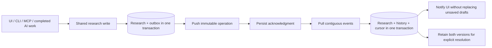

# ADR 0002: Delivery boundaries for private workspace sync

Status: accepted implementation direction, 2026-10-26. Deployment choices remain
gated; the public application remains v0.4.1. This is not a claim of shipped sync.

## Decision

- Build one replaceable reference service first, with SQLite metadata and private
  hash-addressed attachment storage. Keep the domain service independent of HTTP,
  cloud vendors, desktop widgets and AI providers.
- Prove service and client behavior with isolated databases, then a bounded loopback
  HTTP adapter. A loopback adapter is a developer transport, not the multi-device
  deployment: an always-available HTTPS host is required when the desktop is off.
- Offer a documented self-host route. A future managed service may use the same
  contracts, but no paid provider, region or hosting account is provisioned here.
- Research sync has its own workspace/device identity. AI subscriptions and Google
  Slides login do not grant sync access, and neither is a prerequisite for local use.
- Keep research bundle sharing as a snapshot transfer. Import creates local changes
  under the receiving workspace; it never imports another device's sync credentials,
  cursor, enrollment or operation receipts.
- Use server sequence and causal predecessors to decide whether a change applies.
  A stale change is retained as a conflict. Timestamps are display metadata.
- Resolve a conflict with a new explicit operation linked to the original conflicting
  operation. Only an accepted resolution closes that conflict across devices.
  Resolution itself can conflict; old and new content remain recoverable.
- Keep local save, pending upload, awaiting remote receipt, materialized remote state
  and unresolved conflict distinct. An upload acknowledgment alone is not evidence
  that a client has applied the complete preceding event stream.

## Client transaction boundaries

An acknowledged operation not yet in the local received stream remains a causal
predecessor. Older pull pages cannot replace its newer local content. Pending local
edits defer canonical materialization; they do not prevent storing remote history.
A failed materialization rolls back the batch cursor so the batch remains retryable.

## Production gates

| Boundary | Required before a private hosted pilot |
|---|---|
| Owner identity | Reviewed sign-in/recovery, user-to-workspace authorization and device enrollment |
| Desktop credentials | Device-scoped credential in an OS-protected store; never in bundles or git |
| Browser session | Same-origin HTTPS; reviewed HttpOnly session, CSRF/origin policy and revocation; no permanent bearer token in browser localStorage |
| Pairing | Short-lived, single-use owner-approved device enrollment; do not publish the trusted admin API |
| Storage | Workspace authorization for every blob, manifests tied to paper/PDF version, quota and recovery |
| Encryption | TLS and provider storage encryption are separate from E2EE; do not advertise E2EE without client keys and tested recovery |
| Operations | Deployment region/operator, capacity/budget, backups, restore drills and incident procedure |
| Compatibility | Protocol capability/version negotiation, migration and old-client behavior |

The current reference service stores hashed device tokens and rechecks revocation
for each operation. Its `enroll` and `revoke` are trusted administrative seams,
not public identity or account-recovery endpoints. These seams must not be exposed
as an unauthenticated route to make a demo convenient.

## Retention and deletion direction

- Retain operation receipts, conflict versions and tombstones in the first local
  prototype. No implicit pruning or hard deletion is introduced in this slice.
- Define a production offline horizon and retention budget before enabling cleanup.
  A device outside that horizon must rebootstrap, retaining/exporting unsent work.
- Revoke a device rather than silently treating its missing acknowledgment as consent
  to delete history. Revocation blocks future access, not previously downloaded copies.
- Separate local cache eviction from research deletion. Offline pins, current manifests
  and retained history references participate in attachment retention.
- Treat backups as independent recovery artifacts. Restore into a new device identity;
  do not clone its credentials or replay obsolete server acknowledgments.

## Alternatives and consequences

Direct cloud-folder SQLite sync cannot express these merge/recovery rules. A
vendor-specific backend would add provisioning dependencies before correctness is
proved. An unauthenticated file-sharing URL would not meet private-workspace scope.

The reference-first approach permits local progress without deploying a service,
but requires explicit adapter coverage and production identity work before release.
No claim that every existing writer synchronizes is valid until the
[inventory](../sync-write-inventory.md) is covered and tested.

Related: [release scope](../roadmap-0.5.0.md),
[implementation ledger](../implementation-0.5.0.md),
[parallel work](../parallel-work-0.5.0.md).
