# ADR 0004: Owned immutable documents and independent byte availability

Status: **private reference implementation**, 2026-10-26. Authenticated transfer,
document manifests and independent verified bindings are implemented and tested
with fixtures. Reader activation, production enrollment and large-file read
performance remain pending. Preceding checkpoint: `f43e2a7`.

## Decision and vertical slice

Implement one primary-PDF manifest per portable paper, with private workspace-owned
bytes. Receiving metadata must not depend on having enough storage or connectivity
to download the PDF. Never infer ownership merely from knowledge of a content hash.

```mermaid
flowchart LR
    A[Explicit local PDF selection] --> Verify[Stage and verify immutable bytes]
    Verify --> Outbox[Save document intent locally]
    Outbox --> Upload[Authenticated resumable upload]
    Upload --> Owned[Commit verified workspace ownership]
    Owned --> Push[Push paper_document operation]
    Push --> Receive[Receive manifest and advance metadata cursor]
    Receive --> Pending[Durable desired document / missing bytes]
    Pending --> Download[Authenticated bounded download]
    Download --> Check[Verify hash, size and readable PDF]
    Check --> Bind[Recheck current revision and session; bind verified object]
```



The initial accepted wire payload is proposed as exactly:

```json
{
  "paper_id": "<portable-paper-UUID>",
  "sha256": "<lowercase-SHA256>",
  "size": 123456,
  "media_type": "application/pdf"
}
```

`paper_document` uses the paper UUID as entity ID and one exact paper-incarnation
parent. Its logical role is fixed to `primary_pdf`; no extra role field, filenames,
local paths or fetch URLs are needed. Size is a bounded positive integer; use the
existing PDF download ceiling of 150 MiB for this slice. Metadata and complete-byte
limits are distinct. A replacement is a new manifest revision. Deletion detaches
the manifest while retaining old bytes, notes, anchors and conflict/history records.

Normal own-revision, retry, parent lifecycle and explicit conflict resolution rules
apply. Accepted manifest puts must reference a committed owned blob with matching
hash/size in that workspace. Missing bytes on the authority are a retryable upload
prerequisite, not an accepted broken reference. No network URL discovery or AI runs.

## Authority and transport

- Use a private BlobStore namespace per workspace, with a server-assigned directory
  identifier. Never concatenate caller-supplied paths or expose cross-workspace
  deduplication/existence information.
- Add authenticated `begin`, `append`, `commit`, `cancel`, and `read` methods under
  fixed POST routes `/v1/blobs/<method>`. Reuse bounded JSON framing and fixed errors.
- A decoded chunk is at most 256 KiB, encoded with strict base64 within the existing
  512 KiB request limit. Hash/size/offset/limit/upload IDs have closed validation.
- `begin` is idempotent resume/status for a declared manifest. Open upload sessions
  belong to a device inside its workspace; an upload ID is not a bearer credential.
  Another device may read committed workspace bytes, but cannot take over or cancel
  an in-progress session without a later explicit transfer mechanism.
- Every request reauthenticates the token. Revocation stops subsequent chunks and
  reads; it cannot retract bytes already delivered. Tokens are headers, never URLs,
  persistent transfer records or diagnostics.
- Reserve full declared sizes, including partial uploads; cap file/workspace bytes,
  active sessions and chunks. Cancel/expiry affects unfinished uploads only. Do not
  collect committed history blobs until a separate retention policy proves safety.
- Enrollment/revocation remain trusted administrative seams. No public enrollment,
  production listener, new identity provider or cloud deployment is authorized here.

Authority SQLite and BlobStore files/index are separate transactions. Keep lock
ordering consistent, finalize/hash-verify physical bytes first, then commit owned
availability. A crash may leave verified but unowned bytes; those must remain
unreadable and ineligible for manifests until authenticated retry repairs bookkeeping.
Do not describe this as a cross-database/filesystem atomic transaction.

## Client and local research

Introduce an explicitly bound transfer coordinator with workspace, device, server
origin, session generation and local BlobStore. No mutable global AI/account settings
participate. Provide bounded upload/download steps, durable resume state and cancel.
Keep credentials outside the persisted transfer state.

- Local staging and verification precede outgoing transfer. A local document intent
  can remain queued offline; upload/finalize ownership before pushing its manifest.
- Receive commits manifest/head/history/cursor and a transfer intent atomically.
  Missing, corrupt or quota-blocked bytes only change attachment availability.
  Do not roll back unrelated metadata or repeatedly refetch a paper URL.
- Keep desired manifest revision/hash separate from applied verified document binding.
  Download completion must recheck workspace, parent incarnation, current manifest
  revision/hash and session generation before updating that binding.
- An obsolete completed transfer can remain a private cache object; it cannot replace
  the current document. Failed binding leaves the prior document intact and retries
  without duplicating jobs. Cancel preserves partial data; explicit discard removes it.
- Verify SHA-256, full size and PDF readability before exposure. HTML, unusable/truncated
  or password-required PDFs cannot be labelled available. A missing/symlinked/corrupt
  previously verified object revokes availability; repair is explicit and bounded.
- Prefer resolving immutable hash-addressed bytes. If a `.pdf` path is necessary,
  publish into an owned hash-based path with fsync/atomic replacement; never hard-link
  it to a mutable legacy alias or use lossy paper-ID filename sanitization.

DTO availability is independent from metadata sync: `missing`, `verifying`,
`available`, `invalid` or `unchecked`. A stored flag alone is not verification.
Read projections must not perform network I/O or hash arbitrarily large files on
the UI thread; verified status needs explicit validation/invalidation boundaries.

## Existing reader constraints

The source audit found concrete integration gates:

- `fetch.py` uses lossy paper-ID PDF aliases and paper-ID text caches.
- `figures.py` caches by paper ID without validating the source PDF hash.
- `repdf.py` replaces files and changes/removes anchors and derived data; never call
  it during remote application.
- Some desktop note/material anchor jumps lack document-hash checks. Highlights
  already use exact document hashes, but that does not establish all-reader coverage.
- `pocket.py` transforms PDFs; its output must not impersonate the original hash.
- Bundle rollback bookkeeping is in-memory; it is not durable crash recovery for sync.

Therefore the first complete slice proves manifest-to-verified-byte availability.
Keep legacy PDF files and caches untouched until the reader/anchor resolver is
hash-aware. Old or unknown-hash anchors remain readable as research text but cannot
jump onto a different PDF. Reader activation and derived-cache provenance are
required before this feature is presented as working cross-device PDF reading.

## Tests and handoff

Use synthetic PDFs, isolated databases and loopback HTTP only. Required cases:

- Known-hash cross-workspace denial; revocation in every phase; session takeover denial.
- Duplicate/overlapping chunks, gaps, changed retries, invalid base64/offset/size/hash,
  quota reservation races, interruption and restart.
- Finalized bytes before ownership commit, retry repair, missing-owned-blob manifest
  rejection, and upload completion followed by manifest conflict.
- Metadata received before bytes advances cursor; unavailable bytes do not block notes.
- Download A finishing after manifest B, deletion, cancellation or session switch cannot
  activate A. Binding failure retains the prior document and verified orphan safely.
- Different local IDs and sanitized-name collisions remain distinct; legacy files,
  notes, highlights and editable decks stay unchanged.
- Missing/symlinked/corrupt objects and wrong/unknown-hash anchors fail closed.
- No URL fetch, reanchoring, model invocation, credential transfer or telemetry upload.

Suggested parallel boundaries: authority ownership/blob methods; bounded HTTP/client
transport; document schema/research projection; parent transfer coordinator/integration
and reader-activation gates. Agree method signatures before editing shared files.
Update the work ledger with exact tests and remaining real-device/deployment gates.


## Implementation checkpoint

The private reference path now includes workspace-owned blobs, authenticated
session identity checks, primary-PDF metadata, independent desired/applied binding,
and explicit resumable worker steps. See [coordinator contract](../sync-transfers.md).
Metadata acceptance requires server-owned verified bytes; receiving metadata does
not require local bytes. The current reader, hash-aware cache/anchor integration,
large-file read performance and production enrollment remain separate gates.
