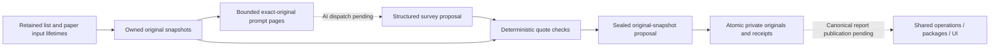

# Analysis audit for specialist reading

Status: v0.5 development candidate, not a release claim. The first deterministic
checks have a local engine, saved-output adapter, native desktop view and shared
JSON CLI/MCP operation. A separate explicit, one-call claim-appraisal candidate
has local private history and a native view. Complete appraisal coverage and
cross-output consistency remain required; opening either panel calls no model.

## Read the result correctly

Open a paper, then **Research tasks > Check saved evidence**. The panel reads saved
research and the owned PDF in a background worker. It initially shows items that
need review; clear the filter to see every checked item. Expand a card and use
**View original passage** for a located quotation in the exact loaded version.
The reader's question and note drafts stay intact. Refresh is explicit.

- **Quote located** means the quoted text and optional anchor were found in that
  exact PDF snapshot. It does not mean the passage supports the associated claim.
- **Number/unit observed** means the same lexical pair appears in extracted text.
  It does not verify the comparator, denominator, uncertainty or interpretation.
  A missing pair may be a derivation or image-only content, not an error.
- **Source unknown** means the saved output has no document-version binding. The
  adapter does not assign today's PDF to older deep dives, answers or notes.
- **Different original** does not search today's PDF for a substitute location.
- **Title similar** is a heuristic. A differing known DOI or title mismatch needs
  inspection; a citation occurrence proves neither agreement nor influence.
- **Title only / citing context missing** identifies the evidence basis available
  for a reference relation. The system does not invent a citing sentence.

There is no quality score, confidence percentage or claim that a paper passed.
An empty report has zero covered items. Limits and unsupported outputs stay visible.

## Implemented deterministic boundary

`research_audit.run(snapshot, items)` accepts a sealed, owner-verified PDF snapshot
and a closed explicit output corpus. It locates declared quotes/anchors, compares
source hashes, checks bounded number/unit occurrences and reports reference-identity
and evidence-basis findings. Normalization reuses the existing NFKC/whitespace/
soft-hyphen/wrapped-word rule. Ambiguous matches retain alternatives; none becomes
an active anchor. No OCR or semantic truth is inferred.

`audit_inputs.AuditCapture` reads one bounded SQL snapshot without schema creation.
The current adapter includes deep explanations, close readings, saved notes,
assistant answers, canonical claims, selected highlights, manual marks, references
and later-work rows. Typed saved reading links and research questions, plus saved
paper-context summaries and recommendations, are included by the SQL slice below.
Unsubmitted chat/user questions are not included. Notes use only an explicitly
recorded anchor document hash; their prose is never automatically treated as an
original quotation. Answers use the validated typed Q&A source link, when present.
All preserve old source versions and leave missing bindings unknown. Versionless
legacy text stays versionless. Selected editable decks have a separate bounded
audit entry described below. Saved grounded-lineage statements now use the
source-aware adapter below. List surveys, complete multi-original corpus checks
and cross-output consistency remain explicit gaps, not successful checks.

## Saved research lineage

The same desktop checker and `analysis.audit` CLI/MCP operation now include
current canonical `paper_lineage_sets` for the selected focal paper. Each
statement retains its subject original hash; each quotation retains its own
selected source hash, page and anchor. IDs include the corpus identity so two
corpora with the same statement do not collide. Generation proposals, archived
versions and imported model judgments do not become scientific verification.

Without `corpus_key`, this action checks only the owned original currently opened in the reader.
Quotations in that exact version can be located and navigated. A quotation from
another selected paper/version is reported as `source_mismatch`, with no
fabricated location or navigation into the focal PDF. Open the recorded source
through the Lineage reader to inspect that original. The report explicitly lists
`lineage_other_originals` as unchecked; it does not claim a complete corpus audit
or semantic support. No model, download, schema creation or research write occurs.

Malformed saved content fails the complete audit rather than omitting its items.
Changed or removed Lineage invalidates an existing capture; refreshing reads the
new current content. Shared total item/byte/passage limits still apply. See
[concrete cases](testing/audit-lineage-scenarios.md).

Bounds: 256 items, 1 MiB input JSON, 512 declared passages and 512 distinct lexical
quantity checks across outputs; individual text is at most 120,000 characters.
The existing source verifier bounds PDFs to 32 MiB / 500 pages / 200,000 words.
An exceeded bound fails the whole report; no silent truncation is called complete.
The short desktop excerpt is presentation only; the operation retains full bounded
item text. UI progress counts actual processed items, not estimated time.

Results are derived in memory and identified by output hash, document hash and
rule version. They do not modify research, create an audit SQL table, enter sync
or bundles, or persist an AI judgment. Refresh can recompute deterministic results.
Native DB/WAL versions guard capture and GUI delivery. Source navigation separately
checks the actual loaded owner and PDF bytes. Cancellation, closing and context
changes discard late presentation and preserve the prior report and drafts.

## Bounded saved SQL output slice

`paper_reading_links` and `paper_research_questions` reuse the closed annotation
row/body validators. Their `source_hash` is an input digest, distinct from the
nullable PDF `document_hash`. Source-less rows remain unknown even if an input
digest happens to equal the loaded PDF digest. The optional, closed `provenance`
object is valid only for these new categories and `paper_context`: `record_hash`
retains exact validated row identity, `input_hash` records the annotation input,
`related_record_hash` records the related highlight row, and `link_state` describes
whether its declared link can be reconstructed. None grants PDF ownership.
Rule identity is `source-checks.v3`; legacy item shapes remain valid. Optional
`source_paper_id` on an item or passage identifies its recorded paper owner in
the same namespace as the sealed source. When a passage omits it, an explicitly
recorded item owner is inherited. The bounded field must be a nonempty string;
absence preserves the legacy single-paper behavior, not a newly inferred owner.

Saved Lineage includes each actual statement/passage owner, mapping local IDs
through the native alias registry when present. Equal PDF bytes never equate
different owners: `source_owner_mismatch` retains the assertion/quote but grants
no location or navigation. Quantities cannot be reported observed against that
foreign owner either. Focal citing passages in a foreign-subject statement still
use their own recorded focal owner and can be located independently.

Appraisal refuses a known foreign owner before reading account/model settings;
retrieval supplies no focal spans to a foreign-owner item. Fact comparison marks
its output binding `different_original` even when the bytes match, so it cannot
become an exact comparable source fact. Extraction discloses owner/binding in its
existing captured prompt. No extra model call, automatic rewrite or schema
migration occurs. This is source identity checking, not semantic support or
verification of another paper's currently unavailable original.

A reading link stores a quote index, explanation section and linked analysis
input digest. It contributes its saved explanation as prose. A quote is available
only from the same paper's validated highlight row with the exact `analysis_hash`
and `document_hash`. Missing/changed highlights, another original or an unavailable
index produce an explicit unresolved-link finding and no borrowed quotation.
A matched, located quote still does not verify the explanation's semantic support.
An empty saved link set remains a visible item without invented quote coverage.

A saved research question contributes its complete question and rationale as
prose. Only its explicit `evidence` field declares a quotation; question wording
or a rationale is not a quote. Both quotation and lexical number checks use the
saved nullable PDF digest, preserving A when B is loaded. `paper_context` has no
PDF-version field: summary and complete reading recommendations remain unknown,
without inferred quotes, paper-identity resolution or a current-PDF assignment.
The context row reuses the existing closed field/stamp/text/collection bounds.
Transient translation/refinement displays have no persisted saved-output schema
in this snapshot and are outside this saved-output audit. No refinements table is
created and no cache/file is imported on read.

All added SQL/JSON/source work stays inside the existing worker capture. Missing
columns, unknown table shape, malformed nonempty payloads and over-budget saved
content fail the capture without truncation, migration or writes. Exact row
identity participates in capture equality and report input identity, including
metadata-only output changes. GUI construction, polling, cards and source delivery
perform no SQL or hashing; the existing source worker still rechecks exact owner
and bytes before a GUI-only navigation callback. Reader drafts remain intact.

The native appraisal UI offers canonical claims only. The core has older tested
eligibility for other source-bound inputs, including manual highlights; this
slice preserves that contract. The three new A1 categories are explicitly
refused before capturing an Audit route, so this adapter adds no paid selection.
No existing appraisal success assertions are loosened.

## Shared agent and script operation

The desktop and default `analysis.audit` use the same `AuditCapture` boundary. The official
local MCP tool is read-only and offline. A host may receive saved text and source
quotations in its context; the user's authorization for that host still applies.
The operation accepts a paper ID, never a file path, SQL, provider or shell command.

```sh
printf '%s' '{"paper_id":"PAPER_ID"}' | paperfact integration analysis.audit --workspace /absolute/workspace
```

PowerShell equivalent:

```powershell
'{"paper_id":"PAPER_ID"}' | paperfact integration analysis.audit --workspace C:\Research\Paperfact
```

### Explicit whole-Lineage check (CLI/MCP)

The worker API is `audit_lineage.prepare(owner, expected, *, cancelled, progress)`.
It returns `PreparedLineageAudit`, with `current()` and
`for_delivery(owner, row)`; delivery returns a detached JSON-compatible report.
Callbacks default to no cancellation and no progress reporting. Call preparation
on a background worker; delivery rechecks provenance without parsing PDF bytes.

`analysis.audit(paper_id, corpus_key=CORPUS_UUID)` checks exactly one current saved
Lineage. Omit `corpus_key` for the original single-PDF behavior. In the desktop
**Research lineage** dialog, select a current saved analysis and choose
**Check all originals**. The existing separate **Check saved evidence** action
continues to check the loaded original only.

The corpus action uses the existing background worker and app activity area.
It disables repeated activation and shows actual originals completed/total;
these are work counts, not an elapsed-time estimate or scientific confidence.
The selected analysis displays a checked-snapshot summary and a finding below
each quotation. Unavailable originals leave explicit unchecked quotations.
**View exact original** still verifies that source independently and opens a
separate reader, without changing the main PDF or the user's drafts.

Cancel returns no new findings. A changed selection, loaded paper, owner or
source cannot receive a late result. Closing waits for the existing worker to
drain. Failure leaves research unchanged and permits an explicit retry.
Changing the loaded context hides the completed snapshot's findings. History
entries cannot start a current-corpus audit; restore/review their source context
separately. Findings describe the checked snapshot, not continuous monitoring;
use the same button to check again after changes.

```powershell
'{"paper_id":"PAPER_ID","corpus_key":"SAVED_CORPUS_UUID"}' | paperfact integration analysis.audit --workspace C:\Research\Paperfact
```

The worker selects the actual generated, imported or bound source reader once;
reader refusal never falls through to another origin or a same-hash peer. Each
selected source independently verifies its owned bytes. Statement quantities are
checked only on their subject original; quotations use their own original, even
when several papers have identical bytes. Source reports preserve partitioned
`passage` indices plus `original_passage` indices into the saved statement.
`passage_indices` records the correspondence explicitly.

`paperfact.lineage-audit.v1` reports `originals_checked` / `originals_total`, each
source's state and deterministic report. An unavailable original is listed with
`report: null`; it is not a successful check. These are coverage counts, not a
quality score. No semantic support or causal influence is certified. Limits are
four originals, 32 MiB total retained PDF bytes, 96 total pages and 50,000 extracted
words, in addition to existing saved-input/item/passage budgets. Exceeding a limit
or changing ownership/source/row during preparation refuses the result;
cancellation returns no partial report. Delivery requires the same actual loaded
owner and unchanged row/database/file witnesses. This conservative lease also
invalidates on unrelated real database writes; retry explicitly.

A missing store is not created by the audit CLI. A missing/changed owned original,
invalid saved data or over-budget corpus returns a bounded error. No network,
login, PDF download, paid call or research rewrite is attempted as a fallback.

## Remaining required audit layers

### A1: complete deterministic coverage

The [bounded selected saved-deck adapter](deck-audit.md) adds an explicit native
check for a typed retained editable deck and its unambiguously recorded owned
originals. It does not broaden the focal SQL operation or complete deck/corpus
coverage: legacy/detached selection, ambiguous/missing source scope and source
navigation remain explicit limits. The remaining file/corpus boundaries are:

| Output inventory | Required next adapter boundary | Current limit |
|---|---|---|
| Editable deck JSON and source/figure catalog (`sync_deck_files`, `sync_deck_publication`) | Read the actual selected retained deck version through typed deck/file ownership, validate bounded source IDs and figure assets, bind each source to its exact owned PDF | Deck `source_hash` is an input digest; a slide/source/figure may reference a different or unknown PDF. Do not use global presentation/cache paths, fabricate file ownership, or assign the focal original to every slide. |
| `list_surveys` and retained list generation inputs | Explicitly select and capture the actual list, membership/incarnations and bounded per-paper source corpus before reading its summary | A list-wide prose summary and captured analysis rows are not per-assertion PDF citations. A single-focal `AuditCapture` cannot certify the list's corpus or assign one loaded PDF to it. |
| Grounded lineage reports/sets and legacy `lineage_team` output | The default typed-row adapter checks the loaded original. Explicit `corpus_key` independently checks a current saved corpus through its actual generated/imported/bound original readers | Installed desktop acceptance, historical/legacy team migration and scholarly evaluation remain open. A title/hash never grants corpus/file authority, global path lookup, citation influence or another paper's ownership. |

A future file/corpus slice must explicitly select and retain the proper source
scope, keep malformed/unavailable sources visible and preserve the same no-model
read boundary. No adapter is activated by this gap inventory.

Pin every quote, figure/table locator and related-paper title to the correct source
rather than attaching them all to the focal PDF. Complete story-to-row coverage,
citing-context and known-author-ID checks. Unknown references stay unresolved.
After-analysis scheduling must not block publication or run a model from a read.

### A2: bounded claim appraisal

[The implemented first slice](model-appraisal.md) accepts selected source-pinned
claims, retrieves bounded local spans and captures one explicit Audit route.
It preserves valid completed results in private local derived history; its source
navigation uses read-only owner checks so verification cannot checkpoint the
sealed audit WAL. This does not yet implement atomic extraction of arbitrary
outputs or the complete procedure below.

The researcher explicitly chooses an Audit route and budget. Split selected saved
output into atomic assertions; retain their output positions. Retrieve candidate
passages locally and ask checkable questions: supported, not found or contradicted,
with exact cited spans. These are model judgments for review, not certified truth.
When available, offer a different model family from the writer and show requested
and returned identities. Do not silently substitute accounts or add paid calls.
Cache only against complete input/document/rule/model identities; preserve failed
or stale results separately from accepted research. Add fixture responses and
independent human evaluation before advertising precision or grounded shares.

### A3: cross-output consistency

The local [bounded fact-sheet and consistency core](source-fact-consistency.md)
now preserves source identity, exact saved-output locations and both comparison
locations. It distinguishes explicit scope, rounding, derived values and missing
reporting, with researcher-review labels. Its isolated focused gate passed 196
cases. Explicit one-call extraction and a modeless desktop comparison view are
now present in the local candidate; opening makes no model call. The complete
CLI/corpus adapters, continuity after result acceptance and scientific evaluation
remain separate gates. Pending comparisons now allow one bounded read-only
recapture after reading-state writes only when the actual owner, source and all
captured research inputs match; changed notes or originals still reject delivery.
This does not add a second model call or relax the default physical capture fence. This bounded slice does not
complete all A3 coverage or establish scientific accuracy.

Extract a source-bound fact sheet of design, applicable assumptions, sample/data,
method, outcome/metric, comparator, units, uncertainty and stated limitations.
Compare saved outputs against these facts and each other. Separate rounding,
derived values, author limitations and reviewer inference. Show both conflicting
locations; never auto-rewrite either output or collapse disagreement into a score.
Use a small rights-appropriate, manually checked corpus to measure each rule's
precision/recall. Synthetic fixtures alone do not establish scientific accuracy.

## Lineage and specialist integrity rules

- A prior-work use needs the focal paper's actual citing passage.
- A description of prior work needs its own abstract/text; distinguish a second-hand account.
- A later-work relation needs the later paper's passage citing the focal paper.
- Citation function can be uses-method, uses-data, extends, compares, supports,
  contrasts or background; support/contrast judgments require review.
- Story sentences map to recorded source rows; inferred influence is labelled.
- Shared author/institution claims use resolved IDs, never names alone.
- Theory, qualitative and empirical studies need applicable appraisal criteria;
  absent reporting differs from zero or failure. A replication plan is not execution.

Portable audit skills and a human gold set remain planned until these procedures
and their evidence are implemented. No private papers are copied into skills.

## Evidence and limits

Engine/input/native UI fixtures cover exact, missing, ambiguous and wrong-version
sources, quantities/units, reference metadata, bounds, cancellation, duplicate
activation, changed workspace/source/saved rows, close-active and retry behavior.
Actual CLI and official SDK stdio calls use synthetic workspaces. Existing MCP
catalog acceptance now requires seven tools, including the added audit operation;
all prior tool behavior assertions remain. The shared synthetic PDF fixture now
explicitly closes its SQLite connection; no behavior assertion was weakened.

English/Traditional Chinese and compact native screenshots were inspected with
bundled fonts. These are local fixtures, not installed Mac/phone acceptance or a
claim that all AI outputs have been audited. Exact combined/full-gate counts belong
to the current delivery ledger and checkpoint, not accumulated overlapping counts.

## List overviews: current status and remaining source contract

The list-overview dialog now identifies the recorded workflow (`topic-roadmap-v1`,
`2026-10-survey`, or unknown), manual edits and the absence of verified claim-level
originals. It does not inspect a PDF or invoke AI merely to display that notice.
Unknown recipes remain unknown without exposing the raw spec. An empty/deleted
survey or changed workspace clears the notice. This is an evidence-status display,
not a list-survey audit or a newly verified corpus.

Current `list_surveys` rows retain text, paper count, recipe, timestamp and edit
flag. The generating digest can mix saved explanations/context and abstracts;
the count does not identify the exact input papers or original versions. Local
generation observations protect publication but are not a portable per-claim
citation ledger. Current membership, equal titles or today's PDFs cannot fill
that missing history. Existing plain surveys stay readable/editable unchanged.

The remaining implementation must introduce one versioned, source-aware survey
contract through the shared research boundary, with these requirements:

- Capture the list lifetime, ordered member identities and actual input digests
  before generation. Keep this source-set identity independent of later membership.
- Give each statement explicit references to the selected paper lifetime and exact
  original hash, plus bounded quotations/pages/anchors where available. Unbound
  statements retain an explicit missing-source state; they receive no inferred PDF.
- Retain actual recipe/provider/model provenance locally with research. Manual
  edits must invalidate or explicitly recheck affected links instead of keeping
  stale source claims on rewritten sentences.
- Carry the typed report, source identities and required verified original/assets
  through sync, bundles and recovery together. A remote reference is not a grant
  to substitute another paper's equal-byte original or activate a retired source.
- Reuse the owned-source readers, deterministic quote checks, bounded sealed jobs
  and shared desktop/CLI/MCP operation. Separate quote location from scientific
  support. Changed, missing, retired or unavailable originals remain visible;
  malformed input fails the complete selected check rather than being omitted.
- Keep old surveys source-unknown. No automatic model call, download or fabricated
  legacy migration. Prove an independent peer/package roundtrip and stale-result,
  cancellation and retry behavior before calling list-survey auditing complete.

Survey generation now captures the actual ordered member paper lifetimes in its
existing private input observation. Recreating an input paper with identical ID,
metadata and analyses cannot publish a result prepared for its earlier lifetime.
The original survey stays intact and the result is retained as a candidate. Older
pending observations without member lifetimes also require explicit review. This
protects publication identity only: these local tokens are not PDF hashes,
per-statement sources or portable evidence. Native generation/edit peer roundtrips
still pass. No extra model call, table, protocol or consent change was introduced.

## Source-aware survey engine: local implementation, not a shipped workflow

The closed record, owned-original proposal engine and durable original/receipt
pairs are implemented locally. Detached backup preserves those originals as inactive
provenance. Canonical report publication, AI dispatch, UI, identity mapping, list
package transport and report recovery are still required. Plain surveys are unchanged;
no model call or PDF download happens from opening a list or importing this code.



Internal development interfaces (not CLI/MCP commands yet):

| Interface | Observable result and boundary |
|---|---|
| `survey.evidence_inputs(context)` | Exact full-prompt and per-paper digest hashes, captured list/member order/lifetimes and titles; no live lookup, paths, account details or private job context |
| `survey_sources.capture(context, *, legacy_root=None, selected_ids=None, cancelled=...)` | Sealed existing originals from that workspace; missing and unselected sources remain explicit; no download, SQL write or current-document activation |
| `survey_sources.pages(corpus, *, max_bytes=245760, cancelled=...)` | Original-version prompt pages or an explicit budget failure; no silent truncation or alternate-source fallback |
| `survey_sources.verify(corpus, sections, *, provenance, cancelled=...)` | Quotes located against sealed originals; model-supplied checked locations are rejected; scientific support remains unperformed |
| `survey_sources.current(corpus)` | Current input/desired-original readiness for a future publisher; stale original proposals remain inspectable without becoming current again |
| `survey_sources.checked_proposal(proposal)` | Defensive report copy only from the in-process checked proposal; decoding JSON alone cannot recreate publication authority |
| `survey_sources.retain_originals(proposal, *, cancelled=...)` | Reuse atomic PDF/receipt pairs; interrupted groups retain complete pairs for exact retry; no canonical row, outbox or active mapping |
| `survey_sources.retained_originals(proposal, receipts, *, cancelled=...)` | Read/check the complete exact association and file bytes; wrong receipts, corrupt bytes and fallback substitution fail |
| `survey_content.assemble / validate / encode / decode / render / validate_pair` | Closed versioned report, exact prose/digest pairing, source states and bounded strict JSON; no filesystem, AI or ownership grant |

The record is `paperfact.survey-evidence.v1`, recipe `list-survey-sources.v1`.
It records actual generation provider/requested/returned model fields without
credentials or account identifiers. Source identity includes its selected input
paper/lifetime and original hash, so equal bytes from different owners stay
separate. Every input has an explicit source state. Statements keep their own
interpretation and passages; a found quotation does not certify semantic support.
Manual prose changes must fail `validate_pair` until sources are explicitly
rechecked or invalidated. Legacy prose is not wrapped in invented evidence.

Bounds:2,000 input members,16 sections,96 statements,384 passages,1MiB record,
200KiB rendered body,500 pages per inspected original and64MiB total captured PDF
bytes. Existing per-original extraction limits still apply. Prompt extraction
uses a separate240KiB default budget. These are resource ceilings, not scientific
quality scores or coverage percentages. Real prior member positions (including
stable ties) remain preserved.

Locally verified: actual legacy and registered managed PDFs, a conflicting legacy
alias, equal-byte distinct owners, missing/not-selected originals, cancelled and
oversized work, no research writes, stale PDF replacement, rejected forged capture
and model locations, strict JSON/private-field denial and unchanged model prompts.
A source record's old captured status is not current availability. The normal
reader must use actual mapped ownership and retained originals after persistence;
coincident IDs/titles/hashes in another workspace cannot substitute for that step.
Independent list-package/native-peer/report recovery and desktop/mobile UX remain
open. Detached original-only recovery is verified separately. No new canonical
table, public protocol field, feature switch or provider call is enabled.

### Durable originals and the next publication boundary

The existing atomic source archive accepts the closed private owner format
`paperfact.survey-source-observation.v1`. It binds the input paper/lifetime,
original hash, list/lifetime and generation request. Its request ID hashes the
whole owner. Receipt validation stays in the pure codec. As with Lineage corpus
observations, a survey receipt cannot authorize a claim original, create a device
grant or activate a document. Generic backup may archive it as inactive provenance.
Partial cancellation leaves only complete PDF/receipt pairs. Retry checks those
exact bytes; corruption is reported, never silently overwritten.

The current operation ceiling is256KiB (`sync_journal.MAX_BYTES`), smaller than
the1MiB report ceiling. Do not put the full report in an optional inline survey
field or serialize private original receipts onto the wire. The next implementation
must use the existing verified artifact boundary with **explicit list ownership**:

- Keep the existing paper-owned artifact contract unchanged. A list-owned survey
  variant needs a distinct owner namespace; never invent a fake paper ID.
- Keep canonical prose and its source ledger in one verified report body. Publish
  the report's metadata/reference atomically, with its actual list and selected
  source-paper lifetimes and explicit receiver-owned identity mappings.
- Stage immutable original assets before canonical acceptance. Blob hashes may
  deduplicate bytes, while distinct source-owner proof/bindings remain distinct.
- Distinguish received metadata, verified report text and available exact originals.
  Missing bytes cannot mean complete offline evidence or trigger a substitute PDF.
- Extend desktop/CLI/MCP, mobile artifact validation, bundle mapping and recovery
  together; prove an independent peer/package roundtrip before enabling UI/AI jobs.

The native list-owned artifact seam is now implemented below. A trusted canonical
publisher and the end-to-end product workflow are still pending. Existing plain
surveys and published maintenance data remain unchanged.

### Native list-owned report artifacts (internal)

`sync_files.list_file_id(list_id, feature="survey", slot="overview")` uses a
separate list-file namespace. The closed manifest carries `list_id`, never a fake
`paper_id`; its only structural parent is that exact list incarnation. Referenced
originals are input dependencies, so changing a selected source does not move the
report to a different structural parent. Existing paper-owned file variants keep
their original envelopes and identities.

`sync_survey_files.encode(report, list_id, bindings, *, input_versions)` returns a
bounded manifest plus a hash-addressed report blob. The blob contains the complete
canonical prose/evidence record (`paperfact.survey-artifact.v1`); no journal size
limit is widened. Each captured original needs a source ID, portable paper ID and
incarnation, original file ID/incarnation and document hash, also present in the
workspace-bound input observations. Missing inputs remain explicit in the report.
Private source receipts and local paths never enter the manifest.

Native operation admission rejects mixed owners and foreign-workspace input
blocks. Publication waits for actual received source outcomes, separately from
blob upload completion; the service checks exact active source lifetimes in its
acceptance transaction. Retired sources retain a conflict instead of silently
rebasing. Download/materialization uses the existing bounded verified closure;
activation rechecks the desired report and exact owning list incarnation. Reading
the report does not activate or claim availability of its PDF originals.

This is a wire/storage seam, not a trusted publisher. Callers must not build source
bindings from untrusted model JSON or treat codec validation as source authority.
The next work derives native mappings from the sealed proposal and retained
originals, publishes the report reference atomically, and adds bundle/recovery,
mobile decoding and desktop/CLI/MCP/UI/AI integration before exposing the workflow.
Native fixture transfer is not installed Mac, mobile or hosted acceptance.

## Primary references informing the design

- [OpenScholar](https://arxiv.org/abs/2411.14199): retrieval, cited synthesis and self-feedback.
- [PaperQA2](https://www.futurehouse.org/research/engineering-blog-journey-to-superhuman-performance-on-scientific-tasks):
  bounded evidence gathering, query expansion and citation traversal.
- [Asta interaction study](https://arxiv.org/abs/2602.23335): users revisit saved
  outputs and evidence nonlinearly; saved-first, inspectable cards are our design inference.
- [Elicit systematic reviews](https://support.elicit.com/en/articles/14759154-systematic-reviews-in-elicit):
  explicit criteria, screening and structured extraction. An exploratory list is
  not a completed systematic review.
- [PRISMA 2020](https://www.prisma-statement.org/prisma-2020): retain search,
  eligibility and exclusion decisions for any future systematic-review module.
