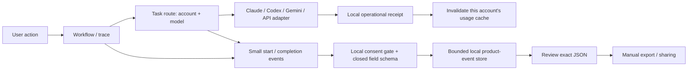

# Paperfact architecture

Paperfact is a desktop research workspace. Reading lists, papers, notes, research
context and shared reading exports are the core. AI providers use configurable
adapters. Daily recommendation workflows remain bundled; independently installed
modules and external agent integrations are proposed in
[the list and workflow design](agent-workflows.md).

## Current boundaries

- `store.py` owns papers, lists, reading state, notes and conversations in SQLite.
- Features assemble their prompts and call `llm.complete`.
- `llm.py` resolves the task profile, dispatches a provider and records a local usage
  receipt. It never changes research records.
- `ai_profiles.py` owns local settings and task routes.
- `ai_types.py` defines immutable settings, requests, results and token usage.
- `ai_providers.py` implements Claude CLI, Codex CLI, Anthropic and OpenAI-compatible adapters.
- `ai_accounts.py` launches official CLI login/status/logout with per-account environments.
- `gemini_cli.py` uses official ACP for Google login and headless Gemini for answers.
- `cli_rpc.py` handles short-lived CLI authentication/model-discovery messages and
  rejects server requests for tools; it is not an agent job orchestrator.
- `ai_choices.py` maps the simple service/account/model picker to existing profiles.
- `desktop/ai_tasks.py` presents per-feature account/model choices without connection
  fields. Account login can be opened from this page without changing the default.
- The desktop dialog and CLI use the same profile API. New requests use the saved
  configuration; in-flight requests retain their selected provider.
- Ranking, crawling, nightly preparation and scheduling remain bundled workflows.
  Their policies belong in those modules, independently of AI adapters and the
  list/notes schema. Future optional extensions should use existing services without
  assuming a research field or changing the meaning of a list.

AI configuration is optional for reading PDFs and maintaining notes. Features that
need generation report a configuration error until a provider is chosen. A failed
provider never automatically falls back to another service or account.

## Profiles and task routing

Settings live in the gitignored `data/llm.json`. Creating the first named profile
migrates existing flat settings into `default` without changing its connection.
Profiles contain a backend, model, endpoint, credential source, output-token limit
and the compatible API's token-limit parameter. Changing a backend or endpoint drops
previous stored credentials unless credentials are explicitly supplied.

`routes` references reusable account profiles; `route_models` optionally overrides
the model for one routed task. An empty model means the provider's default model.
Saving task choices writes both maps atomically, without mutating shared profiles.
Following the global default removes both overrides. Explicit profile calls ignore
task model overrides, and running jobs retain their captured settings.

| Task | Feature |
| --- | --- |
| `ask` | Questions about a paper or passage |
| `translate` | AI translation; quick machine translation remains separate |
| `dive` | Deep dives and background/nightly preparation |
| `list_parse` | Bibliography parsing |
| `citations` | Reference analysis |
| `followups` | Later-work analysis |
| `overview` | Research context |
| `compare` | Paper comparison |
| `slides` | Paper notes and teaching presentations |

Desktop workers and noninteractive CLI commands use `llm.connection_scope` to retain
the settings and environment from job startup. Explicit settings passed to a call
are also a snapshot. For legacy CLI configurations profile selection is:
explicit profile, `PAPERFACT_PROFILE` (or legacy `PAPER_DAILY_PROFILE`), task route,
then saved default. Connection/model environment overrides apply after selection.
`PAPERFACT_LLM`, `PAPERFACT_MODEL` and `PAPERFACT_BASE_URL` take precedence over
their `PAPER_DAILY_*` aliases. Existing vendor-key variables remain supported.
A profile's `api_key_env` names its credential source; gateway profiles default to
`PAPERFACT_API_KEY`, independently of `OPENAI_API_KEY`.

Desktop profile saves set `isolated=true`; they read credentials only from their
stored key or explicitly selected key variable and do not inherit global connection
overrides. Desktop default/routing selections set `prefer_saved_profiles=true`,
so saved routes/default win over the profile environment variable. Existing legacy
CLI settings retain their documented precedence. Account IDs are validated opaque
IDs; CLI homes are derived locally, never taken from list content. Named account
directories support multiple Claude/Codex/Gemini logins; model profiles can share an account.

Keys supplied through the dialog or `--key` are stored locally in plain text.
`api_key_env` / `--key-env` keeps credentials in environment variables instead.
Never include AI configuration files in shared research exports. User-supplied
model IDs are not rewritten for a vendor. Token caps apply to API adapters; Claude
CLI manages its own generation limits and does not report token usage here.

## Adding a provider

Implement `Provider.complete(request, settings, post) -> Completion` and register
it with `llm.register_provider(name, adapter)` at startup. Built-in names cannot be
overwritten. Register shared adapters in the service bootstrap so desktop and CLI
subprocesses see the same registry. Feature code stays unchanged.

`llm.complete(..., task="ask")` preserves the existing `(text, reason)` result.
`llm.complete_result(...)` also returns reported model, finish reason, request IDs
and token usage. Missing usage remains unknown rather than zero or an estimate
from string length. Truncated replies fail while preserving reported usage.
Prompts, credentials and error bodies are excluded from diagnostics and receipts.

HTTP requests retry explicit rate-limit/unavailable responses. Ambiguous network
failures are not resubmitted because they may have already incurred cost.
The test suite uses fake providers and HTTP transports; it needs no vendor API key.

## Paper presentations (implemented)

- `presentations.py` reads selected research evidence, generates a structured deck
  through the `slides` AI task, validates source IDs and saves independent versions.
- Original page text, deep dives, citation/context analysis, chat and reader notes
  remain distinct inputs. Long sources report their coverage limits.
- Drafts, previous generations and source snapshots live under `data/presentations`,
  independently of reading-list membership and research notes. Used figures are copied.
- `slide_layout.py` defines validated editable objects. `desktop/slide_canvas.py`
  renders the native editor and `desktop/presentation_pane.py` saves canvas changes.
  `desktop/presentation_pdf.py` renders that same scene to PDF.
- `presentation_export.py` handles HTML, Markdown and JSON; `presentation_odp.py`
  exports editable OpenDocument objects. `google_slides.py` uses Desktop OAuth
  with PKCE and Drive conversion to create a private Google Slides copy and link.
  OAuth tokens stay in memory and never enter model requests or presentation files.
  Cloud editing is separate from the local draft; no bidirectional sync is implemented.
- The UI selects an AI profile for `slides` like other research tasks. Full MCP,
  managed-mode policy and external agent execution remain future integrations.

See [the presentation guide](presentations.md) for current behavior and limitations.

## Required execution modes

The product must support academic/BYO execution and commercial/managed execution
using the same research services and modules. Managed execution routes all official
model work through Paperfact and a server-owned credit ledger; BYO execution uses
the selected personal connection. This mode policy is not yet implemented.
MCP exposes research tools independently of model access and billing.
See [MCP and the two modes](mcp-and-modes.md) for executor placement, host limitations
and authentication boundaries.

## Future hosted API and research credits

The `gateway` adapter can connect to a service implementing
`POST <base_url>/chat/completions`. It requires an explicit service URL, model and
account token. This repository has no deployed Paperfact API, account system,
checkout or billing implementation yet.

Client request contract:

- `Authorization: Bearer <account-token>` identifies the customer. The desktop
  never receives the service's upstream vendor credentials.
- `Idempotency-Key` identifies one generation attempt across transport retries.
- `X-Paperfact-Task` identifies the research operation, including background work.
- The body contains model, messages and the selected output-token limit.
- Responses contain `id`, `model`, `choices`, `finish_reason` and reported
  `usage.prompt_tokens` / `usage.completion_tokens`; cached tokens are optional.
- HTTP 401/403 reports authentication/access problems, 402 insufficient credits,
  and 429 a rate limit. The client never silently changes billing destination.

A commercial service must own authentication, model entitlements, pricing, spend
limits, credit reservation/settlement and an authoritative usage ledger. It must
atomically deduplicate idempotency keys before charging and return the same receipt
for retries. Availability errors permitting retries must not charge an additional
request. Background tasks need server-enforced limits and clear customer controls.
Payments and upstream secrets belong on the server, separately from research DBs.

`data/ai-usage.jsonl` stores operational receipts: provider, profile, model, task,
timing, IDs, success and reported counts. It contains no prompt, reply, endpoint URL
or key. This editable client log must never determine a customer's credit balance
or be treated as an authoritative bill.

## Lightweight product traces and provider independence

The independent-recipient acceptance flow and shared local bundle service are
documented in [colleague handoff](colleague-handoff.md). Versioned optional
first-use feedback choices are described in [data choices](feedback-privacy.md).

The current supported desktop agent accounts are Claude, Codex and Gemini, plus
the existing model API/gateway adapters. Research features choose a task route;
they do not choose a provider's login flow or quota protocol. Additional agents
should implement explicit capabilities (`authenticate`, `list_models`, `complete`,
`usage`) and declare unsupported capabilities. A subscription does not imply an API
key or a readable quota. New adapters must not silently fall back to another account.
The completion facade remains the common place for receipts and product events.

`feedback.py` defines schema version 1. It has no network uploader. `feedback.flow`
creates nestable nodes; `llm.complete_result` emits AI start/completion nodes.
`AskWorker` carries the parent context across its thread boundary. Independently
launched subprocesses currently start separate traces; an explicit parent-context
handoff is needed before claiming one cross-process tree. Basic UI events currently
cover opening AI settings, list overview and bundle import/export dialogs; these
are action events, not assertions that an import/export succeeded. Instrument
additional workflow stages at their actual success/failure boundaries.

| Fields | Purpose / restrictions |
| --- | --- |
| `schema_version`, `app_version`, `platform` | Interpret events across releases |
| `event_id` | Random ID; future receivers deduplicate it |
| `trace_id`, `node_id`, `parent_node_id` | Join steps without paper/account IDs |
| `session_id`, `sequence`, `day` | Ordering within a local session; no exact activity timestamp |
| `event`, `feature` | Closed categories; start, completion or UI action |
| `backend`, `model_family` | Known service/model categories; custom names become `other` |
| `input_size` | `empty`, `short` (<1k chars), `medium` (<10k), `long`; no input text |
| `duration_seconds`, `success` | Performance/outcome; null means unknown, not success |
| Export `consent` | Policy version, acceptance time and random participant ID |

Store product events separately from research DBs and billing receipts. The opt-in
is off by default. Consent is checked atomically with insertion, including from
analysis subprocesses. Withdrawing deletes local events/identity. Exports are the
reviewed snapshot, not later unreviewed events. Retention is 30 days / 10,000 events.
Random IDs are pseudonymous, not a guarantee of anonymity. Partial traces (crash,
retention, interruption) must be reported as incomplete rather than inferred success.

Useful initial analyses: feature adoption, paths preceding abandonment, repeated
AI calls per task, latency distributions by service/model family, and failure rate
by app release. These do not require question/answer or paper content. The app does
not yet classify user research intent or emit every intermediate workflow stage.
Add closed intent labels only when users select them or opt into local classification;
never substitute snippets, hashes of paper titles, or arbitrary exception messages.

A future central collector should accept versioned batches, validate the same closed
schema, deduplicate event IDs, enforce payload/retention limits and separate consent
from ingestion. Upload permission must be distinct from today's local-recording
choice. Offer opt-out, queue deletion and participant-ID deletion requests. Aggregate
small cohorts before analysis; access raw event rows only for authorized debugging.
No collector, automatic uploader or central analytics dashboard is deployed yet.
The concrete cross-app receiver contract, storage paths, retry/withdrawal behavior
and local DuckDB pipeline are specified in [collection architecture](collection-architecture.md).

Usage prefetch uses `usage_cache.py` and the desktop `UsageMonitor`. A small
account-scoped file marker bridges AI completions from separate processes. Pending
requests are deduplicated; new completions during a query remain dirty for the next
refresh. The UI reads cached snapshots without waiting on network calls. Claude's
read-only control client sends only `initialize` and `get_usage`, with tools/hooks
disabled and `skip_behaviors=true`; it never sends a user/model turn or scans other
Claude transcripts. The experimental response contract is from the
[official SDK types](https://app.unpkg.com/@anthropic-ai/claude-agent-sdk@0.3.301/files/sdk.d.ts).

Gemini quota uses `gemini_usage.mjs` with the installed CLI's credential handling.
It resolves the core module from the active bundle entry rather than choosing an
arbitrary stale chunk, disables interactive/browser authentication, and only calls
account/quota reads. It does not call onboarding or model generation. This is a
version-sensitive internal CLI adapter, not a guaranteed public quota API:
incompatible releases fail explicitly. The result shape follows Google's
[official quota types](https://github.com/google-gemini/gemini-cli/blob/main/packages/core/src/code_assist/types.ts).
Only valid 0–1 remaining fractions become percentages; absent/invalid values stay
unknown. `UNSUPPORTED_CLIENT` is propagated as a clear eligibility failure.
No alternative client identity or account is substituted to bypass it.

API schemas were checked against the [OpenAI Chat Completions reference](https://developers.openai.com/api/reference/resources/chat/subresources/completions/methods/create)
and [Anthropic Messages reference](https://platform.claude.com/docs/en/api/messages/create).

## Shared web readers

Standalone readers cannot access desktop credentials or profiles. Their AI is an
embedding-host capability from `window.paperfact.use("sample")`, with the existing
`sample(prompt, {onText}) -> {text, truncated}` contract. A custom host can implement
it using its own gateway session and also supply `db` and `user` capabilities.

Without a custom host, the legacy Claude Artifact bridge remains supported. If a
configured custom host declines or fails, the reader does not switch to another
host/account. Reading and local notes still work without AI. Never embed vendor
keys or desktop profiles in HTML.

Publishing updated Artifacts is separate: changing source here does not replace
existing shared pages or their research notes.

## Installed builds and updates

- `runtime.py` knows whether the app runs from a source checkout or an installed
  (PyInstaller) build: where its bundled files are (`bundle_root`), where user data
  goes (`data_dir`: `data/` in a checkout, the platform's app-data folder in a build),
  and how to start a subcommand in another process (`cli_command`: `python -m
  paper_daily` in a checkout, the bundled `paperfact-cli` in a build). Features that
  spawn background jobs go through `cli_command`, never `sys.executable -m`.
- `updates.py` reads GitHub Releases for a newer `vX.Y.Z`, at most once a day, and
  replaces an installed build with its platform's file; `desktop/update_banner.py`
  is the banner that offers it. See [Releasing](releasing.md).
- Input handlers that need events from many widgets (focus frames, tab key badges,
  the presentation's Alt+arrows, the mouse's back and forward buttons) register with
  `desktop/window_events.watch`, which filters the app's top-level windows and the
  focused widget. Never install an event filter on the QApplication itself: PySide
  converts every receiver it sees to a Python object, and on Linux Qt WebEngine's
  internal objects crash that conversion as soon as a window with a web view is
  resized. `tests/test_window_events.py` fails if the main window installs one.
