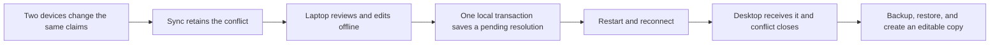

# Claim review across offline peers and recovery

Unreleased `0.5.0.dev`, isolated integration candidate. These are local reference
service and synthetic research journeys, not installed Mac/phone or production
acceptance. [Executed actions and limits](testing/claim-continuity-scenarios.md).

## User outcome

A completed cancelled analysis remains discoverable and editable. A real remote
claim conflict can be reviewed, privately edited, source-checked and confirmed
offline. Its queued resolution survives client recreation, returns to the desktop,
closes the original conflict on both peers, and survives another independent
backup and editable adoption. Original A and selected PDF B remain distinct.

This extends the [nine local operations](local-claim-review.md), without an
implicit model, login, network request, or selected-PDF activation during review.
It does not add arbitrary claim editing to the mobile PWA.

## Captured intent and transaction

Live remote selections retain a version2 private observation: exact conflict
event, canonical head, entity/parent state, pending-write state and resolution
state, alongside the existing target/native/source observations. The complete
observation is compared again before application. A changed or resolved conflict
refuses late application and preserves private text.

Confirmed Apply uses the existing transactional conflict-resolution API. Source
ownership, revised claims, outbox, resolution intent, native receipt, private
revision and public retry receipt share one commit. The queued operation identifies
the original conflict; an ordinary content save cannot stand in for that causal
intent. A failed final receipt rolls everything back; retry applies once.

A live conflict only offers its original paper as receiver. Another paper cannot
borrow its resolution authority. Independently recovered history is different:
the original event is historical evidence, so fresh editable adoption/selection
creates local work without replaying the old resolution or account authority.

## Compatibility and source checks

- Existing version1 nonremote drafts retain their behavior. Version1 remote drafts
  remain readable and keep their structured text, but require explicit target
  reselection before verification/application captures the complete conflict intent.
- Version2 observations use closed nested validators, including event, graph,
  canonical operation, source and parent checks. Unknown or contradictory fields
  refuse; historical paths never become read capabilities.
- Missing and unconfigured current PDFs are compared at the same resolved-reader
  level captured initially. Comparing a resolved absence against metadata-only
  `unchecked` status caused false refusal. A newly appearing PDF, closed reader,
  changed owner or version still invalidates the old observation.
- Sidecar IDs are opaque returned identifiers, not request UUIDs or caller paths.
  Missing optional list summaries receive a bounded fallback label.

## Remaining acceptance

The shared backend/CLI journeys and dedicated live-remote/cancelled-result Qt
button paths now have local tests. Bilingual entry, edited fields, source viewing,
Cancel/Yes, retry suppression, peer return, parent-close draining and legacy
reselection are covered. Known applied/stale drafts require fresh review; queued
and closed conflicts show distinct guidance. Private edit/save/copy remains usable
without a second formal write. This presentation state is not backend authority.
Additional interruption/format combinations, physical devices, production access,
the matching full application gate and installers remain required. Quote location
is not semantic support or expert review. Credentials and private retry authority
do not travel with research sync.
