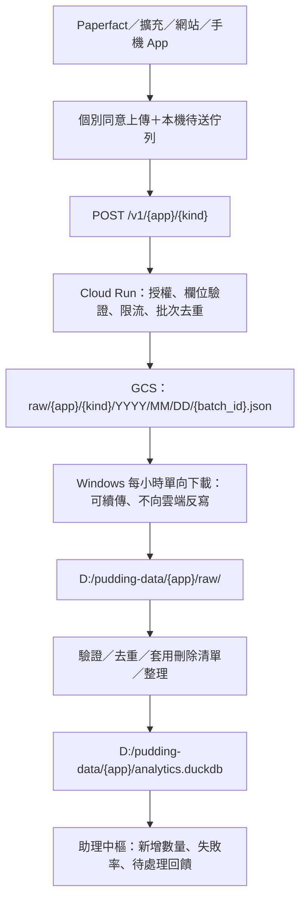

# Receiver design status

The earlier event-upload proposal below is archived design context, not the current
Paperfact export contract. Current schema v2 exports aggregate counts only; see
[the implemented contract](feedback-privacy.md#shared-schema-v2).
Do not deploy the per-event endpoint/participant identifiers below for this version.
Cloud Run, GCS, scheduled sync and DuckDB are still unimplemented.

A future aggregate receiver should use `POST /v1/paperfact/statistics`, validate
only the six allowlisted tables, and keep transport receipts separate from product
statistics. Overlapping 30-day manual snapshots cannot be summed as new events.
Deduplication, upload consent, deletion receipts and protection against repeated
uploads must be designed before enabling a sender. Network metadata can identify
senders even when payloads contain no IDs; transport privacy needs separate review.

---

# 跨 App 的輕量資料接收架構

這是接收端的設計規格，尚未部署 Cloud Run、GCS、Windows 排程或 DuckDB。
Paperfact 目前已實作本機自願紀錄、預覽與匯出；沒有自動上傳程式。
接收端應獨立成共用服務，Paperfact 僅實作事件格式與傳輸 adapter。



## App 與種類

服務端 registry 明確列出允許的 app、kind、schema 版本，路徑不可任意拼接。
第一版 Paperfact 使用 `POST /v1/paperfact/events`。其他 app 自行定義 schema，
但不得透過「接受任意 JSON」跳過驗證。未註冊 app/kind 回覆 404。

`events` 只收操作節點。日後的 `feedback` 是使用者主動送出的文字回饋，
必須有獨立欄位、預覽與同意，不能把原始問答偷放進 events。

## 批次合約

建議單批最多 100 筆事件、未壓縮 256 KiB；傳輸僅 HTTPS JSON，第一版不接受壓縮。
現有匯出包含最多 10,000 筆，未來 sender 必須拆批，不能直接整份送出。

```json
{
  "schema_version": 1,
  "batch_id": "隨機 UUID",
  "app": "paperfact",
  "kind": "events",
  "consent": {
    "policy": "paperfact-upload-v1",
    "participant_id": "自願參與時產生的隨機 UUID",
    "accepted_at": "ISO 8601 UTC"
  },
  "events": [
    {
      "schema_version": 1,
      "event_id": "隨機 UUID",
      "session_id": "隨機 UUID",
      "trace_id": "隨機 UUID",
      "node_id": "隨機 UUID",
      "parent_node_id": null,
      "sequence": 1,
      "day": "2026-10-20",
      "app_version": "0.1.0",
      "platform": "win32",
      "event": "ai.completed",
      "feature": "slides",
      "backend": "codex",
      "model_family": "gpt",
      "success": true,
      "duration_seconds": 12,
      "input_size": "medium"
    }
  ]
}
```

上面是示意值；正式 UUID 欄位須驗證格式。事件白名單與現有 `feedback.py`
一致，拒收多餘欄位、重複 JSON key、NaN、過深結構及不合法類別。
不接受任意 metadata、exception、prompt、response、email、path 等自由文字欄位。
App 版本可使用受長度限制的版本字串，OS 使用封閉類別。

同意範圍須區分「本機紀錄」與「上傳給開發者」。目前的
`product-events-v1` 只同意本機紀錄，**不能直接當成上傳授權**。
傳輸端固定同一批次的 bytes 與 batch_id，失敗重試不得重新分配 ID。

## Cloud Run → GCS

1. 驗證 app/kind、安裝憑證、大小、同意版本及 JSON schema。
2. 通過後原樣存下收到的 UTF-8 bytes，不重排欄位、不往原始事件加資料。
3. GCS 物件名稱以接收日期 UTC 分區；批次的分區日期須固定並能跨日去重，
   可另用 `receipts/{app}/{batch_id}` 儲存處理狀態及原始物件路徑。
4. 使用 GCS generation precondition 建立物件，避免覆寫。
   receipt 與物件需可恢復：先保留 batch_id，再寫物件，再完成 receipt；
   若服務中斷，重送接續相同步驟。不要把兩次寫入說成跨物件交易。
5. 寫入完成才回覆 `201 {batch_id, status:"stored"}`。
   同 ID、同內容回覆 200；同 ID、不同內容回覆 409。
   限流回覆 429 與 Retry-After；未保存的失敗不得回覆成功。

接收時間、內容 SHA-256、schema、byte count 放 receipt／物件 metadata。
這裡的雜湊僅用於批次完整性與去重，不拿論文標題或使用者文字的雜湊當匿名 ID。
服務日誌只留 request ID、app/kind、狀態碼與耗時，不寫 request body、憑證或信箱。
原始資料維持私有；Cloud Run 用附加 service account 存取指定 bucket，
不同任務使用不同 IAM 身分，不分發 GCP service-account key 給 App。

## 每個 App 一把金鑰的用途

私有 server-to-server client 可以使用各自輪替的金鑰。公開桌面 App、
瀏覽器擴充與手機 App 內的固定金鑰可被取出，只能作入口分類或粗略限流，
不能視為可信身分，也不能授予讀取 bucket 的權限。

公開客戶端建議用同意後取得的可撤銷安裝憑證，限於某個 app/kind 的寫入；
需要更強來源保證時再接使用者登入。匿名憑證仍可被濫發，需發放限流、
總量上限與監控。IP 可於短期安全限流處理，不進入產品分析事件。
Cloud Run 若開放公開 HTTP，必須在應用層驗證憑證；app key 不會自動通過 Cloud Run IAM。

## Windows → DuckDB → 助理中樞

- 排程每小時執行，單一 instance lock 防止上次未結束又啟動。
- 單向下載新物件，寫入 `.partial`，驗證大小／checksum 後改成正式檔名。
  使用最小讀取權限；不帶遠端刪除或反向同步選項。
- 以 GCS object name + generation 作 checkpoint；下載或匯入失敗可重跑。
- 每個 app 一個 DuckDB，建議 `batches`、`events`、`deletions` 三張表。
  `events` 以 event_id 去重，batch_id 連到來源；一個批次匯入成功再提交 checkpoint。
  schema 不相容的檔案進 quarantine，發通知後等待修復，不靜默略過。
- 研究 PDF／筆記不進這個資料管線；上游未回報的結果保持 null。
  缺少結束事件只能標為「未完成／未知」，不能直接判定使用者放棄。
- 中樞只讀彙總結果，例如「Paperfact 新回饋 3 則」或「簡報改寫本日 12 次、
  失敗 2 次」。通知以 app/kind/checkpoint 去重，重跑不重複通知。
  這裡只定義介面，尚未新增中樞任務或傳送訊息。

## 保留與刪除

原始事件建議保留 30 天，匯總資料可依用途另定期限。撤回上傳同意須停止
新上傳並清掉待送佇列；已接收資料須有 participant_id 對應的刪除請求。
刪除流程覆蓋 GCS 原始資料、Windows raw、DuckDB、備份及任何舊快照。
寫入可持續追蹤的刪除清單，匯入前先套用，避免重下載把已刪除資料加回來。
單純不使用同步的刪除選項，並不能代替資料保留與刪除工作。

這些隨機 ID 是假名化資料，不能宣稱完全匿名。小樣本的功能／模型／時間
組合仍可能辨識人，報表應抑制過小群組。

## 上線驗收

先用合成事件驗證：合法接收、非法欄位與超大 payload 拒收、錯 app/key、
同批重送、跨日重送、寫入中斷恢復、429 重試、撤回後不送、刪除後不復活、
Windows 斷線續傳、DuckDB 重跑不重複，以及中樞通知去重。
正式上線前確認 GCP project、region、bucket、網域、憑證發放方式和資料接收者；
此規格不包含建立或收費啟用雲端資源。

官方依據：[Cloud Run 認證](https://docs.cloud.google.com/run/docs/authenticating/overview)、
[GCS 認證](https://docs.cloud.google.com/storage/docs/authentication)、
[GCS request preconditions](https://docs.cloud.google.com/storage/docs/request-preconditions)。
