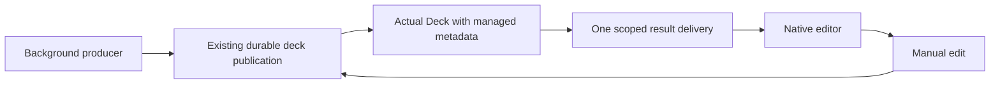

# Managed presentation result delivery

Status: implemented in the isolated 0.5 integration tree; not committed or released.
The current affected gate passes 86 cases. This is not a full application pass.

## Behavior

The background producer saves the deck through the existing publication boundary.
The editor now receives that actual Deck object, including its managed-file
observation and immutable figure locations. Reconstructing only its public JSON
had lost those fields: a real generated managed deck could be displayed but its
next manual edit failed to save.

`desktop/presentation_delivery.py` keeps one ephemeral result per admitted job.
It captures the original database path/native identity, deck directory and real
window owner when available. It retains the selected account/model options only
in memory. Its worker checks the captured scope before calling the producer;
its callbacks require the same live native widget and outstanding job.

Delivery validates that its JSON transport matches the actual producer result.
A missing result, altered transport, replaced workspace, closed owner or destroyed
widget cannot substitute another writable deck. Duplicate delivery cannot erase
an edit made after the first result. Failure releases the current UI job so an
explicit retry can proceed. Backend source validation and publication remain
responsible for data authority; this display token is not serialized permission.

Only `PresentationPane._start_generation_ready` and `_generated` changed among
its original methods; 78 other method ASTs remained exact. New notices have
English and Traditional Chinese text, chosen on the GUI thread before work starts.

## Observable acceptance map

All new cases use real temporary SQLite workspaces, managed deck publication,
actual PNG assets, a simulated producer and manually controlled runner callbacks.
The producer executes on a fixture background thread. No real provider is called.

| Test scenario | Observable outcome |
|---|---|
| Submit start 25 times, publish, then edit | One job is admitted; the generated deck remains editable, preserves notes/layout, and exports its exact red/blue source PNGs inline. |
| Deliver the same result twice | The next unsaved edit and its autosave timer survive; saving/reopening retains that edit. |
| Change database, deck folder or native database after publication (3 cases) | The original view remains unchanged; no replacement destination is created. |
| Change database or deck folder before worker entry (2 cases) | Producer is never called; failure releases UI state. The English refusal is asserted. |
| Destroy the native widget before delivery | Callback touches no deleted Qt widget; the already saved original deck remains readable. |
| Fail, retry and repeatedly activate retry | The previous saved deck survives; one new job is admitted and its result remains editable. |
| Alter transport JSON | The altered deck never reaches the view; the genuine saved result remains intact. |
| Close the captured outer workspace at the same path | The old result cannot replace the view even without changing the path. |
| Deliver transport without running the producer | Pending edits survive and no unpublished result is accepted. |

These are 12 cases in `tests/test_presentation_delivery.py` (two functions expand
across the listed context variants). They do not test paid models, real cloud
accounts, forced provider cancellation or installed-device behavior.

The old autosave regression fixture now models the real producer's saved result
before its UI callback. The stale UI edit/timer remain pending through that
publication. All four original assertions are preserved; a fifth explicitly
checks that the stale timer is still pending at delivery. The other 32 functions
in `tests/test_presentation_pane.py` remained AST-identical. This ports the
producer actor; it does not turn arbitrary callback JSON into a save API.

## Current evidence

- A real managed-generation/edit test failed at `widget.save_changes()` before
  the fix; source hashes were stable and no external calls were admitted.
- Coherent root gate: **86 passed, zero skipped**, 313.00 seconds in pytest;
  1,230 source inputs unchanged and zero unexpected provider/remote calls.
- Breakdown: 12 new delivery cases, 29 existing pane cases, 32 report tests,
  12 collection tests and one Chinese-content regression. Do not add this result
  to overlapping earlier gate totals.
- Ignored receipts: `build/merge-resolutions/presentation-delivery-before-result.json`,
  `presentation-delivery-joint-result.json`, corresponding XML/logs, and
  `presentation-delivery/autosave-fixture-port-proof.json`.

## Unicode correction

PowerShell's default text pipeline had converted newly authored Chinese literals
to replacement question marks despite Python's UTF-8 output mode. Existing text
read from files was unaffected. An explicit UTF-8 input probe verified code points;
the fourteen new catalog translations were restored without changing their
English descriptions, source IDs/hashes or the original five entries.

`tests/test_reviewed_catalog.py` reproduced the damaged real catalog and now
passes in the 86-case gate. It requires Chinese characters in each reviewed
Chinese prose field; it does not evaluate translation quality. The maintained
report generator rebuilt both local previews. The older damaged catalog/previews
and initial failing receipt remain available under ignored build output.

Use explicit UTF-8 PowerShell stdin or write Unicode through a verified file API;
`python -X utf8` alone does not control the parent shell's pipe encoding. Preserve
existing newline bytes; text-writing already decoded CRLF can duplicate carriage
returns. These fixes do not justify editing unrelated source or test assertions.

## Still required

Durable restart-safe deferred drafts, verified file-candidate Apply, complete
asset/history enrollment and package/sync/recovery continuity remain open.
Unbound default generation's original-workspace guard has a separate master-first
candidate. Initial legacy reader/render I/O is not made fully asynchronous here.
Whole-suite, installed Windows/macOS/Linux and physical mobile acceptance remain
required before release. See [status](status-0.5.0.md) and
[presentation backend reconciliation](presentation-generation-merge.md).
