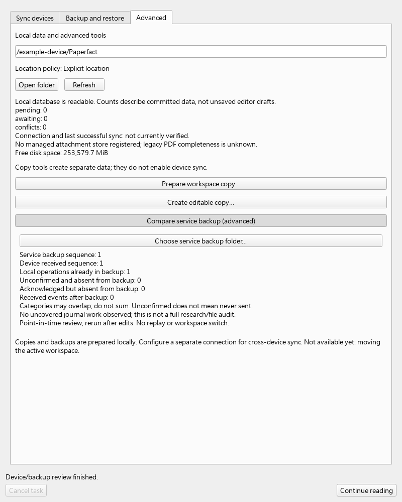
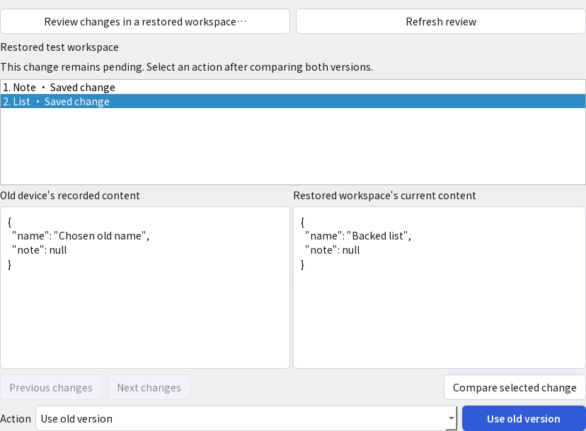

# Review old-device work before authority recovery

Status: local v0.5 comparison and explicit typed recovery choices; not automatic
post-disaster merging or complete recovery.
Use this when recovering an authority from an older backup while a device may
contain more recent work. Keep the old device workspace intact.

## Desktop

Open **Workspace and recovery > Advanced > Compare service backup (advanced)**.
Expand it, then choose the authority backup folder containing `manifest.json`.
This is an operator/service backup, not an ordinary research/list ZIP.
Unenrolled local databases have this action disabled. Reading remains available.



The operation runs in the existing background worker. Repeated activation does
not create another job. Cancel and close drain admitted work; switching or
rebinding the workspace suppresses stale delivery. The source database and backup
are read-only. The result describes the checked point in time; repeat after edits.
Unsaved editor drafts, uncaptured research and attachment ownership are outside
this journal comparison. It is not a complete research or file audit.

## Interpret the result

| Field | Meaning and next action |
|---|---|
| Service backup sequence | Last event retained for the selected workspace in the verified authority backup |
| Device received sequence | Last contiguous retained received event on this device |
| Local operations already in backup | Exact operation fingerprints present in the backup, including a successful send whose acknowledgment was lost |
| Unconfirmed and absent from backup | Local operations without a saved acknowledgment that were not found in this backup; preserve and review them, do not assume never sent |
| Acknowledged but absent from backup | This device retained a server acknowledgment newer than the backup; preserve the local work |
| Received events after backup | Accepted/conflicted events this device received beyond the backup; preserve the old received history |

Categories overlap: one acknowledged operation can also be a received event. Do
not sum them into a unique change count. `device_behind_by` describes a received
prefix lag, not missing research or lost data. Zero uncovered journal work does
not certify complete backup coverage of the device's files, drafts or research.

Before any migration, save drafts and use **Create complete backup** while all
research producers are quiescent. Preserve the complete old workspace and verified
backup. Join the [fresh recovered authority](sync-authority-restore.md) into a
separate new local directory with newly issued device credentials. Review supported
research-package imports there; this comparison does not prepare/apply them.
Do not rewrite an old identity/cursor, discard an outbox or blindly replay an old
operation into the new authority. Guided comparison and supported keep/add/replace/restore or note-copy choices
are available below. Exact-original and compound reconciliation remain pending.

## Operator CLI and API

```sh
.venv-sync/bin/python -m paper_daily sync-admin review-device-backup --database /private/old-device/papers.db --input /private/verified-authority-backup --workspace example-workspace --seconds 30
```

On Windows use `.\.venv-sync\Scripts\python.exe`. All paths/identities are explicit;
this uses no GCP SDK, credentials, network, login, AI or global research database.
It does not initialize missing databases. Success is one JSON receipt with
`state=reviewed`, identities, sequences, counts, `uncovered_journal_domains`,
`requires_preservation`, `replayed=false`, `research_and_files_fully_audited=false`.
The receipt contains no note bodies, titles, source paths or credentials.

| Flag | Requirement/default |
|---|---|
| `--database FILE` | Required existing old-device SQLite database with sync identity/cursor/journal |
| `--input DIRECTORY` | Required complete authority backup; all referenced bytes must verify |
| `--workspace ID` | Required backed-up workspace matching this device's stored binding |
| `--seconds NUMBER` | Default 30; positive and at most 300, cooperative budget |
| `--help` | Offline parser help; no account or state action |

```python
sync_device_recovery.review(database, snapshot, workspace, *,
                            seconds=30, cancelled=lambda: False) -> dict
```

The service checks exact shared received history, closed canonical operations,
local fingerprints and backed-up acknowledgments. It rejects missing/gapped or
changed inputs, contradictory receipts and oversized records rather than giving
truncated reassuring counts. The local record bound is 100,000; the time budget
also covers manifest/attachment verification. Existing read-only SQLite helpers
and file/WAL version guards are used; OS calls are not hard real-time cancellation.
It is not a sandbox against malicious same-user filesystem replacement. The result
is an observation, not a capability to replay, rebind, restore or upload anything.

[Scenario map](testing/device-recovery-review-scenarios.md) records exact local
checks and the unresolved full, hosted and installed-device gates.


## Per-change recovery core

The internal APIs below are integrated into the checkpoint source, with isolated
native-fixture coverage. Guided desktop comparison, note copy and supported
metadata/note keep/add/replace/restore use these APIs.
Old workspace/history remains intact; old envelopes are not blindly replayed.

| Entry | Contract |
|---|---|
| `sync_recovery_candidates.prepare(database, snapshot, workspace, *, seconds=30, cancelled=...)` | Read-only index; `.page(...)` and `.details(change_id, ...)` retain exact source identity |
| `sync_recovery_target.observe(index, target_database, *, seconds=30, cancelled=...)` | Prove fresh target history/binding; `.compare(change_id, ...)` exposes source/current state without writing |
| `sync_recovery_note_copy.prepare(observation, change_id, request_id, *, with_original=False, seconds=30, cancelled=...)` | Explicit note copy with a new native identity; positioned notes require exact PDF/selection verification; `with_original=True` includes the verified old-device original in the same native transaction |
| `sync_recovery_claim_group.prepare(observation, change_id, request_id, *, replace=False, seconds=60, cancelled=...)` | Complete portable claims, exact native dive/close inputs and original; `.comparison` shows all three members; `.apply(...)` commits atomically and returns local-only state |
| `sync_recovery_choices.prepare(observation, change_id, choice, request_id, *, seconds=30, cancelled=...)` | Explicit keep/add/replace/restore for supported metadata, unanchored notes and order; `.apply(...)` is idempotent |

Saved decisions are checked against the exact source operation/fingerprint,
source and target identities, choice, native operation and sequence. Retrying a
corrupt receipt fails without writes, including keep-current (which emits no
research operation). Native research, outbox and decision receipt commit together;
interruption rolls them back. Cancel/stale bindings never authorize another target.

Legacy/hashless positions, unavailable original bytes, compound scientific content, arbitrary deletion, unproved parent changes, complete editable recovery UX, cloud recovery and installed-device
acceptance remain open. A successful subset does not mark recovery complete.


## Review and copy a recorded note

1. In **Workspace and recovery**, open **Recovery**, expand the existing service
   backup comparison, and choose the verified backup containing `manifest.json`.
2. Select **Review changes in a restored workspace** and choose the separate,
   already joined target folder containing `papers.db`. The app stays in the old
   reading workspace; this action does not initialize or switch a workspace.
3. Browse 20 recorded changes per page. Select a row and press Enter or choose
   **Compare selected change**. Resize the list and both read-only content panes
   with the splitters. The current pane includes the target's pending edits.
4. For an eligible v2 note, **Copy as new note** adds one distinct note
   to the target's native outbox. Existing notes and the old workspace stay intact.
   No AI call is made. An already-enabled target sync controller may send it.
5. Refresh after saving. Reopening the same review recognizes the recorded copy;
   repeated clicks, retry and reopening cannot create another copy. Later edits
   or deletion of the copy are retained.



Cancellation/close drains active work. Changing the workspace, source binding or
queued target observation blocks stale application. A save that already committed
is reported as saved even if cancellation or a target change occurs afterwards.
PDF-bound notes, unsupported scientific/file content and deletion remain visible
but pending; there is no generic flatten/replay action. Exact-original verification, unproved parent changes, compound recovery and
complete recovery/device acceptance remain outstanding.


## Choose how to recover supported content

After comparing a row, the **Action** selector lists only currently admissible
choices plus previously recorded choices. Lists and other metadata default to
**Compare only**. Unanchored notes retain **Copy as new note** as the default;
choosing a replacement instead preserves the original note identity.

| Choice | What it does |
|---|---|
| Keep current content | Records a local decision; writes no research operation or outbox item |
| Add old content | Creates a supported entity only when its target is absent |
| Use old version | Writes a new native version over the reviewed current entity; earlier history remains |
| Restore old content | Explicitly restores a known deleted entity, without silently restoring its children |
| Copy as new note | Creates a distinct note, preserving the original note and any verified PDF position |

Use/restore shows a confirmation dialog defaulting to **No**. Repeated activation
while confirming starts no job. Changing selection during the dialog cancels the
old choice; a later target edit is rechecked in the native transaction and cannot
be overwritten by the stale decision. Failure/retry reuses the prepared request.

Refreshing retains a completed add/replace/restore/keep decision even when its
success changed what is currently admissible. Selecting that already-recorded
action cannot apply it again or overwrite subsequent edits. Another explicit,
currently eligible choice requires a new review-bound decision.

The controls cover supported lists, paper metadata, membership, reading state,
order and unanchored notes, subject to exact parent-lifetime checks. Keep is a
local preservation decision, not proof of original ownership or complete recovery.
PDF-positioned notes and unsupported scientific/file operations cannot obtain a
generic write capability; unproved parent changes and original verification remain blocked.


## Recover related lists without losing their links

Recover the supported parent first, then review its children. For example:
**list > membership > reading state > paper order**, followed by list order.
Each step remains an explicit native action; it does not replay the old envelope.

A changed parent lifetime requires a recorded recovery decision, the exact old
operation/fingerprint, its actual native journal receipt, and the current target
lifetime. Unchanged parents are checked against the selected verified backup.
A same-named entity, matching ID or deliberate reuse of an old incarnation is not
an unrecorded recovery grant. Missing, corrupt or superseded proofs block writes.

Historical parent proofs are checked separately from current write eligibility.
After explicit list deletion/restore, a retained child needs explicit restore
under the verified new parent. Restoring the list alone never revives children.
Membership/order lifetimes and complete-set digests are rebuilt by the existing
native builders; the chosen order is preserved without dropping extra members.
A target edit after preparation invalidates the decision; refreshing can preserve
the newer parent name while recovering its children.

Local reference-service and second-native-client fixtures verify accepted list,
membership, reading time and order delivery. This is not installed-device/hosted
acceptance. Arbitrary parent migration, PDF/scientific ownership and compound
file recovery remain open. Copy-as-new also accepts a supported recorded paper
mapping: recover a missing post-backup paper through an explicit **Add old
content** decision, refresh the comparison, then copy its unanchored notes.
Both the old source operation and the native parent receipt must verify; matching
IDs or even reusing an old incarnation without a receipt cannot authorize copying.
Later paper metadata edits remain intact when retrying the same note-copy request.

The current protocol deliberately prohibits paper deletion. This flow recovers
missing papers; it does not weaken that retention rule or invent paper resurrection.
Notes carrying page/anchor references stay pending for exact-original verification;
no anchor is silently removed to make a copy succeed. A blocked copy still permits
read-only side-by-side review. Corrupt receipts for an already recorded copy fail
closed rather than being presented as a new unsupported action.


Positioned note copies use the same `sync_recovery_note_copy.prepare(...)` API.
The target must own the exact hash through an immutable original artifact or
its desired primary PDF. Explicit `with_original=True` also supports an original
missing from the target/backup: inspect the old device's owned PDF first, then
stage bytes off-lock and publish original ownership plus note in one transaction.
Geometry and recorded selected words are verified;
private commentary is not compared as a quotation. Verification repeats inside
the write transaction and byte changes before commit roll back the whole copy.
Only a successful committed receipt can skip later source availability checks.
This extends copying, not metadata keep/replace/restore for anchored notes.
[Requirements and evidence](testing/device-recovery-review-scenarios.md#exact-original-positioned-note-recovery-2026-11-14).


## Complete source-pinned claim groups

A portable native claim set pins the full deep/close analysis data hashes used
for generation. Recovery validates these exact native inputs, the PDF's hash,
page count and each recorded located passage. It preserves every claim,
proposed judgment, unlocated/missing passage and generation field; location
verification does not certify semantic support. Different generations are never
combined merely because they share a paper or PDF hash.

`sync_recovery_claim_group.prepare(...)` performs read-only comparison. The
source must provide exact native input values and an owned original. Current
matching versions are read directly; otherwise recovery searches the retained
local journal and accepted inbox history by the pinned full data digest and exact
paper lifetime. A newer edit or source-side deletion does not replace that input.
Nonportable legacy source IDs and changed source-parent lifetimes still need mapping.
`replace=False` refuses differing/deleted destination members. Explicit
`replace=True` prepares all three members together, with native restoration where
required; visible rows inconsistent with native history still refuse to protect
untracked private edits. The UI previews the whole group before confirmation.

Confirmation stages verified bytes, then uses the existing typed source publisher
and native research writer in one transaction with a bounded payload-bound
receipt. An error/cancellation after an earlier child write rolls back original
ownership, all three results, outbox and receipt. An unowned staged cache can
remain; it grants no ownership or active-PDF change. Repeated confirmation or
reconstructed requests validate recorded source/native operations and return the
original decision, preserving later edits/deletions without requiring the PDF again.

Results say `state="saved_locally"`, `remote_acceptance_checked=False`,
`semantic_validation="not_performed"` and `recovery_complete=False`.
No old operation replay, AI/model call, remote acceptance claim or account transfer.
Independent manual marks and reading-link/Lineage groups, foreign-workspace deck mapping, unknown legacy/source-lifetime
migration, full audit, hosted deployment and installed/device acceptance remain
open. [Behavior evidence](testing/device-recovery-review-scenarios.md#complete-portable-claim-group-2026-11-14).


### Historical native claim inputs

Exact input data hashes can resolve a previous native version after source-side
editing/deletion. Recovery searches only that feature's portable entity, workspace,
paper epoch and matching original hash (or its explicitly unbound analysis value).
It accepts retained own-journal intentions and accepted foreign inbox versions;
a foreign conflict/cache entry alone cannot supply a dependency. It does not infer
inputs from titles, similar text or whichever analysis happens to be newest.

Retained inbox events prove received versions. A graph receipt is only a lookup
cache: missing caches can fall back to bounded inbox lookup; caches disagreeing
with retained events refuse without repair or publication. Source/target leases,
per-record byte limits, 100,000-record limits, cancellation and the caller's wall
budget remain enforced. JSON parsing follows the byte guard; scans create no
source index/table or extra background service.

The resolved envelopes remain review input. Recovery still emits new typed
operations/one local receipt in the existing transaction and preserves current
source edits/deletions. Missing historical pins, wrong parent epochs and unknown
legacy mappings remain pending. No AI call or new MCP/network interface is needed.


## Complete editable deck recovery

In the existing old-device change review, select a recorded deck, compare both
panes, then choose **Use old complete deck**. Confirmation is required before
replacing/restoring that slot. Cancel leaves research and queues unchanged;
repeated activation reuses the same durable decision. No AI call is made.

`sync_recovery_deck_group.prepare(observed, change_id, request_id, *, replace=False,
seconds=60, cancelled=...)` returns a sealed `DeckGroup` with a read-only
`comparison` and `apply(*, seconds=60, cancelled=...)`. The comparison retains full
editable slide data, speaker notes, figures, source catalog and original hashes.
The native UI summarizes saved text; this is not a visual slide renderer.

Source closure hashes, JSON/PNG validity and native PDF ownership are verified
before staging. Schema-1 inputs receive the known source workspace; schema-2
scope remains exact. The recovered deck uses a new native envelope. Source bytes
stay unchanged. Original ownership, desired deck, verified local activation,
outbox and bounded decision receipt commit in one transaction. Failures may
leave unowned immutable staged bytes, never a partially published research group.

A different/deleted target needs explicit `replace=True`; its old history stays.
Target changes, late private legacy decks, damaged current managed files, missing
originals and corrupted assets refuse publication. A successful receipt retry
preserves later edits/deletions and does not require lost source files again.
Root and related-paper originals are supported when recorded document references
match retained native operations in the source workspace: exact paper, operation,
document incarnation, parent lifetime and hash. Related parents use the existing
explicit metadata recovery decisions. If a related paper was created after the
backup, review and restore that paper first, then compare the deck again. The
comparison lists recorded original titles and hashes. Equal PDF hashes do not
merge distinct paper owners; ambiguous ownership refuses publication.

New receipts retain source/target original parents; existing root-only receipts
remain retry-safe. Retiring an original does not authorize restoration through a
new deck request. A previously committed decision can still be recognized after
source assets disappear, without recreating the retired original. References in
a different source workspace and unknown legacy ownership still need explicit
mapping. Scientific support, installed-device acceptance and full highlight/Lineage
recovery are not certified by this operation.


## Highlight analysis and PDF marks

Select a recorded `highlight_analysis` change in the existing recovery review,
compare quotes/roles/reasons, then choose **Use old complete highlights**.
Confirmation is required; cancellation and repeated clicks follow the same worker
and durable-decision path as deck/claim recovery. No model is called.

`sync_recovery_highlight_group.prepare(observed, change_id, request_id, *,
replace=False, seconds=60, cancelled=...)` returns a sealed `HighlightGroup` with
`comparison` and `apply(*, seconds=60, cancelled=...)`. It checks the owned PDF
hash, normalized original-text hash and every complete quote. New anchors come
from exact source placement, not current PDF B or guessed page positions. Quotes
that cannot be located refuse the group without partial research writes.

The selected analysis retains all quotes, roles, reasons and coverage. Native PDF
marks retain its quote/reason and use freshly verified geometry. Current target
hidden choices take priority; otherwise verified source mark choices are used.
Source mark IDs must still refer to the selected quote. Manual and unrelated
target marks stay untouched. Uncaptured source/target words refuse overwrite.
Analysis or mark replacement/restoration needs explicit `replace=True`.

Original ownership, analysis, marks, outbox and one bounded receipt commit together.
A failed child or cancellation rolls everything back; unowned staged bytes may
remain. A recorded successful retry preserves later edits/deletions without
requiring source bytes again. A corrupted receipt cannot restart publication.
Old sources need retained native history but do not need a current capture writer;
inspection remains read-only. The destination still needs actual native capture.

This does not recover independent manual marks or reading links as part of the
AI group. Deleted source marks need a separate explicit decision; missing/legacy
source ownership remains pending. Quote location is not semantic support, and
installed Mac/phone and hosted-service acceptance remain separate gates.

Restored original ownership does not switch the active primary PDF.


## Independent manual highlights

In the old-device review, select a manual highlight and choose **Copy as new
highlight** (or **Copy highlight and original** when the original is missing).
Compare the complete quotation and page range, then confirm. The result is a
manual highlight in the PDF reader, never a converted text note. Existing marks
remain unchanged. An occupied exact selection shows why copying is unavailable;
keep/review the existing mark instead of bypassing its one-selection constraint.

The existing `sync_recovery_note_copy.prepare(observed, change_id, request_id, *,
with_original=False, seconds=30, cancelled=...)` now accepts native manual-highlight
puts as well as notes. It returns the same sealed copy adapter, with a
`manual_highlight` property and `apply(...)`. Notes retain their existing identities
and receipt format. Manual copies have a distinct portable key and return
`paperfact.recovery-manual-highlight-copy.v1`; their native operation journal is
the retry receipt. No new generic recovery engine or wire feature was introduced.

The adapter checks the exact owned PDF and actual selected text, using the same
line-aware/dehyphenating extraction as normal manual drawing. Whitespace, page
positions, source identity and selected words are checked without guessing or
substituting the current PDF. A byte-bounded JSON position query rejects a target
collision before copying, including different JSON formatting of the same geometry.
The transaction rechecks the slot. Unrelated/differently positioned marks remain.

If requested, verified original ownership, the new mark and its outbox/journal
commit together. Failure/cancellation rolls back all owned research. A repeated
successful request preserves later deletion and no longer requires original bytes;
a new request may use an independently owned target original. Original ownership
does not switch the active PDF. Source envelopes/files stay unchanged. AI marks,
analysis groups, reading links and Lineage still use their own actions/gates.


## Exact reading-link context: comparison prerequisite

The old-device comparison now resolves saved explanation links against their exact
section text and ordered highlight items. It displays the earlier deep/close
explanations, selected quotes/reasons and each link's explanation as readable
text. A missing optional explanation stays absent, so section IDs are not shifted.
Current unrelated explanations are never substituted merely by section number.

`sync_recovery_reading_context.resolve(source, change_id, *, seconds=30,
cancelled=...)` accepts the actual prepared source review and returns
`paperfact.recovery-reading-context.v1` with `state="resolved_read_only"` and
`write_authority=False`. It does not modify either workspace or call AI. Its
output is data, not a destination/publication capability. Grouped link publication
uses the separate confirmed native transaction below; the resolver itself remains
a source-only inspection capability.

The existing link key hashes full rendered section records, the highlight source
hash and ordered complete items (including roles/reasons). Resolution first tries
verified native heads, then bounded own-journal and accepted-inbox history. A
foreign conflict/cache alone cannot supply an input. Every resolved operation
must match the original workspace, paper epoch and source constraints. Exact
original bytes and quote placement are checked through the shared highlight
source reader, without fabricating a target or copying its write authority.

Search retains at most 32 semantic versions per feature, tries at most 512
combinations and bounds the returned context to 2 MiB, with byte/record/time and
cancellation guards. It fails explicitly rather than truncating or guessing.
These digests bind visible sections/items, not unrecorded execution metadata or
original timestamps; selected metadata comes from actual retained native records.
Unknown legacy keys, unavailable originals and semantic support remain unresolved.
When a group cannot be prepared, English/Traditional Chinese UI keeps the verified
context read-only. Existing keep decisions remain separate.


## Confirmed explanation-link group recovery

Select a native saved explanation-link change and choose **Use old complete
explanation group**. Compare the earlier deep/close explanations, ordered
highlight quotations/reasons and links against current research, then confirm.
If an optional old explanation is absent, the comparison shows absence and the
confirmation explicitly warns that its corresponding current explanation will
be cleared. This is not permission to delete a paper or any other research.

`sync_recovery_reading_group.prepare(observed, change_id, request_id, *,
replace=False, seconds=60, cancelled=...)` requires the real target observation
and resolves the exact native source context. It returns a sealed `ReadingGroup`
with `comparison`, `already` and `apply(*, seconds=60, cancelled=...)`. Conflicting
or retired target members require `replace=True`; uncaptured visible edits refuse
even explicit replacement. A source context dictionary alone cannot authorize it.

The owned exact original, dive, close reading, highlight analysis and explanation
links publish in one native transaction with the outbox and a bounded
`paperfact.recovery-reading-group.v1` receipt. Optional absence uses a native
delete only when necessary. Manual/PDF marks, other annotations and the active
primary PDF stay unchanged. Source workspaces are never rewritten and no model
is invoked. Staged unowned bytes may remain after failure; content, ownership,
outbox and receipt roll back together.

Receipts verify retained source/native operations and fingerprints, exact link
inputs, mapped paper ownership and original publication. Repeated successful
requests recognize the saved decision without overwriting later edits/deletions
or requiring the source PDF again. A new decision must recheck the original and
current destination. `saved_locally` does not assert remote acceptance, semantic
support, complete recovery or installed-device acceptance. Independent source
deletion decisions and foreign/legacy source mappings remain separate gates.


## Confirmed native Lineage report recovery

Select a saved native Lineage put and choose **Use old complete lineage report**.
The English/Traditional Chinese comparison shows selected papers/source hashes,
research gaps and changes, proposed judgments, exact quotations and locations.
Compare the complete old/current reports before confirming replacement. Quote
location does not certify influence, citation identity or scientific support.

`sync_recovery_lineage_group.prepare(observed, change_id, request_id, *,
replace=False, seconds=60, cancelled=...)` returns a sealed `LineageGroup` with
`comparison`, `already` and `apply(*, seconds=60, cancelled=...)`. It requires the
actual native target observation. Existing different/retired reports need explicit
`replace=True`. Uncaptured visible words refuse even replacement. Corpus identity,
portable payload, selected paper ownership and generation metadata are preserved;
no model is called and other research/primary PDFs are not replaced.

Each available selected original must match the retained native source operation,
its exact dependency lifetime, owned readable PDF, hash and page count. Every
recorded located quotation is rechecked at its original position. The paper
parents need the existing backup-prefix or explicit recovery-decision mapping.
Verified bytes are staged off-lock; all original ownership/outbox entries, fresh
native Lineage dependencies, report/history projection and the bounded
`paperfact.recovery-lineage-group.v1` receipt commit together. Old source pins are
not replayed into the fresh workspace. Failed/cancelled children roll back all
owned research; harmless unowned staged bytes can remain.

Successful retry validates retained operations and fingerprints, not current write
eligibility, and does not replace later edits/deletions. A new request verifies
current source bytes and destination. Missing/retired exact source ownership,
unknown legacy records and foreign identity mapping still need separate decisions;
this action does not silently restore a deleted original. Explicitly unavailable
report sources remain unavailable and do not gain file grants. `saved_locally`
does not assert remote acceptance or complete recovery.

Read-only source review treats a nonexistent and zero-byte SQLite WAL sidecar as
the same no-transaction-pages state. SQLite itself can create/remove that empty
file on a read-only open/close. Main-database and every nonempty-WAL version remain
strict, including native mutation tokens. Real later writes invalidate the sealed
review; no long-lived connection, write-blocking lease or automatic retry hides
a concurrent change. Hosted and installed-device acceptance remain separate.
