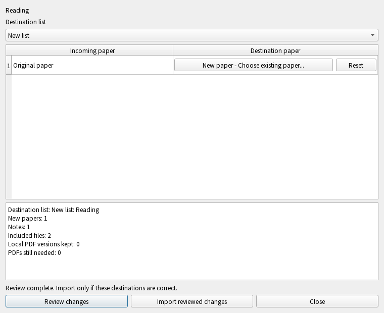

# Importing a list package into an enrolled workspace

This service is a bounded import operation, not first enrollment, cloud sync, a
workspace backup, or an AI job. Existing desktop/CLI calls to `bundle.import_`
use it when commit-time research capture is installed. An incomplete or broken
capture binding fails closed; it never falls through to the legacy SQL importer.
The existing unbound/reader-only import behavior remains separate.

## API and review boundary

```python
service = PackageImporter(database, data_root, current_path=current_database)
prepared = service.prepare(archive, ticket=ticket)
preview = prepared.preview()
result = service.apply(prepared, ticket=ticket)
```

Run preparation/application in a worker. Preparation inspects a fixed archive,
checks bounded content, builds typed graph operations, stages included bytes,
and captures target observations. It does not upload, contact a provider, change
the active PDF, or commit research. The preview exposes the old package ID to
receiver-local and portable paper mapping, destination list, PDF conflicts,
research counts, and omitted reproducible files. Staging may leave private
immutable cache bytes; that alone grants no applied ownership.

`import_package(database, data_root, archive, **options)` is the shared one-shot
entry and rejects concurrent repeated activation for the same archive path.
Callers that expose previews must retain the prepared object and its ticket;
cancellation before publication wins over the final commit. Close/workspace
switch must cancel the captured ticket and/or invalidate `current_path`.

An exact archive fingerprint gives retry identity only. It does not identify a
stable list origin across changed ZIP files. The first unknown package can enter
an empty list namespace. In a nonempty workspace, an unknown package requires
`allow_new_namespace=True`, or a reviewed `target_list_id`/`paper_mapping` with
`confirmed_mapping=True`. Mapping values are receiver-local paper IDs; destination
list IDs are the workspace list IDs. Names/titles never establish identity.
The desktop file and sharing-link entry points now open a native review for an
enrolled workspace. Choose a new destination list or an existing active list,
then explicitly pair incoming papers with existing local papers when needed.
Titles are display/search text, never automatic matching authority. Preparation
runs in a worker; only the separate confirmation button applies the reviewed
operation. Changing destinations invalidates confirmation. Broken capture cannot
fall back into the legacy SQL importer. Unbound workspaces retain their existing
import flow.

## Supported research and exact bytes

Within the closed existing package format, the service maps paper metadata,
list membership/order, notes, typed research content (including reference edges,
list pins, reading goals, linked Q&A, and SQL-backed reading annotations), current
PDFs, immutable original PDFs, and editable notes/guide decks with their used PNG
assets. Semantic evidence IDs, quotes, original source hashes and original URLs
are retained. Hashless historical explanation remains provenance-unknown; importing
beside a PDF does not turn it into verified analysis.

Included bytes must pass the existing document/artifact verifiers. Original
source publication uses `prepare_source`/`publish_source_in`; activation uses its
exact observed operation and sealed materialized version. A managed current PDF
with a different hash remains in place, and conflicting imported analyses/decks
are skipped and reported even with `replace=True`.

All graph/projected SQL, outbox entries, applied file bindings and the durable
local request receipt commit in one caller-owned transaction. Child/commit failure
rolls them back. A retry with the same request and inputs returns its saved result;
request identity reused with different inputs is rejected. An exact archive seen
on a second device without the first device's local receipt reuses portable IDs
and preserves newer research by default. Deleted targets require a separate
explicit restoration operation; import/replace/retry cannot revive them.

A result of `applied_locally` means only local commit. It has
`remote_sync="not_requested"`; remote availability requires normal authenticated
attachment upload plus metadata sync, followed by download/activation on the
other device. `previously_applied` is a historical receipt, with
`availability_rechecked=False`, not a fresh offline-ready verdict.

## Explicit remaining boundaries

- Link-only primary/original PDF records cannot enter this enrolled path until a
  separate verified download step supplies their bytes. Missing declared PDFs do
  not become a complete result. Papers explicitly lacking a PDF are reported in
  `pdf_needed`; their hashless research remains unknown.
- Nonempty legacy research KV caches, nonempty historical ML module metadata,
  edited material-position files, cache-only semantic annotations, unknown tables
  or fields, and annotation deletions without portable history are rejected before
  research writes. They need reviewed typed adapters, not a generic raw-SQL bypass.
- Unused images, extracted text and redundant caches backed by typed annotations
  are listed as omitted derivatives. Multiple original source hashes in one deck
  require a future explicit source mapping.
- A list package is the content selected by its existing exporter. It is not an
  export of every device preference, complete workspace history, reading-state
  surface, provider account, credential or cache directory.
- Updated-package origin negotiation, unowned scientific-result adoption and
  unbound imported-original ownership receipts remain separate follow-ons. Desktop
  mapping/confirmation and explicit native version comparison are locally integrated.

Budgets are 500 papers, 4,000 research rows, 4,096 ZIP entries, 512 MiB compressed
and expanded content, and 8 MiB per metadata file. Existing per-document, deck,
asset and protocol validators add their own lower limits. No provider/network or
background synchronization starts as a consequence of import.


### Source-complete Lineage import (v0.5 development)

The enrolled importer now accepts source-complete Lineage packages through the
same public bundle entry. It maps all selected peers and prepares their exact
original versions, independently of the current primary PDF. A byte-validated
package lease fixes scientific content; sealed file proofs grant the exact bytes.
Source publication, the typed report operation, local research and the import
receipt share one transaction. Missing/corrupt PDFs, stale preview targets,
cancellation and late failure cannot partially replace research.

The preview/result includes `lineage_reports` and `lineage_reused`. An identical
native report can be reused after rechecking its saved SQL content. A different
saved report requires the [explicit version comparison](lineage-import-comparison.md),
including when `replace=True`. The desktop destination/mapping and native version
choice UI are now integrated locally. Unowned/removed reports still require their
separate adoption/restoration; Keep current does not silently enroll them.
Import does not start AI calls or remote sync. [Scenario map and evidence](testing/enrolled-lineage-import-candidate.md).


## Desktop destination review (v0.5 development)

1. Open **Import research package**, from a local file or a sharing link.
2. Keep **New list**, or select the actual existing destination. Each incoming
   paper remains separate unless explicitly paired with an existing paper.
3. Use **Choose existing paper** to search its title or exact local ID; choose a
   result explicitly. Reset removes that pairing. Long titles have bounded labels
   while the underlying exact target ID is retained. Search offers up to 50 active
   matches after lifecycle filtering; this does not enable paper deletion.
4. Select **Review changes**. The preview shows readable counts and PDF conflicts,
   not internal operation IDs or JSON. Review does not commit research.
5. Select **Import reviewed changes** to save. Ordinary sync follows its own
   connection/consent settings; import itself starts no upload or model call.

Canceling the paper picker preserves the current preview. Changing a mapping or
destination requires another review. Closing while work is active cancels its
publication ticket and waits for the admitted worker before releasing files.
Stale delivered previews cannot enable confirmation in another workspace. If
commit already won before a workspace switch, the dialog reports local success
in the original workspace without navigating the new workspace.

A changed archive must be reopened: its old target choices are not applied to
new package contents. Different native Lineage reports open a read-only comparison
before explicit choices and final confirmation. Unowned/removed reports remain
protected; this dialog does not bypass separate adoption or restoration.



### Worker-owned review API

- `PackageReview(database, data_root, archive, *, current_path=None)` binds one
  existing enrolled/captured receiver and archive.
- `inspect(ticket=None) -> dict` validates the archive and returns its name,
  incoming paper IDs/titles and active destination lists; no research commit.
- `search(query: str) -> dict` returns up to 50 active local paper IDs/titles/year
  and a `more` flag. Query length is at most 200 characters.
- `prepare(*, target_list_id=None, paper_mapping=None, ticket=None, lineage_choices=None) -> dict` stages
  the maintained import and returns a readable preview contract. Its archive
  fingerprint and observed destinations must remain current.
- `apply(ticket=None) -> dict` publishes only that prepared operation through the
  same transactional importer and retry receipt as other entry points.
- `close()` cancels the currently admitted ticket; a completed publication cannot
  be retracted. `discard()` removes private staging and must run after work drains.

Run inspection/search/preparation/application/discard on the owned worker. The
desktop dialog serializes these tasks and rechecks receiver identity at GUI
delivery. See [concrete behavior cases](testing/package-review-scenarios.md).
