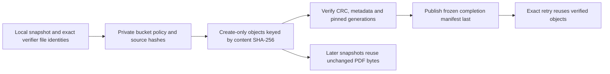

# Publish a reviewed authority backup to private GCS

Status: local v0.5 operator implementation with simulated-cloud tests. No GCP
project, credentials, bucket, IAM, upload, VM or schedule has been configured or
used by this checkpoint. This is separate from ordinary desktop research use.

## Headless operator setup

From a source checkout, use one command for the operator environment:

```powershell
.\scripts\setup-sync-service.ps1
```

```sh
bash scripts/setup-sync-service.sh
```

Both use the checked-in lock to create/update `.venv-sync`, install only the base
and GCP operator extra, and show offline CLI help. They leave the desktop `.venv`
separate. They do not initialize research/service state, discover cloud credentials,
log in, upload or enable a service. Windows setup environment routing is exercised
with a fake package installer in a disposable checkout; actual network installs,
POSIX setup and installed/server acceptance remain separate gates.

The optional `gcp` extra contains google-cloud-storage and google-crc32c; exact
versions are in `uv.lock`. SDK 3.17.1 / CRC 1.9.0 signatures were inspected locally.
Development dependencies include these SDKs for regression tests. Ordinary
client runtime dependencies do not, and the desktop build configuration excludes their module
namespaces. A packaged CLI without the operator SDK returns a bounded failure;
use the source operator environment for publication. No installer was rebuilt.

## Explicit publication

First create and inspect a [local authority backup](sync-authority-backup.md).
After the operator approves the exact project, bucket, location, access and budget:

```sh
.venv-sync/bin/python -m paper_daily sync-admin upload-backup --input "$HOME/.paperfact-sync/pilot-authority-backup" --bucket REPLACE_WITH_PRIVATE_BUCKET --prefix paperfact/authority-backups --seconds 300
```

On Windows replace `.venv-sync/bin/python` with `.\.venv-sync\Scripts\python.exe`.
The uppercase bucket is intentionally a placeholder; replace it with the approved
actual bucket name. No default bucket or project is inferred from Slides OAuth
or an AI account. The SDK uses the separately configured operator ADC/project;
prefer the approved VM service account, not a desktop service-account key file.
The command never logs in or changes IAM/bucket configuration itself.

Success is one stdout JSON receipt: `state=published`, snapshot SHA-256,
`remote_prefix`, `object_prefix`, verified logical file/byte counts, and newly
acknowledged/reused file counts. Progress is bounded categorical JSON on stderr,
throttled to actual counters, without research contents, object names or tokens.
Use `--quiet` for a scheduler/log consumer. Counts are not transfer speed, billing,
percentage or ETA; reuse also includes verification after an uncertain ACK.

| Option | Requirement/default |
|---|---|
| `--input DIRECTORY` | Required verified private authority snapshot, not a list ZIP or active research DB |
| `--bucket NAME` | Required explicitly approved existing private bucket |
| `--prefix PREFIX` | Default `paperfact/authority-backups`; bounded plain path segments |
| `--seconds NUMBER` | Default 300; positive and at most 300, cooperative work budget |
| `--quiet` | Suppress progress records; keep final stdout receipt/errors |
| `--help` | Offline usage; no state/account/cloud action |

Errors return 2 with a bounded next-step message. Existing remote objects are not
overwritten. Preserve the unchanged local snapshot and retry it to verify/reuse
already completed objects. SDK resumable transfer/retry operates within a call;
this implementation does not persist a resumable-upload URL across process restarts.
A new process skips completed content and restarts an unfinished object.

## Content-addressed cloud layout



Cloud layout version is `paperfact-authority-gcs-v1`:

```text
PREFIX/objects/SHA256
PREFIX/snapshots/MANIFEST_SHA256/manifest.json
```

The final object contains the exact local manifest bytes. Its existing validated
relative paths still determine local materialization; each entry's SHA-256 selects
a shared cloud object. Sharing cloud bytes is not a device/source ownership grant.
Only the operator service account reads this private bucket; desktop/mobile clients
use the authenticated sync authority, not these storage paths or public URLs.

Local SHA-256 and file identities are checked before transmission; the SDK uses
CRC32C validation. Every creation requires generation 0; an existing or concurrently
created object must match size, CRC, role and hash metadata. Before the completion
manifest, prior object generations and local inputs are checked again. The manifest
is transmitted from frozen owned memory, so late input-path replacement cannot
change the completion bytes. If a response is lost or local inputs change after
remote completion, the command may report failure even though a valid completion
exists: re-verify/retry the same unchanged snapshot rather than deleting it.

Two distinct snapshots can reference one exact PDF object while retaining separate
authority databases/manifests. No garbage collection or deletion is implemented.
Never add object expiration/pruning until every retained manifest reference has
been accounted for; deleting shared objects would break multiple snapshots.

## Access, privacy and remaining operational work

The bucket must explicitly report public-access prevention=`enforced` and uniform
bucket-level access enabled. Inherited/unknown policy is refused. The command checks
policy before data and before completion, not continuously against a privileged
operator changing policy concurrently. Review effective IAM separately. The adapter
needs approved bucket metadata read, object read and object create permissions;
it never sets policy or asks for broad object overwrite/delete permissions. The
SDK may attempt cleanup on upload corruption; limited permissions can leave a
bad orphan that requires reviewed operator cleanup, never blind overwrite.

Backups contain private research and device token hashes. Keep operator access,
connection records, list sharing and optional diagnostics/analytics separate.
No ADC key, raw prompt, answer, paper text or cloud error response is printed or
added to Git. Cloud storage is not application-level end-to-end encryption; the
bucket operator can access the data. A malicious same-user filesystem/cloud
administrator is outside the integrity boundary. Hash metadata is not a signature.

The [manual unit template](../deploy/gcp/paperfact-backup-upload.service.example)
is inert and has no timer. Adapt its paths/bucket on an approved host, then run
systemd validation and an isolated upload/download/restore rehearsal before enabling
anything. It does not capture snapshots, apply retention, create IAM or establish
an RPO. Regular capture, retention/storage budgets, remote fetching, real GCS
metadata/CRC behavior, restore and installed-device acceptance remain required.
Do not turn the proposed hourly backup target into a promise based on mock tests.

## API and evidence

`sync_gcs_backup.publish(snapshot, bucket_name, *, prefix=PREFIX, seconds=300,
cancelled=lambda: False, progress=lambda value: None, client=None) -> dict`

`client` is an internal test seam, not a configurable endpoint. Production emulator
redirection is refused. Credentials/HTTP flushes are not hard real-time operations;
cancellation and budget checks occur between local/chunk/RPC boundaries. Partial
objects can survive cancellation; a published completion cannot be retracted.

[Scenario map](testing/gcs-backup-scenarios.md) records mock-cloud, actual
snapshot/toolchain checks and real SDK multipart/resumable code over in-memory HTTP. It does not prove live GCP or full v0.5 release readiness.
The adapter follows the official [Blob upload/reference](https://docs.cloud.google.com/python/docs/reference/storage/latest/google.cloud.storage.blob.Blob)
and [retry guidance](https://docs.cloud.google.com/storage/docs/retry-strategy).
Policy requirements are described in [public-access prevention](https://docs.cloud.google.com/storage/docs/public-access-prevention)
and [uniform access](https://docs.cloud.google.com/storage/docs/uniform-bucket-level-access).
These vendor mechanisms support the implementation; the commit-last/deduplication
layout and private single-owner pilot policy are Paperfact design choices.

## Retrieval

Retain the publication receipt and use its exact manifest digest with the [verified retrieval command](gcp-backup-retrieval.md). Local SDK transport tests now cover publication, retrieval and fresh-workspace recovery; real cloud restore remains unverified.
