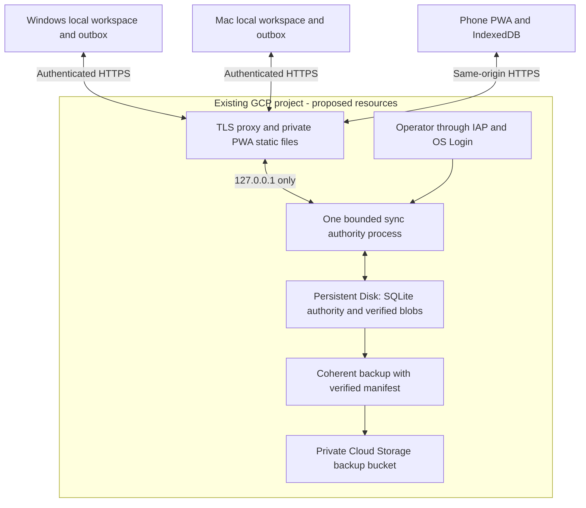

# GCP private sync pilot proposal

Status: proposal, 2026-11-13. The owner selected reuse of the existing GCP project
for planning only. No cloud account, billing, DNS, IAM, resource or deployment was
changed or inspected. The local SDK project preference was read; its candidate
has not been confirmed as Paperfact's target and is not embedded in public docs.
Target project ID, approved region, hostname and budget remain unconfirmed.
This is not authorization to apply infrastructure or upload research.

## Recommended first deployment

Engineering recommendation: one Compute Engine VM, one dedicated durable data
disk, a TLS reverse proxy and one local sync authority process. Serve the private
PWA and /v1 API from the same HTTPS origin. Use Cloud Storage for independent
backups initially. This matches the current SQLite transaction/file model while
preserving the future Cloud Run path. It is a single-user pilot, not a public
multi-user service or high-availability design.



The desktop may be off while the Mac/phone synchronizes against the VM. Every
client retains local research and pending writes while the VM is unavailable.
This architecture does not itself prove the installed-device journey works.

## Delivery phases and acceptance

The deployment and the app release are separate deliverables. A running VM is
not evidence that every research feature is synchronized.

| Phase | Deliverable | Acceptance before proceeding |
|---|---|---|
| 1. Review | Project/region/hostname/budget record, resource inventory and regional estimate | Exact target project confirmed; existing OAuth and unrelated services identified and left unchanged |
| 2. Prepare | Reviewed infrastructure configuration, pinned server/PWA artifact, TLS configuration and backup/restore scripts | Full application gate for that exact artifact; Linux mount-loss/restart and private credential tests; no real research required |
| 3. Isolated pilot | New service identity and separate Windows/Mac fixture workspaces | Changes converge after offline edits, interrupted upload resumes, conflicts remain visible, duplicate retries do not duplicate content |
| 4. Recovery | Independent backup and isolated restore rehearsal | Manifest and referenced files verify; old client cursors cannot silently attach to rolled-back history |
| 5. Owner use | Explicitly enrolled personal devices and selected research workspace | Apple Silicon installed-app journey recorded with versions/checksums; enable background sync only after review |

At the current checkpoint, the plan and local administration helpers exist.
Public HTTPS hosting, coherent automated backups, Linux operations, cloud
provisioning and installed-device acceptance remain unverified. Some newer
research paths still need UI, package-adoption and installed-device acceptance.
Native Lineage publication now has local two-workspace journal, source-transfer,
conflict and HTTP/mobile integration evidence; this does not certify the hosted
service or complete research synchronization. See the continuation ledger for
exact evidence and the remaining release gates.

## Intended everyday workflow

1. Windows connects to the private HTTPS service using its own device record.
   The user reviews the workspace and explicitly enables background sync.
2. Mac joins the same remote workspace with a different device identity. It pulls
   research metadata and verified attachments; the UI distinguishes pending,
   transferred and available content rather than calling everything complete.
3. Reading and edits remain local while offline. On reconnection, pending changes
   retry automatically; conflicting edits require an explicit choice instead of
   silently replacing one device's work.
4. Both desktop apps may be closed while the service stays available. Background
   synchronization runs while an app is running; this proposal does not install
   an always-running desktop daemon or promise synchronization after app exit.
5. The phone opens the same HTTPS origin as a PWA. Its supported reading/editing
   scope is recorded separately from desktop capabilities. Browser background
   execution is not assumed; verify convergence when the PWA is reopened.

The sync service holds research and attachment state. Each device keeps its own
AI account credentials and model configuration. App updates, diagnostics and
optional feedback remain separate services and consent flows.

## Why the current service is not a Cloud Run image yet

Cloud Run's writable container filesystem is ephemeral and memory-backed; it
cannot be the durable SQLite authority. See the official
[container contract](https://docs.cloud.google.com/run/docs/container-contract).
Cloud Storage FUSE lacks filesystem locking and has different semantics; Google
advises against using it as a database backend. See the
[FUSE limitations](https://docs.cloud.google.com/storage/docs/cloud-storage-fuse/overview).
The resulting design inference is to avoid putting this SQLite database on a
FUSE mount or assuming max-instances=1 makes container storage durable.

Cloud Run remains a possible later architecture, with an actual PostgreSQL
transaction adapter in Cloud SQL and an immutable object adapter in GCS. The
clients can retain the same protocol. This requires preserving per-workspace
revision allocation, operation uniqueness, receipts, conflicts, authorization and
blob publication under concurrent instances. A process-local lock is insufficient.
Cloud SQL supports Cloud Run connectivity, but it is not a drop-in replacement
for the current SQLite-specific SQL and connection lifecycle. See
[Cloud Run to PostgreSQL](https://docs.cloud.google.com/sql/docs/postgres/connect-run).

## Proposed resource envelope

Values below are review defaults, not provisioned resources or a measured capacity.

| Resource | Pilot proposal | Confirmation required |
|---|---|---|
| Project | Existing owner-selected project; new resources use a Paperfact-specific prefix | Exact project ID, billing and existing IAM policies |
| Region | Prefer asia-east1 for the owner's Taiwan workflow, unless existing resources/residency favor another region | Region, zone and quota |
| VM | One e2-small, non-Spot, ordinary Linux LTS, single authority process | Benchmark memory/CPU with representative research and concurrent transfers |
| Boot disk | 20 GB, replaceable; no research state | Image and patch strategy |
| Data disk | 50 GB balanced Persistent Disk, ext4, single writer, deletion protection | Actual PDF/asset inventory, headroom and growth |
| Hostname | One owner-controlled sync hostname | DNS control and TLS issuance |
| Public ingress | HTTPS 443; port 80 only if certificate issuance requires it | TLS proxy, renewal and firewall rules |
| Administration | IAP/OS Login; no public SSH rule | Least-privilege operator identity |
| Backup | Private regional GCS bucket; uniform access and public-access prevention | Location, retention and restore runbook |
| Logs | Bounded route/status/latency and categorical failures | No tokens, headers, bodies, research text or raw tracebacks |
| Budget | Alerts and explicit workload/storage/egress caps | Approved monthly limit and current regional estimate |

Taiwan region location is documented in
[Compute Engine locations](https://docs.cloud.google.com/compute/docs/regions-zones).
Persistent Disk supplies durable block storage; see
[Persistent Disk](https://docs.cloud.google.com/compute/docs/disks/persistent-disks).
Administrative IAP SSH is documented in
[IAP connections](https://docs.cloud.google.com/compute/docs/connect/ssh-using-iap).
Bucket policy references:
[uniform access](https://docs.cloud.google.com/storage/docs/uniform-bucket-level-access),
[public-access prevention](https://docs.cloud.google.com/storage/docs/public-access-prevention).

## Work required before a private pilot

1. Freeze and validate the application candidate, then produce a signed or
   checksum-pinned server artifact. The earlier frozen candidate passed its full gate; subsequent changes still
   require a new coherent full gate.
2. Adapt the [review-only systemd template](../deploy/gcp/paperfact-sync.service.example)
   and tested `serve --require-mount` startup guard. Verify the unit on Linux with
   an unprivileged service account, supervised
   restart and graceful stop. Require the data mount before startup; a missing
   disk must stop startup rather than create an empty authority on the boot disk.
3. Keep the existing HTTP listener on loopback. Add a reviewed TLS proxy with
   bounded request/header sizes, connection limits and rate limits tested against
   real bootstrap/resumable-transfer traffic. Never remove client URL validation.
4. Serve the exact versioned static PWA and /v1 paths from one HTTPS origin.
   Verify service-worker updates, response framing, caching and browser origin
   behavior end to end. The reference Python HTTP adapter is not certified for
   direct internet exposure.
5. Issue each device a distinct identity through trusted local administration.
   Transfer its private connection record only to that device. Verify it in the
   desktop, join a separate workspace where required, then explicitly enable
   background sync. No implicit migration/upload from merely loading a record.
6. Add service/disk monitoring and a coherent backup exporter. Disk-full,
   permission, partial upload and restart errors must retain client outboxes.
7. Prove disaster recovery without pretending a rolled-back authority is current.
   Detect a client cursor ahead of recovered history and refuse silently dropping
   it. Until a recovery-epoch protocol is implemented and verified, recovery into
   a fresh service/workspace identity with explicit client re-enrollment is the
   conservative runbook; do not reset cursors or reuse old sequences automatically.
8. Execute the full Windows -> offline Mac -> reconnect -> phone note -> Windows
   journey with two conflicting edits, interrupted large files, device revocation
   and a separate restore. Record the actual installed versions and checksums.

Items 2-8 are deployment/acceptance work, not claims that infrastructure is ready.
The existing sync-admin commands initialize, issue and serve locally; they do
not create the cloud resources or harden the public edge.

## Identity and privacy boundary

- GCP operator identity, sync device credentials, AI accounts and Google Slides
  OAuth are separate. Reusing a project does not reuse one identity for all four.
- Keep existing OAuth/API setup untouched. No AI credential is sent to the sync
  service, and synchronization never invokes a model.
- Use a dedicated VM service account with bucket-scoped backup permissions. Avoid
  long-lived GCP JSON keys on desktop clients or in the repository.
- TLS and provider disk encryption do not mean end-to-end encryption. The server
  operator can access research. Disclose that before enabling remote sync.
- Device revocation stops future service access; previously downloaded copies
  remain on that device. Detached research backups do not reactivate its identity.
- Research packages and diagnostics remain separate from cloud sync credentials.
  Feedback/analytics consent is independent of research synchronization consent.

## Backup and recovery design

Back up authority SQLite, blob-index state, referenced immutable bytes and a
hash-verified manifest as one recoverable set. A raw copy of a live SQLite file
can omit WAL changes; use an explicit short write pause and SQLite backup APIs,
then validate the captured set before uploading. Upload immutable backup objects
and publish the complete manifest last. Do not implement storage garbage
collection until verified backups/history no longer reference the objects.

A proposed initial target is hourly backups, with a 24-hour local window, seven
daily and four weekly independent retained sets. This is a target to size and
test, not an achieved RPO or retention promise. Restore into a separate test
VM/disk, verify all hashes and retained conflicts, and exercise the recovery
identity/cursor rule above. A disk snapshot alone does not prove application-level
consistency across authority and blob metadata.

## Cost worksheet and controls

No fixed monthly quote is claimed: the project, discounts, region, traffic and
research size have not been inspected. Estimate before provisioning using current
[Compute pricing](https://cloud.google.com/products/compute/pricing),
[general-purpose VM pricing](https://cloud.google.com/products/compute/pricing/general-purpose),
[network/IP pricing](https://cloud.google.com/vpc/network-pricing),
[Cloud Storage pricing](https://cloud.google.com/storage/pricing) and the
[Google Cloud calculator](https://cloud.google.com/products/calculator).

```text
monthly estimate = VM running hours + boot/data disks + external IP
                 + internet download traffic + backups/storage operations
                 + DNS/TLS infrastructure + retained logs
```

Start without a paid load balancer or Cloud SQL for this VM proposal; adding either
requires a new estimate. Regular alerts-only budgets are not spending caps. Check
whether any newer spend-cap mechanism covers the actual selected project/service;
never assume it covers VM, disks, IP, egress and backups together. Official references:
[budgets](https://docs.cloud.google.com/billing/docs/how-to/budgets),
[spend-cap scope](https://docs.cloud.google.com/billing/docs/how-to/budget-api-spend-cap).
Use application quotas and upload limits alongside financial monitoring.

## Required owner inputs before an executable deployment plan

- Project ID and whether its billing/IAM policies permit a private pilot.
- Region/zone approval and an owner-controlled hostname.
- Monthly budget ceiling, estimated stored GB and monthly download GB.
- Backup retention and who may operate/recover the service.

Do not infer these from an OAuth client secret or personal account email. The next
artifact should be reviewed infrastructure configuration and an exact regional
estimate, with resource creation a separate approval step. Continue local tests
while those inputs are pending; no production migration is implied.


## Local backup preparation checkpoint (2026-11-14)

The candidate now implements [bounded local authority backup export and read-only
inspection](sync-authority-backup.md). This supplies the snapshot/committed-object
capture seam in the backup design above. It does not supply GCS upload, timers,
retention, isolated restore, fresh recovery identity or Linux/cloud acceptance.
Hourly backup/RPO targets above remain proposed, not operational promises.


## Local recovery preparation checkpoint (2026-11-14)

The [fresh-identity restore command](sync-authority-restore.md) now reconstructs
one selected snapshot workspace in an isolated local service. It replays validated
events, verifies original accepted/conflict outcomes, rebuilds blob indexes and
requires new device enrollment. This advances the local recovery seam; it does
not deploy/recover a VM, publish GCS backups, automatically migrate old pending
client work or certify physical-device/hosted acceptance.


## Private object-publication adapter checkpoint (2026-11-14)

The [source-only operator uploader](gcp-backup-publication.md) now implements
private bucket checks, create-only verified shared objects and completion-last
snapshot manifests. Isolated tests use actual local snapshots and simulated SDK
calls; no cloud credential or resource was used. The paired setup scripts create
an independent headless environment. The manual unit template is review-only,
without a timer, capture/retention job or achieved RPO. Project/region/budget,
real GCS fetch/restore, TLS/VM operations and installed-device gates remain open.

### Local retrieval preparation

The operator can now retrieve an exact private GCS snapshot into a new directory, with generation-pinned SHA/CRC verification and normal authority closure checks before completion. [Workflow](gcp-backup-retrieval.md). This closes the local download implementation gap; live cloud recovery, retention, scheduling, target configuration and installed-device gates remain open.
