# Explicit grounded-lineage producer checkpoint

This includes a reusable production **core**, staged native projection, public
unbound list packages and mobile readers/consumers, not a complete v0.5 workflow.
The [desktop research-lineage action](lineage-reader.md) now connects source
selection, the admitted job, local/native publication and exact-original viewing.
Reviewed stored-result/package adoption remains unfinished. The
shared task registry now includes `lineage`, and strict native journal/service
admission is implemented with focused integration evidence. The implemented retention, source ownership,
package and mobile boundaries are described below with their remaining gates.
Research-task question templates alone do not implement this workflow. Rejected
historical hooks are not copied or used as an alternative execution path.

`lineage_jobs.LineageJob.prepare` takes one actual `CorpusSnapshot` and an existing
`FrozenRoutes` value explicitly declaring `lineage`. It refuses an Ask-only map,
an undeclared/default fallback and backend `none`. Callers declare `lineage` in `llm.freeze_connections(("lineage",))`; the existing
AI task settings page can save a per-task account/model override or inherit the
global choice. An undeclared FrozenRoutes task remains an error. There is no route discovery, login or provider probe on prepare.
The facade receives the captured account/configuration and `task='lineage'`.
Credentials, account directories, source text and the route map are excluded from
job repr and report metadata. Future UI must show current intent separately from
the completed run's requested/returned models, leaving absent returned IDs absent.

## Core behavior and limits

- Prepare, run and result `current()` require a worker. Report/execution getters
  return defensive JSON copies without SQL, parsing or model calls.
- The selected corpus is exactly the existing one-to-four sources, focal first.
  Its current database identity, binding, paper lifetimes, selected identities and
  original byte ownership are checked before spending a call. The focal original
  is mandatory; a missing selected peer remains explicitly unavailable.
- Full bounded normalized page inputs come from `research_lineage.pages`; sources
  are not omitted or silently truncated to fit. The existing 64 MiB/96-page and
  240 KiB input-text limits apply. The total prompt cap is at most 256 KiB.
- One explicit facade completion is allowed. The requested output limit defaults
  to 4,000 tokens, may be explicitly chosen up to 8,000, and must fit the captured
  configuration. Invalid/insufficient limits refuse; no clamp occurs. This is a
  requested facade limit, not a universal provider billing/output guarantee;
  existing CLI adapters do not enforce the token setting. The local returned-text
  cap remains 200 KiB regardless of provider behavior.
- A job has a nonblocking single-flight guard; another call while it runs reports
  `already_running`. An existing database/corpus job lock also refuses simultaneous
  duplicate jobs. A successful repeated call returns the cached result. A failed
  attempted completion or malformed reply requires an explicit new job, never an
  automatic call. An unusable reply is released after its first validation error;
  the next run refuses with `explicit_new_job_required`.
- Cancellation before the call spends nothing. A completed response can remain
  privately bounded while quote verification stops. An explicit verification
  retry uses that response, spends no additional call and stays retained after
  cancellation. It does not turn Stop into automatic reactivation.
- Closed proposals pass the existing duplicate-key/nonfinite/schema/reference
  checks. Quotes are checked against the sealed original snapshots. Missing or
  ambiguous quotes stay missing/ambiguous; locating words does not certify the
  proposed interpretation. Relation citation identity remains unresolved and
  semantic validation remains not performed, even if a proposal says supported.
- Source, parent, account-route or supplied view-lifetime changes after completion
  produce an explicitly retained result. Such a result is nonadmissible for new
  installation. No result in this checkpoint is written or installed. Retention
  after a detected change is sticky for that job; returning to the old selection
  cannot silently restore admission.
- `result.current()` checks source ownership only. It does not depend on future
  model preferences and is not permission to publish or deliver into a GUI. An
  already held report keeps its original text/models when next intent changes.
- The `current` callback is a seam for an actual native/window epoch lease, not
  a native-PDF witness manufactured by this core. Backend tests exercise the lease
  callback and real PDF, parent and DocumentReader invalidations. Real Qt load/
  source/view/draft delivery acceptance still belongs to the later UI slice.
- Captured route/configuration does not detect an external vendor login change
  inside an unchanged CLI credential home. No credential-store probing, login or
  account verification is performed or claimed here.

The core retains no SQLite handles, invokes no search/download and writes no
research rows. Its explicit job lock uses the maintained `.research-jobs`
namespace. Schema-valid, quote-checked reports are retained as private candidates;
this does not install a canonical report or grant publication authority. A bounded
raw completion cancelled before quote verification still remains process-owned;
durable pending-verification recovery is a separate remaining case. Replay-safe
canonical publication and full preservation remain follow-on work.

## Durable original observations (2026-11-13 continuation)

Before its first model call, `LineageJob.run` now retains every available selected
original through `lineage_source_snapshots.retain(corpus, *, corpus_id, request_id,
cancelled=lambda: False) -> list[dict]`. This worker-only function uses the sealed
actual corpus, validates all receipt metadata first, checks current owners before
and between writes, and publishes each original/receipt pair through the existing
atomic private-source mechanism. Missing peers produce no invented PDF or receipt.
It never publishes a canonical lineage row, synchronization operation, active
source-owner association or provider credential.

`LineageJob.prepare(..., corpus_id=None)` accepts a canonical corpus UUID for an
explicit existing corpus; otherwise it creates one. The execution metadata returns
that UUID independently of the per-attempt request UUID. Repeating the same job
retains exact receipt identities. An explicit new attempt preserves a distinct
observation even when the selected bytes and corpus UUID are unchanged.

The closed private format is `paperfact.lineage-source-observation.v1`. It records
the actual source paper/lifetime, focal paper/lifetime, corpus and request UUIDs,
evidence source ID and selected bibliographic identity, source-owner ID, database
identity and workspace binding. The evidence ID must reproduce from that exact
identity and PDF hash; a focal paper cannot claim two different lifecycle epochs.
Its hash-addressed request also binds the PDF hash and size. These are archive
observations, not a new implementation of the proposed active
`paperfact.lineage-source-owner.v1` contract below. In particular, they do not
claim a current paper/original graph incarnation or authorize a claim lookup.
The claim original resolver explicitly rejects this format as owner authority.
First-enrollment inventory carries these bytes as archive-only, so neither claim
nor live-Q&A source fallback can promote them by hash alone. Explicitly selecting
an actual primary PDF remains a separate supported action.

A source-retention failure spends no model call; retry can repair a lost file
publication acknowledgement. Cancellation can leave complete private pairs but
never a half-published pair or active research row. Once a completion was attempted,
the existing explicit-new-job rule remains unchanged. The ordinary independent
backup includes these typed observations and exact immutable PDF objects; detached
restore retains them as historical recovery records without reviving owners,
devices or jobs. Completed schema-valid reports now also use the private candidate
channel below. These original pairs do not grant the active ownership required
for canonical publication or make Lineage shared or visible in a dedicated UI.

## Durable private proposal results (2026-11-13 continuation)

After quote/schema validation, a job prepares a sealed native candidate and retains
it through the existing `research_generation_requests`/owned generation-sidecar
channel. It always has status `candidate`, never `accepted`. The closed context
format is `paperfact.lineage-proposal-context.v1`; it binds the original corpus,
ordered source paper/lifetimes, every available typed original observation, report,
requested/returned model IDs and original-only input recipe. It explicitly has no
observed canonical target or publication permission. Generic main-key generation
remains closed and cannot publish a `paper_lineage_sets` row.

A replaced or rebound database receives no old candidate SQL. The owned sidecar
retains the original request/path/binding as provenance. Sidecar paths are fixed by
the maintained generation recovery namespace; serialized provenance never chooses
a restore destination. The generic reader filters scope as before. Independent
backup validates every required original and includes source pairs from the actual
retained requests, including an earlier native database identity at the same path.
Missing/corrupt bytes block creation. Detached restore keeps records as historical
recovery data, without activating a device, source owner or producer.

A save error preserves the in-memory completed result. Retrying the same job
reuses its prepared record and does not call the model again. Concurrent native
retention retries keep one exact SQL receipt. After a commit-acknowledgement error,
the persister checks the exact committed request before creating a sidecar.
Request ID reuse with different data refuses. Already retained job results are
cached without re-running persistence on each read.

The existing retained-work review can display and explicitly export these proposals,
with apply/edit/target-selection blocked pending corpus-aware publication. Its
text export includes validated scientific statements, judgments and quoted source
titles; it omits private context/route/owner metadata. Exported research text can
still be sensitive. Opening saved data never runs AI. This is not the dedicated
saved-first Lineage researcher interface required below.

| API in `lineage_candidates` | Contract |
|---|---|
| `prepare(corpus, report, execution, receipts, *, started_at, reason=None) -> PreparedCandidate` | Worker-only native capture; supplied report sources must equal the sealed corpus. |
| `persist(prepared) -> research_generation.Publication` | Worker-only exact candidate save; refuses altered native proofs and foreign SQL targets. |
| `saved(database, paper_id) -> list[dict]` | Worker-only bounded read of saved SQL/owned-sidecar proposals, with no model or writes. |
| `validate(record) -> dict` | Closed archive validation; cannot grant accepted authority. |
| `originals(record) -> list[dict]` | Validated exact PDF size/hash descriptors. |
| `source_receipts(database, conn) -> list[dict]` | Bounded original observations for independent backup from the caller's research snapshot. |
| `export_content(row) -> dict` | Whitelisted readable report content, without private execution context. |

`PreparedCandidate.record` returns a defensive copy. Deserializing a saved record
cannot create this process's native retention proof. `LineageResult.execution`
reports `persistence='candidate'` and `candidate_id` only after retention succeeds.
The candidate is not a successful canonical installation, and it is not an
observed target for automatic replay. Fresh corpus/target/source checks remain
required when the explicit publication/review workflow is implemented.

## Staged shared-operation contract (2026-11-13 continuation)

`lineage_wire` now validates a complete portable payload and v2 operation, while
the live journal/service registry remains unactivated for Lineage. Importing or
using this codec does not install SQL schema, register a task, publish an operation
or start a model. The ordinary `sync_journal.canonical_operation` still refuses
this new domain. This separation is a deliberate activation boundary until the
canonical writer, all-source ownership and every preservation/receiver path close.

The v2 envelope header and final UTF-8 byte budget are shared with the maintained
validator rather than approximated with another operation kind. The active
validator's optional field set and default behavior are unchanged. The staged
operation requires a closed `content_address={feature: lineage, key: corpus UUID}`
for both put and empty delete. Its focal scope/key, row source hash, focal original
hash, timestamp, complete typed report and ordered portable bindings must agree.
The full inline payload is bounded, without truncation.

Sender and receiver conversion uses only already registered paper identities and
actual existing paper rows; it never invents a mapping. It preserves the report,
quotes, evidence IDs and model metadata. These conversion functions provide data,
not parent-lifetime observations or publication authority. A publisher must supply
its actual coherent SQL transaction and separately validate the observed target,
parents, exact originals and native view/source leases.

Accepted and pending graph overlays preserve the typed corpus address. They reject
stripping/changing the known address before mutation. Each selected paper lifetime
participates in conflict checking; equal PDF hashes do not merge paper ownership.
A known corpus keeps the ordered paper identities captured under its UUID. UI
adapters should reuse the saved order for an unchanged selection; a different
selection/order needs a new corpus identity. Explicit restoration may use fresh
incarnations of the same ordered paper IDs, with the normal graph lifecycle rules.
An unavailable original still has a paper parent but no invented file requirement.

| API in `lineage_wire` | Contract |
|---|---|
| `validate_payload(payload) -> dict` | Complete portable Lineage content, with exact row/corpus/source metadata and size limits. |
| `encode_row(conn, row) -> dict` | Registered sender identities only; no writes, downloads or identity minting. |
| `decode_row(conn, payload) -> dict` | Registered existing receiver owners only; no projection or write permission. |
| `parent_identities(payload) -> list[tuple[str, str]]` | Complete focal-first ordered paper identity closure. |
| `required_originals(payload) -> list[dict]` | Each available paper/source/hash binding, including distinct owners of equal bytes. |
| `canonical_operation(operation) -> str` | Closed staged v2 envelope, typed address and exact ordered parents; not live journal admission. |

The live content/schema registration, caller-transaction publisher, active original
ownership, retained request/capture/package closure, authenticated Lineage HTTP
round trip and independent mobile validation/display remain required. Pure graph
and registered-identity codec tests do not certify those later integrations.

## Proposed shared activation, not changes in this checkpoint

Exact current baseline hashes for these proposed shared paths are in
`build/lineage-activation-beforeimages.json`. A future owner must re-admit those
hashes and agree narrow hunks before editing. No whole-file prototype port is
appropriate.

1. **Task routing:** register `lineage` in `ai_profiles.TASKS` and the existing
   desktop task-choice labels. Capture that task's resolved `FrozenRoutes` at the
   explicit action. Missing selected accounts/capabilities fail visibly, with no
   Ask fallback. Opening saved reports reads only `lineage_sets.saved`.
2. **Observed target:** `research_generation.begin_generation` currently rejects
   keys other than `main`, `_target` selects by one owner column, and its closed
   registry lacks `paper_lineage_sets`. Add a narrow typed composite target
   `(focal paper, corpus UUID)`, exact prior target/absence and each selected
   parent's lifetime/identity/source observation. The existing main-key producers
   must retain their exact behavior. Do not force a corpus into a fake main-key
   claim or broaden arbitrary target/table validation.
3. **Typed publication:** use `lineage_sets.validate/validate_row/source_hash` for
   the body and `lineage_sets.convert` for registered local/portable paper IDs.
   Preserve report evidence IDs and source hashes. The ordered graph parents are
   the exact focal-first bindings (maximum four), not whatever papers share a
   title or PDF hash. `lineage_address` supplies the closed address/known-delete
   rules; registering it must not relax generic parents or infer unknown deletes.
   Exact target/source/lifetime CAS, row, outbox and request/candidate receipt must
   share one caller transaction, including rollback, retry and deletion/restore.
4. **Every original, before activation:** `source_snapshots._owner` is currently
   focal-generation-specific; `local_source_owners._claim/_owner_matches` are
   claim-specific. Calling either with a peer pretending to be the focal paper,
   minting fake claims/generation receipts, or retaining only the focal PDF would
   be incorrect. Add reviewed typed lineage source ownership bound to actual
   corpus, source paper/hash and that paper's captured lifetime. Stage and verify
   every available exact original; grant each ownership beside the lineage row/
   outbox in the publication transaction. Cancelled preparation grants no active
   authority. Missing originals have no invented artifact. Completed stale output
   needs all of its exact originals retained with its candidate provenance.
5. **Saved-first desktop:** add one bounded modeless `Why this paper exists...`
   entry under the existing Research tasks surface. Opening lists saved corpus
   reports without search/model work. The researcher chooses at most three peers,
   sees unavailable originals and current Lineage account/model/budget, then
   generates explicitly. Present the prior gap, current change and later
   development with original words, separate interpretation and unresolved checks.
   Source buttons reuse the approved source verification/navigation contract for
   the actual loaded source/hash/epoch. They do not jump to a desired replacement
   or use an AI title as identity. Preserve question/note drafts, reuse a child on
   repeated open, reject stale paper/account/native deliveries, and drain actual
   workers before accepted close/restart/update releases captures. No new tab,
   settings wizard, automatic corpus search or quality score is needed.
6. **Complete preservation before shipping:** enroll the new table/known state,
   bounded producer/request histories, every peer original and private retained
   provenance in capture, initial enrollment, backup and detached recovery. Export
   packages must include the declared corpus/source closure or refuse before
   output with an actionable explicit include-corpus choice; they cannot silently
   omit peer papers or attach same-hash bytes to another paper. Source A must
   survive while primary B stays distinct. Restore/import maps fresh receiver
   owners and never revives old device/job authority. Previously blocked recovery/
   export hooks remain unapplied pending their separately reviewed exact contract.
7. **Projection, sync and mobile:** register strict typed payload/graph/materializer
   and retained-history validators; preserve active and known-deleted exact corpus
   addresses. Add closed source-preserving snapshot/display projection and exact
   `required_capabilities` union with Inbox, queue pins and positions. Old clients
   refuse unsupported closure before cursor/state mutation. A nonempty lineage
   table must never silently disappear from a snapshot. Mobile independently
   validates/displays reports and authenticated exact original assets; no mobile
   AI execution or fake native viewport support follows from this core.

Required later acceptance includes real observed publication/rollback/retry,
concurrent target edits, peer deletion/recreation, all-source retirement, source
A/current B transfer, independent package/backup/restore and mobile HTTP/offline
round trips. The current backend checkpoint does not close those release gates.

## Concrete ownership seams for the next review

The proposed private `paperfact.lineage-source-owner.v1` can reuse the maintained
`research_local_source_owners` columns, with an explicit closed owner branch:
database identity/binding, actual source paper/lifetime, actual source-owner ID,
focal paper/lifetime, corpus UUID and report source ID. Also capture nullable
exact paper-graph and original-artifact incarnation references when synchronized;
unknown lifetime cannot be replaced with hash equality. The canonical association
must validate `paper_lineage_sets` via `lineage_sets.validate_row`, locate that
exact ordered `source_id/paper_id` binding and require its declared PDF hash.
Retained historical candidates must use archive-only proof, not active ownership.
This is a proposal for review, not a newly accepted private schema in this core.

The actual existing file domain is `sync_source_files.py`, not a new generic
source publisher. Its `encode`, `validate_manifest` and `validate_source_closure`
already describe immutable original bytes under the actual paper graph parent.
Its convenience `publish` owns transactions; calling it repeatedly and then
committing the lineage row would not be one atomic compound operation. The
maintained `PreparedSource`, `prepare_source` and `publish_source_in` already
provide sealed staging and caller-owned installation. Reuse that exact seam for
every peer, with typed lineage row/outbox/receipts in the same transaction; no new
generic installer is needed. The lineage association/observations still require
separately reviewed activation.
Known original retirement must refuse automatic republish or same-hash ABA reuse.
Existing `source_provenance.wrap/retain_in` is archive-only and cannot grant an
active lineage source owner.

The actual closed envelope module is `sync_schema_v2.py`; the package file helper
is `bundle_files.py`, while typed package ownership/publication is in
`package_import.py`. Mobile projection is in `domain.mjs::projection` and typed
row projection in `content.mjs::projectContent`. These exact existing paths are
hash-pinned in the proposal receipt. No nonexistent module or old rejected patch
is treated as an implemented seam.

## Root integration evidence

The exact three-file core handoff was admitted to the isolated integration tree.
The independent helper union passed 169 selected cases; the root then passed all
35 new producer cases with zero skips, Ruff clean and 1,193 admitted inputs
unchanged during that gate. See ignored `build/merge-resolutions/lineage-core-root-result.json` and matching XML.
The six root differences from the fork were four reviewed documentation updates
and the independently tested collector source-isolation pair; production lineage
dependencies were exact. No existing source/test file was replaced.

This original-pages-only producer has not used deep/close reading text. Future
`lineage_sets.inputs.dive/close_reading` must stay null unless a separately
approved recipe actually includes that input. A target compare-and-save observation
is distinct from provenance of model-used material.

These are partial backend checks. Shared activation, native UI, durability and
complete portable closure remain open, and the full application gate is required.

## Pre-call composite-target binding

`LineageJob.prepare(..., publication_observation=observation)` optionally binds the
job to a native `lineage_observation.observe` result captured before model use.
The observation must belong to the identical sealed corpus. Its request/corpus
UUIDs become the job's UUIDs; a conflicting explicit corpus ID is rejected.
The schema is still an explicit prerequisite, never installed by observation.
Existing original-only callers may omit this argument; those candidates have no
publication base and cannot be treated as observed canonical writes.

`target_lease(observation)` captures a still-current worker observation.
`lease_data(lease)` returns defensive original metadata even after the reader
closes; it is retention evidence, not current write permission.
`check_target(lease)` rechecks source owners and SQL/native metadata on a worker.
The job refuses a changed target before making a model call. A change during the
call produces a retained `lineage_target_changed` candidate and leaves the target
row untouched. Source/account/view reasons retain their existing separate meaning.

New private candidates optionally include the closed data-only
`publication_base` descriptor: format `paperfact.lineage-target-base.v1`, request
UUID, corpus UUID, SHA-256 digest of the exact original target row (null if absent),
and SHA-256 digest of the full original observation. The native prepared candidate
also seals its retained lease; swapping in a different observation cannot retarget
it. Old archive candidates without the descriptor remain readable. Deserialized
hashes/records cannot recreate native job or publication authority.

A final publisher must still run `check_in` within the same transaction as source
ownership, canonical content, journal and receipt changes. The pre-call worker
check is not a commit lock. Unbound raw-SQL delete/reinsert that reproduces every
original byte is not an independently tracked epoch; do not claim this descriptor
alone detects that unsupported ABA path. Saved-first UI, canonical publication,
portable closure and mobile activation remain separate release requirements.

## Staged local compound publication

`lineage_publication.prepare(candidate, *, cancelled=lambda: False)` accepts only
an intact native `PreparedCandidate` with a pre-call target lease and no retention
conflict. It verifies every retained original/receipt pair outside the write lock
and captures file versions. It performs no schema changes or SQL grants. A missing
original is an explicit failure, never a primary-PDF fallback.

`lineage_publication.publish_in(conn, prepared)` requires a worker and an existing
caller-owned transaction. It compares the observed composite target and all parent
metadata, then installs the exact `paper_lineage_sets` row, each available original
association in `research_local_source_owners`, and an exact request receipt in
`research_lineage_publications`. A savepoint rolls back the whole compound write
on failure without discarding earlier caller work. The function never commits.
Caller rollback also removes these writes, and a subsequent retry can install them.

The receipt records request/candidate IDs, the exact row JSON and all original
receipt JSON. Identical retries verify the still-published row and every original
association before returning the same result; missing/altered associations or a
changed target refuse acknowledgement. Concurrent caller transactions serialize
through SQLite and do not duplicate rows/receipts. PDF parsing/hashing and disk
publication remain outside the transaction; file metadata is rechecked inside it.
Unavailable selected papers remain in the report/bindings without invented bytes.

Original observations keep their existing archive format. Merely finding one on
disk does not activate an original or grant claim ownership. The compound SQL
association and exact publication receipt are separate evidence; typed Lineage
source activation/readers still need implementation. No generic claim-source
lookup is broadened by this publisher.

This is an unbound-workspace staging seam, not an enabled desktop feature. A real
sync-bound candidate is explicitly refused with
`lineage_compound_sync_publication_required`; it must use one observed transaction
for all peer file operations, Lineage content/outbox and receipts. Shared wire
admission, active source readers, complete capture/enrollment/package/backup/
receiver closure, mobile projection and saved-first UI remain release gates.
Do not expose the staged writer through the UI/CLI/MCP before those preservation
paths are implemented: a private candidate surviving backup is not proof that a
canonical publication/history is portable.

### Detached preservation after local publication

`lineage_recovery.publication(row)` validates the bounded closed publication
receipt, while `lineage_recovery.Records` joins canonical rows, exact candidates
and original associations at recovery validation time. The maintained backup
create/inspect/restore path now preserves the local report and all peer originals,
without reviving device or job authority. See [the recovery contract](sync-recovery.md#staged-lineage-result-and-original-closure).
This closes the local detached-backup path only; enrolled publication, fresh
editable adoption, list-package sharing and mobile/source activation are still
required before exposing this staged producer as a complete feature.

## Saved exact-original inspection seam

`lineage_originals` reads a currently published **local unbound** result without
replaying a generation job. It requires the actual loaded `HighlightOwner`, exact
saved Lineage row and selected evidence source ID. No schema/lifecycle/source grant
is created, no account or network is consulted, and no model runs. The publisher
maintains a guarded JSON-expression index for corpus-scoped receipt lookup;
unrelated malformed history is not parsed or selected as current provenance.

| API | Observable contract |
|---|---|
| `prepare(owner, expected, source_id, *, cancelled=lambda: False) -> Original or None` | Worker-only read of the exact current row/publication/candidate/association closure; validates every selected paper lifetime and verifies the selected original bytes outside SQL. `None` means cancellation or a known unavailable original. |
| `metadata_current(snapshot) -> bool` | Bounded native database/binding/lifetime, exact SQL and file-version checks. No PDF parsing/hashing, writes or ownership repair. |
| `for_delivery(snapshot, owner, expected, source_id) -> bytes` | Checks the actual current loaded-owner object, exact corpus/result and selected source again; returns immutable verified PDF bytes or refuses stale delivery. |

`Original.source_id`, `.document_hash` and `.paper_id` identify the actual peer
source, not necessarily the focal paper. These fields, byte object and complete
native context are sealed together. Paths and private provenance are not exposed
as a public filename to reopen later; the delivery API returns already verified
immutable bytes. UI adapters must call it with their actual current loaded view
and selected result/source when handling the worker completion, including after
close/reopen or mode changes. This seam alone is not a finished PDF viewport or
citation-button integration.

The retained original A remains inspectable if the current primary is B. A damaged
A never falls back to B or another equal-hash paper owner. A replaced database,
changed canonical result, altered publication/candidate/association or retired
selected parent invalidates the snapshot. Verification uses the bounded PDF read's
hash result for the atomic-pair check instead of hashing the same bytes twice.

Detached archives retain research/PDF objects but do not have live source grants;
this reader refuses them rather than minting receiver ownership. Bound workspace
publication/source reading, typed fresh enrollment, list-package sharing, native
PDF/anchor UI and mobile still need their complete respective implementations.
Archive linkage validation is shared with recovery as data validation, and the
live reader separately checks the actual native database and parent lifetimes.

`lineage_recovery.linked_publication(receipt, candidate) -> (row, originals, context)`
performs that shared closed-data linkage check; it grants no live owner or replay rights.

## Original-file lifetime dependencies before live sync admission

Paper-parent lifetimes alone do not preserve exact original ownership. Deleting
and restoring an `original_source` with the same PDF hash creates a different
file incarnation. A held Lineage intent must not silently acquire that new grant.
The staged dependency-complete frame therefore carries `source_dependencies`, an
ordered list of exactly the available selected originals. Each closed item has
`source_id`, portable `paper_id`, derived original `file_id` and `incarnation`.
Hash identity and file lifetime are distinct; equal bytes under different paper
owners still require distinct file references.

`lineage_peer_sources.pins_in(conn, client, prepared, operations)` captures these
references after actual peer publication in the caller's same transaction. It
rechecks the native composite observation, storage scope, staged file versions and
actual original graph metadata. It creates no additional SQL row, operation or
commit. Returned pins are data, not transferable native publication authority.

`lineage_dependencies.canonical_operation(operation)` is the dependency-complete
staged codec. A put must carry every exact original pin in corpus order, with no
extra/unavailable originals. A delete carries an explicit empty list so retiring
a report does not require reactivating its sources. The diagnostic base codec
`lineage_wire.canonical_operation` retains its source-less staging compatibility,
but validates pins whenever supplied. It must not be used alone to admit a live
source-less Lineage operation.

`lineage_dependencies.active(get_entity, operation) -> bool` checks all selected
paper lifetimes, every original's pinned incarnation and its exact paper parent.
Unknown, missing, inactive or same-hash-restored originals return false. The getter
must be scoped to the authenticated workspace and the check must run inside the
service acceptance transaction, before any head/cursor/content change. A failed
check becomes a preserved source conflict; never repair it by replacing the old
pins with the latest source metadata. Blob availability/authentication are
separate maintained checks; this predicate supplies neither by itself.

```mermaid
flowchart LR
    O[Native pre-call corpus observation] --> P[Verified peer byte staging]
    P --> T[Caller transaction: peer file operations]
    T --> I[Capture exact source dependencies]
    I -. pending bound publisher .-> C[Lineage content, outbox and receipts]
    C -. pending live admission .-> S[Authenticated service transaction]
    S -. invoke implemented guard .-> G[Compare paper and original file lifetimes]
    G -. pending receiver integration .-> R[Preserved conflict or exact applied research]
```

The live journal/service still rejects Lineage frames. No capability, feature/task
registry, source-less acceptance shortcut or UI entry was activated. Remaining
integration must wire the strict codec into shared admission; the guard into the
service's same acceptance transaction; caller-transaction content/receipt writes;
receiver projection/source reads; capture/enrollment/package/snapshot closure;
required-capability refusal and mobile projection. The original pins must survive
those paths without copying a previous device's authority. Tests using accepted
original-file events and a service-graph predicate are not an end-to-end accepted
Lineage event or a deployed/cross-device acceptance claim.

Whole-paper deletion is currently prohibited by the live retention contract.
Pure guard tests may simulate retired paper metadata explicitly; they do not
establish supported live paper deletion. Original-file deletion/restoration uses
the actual maintained journal/service path. Resolve the paper-retention policy
separately instead of weakening that gate for a fixture.

The sender must queue every required original-file operation before its Lineage
content operation and respect verified transfer readiness. Acceptance cannot
substitute a blob hash or a freshly looked-up file lifetime for the captured pin.
The final bound publisher needs one outer savepoint for peer publication, pins,
canonical content, outbox and receipt, including failures after the peer batch.
`pins_in` rejects an absent/foreign client, missing caller transaction and forged
native staging; it does not independently roll back earlier caller writes.

## Independently staged receiver projection

`lineage_projection` has no live sync writer or service registration. Recovery
uses its closed metadata validators only. The broad native integration was not applied; this component can be reviewed/tested without enabling
new packet admission, automatic schema initialization, writers or UI actions.

- `initialize_in(conn)` explicitly creates its maintained staging tables inside a
  caller-owned transaction; it selects no default database and never commits.
- `write_in(conn, operation, *, visible=True)` is the standalone wrapper. It
  owns a savepoint inside an existing caller transaction, rolling back the row,
  provenance and history together on failure while preserving earlier caller work.
- `apply_in(conn, operation, *, visible=True)` is the journal-owned write seam.
  The caller must initialize tables first and own the outer transaction/savepoint,
  propagating failures so it rolls back every child. This function performs no
  DDL, transaction control, PDF/filesystem read or commit. It is compatible with
  the journal's unchanged restricted SQLite writer; it grants no permission to
  create savepoints, commit, create tables or modify journal bookkeeping.
- Both paths validate the dependency-complete frame, actual workspace and native
  aliases. Visible rows require every exact materialized paper lifetime and the
  matching current desired original-file operations (workspace, owner and file
  incarnation). Those inputs are rechecked after the writes as well. Retired,
  restored or foreign originals refuse; cached hashes alone are insufficient.
  The caller separately owns accepted-event authentication, graph CAS and actual
  original-byte verification. These functions are not public acceptance APIs.
- `validate_record(row)` validates closed stored metadata and returns its exact
  operation. It grants no source, device or replay authority.

The unregistered `research_lineage_sync_sources` shape is `entity_id`, `paper_id`,
`corpus_key`, `operation_json`, `active`, `fingerprint`. `active` means scientific
projection visibility, not verified offline PDF availability. `fingerprint` records
the exact last materialized local row. External edits, unexpected removal or an
unowned row inserted while hidden cause review refusal instead of overwriting,
normalizing or resurrecting content. This fingerprint is a local consistency check,
not an authentication signature.

Hidden projections keep the actual put operation/provenance with `active=0`;
revealing it again does not fabricate a delete event or outbox work. Explicit
retirement preserves the known corpus key, and retirement from an older Lineage
incarnation cannot delete a restored report. A known corpus cannot reorder or move
its selected paper owners. Existing unowned research requires observed enrollment,
even if its scientific content happens to equal the incoming payload.

The shared pure `sync_graph.check_preconditions` now also rejects stale explicit
source dependencies for staged Lineage frames. This is a rejection-only change:
normal canonical journal/service validation still refuses Lineage frames. Legacy
source-less diagnostic frames are not a live-admission exception. A fixture service
original-file restore reproduced `(source_guard=False, shared_guard=True)` before
the change and `(False, False)` afterward; no Lineage event was admitted.

The bound history/source archive path below now preserves the staged projection.
Next reviewed integration must close fresh source ownership and
sharing/snapshot/mobile contracts before enabling the producer/UI.
The receiver initializer/callback must be connected explicitly to the real engine,
and strict packet admission must require the complete source dependencies. It is
not sufficient to register a feature name or to call this staged callback directly.

## Independently staged bound-original reader

`lineage_bound_originals` remains unregistered, read-only and saved-only. It
complements the unbound local-publication reader; it does not make a projection
receipt into source authority or admit a Lineage event.

- `prepare(owner, expected_row, source_id, *, cancelled=...) -> Original | None`
  runs on a worker. The actual loaded `HighlightOwner`, exact displayed row,
  visible projection fingerprint, portable payload and existing local aliases
  must agree. Every selected paper projection and all pinned paper/original-file
  graph lifetimes are checked in one read-only snapshot. The selected original
  must also be the exact current desired locally owned file incarnation.
- File closure verification happens after releasing the SQL connection, against
  the workspace's existing registered read-only store. Missing bytes return
  `None`; no network, model, cache initialization, fallback PDF, primary activation
  or original-source grant is performed. Damaged bytes are refused.
- `metadata_current(snapshot) -> bool` checks native ownership, SQL metadata and
  verified file versions without rehashing PDFs. `for_delivery(snapshot, owner,
  expected_row, source_id) -> bytes` also requires the actual current owner object
  and returns the immutable already-verified bytes, rather than reopening a path.
- Same-hash original deletion/restoration cannot revive an old source pin. A
  selected peer's changed materialized lifetime invalidates the read even when
  another selected original was requested. Cancellation suppresses delivery.

Receiving metadata alone never borrows the sending device's cache. The receiving
peer must own its own exact file metadata and complete its existing verified
transfer before this reader can return bytes. Native database replacement,
changed projection/row, missing ownership and switched loaded views all refuse.
These checks are not a substitute for authenticated accepted-event validation;
live producer/protocol integration, fresh editable recovery, sharing, mobile projection
and actual desktop source navigation remain open.

## Bound projection history and detached recovery

The explicitly initialized projection now also maintains
`research_lineage_sync_history(operation_id, entity_id, operation_json)` in the
same caller-owned savepoint as scientific content and current provenance.
Identical retries add no row; a reused operation ID with different content is
refused before any write. Failed current-projection writes roll history back too.
Retiring or hiding a report never erases earlier full portable report operations.
This is retained evidence, not an authenticated event stream or replay grant.

The recovery-only registry recognizes both history and current provenance.
`lineage_recovery.BoundRecords` checks:

- Every current marker has its exact immutable operation; every history group has
  a marker with the same fixed corpus and ordered selected paper identities.
- Every selected paper has its actual retained portable-to-local mapping. Each
  available original pin has a retained original-file version with the exact
  workspace, paper parent/incarnation, file incarnation and document hash.
- A visible canonical row equals its portable operation after exact alias mapping
  and matches its fingerprint. Hidden/deleted projections have no canonical row.
  A retained fingerprint must correspond to actual scientific history.
- Every referenced original file's complete byte closure is preserved through
  the existing recovery object verifier. Missing source/version/history, changed
  canonical content or inconsistent ownership refuses the archive. Container
  hashes alone cannot bypass these cross-record checks.

Historical original incarnations need not be currently active: archives preserve
old scientific evidence after source retirement/restoration. That does not make
old pins active for `lineage_bound_originals` or grant a detached viewer permission
to use a new source incarnation. Byte deduplication retains separate paper owners.

Detached restore installs canonical scientific rows only, and places the two
projection/history protocol tables in `recovery_records`; it creates no live
Lineage projection, sync binding/device identity or original ownership from those
records. Source objects remain available as preserved data. The explicit owned
BlobStore requirement is unchanged. Fresh editable source enrollment, list
sharing and positive live protocol admission remain separate incomplete gates.

## Portable saved-only mobile reading

The SQL read projection now carries full validated Lineage reports in portable
schema v2, with mandatory `lineage` capability refusal in older readers. Mobile
imports preserve quotes, sources and unresolved scientific judgments as read-only
metadata and display them in bilingual overview cards. Native report generation,
shared-operation admission and source-PDF activation remain separate; importing a
read projection grants none of them. See the
[closed mobile/read contract](sync-projection.md#saved-lineage-read-projection).
This closes metadata omission, not the remaining complete mobile sync/source path.

## Source-complete list-package component

`lineage_packages` now collects exact published/projected originals and all selected
paper context, including peers outside list membership. Its standalone ZIP codec
checks actual PDF hashes, page counts and each claimed located quote, independently
of report/container hashes. It serializes no sender-native source or graph grants.
Normal export and unbound import now use the source-preserving native adapter;
enrolled import remains gated pending compound source/content operations. This
preserves exact originals without importing sender authority.
[API, bounds and remaining enrolled receiver work](lineage-packages.md).

## Mobile typed-event consumer

The independent mobile consumer now validates full Lineage envelopes and exact
paper/original-file dependencies, retains raw scientific receipts and overlays
current content on saved read-only cards. Retired/restored source lifetimes and
typed deletions cannot revive old snapshot content. Python-generated native
three-original frames are tested as synthetic receiver events; live authority
admission remains off. This supplies a missing consumer boundary before complete
shared activation, without claiming source-byte grants, semantic validation or
physical-device acceptance. See the [event contract](sync-projection.md#mobile-lineage-event-consumer).

## Restricted journal writer compatibility

The standalone projection previously owned its own savepoint. Calling that
function under the journal's actual authorizer raises SQLite `not authorized`,
because the journal deliberately owns transaction control. The new `apply_in`
seam separates bounded research DML from the standalone savepoint wrapper;
SQLite permissions remain unchanged. An arbitrary caller must not catch a late
`apply_in` error and commit its partial child writes. The journal's owning
savepoint/transaction must roll them back. Standalone callers that need to catch
an error while retaining earlier work use `write_in` instead.

Current original metadata is checked before and after scientific publication.
Tests include late same-connection source retirement/paper replacement and a
failure after earlier immutable history insertion. A real owner transaction can
publish all three native original-file operations/outboxes plus the scientific
projection atomically, or roll them all back. Verified PDF work is completed
before that transaction. Unowned BlobStore bytes may remain after rollback;
metadata rollback grants no right to use them.

Hidden projections must receive the original put with `visible=False`. They
retain its full source pins and immutable scientific operation in history while
removing the current row; they do not manufacture an empty deletion of that put
or reactivate a retired original. The future receiver must still enforce actual
graph/dependency visibility and call the appropriate typed writer.

This closes a protected-writer integration blocker. The production journal still
refuses Lineage envelopes, and this seam creates no Lineage outbox entry, accepted
service receipt, cursor change, provider/task registration or UI action. Native
receive dispatch and trusted schema setup are now connected as described below;
complete compound publication, observed operation building/resolution and real
Lineage event journeys must close before live admission, enrolled import and
editable recovery are activated. Mobile consumer and archive support are prerequisites, not evidence
that these native paths have already been registered.

## Source-publication readiness

`lineage_dependencies.ready_to_push_in(conn, client, operation)` checks a staged
Lineage envelope against its fixed native journal database, workspace and device.
`FileTransfers.ready_to_push` and the desktop `AttachmentSteps.prepare` both
use it, including when no attachment store is registered. It uses local metadata
only, without reading PDF bytes, authenticating, issuing requests or changing
the operation. A typed retirement with empty dependencies
has no original-upload requirement.

Each exact source-creation incarnation must have a validated final received
outcome in the journal. Uploaded bytes or an acknowledged server revision do
not prove acceptance. While a matching local original publication exists but its
outcome is not received, the predicate returns false. An unknown source or a
mismatched publication fails explicitly instead of waiting forever. Received peer
publications may satisfy readiness without a duplicate local upload/outbox.

A final source conflict also ends the transfer wait. This is not permission to
publish stale science: graph preconditions and conflict handling still decide
whether those exact source lifetimes are active. Retiring/restoring the same PDF
hash does not rewrite the original pins or make old evidence current.

The source operations may therefore need one completed push/pull pass before a
later pass can send their scientific child. This deliberately favors received
causal evidence over interpreting upload progress as a service decision.
Readiness alone does not open the live Lineage registry, build a scientific
outbox, grant source bytes or complete native materialization/enrollment.

## Native receive visibility decisions

`lineage_dependencies.projection_reason_in(conn, client, operation)` inspects a
staged full Lineage operation in the fixed native journal transaction. The sender
may be a different device; the receiving database/workspace binding must match.
It checks actual received graph lifetimes and the matching native projection
revisions, never blob cache presence or a download completion flag.

| Result | Intended receiver action |
|---|---|
| `None` for a put | Project the exact report only after the receiver validates its event and local optimistic-edit guards |
| `parent_pending`, `source_pending` | Defer; retain current content and local edits |
| `parent_deferred`, `source_deferred` | Defer until the native dependency projection catches up |
| `parent_missing`, `source_missing` | Hide the scientific row, retaining the original put and provenance |
| `parent_deleted`, `source_deleted` | Hide; do not infer permission to recreate the dependency |
| `parent_incarnation`, `source_incarnation` | Hide; equal PDF bytes do not authorize attachment to a new lifetime |
| `None` for a typed retirement | Apply its actual empty retirement without requiring active originals |

All dependency keys are inspected for outstanding local writes before checking
any missing/deleted source. Thus an earlier obsolete source cannot erase the
current scientific row while a later dependency still has a pending edit. The
existing generic receiver must also keep its same-entity outstanding-edit guard.

For a hard lifecycle failure, use `lineage_projection.apply_in` with the original
put and `visible=False` under the receive owner's protected writer phase. Do not
turn it into `action=delete,payload={}` while retaining put pins. The original
operation, report and pins remain in immutable history. Pending/deferred cases
must not invoke that hiding write. The caller owns all rollback and cursor work;
this helper supplies neither an accepted scientific event nor source access.

This decision seam is verified with real native source acceptance, retirement,
restoration and peer receive, followed by protected staged scientific projection.
A separate fixture lowers an existing native applied revision to model projection
lag; the actual native materializer repairs it. No scientific graph head,
service receipt or outbox is manufactured for these tests. The current
`SyncClient._materialize_graph` now invokes this typed decision and an explicit
visibility-aware writer, with original-file metadata ordered before dependent
science. The common native codec still refuses Lineage, so this wiring is not
proof that accepted native scientific events can be sent or received yet.

## Remaining native activation closure

Close the remaining items before enabling the common codec. The checklist
includes implemented prerequisites; it is not an alternative public entry point
or deployment permission. The dispatch/setup checkpoint below records what is
actually wired and what still awaits end-to-end admission.

| Boundary | Required implementation and verification |
|---|---|
| Closed codec | Dispatch only explicit typed Lineage through the dependency-complete codec. Reject missing pins, extra fields, foreign owners, reordered corpus and generic untyped retirement of a known address. Keep the generic feature table unchanged until capture is explicitly supported. |
| Native operation builder | Initial put construction from the sealed observation/source staging and actual native candidates is implemented. Do not recapture newer original lifetimes. Actual scientific outbox creation/edit/retirement/restore and conflict resolution still require complete shared admission and real event tests. |
| Trusted schema setup | Initialize Lineage projection/history outside the restricted writer and without implicit enrollment. Cover new, older enrolled, joined and restored workspaces. Initialization failures preserve earlier caller work and cannot reset identity/cursor. |
| Typed receive writer | Implemented explicit visibility callback, immutable original guard and native adapter; paper roots/original-file metadata precede dependent content. Still requires genuine Lineage event journeys after closed codec/builder work. |
| Receiver transaction | Apply this reason policy after same-entity guards. A source retirement/restoration must revisit unchanged scientific heads. Commit scientific history, visible state and cursor together; a late writer failure rolls everything back. |
| Native client factories | Explicit native projector registration is wired in bootstrap/join, enrollment/sync, capture, deck runtime, inbox and primary migration. Attachment remains read-only; older workspaces need explicit trusted schema preparation. Hosted/device acceptance is still separate. |
| Compound publication | Publish exact original operations, the scientific row/outbox and native action receipt in one owner transaction after off-lock verification. Retry is idempotent; stale pre-AI observations cannot overwrite current content. |
| Source transfer | Use received-result preparation in both desktop and direct transfer paths. Held uploads defer the child; real source conflicts stay conflicts. Preserve old source evidence on delete/restore and never replace pins automatically. |
| Resolution and recovery | Preserve typed addresses and selected source pins for incoming/canonical choices, including absent canonical heads. Finish enrolled imports, copied recovery enrollment and source ownership without restoring sender/device authority. |
| End-to-end acceptance | Real two-client service/HTTP journeys for all above, mobile wire parity, complete full gate and installers; then hosted GCP and physical Windows/Mac/phone acceptance. |

## Explicit graph projector registration and trusted setup

`SyncClient(journal, writer, *, order_writer=None, projection_writer=None)` and
`SyncClient.attach_existing(journal, writer, *, order_writer=None,
projection_writer=None)` accept an optional graph receive capability:
`projection_writer(conn, operation, *, visible: bool)`.

The callback receives the complete original operation in a separate JSON copy.
Changing it fails the receive transaction after the callback, rolling back earlier
research writes, graph state and inbox/cursor work. The journal's existing SQL
authorizer still forbids transaction control and DDL inside the callback. For
ordinary graph content without this capability, the previous generic write/delete
behavior remains. A typed Lineage projection without a registered capability
fails explicitly; it cannot silently use the generic synthetic-delete fallback.
Version-1 legacy materialization continues to use its existing writer.

`sync_research.research_projection_writer(conn, operation, *, visible)` implements
the native adapter. Ordinary content delegates to existing research persistence;
typed science delegates to `lineage_projection.apply_in` with the full put and
separate visibility. All native client factories listed above explicitly register
it. This registration does not open the common codec, authorize source bytes or
cause analysis/model calls.

`sync_research.initialize` creates Lineage synchronization metadata/history in
its existing caller-owned savepoint, outside the restricted writer. It leaves an
absent scientific report table absent: candidate-only enrollment does not create
canonical results storage. Existing copied reports remain intact.

Explicit `LineageWorkflow.prepare` checks the loaded owner, then initializes the
report schema inside its owned transaction and existing trusted typed-action
scope. It rechecks cancellation/view lifetime before committing. This preparation
makes no model call. Complete typed receive initializes the report schema once
inside the receive transaction, after checking the actual database and local
workspace/device binding, before readiness/capacity checks. The sender may be a
peer; it never becomes the local device identity. A late projection failure rolls
back schema, scientific rows, inbox and cursor together.

Merely attaching a native client or reading saved reports stays read-only. The
protected projection callback still forbids DDL and refuses missing schema when
called directly; it is not an implicit migration entry point. Receiving metadata
does not grant access to PDF bytes. See the [schema lifecycle scenarios](testing/lineage-schema-scenarios.md).
Hosted and installed-client upgrade acceptance remain separate gates.

During receive, the visibility decision uses the last actual validated inbox
event in the same transaction. The durable cursor is committed afterward; using
it prematurely would misclassify just-received own source acknowledgements as
pending. Merely acknowledging a push without receiving that event still defers.
No caller-supplied future sequence or upload flag can advance this evidence.

Tests exercise actual ordinary graph service events, source-preserving callback
writes, late failures, mutation refusal, transaction-control refusal, replay and
retry. Native typed dispatch is tested directly with full staged source frames
without inventing a scientific event/head/receipt/outbox. Common Lineage admission,
end-to-end observed operation publication/resolution, compound enrollment/import,
complete full validation and installed-device/hosted acceptance remain open.
Initial observed put construction and native candidate conversion are now
implemented as described below; they do not create scientific outboxes.

## Observed native operation construction

These worker-only APIs construct a staged put frame in the caller's existing
transaction, without creating a scientific row, outbox, service receipt or schema:

- `SyncClient.new_lineage_operation_in(conn, prepared_sources, source_operations,
  payload) -> dict` delegates to
  `lineage_operations.build_in(conn, client, prepared_sources, source_operations,
  payload) -> dict`.
- `lineage_operations.from_candidate_in(conn, client, prepared_sources,
  source_operations, candidate) -> dict` consumes the actual native retained
  `PreparedCandidate` from a completed Lineage job. A saved JSON record cannot
  impersonate that process-owned candidate/lease.

Use the source staging prepared from the original `LineageObservation`, then
publish its original-file operations in the same owner transaction and supply
that exact operation map. The builder obtains source pins through the maintained
native source proof and takes target revision/predecessor, selected paper epochs,
request identity and corpus from the original observation. The full portable
source facts, including page count/availability, must equal the captured corpus.
A recomputed hash over falsified source metadata does not satisfy this check.
All selected papers remain parents, including unavailable peers without fake
file pins. The returned JSON is an independent copy to retain for retries.

The candidate adapter requires the original pre-analysis lease and a pending
publication candidate. It preserves the exact verified report and requested/
returned model metadata, and never invokes a model again. Retained stale,
cancelled or route-changed output stays a candidate instead of becoming a new
publication request. It validates native source/database scope before converting
local paper IDs; a foreign workspace is refused before reading its paper mapping.
That proof is reused for assembly rather than reverified twice.

Neither data construction nor a valid candidate proves semantic influence/support.
The raw payload builder is not proof that a completion happened. For native
model-generated output, use the sealed candidate adapter; imported/manual reports
need their separate verified import/intent path. Actual bytes/quote verification
happens in the maintained off-lock source/job/import stages, not by parsing PDFs
inside this SQL builder. The final publisher must still own source writes,
scientific projection/outbox and its receipt under one transaction.

Current tests cover real source publication and service acknowledgement, retry
stability, retired/restored sources, a new local target, unavailable selected
peers, actual retained job completions with fake providers, and failure rollback
after earlier source child writes. They create no scientific protocol history.
The common codec still refuses the frame; native edits, retirement/restore,
conflict resolution, final compound publication and explicit stored-candidate
adoption after restart remain completion gates. Do not reconstruct old native
leases or sender authority from portable archive JSON.

### Next compound publisher boundary

The unbound `research_lineage_publications` receipt is intentionally rejected for
bound contexts by recovery validation. Do not insert bound publications into it
as a shortcut. A candidate design is to use the actual native journal operation
with the candidate request ID as the bound action receipt, retain the real private
generation candidate, and rely on the native projection/history plus original-file
versions for source-complete recovery. This must be verified with genuine shared
scientific outboxes/receipts before it becomes an implemented contract.

First publication and exact retry need a post-write observation check that permits
only this action's scientific mutation and exact source creations. It must still
reject later edits, changed source/parent lifetimes or replaced databases, rather
than masking arbitrary observation differences. Complete the typed builder/guard
and incoming/canonical resolution paths (including typed retirement with empty
pins), central closed-codec dispatch and real two-client service/HTTP journeys
together. Do not fabricate scientific receipts or weaken the current unbound
publisher guard to test this transition.

## Native shared publication

Current contract (2026-11-13): this section supersedes older staged-only
admission descriptions above. The common native codec accepts only full
dependency-complete Lineage operations. Generic single-parent content capture
does not create these operations.

`lineage_shared_publication.publish_in(conn, client, prepared_sources, candidate,
*, cancelled=...)` consumes the real native sealed candidate and its original
source observation. The caller owns the transaction. It publishes/reuses exact
original-file operations, builds the scientific operation and applies it through
the real journal, native writer and parent guards in one savepoint. Failure or
cancellation rolls back that action while retaining earlier caller work.

The result contains `state="published_local"`, `request_id`, `operation_id`,
`applied` and `sequence`. This is a local durable action, not remote acceptance.
Exact retries verify the real journal envelope, original source versions and
current scientific projection. A later edit or changed lifetime prevents stale
retry from overwriting newer work. No unbound publication receipt or fabricated
scientific journal entry is used. Source uploads and validated received source
outcomes precede sending the scientific child.

Incoming/canonical conflict choices retain original source pins. Changed source
lifetimes invalidate displayed review; obsolete evidence requires retirement or
a new analysis, never silent rebasing to a same-hash restored file. Explicit
scientific restoration creates a new scientific incarnation.

Local evidence includes genuine two-client publication/retry, concurrent retry,
transaction rollback, conflict resolution, source deletion/restoration, detached
recovery and authenticated loopback HTTP events consumed by the existing mobile
projection. Exact receipts and failed intermediate experiments are recorded in
[the continuation ledger](testing/continuation-20261112.md). These focused checks
do not replace the required new full gate.

Remaining work includes reviewed stored-result and
package/recovery adoption, final capacity integration validation,
hosted Linux operation and real Mac/phone acceptance. Standalone raw operation
construction is still data only and cannot certify an AI completion or grant
source ownership. Detached recovery never reactivates old device identities.

### Per-paper capacity under competing device creates

The production limit is 64 active corpora per focal paper. Local observation
checks capacity before model work; the native writer refuses a new visible row
at capacity while allowing updates. The serialized authority counts active typed
scientific heads in the same workspace/focal scope and retains excess creates as
conflicts. Source deletion alone does not free the authority slot: explicit
scientific retirement does, so obsolete source restoration cannot manufacture room
or revive a report.

Receive materialization uses `projection_capacity` to retain a canonical head
without adding a 65th visible row or failing the receive transaction. It retries
after space is freed, including on an empty next page. This protects the receive
cursor while a rejected optimistic local corpus is being removed. Capacity tests
use real native journals and service events, with a small configured fixture
limit for the same boundary; see the [scenario map](testing/lineage-shared-scenarios.md).

### One recorded-origin selector for original inspection and export

`lineage_source_reader.reader_in(conn, owner, row)` requires a worker and the
actual capture-aware read transaction. It verifies the loaded owner and exact
current canonical row before reading import/publication provenance. Native
bindings select the bound reader; a matching import receipt selects the receiver
reader; otherwise an exact local publication receipt is required before selecting
the generated reader. Reader selection itself grants no byte access.

The desktop source action and `lineage_packages.collect` share this selector.
Each chosen reader retains its own sealed preparation/delivery/currentness checks.
No failure triggers a second reader, a primary-PDF fallback, a download or a new
model call. Missing import matches do not imply local publication. This is a
current-row boundary; historical restoration needs the separate
[lifecycle contract](lineage-lifecycle.md), not a relaxed selector.
