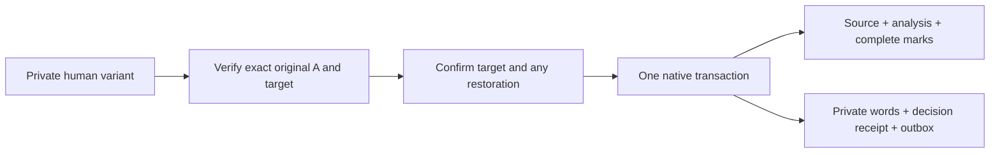

# Confirmed human highlight application

Status: 2026-11-02, isolated `0.5.0.dev`, unreleased. Backend only; no new native
highlight editor or registered highlight CLI/MCP tools. The maintained related
gate passes 269 cases, including38 new, in614.83s with privacy/Ruff green and
zero failures/errors/skips/input drift. [Executed actions](testing/highlight-application-scenarios.md).

## Shared operation

`ResearchReview.apply_highlight_draft(preview, body, request_id=...,
confirm_target=True, restore_deleted=False, draft_id=None, revision=None,
cancelled=...)` consumes this process's exact edited-body verification. It requires
every quote to be located and a nonempty complete analysis/mark plan. Serialized
`apply` flags never grant authority; private snapshots still require `apply=False`.
Generic Decide/Keep remains unsupported for this typed domain.

An explicit existing variant/revision uses the normal private CAS. Without one,
the request deterministically identifies a private revision; exact words are saved
in the same transaction. Manual route provenance is retained by the typed private
record and decision receipt; the content-only report says manual/no semantic check.
The closed canonical analysis body does not gain invented generation fields.

## Captured authority and curated state

Recheck the native database/binding, complete retained row, receiver paper and
parent lifetime, current analysis, all current/tombstoned AI mark observations,
manual-mark digest and current selected B. Unknown mark keys inherit absence from
that same captured graph parent, never a freshly convenient target. Deleted
analysis/marks require an explicit restoration choice and preserve tombstone history.
Source retirement remains a separate refusal; no cache can restore it implicitly.

Preserve manual marks, matching hidden choices and historical omitted marks.
The actual reader filters omitted quotes against current analysis items. A's
extracted-page digest remains source provenance, not a body-revision identifier.
Current B is not activated as A. Repeated exact requests return their committed
decision before requiring obsolete runtime/source checks, even after later research
or source retirement; changed payloads with the same request ID refuse.

## Transaction boundary

One caller-owned transaction saves private words, publishes source ownership,
applies analysis and each rebuilt AI mark, captures outbox operations and records
the private decision. The real remote-analysis path resolves the exact captured
conflict, with all companion marks in the same commit; a lone mark is no group.
Staged bytes may remain cache after failure but grant no graph/source ownership.

Expected final marks and causal tokens derive from captured input plus the plan,
not a post-write reread that could bless an intervening callback. Final validation
checks analysis content/operation, all marks, parent/manual layers, exact source,
storage registration, B, private revision and decision receipt. Cancellation or
failure before commit rolls every database write back. An unrelated note may
commit without invalidating the group. Lost commit replies and concurrent identical
requests reuse one decision. Old receipts remain readable; parent metadata lookup
recognizes this typed decision on its original retained item.

## Actual local journeys and limits

Two variants survive backup, detached restoration and editable adoption after the
old folder is unavailable. A genuinely private pending original is published only
with successful Apply; injected decision failure leaves it unpublished. Accepted
research reaches a second database through the reference service and verified
attachments; offline native mark hiding and a note survive client recreation,
return sync and another independent backup, with A/B and both private bodies intact.
Private drafts do not replicate. A separate actual remote-analysis conflict closes
correctly and delivers complete marks to both peers.

These are synthetic backend/protocol journeys, not native highlight editing on a
physical laptop. Native fields, confirmation/busy/cancel/late-delivery UX and shared
transports remain next. Existing desktop reading-link rendering uses its full
content key, but the audit adapter's legacy index/source-digest association needs
separate completion for changed highlights; this gate does not certify that audit.
Remaining formats, canonical integration, complete check, production identity/
hosting and installed Windows/Mac/phone acceptance still gate the full release.

The current canonical source/tests and daily installed applications are untouched.
No paid model calls, credentials, production deployment, telemetry, commit/push or
release. Existing scoped transaction/read-vs-write skill patterns apply; no new
global skill rule or generated copy was introduced.
