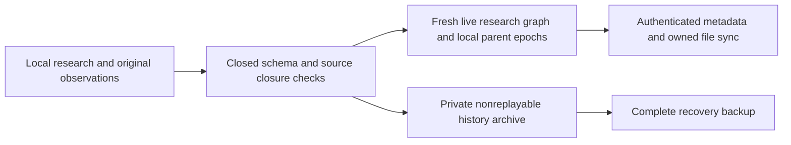

# Initial enrollment: history and known deletion

Status: isolated implementation with fixture verification. Preparing a reviewed
copy does not adopt it or upload research; runtime adoption has separate gates.

## Authority boundary

`research_history_archive` is a lazy, private protocol table. It is created only
for a nonempty validated batch inside the caller transaction, never by the global
research schema or startup migration. Records contain a deterministic ID, an
explicit registered protocol and canonical JSON retaining the original typed
record. Original request/context/row strings remain unchanged. Archived database
paths, bindings and local epochs are observations; migration never follows them
as file capabilities, restores a pending job or reuses an old runtime identity.

Supported archive adapters:

| Original protocol | Closed validator | Live treatment |
|---|---|---|
| `research_generation_requests` | `research_generation.validate_request_record`, bounded closed input snapshots | Preserve accepted/candidate output and original inputs privately; no active request table is copied. |
| `research_generation_recovery` | Same validator plus trusted sidecar ownership/location checks | Preserve completed cancelled/failed-delivery output, including its original source. |
| `research_chat_requests` / `research_chat_recovery` | Maintained QA validator plus closed nested input, graph observation, target and source checks; strict owned sidecar decoding | Retain prepared questions and completed candidates privately. Never synthesize an assistant turn or reactivate a request. |
| `research_chat_links` | Typed message/exchange/reply/source identity plus exact current SQL turn validation | Install only links whose current turns exist, after adapter initialization and before baseline capture. Orphan links remain archive-only. |
| `research_chat_review_receipts` | Strict bounded duplicate-key-safe nested JSON, original QA input validation, displayed target/graph identity and receipt fingerprint | Preserve the complete human-reviewed answer and observations privately, with every declared original; install no active review/job table. |
| `research_review_receipts` | Closed seven-column scalar/result/provenance validation | Retain exact private decision history and declared originals; no old live decision authority. |
| `research_review_drafts` | Maintained draft validator plus strict nested JSON, SQL snapshots and conflict graphs | Preserve each draft_id independently of request_id, exact text/bases and originals; inspect prepared-copy history read-only. Prepared/detached inspection is read-only; fresh reattachment remains open. |
| `research_parent_lifecycle` | `research_lifecycle.validate_record` plus exact six trusted trigger definitions | Archive original epochs; install fresh local epochs for copied live parents. |

Unknown protocols, columns, nested inputs, malformed records, duplicate JSON keys,
nonfinite values and missing byte closure block the copy. Coverage reports expose
archive counts by protocol, distinct historical originals and known deletions.
No archive row is promoted to a current reader, source owner or replay authority.

## Exact originals and live content

Source dependencies include the captured document, prior annotation target and
source-dependent highlight/reading inputs. Lookup uses declared hashes within
explicit trusted PDF roots or the owned source registry; context paths are never
opened. Originals needed only by history stay local and in the complete backup,
without automatically joining shared live source artifacts. Byte hashes dedupe
storage. Current claim A can remain grounded in original A while primary B and
completed candidate B are retained separately.

Every explicitly declared live chat source or anchor also publishes its exact
`original_source` artifact in the isolated candidate/outbox. A peer can therefore
fetch the original A while primary B stays current. Missing or changed A blocks
preparation. Lookup uses trusted roots/owned source declarations, never archived
context paths. Preparing still performs no remote upload. Message/exchange/reply
UUIDs are semantic identities; old workspace, device, database, lifecycle and job
observations remain private history. An explicit reply to an absent UUID remains
unresolved and is counted; a present target must be a user turn in the same paper
and exchange. Legacy unlinked rows remain unpaired, with unknown provenance.

Live research is checked losslessly after projection. Only declared structured
JSON columns normalize representation by canonical re-encoding: whitespace and
object key order may change. Unicode codepoints, array order, numeric types and
all prose/other cells remain exact; booleans never compare equal to integers.
Original historical strings keep their original representation in the archive.

SQLite row/schema digests identify committed research changes. Main database
path/device/inode still detect replacement; WAL/SHM/journal inode and checkpoint
mtime are device-local storage mechanics, not research revisions. Closed idle
`.research-jobs/<64hex>.lock` files contain only one `0` byte and are not copied.
A nonblocking OS lock check rejects active producers; unknown lock entries block.
Preparing a copy still does not replace the source or complete runtime adoption.

## Known-empty annotations

The four registered singleton annotations are claims, highlight analysis, reading
links and research questions. First enrollment represents a known deletion as an
ordinary version-2 empty `research_content` delete for its deterministic
paper/feature/main ID and exact fresh paper-parent incarnation. It creates no
placeholder `put`, claim, quote or analysis body.

The typed initial-deletion operation requires absent current content, a current
paper and an unused child incarnation. Projection recognizes only those four
IDs under that exact parent, then commits the known-empty marker/projection with
the tombstone and outbox. Identical retries do not duplicate data; caller rollback
removes the whole result. Peer reads remain known-empty, including forced cache
reads, and do not invoke AI. A separately confirmed source-aware restoration
creates a new incarnation through the existing typed claim workflow.

Mobile mirrors the four-ID rule, suppresses stale snapshot content/highlights and
retains unrelated deep/close reading. Unknown IDs, wrong parents and nonempty or
unsupported payloads cannot infer a deletion. Actual enrollment-to-HTTP fixtures
exercise a stream with no prior annotation `put`, offline restart and retry.

## Remaining adapters

This slice does not claim arbitrary workspaces are fully migratable. The central
recovery registry also lists these stable formats that need separate closed
initial-enrollment adapters:

- Compound requests/recovery: preserve each typed mutation and all original sources.
- Capture candidates: strengthen the current shallow observation/mutation wrapper
  validator before treating nested SQL-row snapshots as an archive contract.
- Review drafts: finish fresh current-target/source reattachment; private
  preservation and prepared/detached inspection are implemented.
- File candidates/drafts and slide/legacy deck recovery: preserve full validated
  JSON/image/evidence/source closure through the shared file codec.
- Integration/action receipts: identify closed result variants and preserve retry
  provenance without making old commands replayable.
- Already-enrolled or detached recovery workspaces: explicit rejoin/adoption and
  identity policies remain separate from this first-enrollment copy.

Unknown/unmigrated formats remain visible blockers. Passing the focused fixtures
is partial evidence; the combined candidate still requires the project's full gate.

## Reviewed-Q&A first-enrollment integration (2026-11-01)

Reviewed-QA/history/first-enrollment/recovery integration: **131 passed, 0 failures/errors/skips**, 337.98s pytest /339.39s wrapper on932 unchanged inputs. Bilingual preview/prepare and maintained desktop copy controls: **27 passed, 0 failures/errors/skips**,34.24s pytest /35.69s wrapper on933 unchanged inputs. The exact backend-to-UI delta is three added coverage labels/entries in the dialog and one new UI test file; backend modules/tests are unchanged. These are separate partial gates, not a full app pass. Earlier24new-case selection passed52.70s pytest/54.19s wrapper; it overlaps and is not an extra total. Ruff passes.

The actual flow covers reviewed A beside current B, exact private receipt backup/detached restore, peer message/source transfer and a captured peer note returning. Another actual C survives only in review history after prior turns/jobs are removed; its absence or mutation blocks the copy. No observed context path is followed. See [actions and limits](testing/initial-enrollment-review-scenarios.md).

## Review decision history (2026-11-01)

`research_review_receipts` now has a closed seven-column adapter. Original result/provenance strings and declared source hashes are retained privately, without live request/decision tables or observed-path access. Both applied and kept decisions have real copy/backup/detached-restore coverage; history-only original absence or mutation refuses publication. The bilingual preview names this coverage. [Actual actions and limits](testing/initial-enrollment-decision-scenarios.md). Edited-draft resumption and other outstanding formats remain open.

## Saved draft variants (2026-11-01)

Two real variants sharing a request survive copy, backup and detached storage with exact strings and originals. The prepared-copy service and bilingual Qt view can inspect/copy them; historical Keep/Apply is blocked. The integrated citation/draft/review/recovery selection passed240 cases on942 unchanged inputs. The earlier detached reader audit exposed missing entries. That reader is now repaired; reviewed current-target/source resumption remains required before calling the full journey done. [Actions and limits](testing/saved-draft-scenarios.md).

## Independent draft reading (2026-11-01)

Prepared and recovered archive wrappers, plus raw direct-backup draft rows, now
share one bounded private read projection. Old contexts stay observations;
records/IDs/text remain exact, duplicate generic entries are suppressed, and
no live old protocol or mutation authority is installed. The shared89-case
selection passes on943 inputs. Fresh target/source edited application is still
required. [Actual reader controls](testing/detached-draft-reader-scenarios.md).
