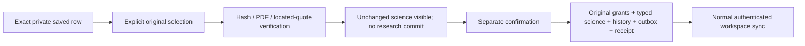
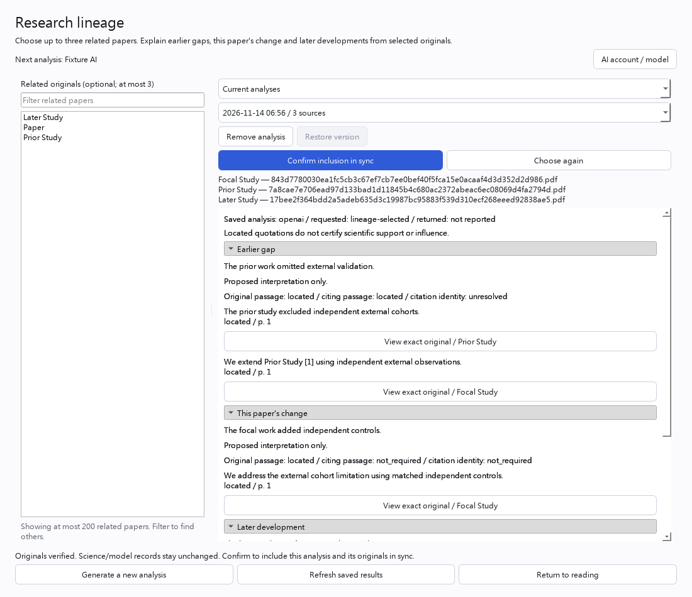

# Include a private saved analysis in sync using selected originals

Status: local v0.5 development implementation, unreleased. This is explicit
adoption of an existing private saved Lineage row in an already enrolled workspace.
It is independent of list membership, list-package import and AI login. Native
marker/history repair and restoration remain separate actions.

## Desktop workflow

1. Open Research lineage and select the current private saved result. Eligible
   candidates show **Verify originals for sync**. Already native, historical and
   unenrolled results do not offer this action. The initial UI hint is not proof
   that the full source/adoption check will succeed.
2. Select the exact PDF requested for each available source. The picker identifies
   the saved title and hash prefix. Canceling any picker starts no task.
3. Wait for original verification. The report stays visible; selected filenames
   remain in the review area. Hashes, PDF pages and every purported located quote
   are checked. Science text, rationale, generation model and saved timestamp are
   preserved. No model, login, download or search is invoked.
4. Review the saved report and selected originals, then click **Confirm inclusion
   in sync**. This separate action queues the analysis and original files for your
   workspace's existing sync connection. Existing automatic sync may transfer them
   to your enrolled devices. Metadata queued locally is not remote acceptance or
   proof that a peer has downloaded its originals.
5. Use **Choose again** to discard the prepared choice before confirmation. A
   missing/wrong PDF, changed saved row or changed owner requires a fresh review;
   the old saved research remains intact. A changed row discovered at GUI delivery
   requests a refresh instead of enabling confirmation of stale science.



No matching research ZIP is needed and no temporary list is created. Unavailable
sources retain their explicit unavailable state; the action cannot invent an
original or change which papers the analysis selected. Quote-location checks do
not establish scientific interpretation, influence or citation-identity truth.



## Shared operation boundary

`lineage_direct_adoption.DirectAdoption(database, data_root, *, current_path=None)`
uses the existing enrolled workspace runtime/storage boundary. It never enrolls
or switches the workspace. Its worker-only operations are:

```python
inspect(paper_id, corpus_key, *, ticket=None) -> dict
prepare(paper_id, corpus_key, originals, *, ticket=None, request_id=None) -> PreparedAdoption
apply(prepared, *, ticket=None) -> dict
```

`originals` maps every available saved source ID to an explicitly selected PDF
path, with no extra IDs. An optional request ID must be a canonical UUID.
`PreparedAdoption.preview()` returns the unchanged row, original count, observed
parents and `applied=false`. A prepared plan is process/service scoped and is not
serializable import authority. It retains native byte proofs rather than trusting
later reads of the original selected pathname. Cancellation uses the existing
workspace `Ticket`; a commit that already won cannot be retracted by closing.

The typed selected-byte validator `lineage_package_targets.validate_selected`
produces the same bounded scientific/byte lease used by native compilation,
without admitting generic list-package metadata. It grants no source ownership.
The caller additionally observes the actual SQL row, materialized paper lifetimes,
existing source graph/desire and absence of native science ownership. Source and
scientific admission are one caller-owned transaction. The general projection's
unowned-row guard remains intact; generic replace is not adoption permission.

Publication rechecks the row, ordered parents, source lifetimes, workspace/file
binding and prepared-byte proofs. Only that matching private row is removed under
capture suppression before the normal typed write restores identical science with
native history. Original grants, source activation, science, history, outbox and
a retry receipt commit together. A late failure rolls all SQL authority back.
Private staging/materialized cache files may remain; they grant no ownership.

Exact retries of the same plan return `state=previously_applied` without another
scientific operation. That receipt explicitly does not recheck present-day byte
availability or reactivate retired science. A plan from another service instance,
altered plan, missing native markers/history, changed mappings or source retirement
is rejected rather than silently repaired. No original becomes the primary PDF
merely because it was adopted as a version-pinned analysis source.

The read-only `can_offer_in` helper is a conservative UI hint; `prepare/apply`
remain the complete final boundary. There is no new unauthenticated HTTP/MCP
publication endpoint or remote arbitrary-path interface.

See [behavior evidence](testing/lineage-direct-adoption-scenarios.md). Coherent full
validation, installed-device migration, semantic audit and real hosted Windows/
Apple Silicon/mobile acceptance remain separate release gates.
