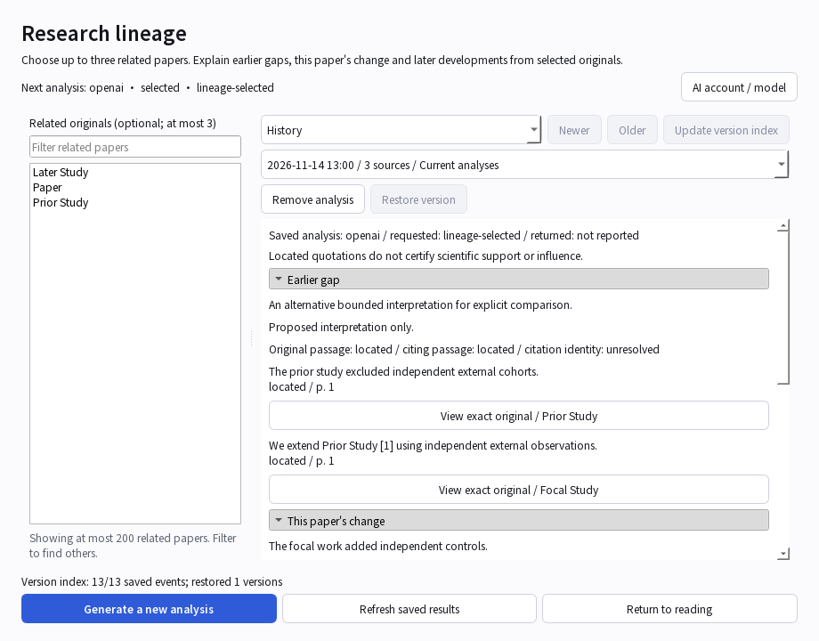
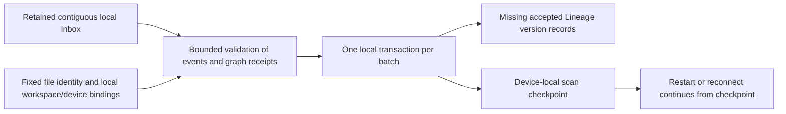

# Restore missing received-history entries

Status: locally integrated v0.5 development behavior, 2026-11-14. This repairs the
native version catalog of earlier test builds using their retained accepted inbox;
it is not first enrollment, scientific replacement, remote recovery or AI analysis.

## Everyday use

- An explicitly connected normal sync pass now performs a bounded local history
  scan. Opted-in automatic sync continues while the scan remains pending; it does
  not label a partial index idle or silently enable synchronization.
- Offline, open a paper's **Research lineage > History > Update version index**.
  The button is disabled once this database's saved-event prefix is indexed, or
  when the workspace has no supported native sync history.
- Counts such as `13/13 saved events; restored 1 versions` describe actual locally
  received events and versions inserted in this pass. They are not paper counts,
  research-quality percentages, time estimates or upload progress.



The operation does not call a provider, log into an agent account, fetch a PDF or
contact the sync service. Normal sync's independent transfer work may still run
when the user has explicitly requested that normal sync. Indexing metadata alone
never grants original-file bytes or changes current research, drafts or outboxes.



## Atomic batches, cancellation and recovery

Each batch validates actual contiguous sequence, event/outcome columns, workspace,
canonical operation and its exact graph receipt. Only accepted native Lineage
operations are added; conflicted events keep their existing conflict handling.
Existing conflicting history identities, missing events/receipts and unsupported
schemas stop the batch rather than overwriting or skipping provenance.

The same transaction owns restored history and its checkpoint. Cancel, changed
file/workspace/session, or failure before publication rolls back that batch.
Earlier completed batches remain durable and can resume after restart. Closing
the history window cancels publication and drains its worker. A view change after
a completed batch cannot replace another paper's visible selection.

The checkpoint is scoped to workspace, device and database file identity. A copy
or restore cannot silently reuse another file's scan position. It is excluded
from research backup/restore and sharing; the actual scientific history remains
in the appropriate research archive. Cold native workspaces with no received
events create neither scan metadata nor an optional report table. Inspection and
status use read-only connections and create no schema.

This is not repair of missing/corrupt original PDFs, arbitrary damaged databases,
rollback of a remote authority, or permission to adopt unowned research. Those
paths retain their independent verification/recovery gates.

## Worker API

```python
repair = HistoryRepair(
    native_client,
    current_path=current_database,
    expected_identity=loaded_database_identity,
    current=window_or_session_is_current,
)
status = repair.status()
result = repair.drain(ticket, progress, max_steps=16, seconds=3, limit=64)
```

- Construction/status are read-only. The client must have an explicit native
  projector and matching local journal/research bindings; capture, if present,
  must agree. Guarded session callbacks remain enforced.
- `status() -> dict` returns `through`, `target`, `remaining`, `more`, `scanned`
  and `restored`. Status counts are not a fresh byte-availability verdict.
- `step(ticket=None, *, limit=64) -> dict` owns one transaction and one fresh
  single-batch Ticket. Limit is 1-128 events, with a 4 MiB event-byte budget and
  a bounded per-event envelope. At least one valid event can make progress.
- `drain(ticket=None, progress=..., *, max_steps=16, seconds=3, limit=64)` runs
  at most 1-100 atomic batches with a soft 0-20 second work budget. Time can only
  stop between batches; it is not an ETA or an interrupt of an active commit.
  Its parent ticket can still cancel later batches after previous commits.
- `through` is a durable processed sequence; `target` is the received cursor
  observed for that batch. `restored`/`scanned` count this invocation, not all past
  work. New receives retain versions themselves and later checks can advance the
  local index for their new prefix.

Run work on an owned background worker. No model or transport is supplied to the
repair API. The desktop history action and normal sync call the same service.

[Concrete cases and exact evidence](testing/lineage-history-repair-scenarios.md).
Full application validation, installed Apple Silicon/phone acceptance and hosted
GCP operations remain separate release gates.
