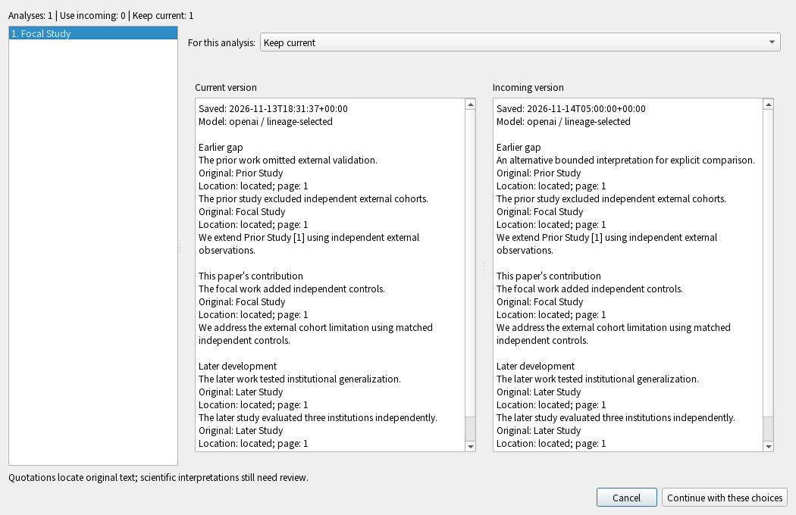
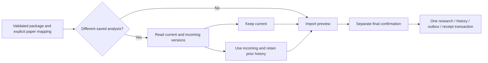

# Compare saved and incoming Lineage analyses

Status: unreleased v0.5 development integration, 2026-11-14. This is an explicit
native-report import step, not AI generation, first enrollment or a sync service.

When a research package differs from the current native Lineage report, the import
review now shows both versions, model metadata, original quotations and recorded
locations. Select **Keep current** or **Use incoming; keep current in history**
for each analysis, then continue to the ordinary import preview. Publication still
requires its separate final confirmation. Default selection is Keep current.

## What the choice authorizes

A process-local sealed decision binds the exact archive fingerprint, receiver
file identity and sync bindings, complete paper mapping, saved SQL row, native
operation and projection marker. A changed report, archive, receiver or mapping
requires another comparison. The generic `replace=True` option does not grant
this permission, and a raw JSON dictionary cannot stand in for a native decision.

Only a current owned native report with the same selected paper identities can
be replaced. Its prior version remains in the maintained history, including the
exact original-source references. A missing native marker, unowned old result,
removed analysis or changed source owners cannot acquire replacement/restoration
permission from this screen. Keep current preserves that state; it is not adoption
or a claim that the workspace is fully enrolled. An [explicit exact-content
adoption choice](lineage-matching-adoption.md) is now available only for a matching
original-complete package with no native authority/history and unchanged selected
paper lifetimes. Direct legacy source selection and restoration remain separate work.

The comparison is read-only. It does not call a model, authenticate an AI account,
download PDFs, upload research or certify scientific interpretations. It shows
recorded requested/returned model metadata; absent metadata says not recorded,
without inventing a model/version. Original quotations and their locations are
shown separately from proposed scientific statements.

## Native/library APIs

- `PackageImporter.prepare(..., lineage_decision=None)` keeps its default refusal
  for different reports. `ReviewRequired`, a subclass of `UnsupportedPackage`,
  exposes its native `.review` without printing research in the exception message.
- `review.conflicts` returns independent display records: `id`, `title`,
  `can_replace`, current/incoming bodies and their saved timestamps. Current
  bindings are local; incoming scientific bindings retain their portable form.
  Paper identity is never inferred from title equality.
- `review.decide({comparison_id: "keep" | "replace", ...}) -> Decision` requires
  exactly one valid choice for every compared report. The decision is process
  local; do not serialize it into packages, telemetry, CLI JSON or sync messages.
- Pass the actual decision into `prepare`, then use the normal observed `apply`.
  Its result counts `lineage_preserved`, `lineage_replaced`, `lineage_reports`
  (new reports), and `lineage_reused` (identical reports).
- `PackageReview.prepare(..., lineage_choices=None)` returns
  `state="needs_lineage_review"` with read-only conflicts when comparison is
  needed. After explicit selection, call it again with the complete choice map.
  It retains the native decision internally and returns an ordinary prepared
  preview; changing destination/mapping invalidates the comparison.

Close/cancel and final publication share the same Ticket. Stale GUI delivery
cannot enable confirmation or navigate another workspace. Late scientific-write
failure rolls back research, outbox, preserved history and the import receipt;
retry prepares again. A commit that already won remains saved and cannot be
retracted by closing its window.

## Received history and remaining gates

Native receive now retains each validated accepted Lineage event inside the same
transaction as its inbox/cursor, before materializing only the latest head.
Otherwise a batch containing two versions would show the latest report but omit
the earlier version from the receiver's native version catalog. History insertion
requires the actual accepted inbox and graph receipt plus the explicit local
projector/binding. It grants no original bytes; downloads remain explicit.
Conflicted events stay in their existing conflict records and do not become
accepted native versions. Failure rolls back history with the rest of receive.

The read-only capacity check treats an absent optional report store as empty
without creating tables. Wrong schema kinds/structures still fail closed.

Already-consumed beta inboxes can contain older accepted events missing from
native history. The [bounded local repair](lineage-history-repair.md) now restores
them from retained provenance, automatically during explicit sync or from the
History page offline. Its local migration and GUI cases pass; actual installed
beta migration and full/device acceptance remain separate gates.

Other release gates remain: complete unowned-result adoption, full validation,
maximum-size/performance checks, hosted GCP operations and physical Windows/Mac/
phone acceptance. [Concrete scenarios and receipts](testing/lineage-import-comparison-scenarios.md).
