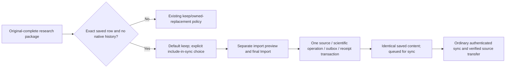
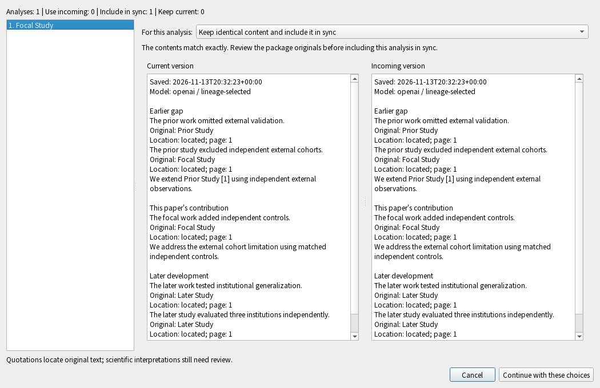

# Include an identical saved analysis in sync

Status: v0.5 development integration, not a shipped release. This explicit
source-complete package action addresses a private legacy Lineage result that
has never had native synchronization authority. It does not repair missing
native markers, restore a retired analysis, or replace a different result.

## Desktop workflow

1. Import a research package with every exact selected original included. Confirm
   the list/paper mapping, then choose Review changes.
2. If an existing private analysis matches the incoming one exactly and has no
   native journal/graph/marker/history, the comparison offers **Keep identical
   content and include it in sync**. Keep current remains the default. Read the
   recorded scientific statements, original quotations, locations and model
   metadata; package byte validation does not certify scientific interpretation.
3. Choose explicitly for each analysis, then return to the import preview. The
   preview counts identical analyses to be included in sync. Nothing scientific
   is committed by selecting this choice or closing the comparison.
4. Click the ordinary final Import button. Closing before that step cancels the
   prepared action. No extra AI login or model call is required.

## What must match

The complete saved row must match the verified incoming payload after explicit
paper identity mapping: corpus, selected sources/bindings, original-document and
source hashes, full scientific report, generation metadata and original saved
timestamp. The operation preserves that row, including its requested/returned
model record; it does not label adoption as a newly generated result.

Selected paper lifetimes must already be active and actually materialized in this
native workspace. Their identities/incarnations are included in the sealed review;
a deleted/recreated paper invalidates an earlier choice even when science text and
paper mapping still look the same.

A current native head, optimistic graph entry, pending journal operation,
projection marker or retained scientific history makes this private-adoption
choice unavailable. A missing marker is not proof that native history never
existed. Removed/mismatched results and changed mappings require their separate
review/recovery workflows. The general replace flag cannot authorize adoption.
A package missing original closure cannot supply the necessary source grant.

The process-local sealed review binds the archive, receiver file/binding, paper
mapping, exact saved row and available choice. A changed input invalidates the
decision. The prepared action also carries the observed row fingerprint through
actual publication, not only through initial preview.

## Atomicity and retry

PackageImporter already owns the compound transaction. Immediately before the
scientific write it rechecks the private row and absence of native authority,
removes only that exact row under capture suppression, then performs the normal
typed scientific journal write. Original-file grants, scientific history, the
unchanged canonical row, outbox and import retry receipt commit together. Generic
Lineage projection still refuses unowned rows; its guard was not weakened.

Cancellation or a late writer/receipt failure rolls the entire action back,
including the temporary removal. Changed targets are preserved and require a
fresh preview. Identical retries return the original import receipt and do not
create duplicate scientific operations. Rapid clicks share the existing worker
admission guard. Closing or switching workspace while pending cannot redirect
the operation or create a new database.

As with existing imports, private verified staging/cache files may survive an
interruption without conveying ownership. **Queued for sync** is not remote
acceptance, attachment download or semantic scientific verification. Reading
availability remains separate from metadata status.

## API and scope

- `lineage_import_review.Review.conflicts` adds `can_adopt` alongside `can_replace`.
- `Review.decide(choices)` accepts `adopt` only for eligible exact-content items;
  it returns the same process-local sealed `Decision` used by `PackageImporter`.
- `PackageImporter.prepare(..., lineage_decision=decision)` compiles the observed
  action; `apply(prepared, ticket=...)` performs the ordinary compound write.
- Successful previews/receipts count these results as `lineage_adopted`.
- `lineage_matching_adoption.eligible_in` and `consume_in` are internal transaction
  helpers, not user capabilities, standalone publication or public HTTP/MCP APIs.

This implements the matching-package route. A private report without a matching
package can now use the separate [explicit original-selection adoption](lineage-direct-adoption.md)
workflow. Neither route is a universal legacy migration. Native marker/history corruption,
restoration, complete audit, the full application gate, installed Mac/phone and
hosted acceptance remain separate work. See the [behavior map](testing/lineage-matching-adoption-scenarios.md)
for actual local evidence and limits.
