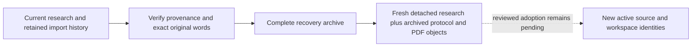
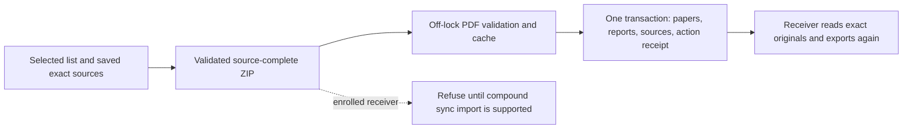

# Source-complete Lineage list packages

Status: development integration, 2026-11-13, unreleased. Normal list export and
unbound list import now use the maintained source-preserving codec and native
publisher. Exact-original reading/re-export and complete import-history backup
have local fixture coverage. Source-complete enrolled import now uses the shared
package transaction; see [enrolled import](enrolled-package-import.md#source-complete-lineage-import-v05-development).
Native live publication/receive and fresh editable recovery also have local tests.
Reviewed replacement/adoption, full validation and installed-device acceptance
remain incomplete; an enrolled import never bypasses those replacement guards.

## Preserved content and boundaries

One selected focal report can depend on papers outside the list. The component
collects full actual selected/context paper rows, every current selected-focal
Lineage row and its exact original PDF versions. Context papers are not silently
added as list members, and their unrelated analyses/notes are not included by
this collector. An unavailable selected peer remains explicit context without an
invented PDF or download. Source paths have separate focal/paper/hash namespaces;
a different current primary PDF is never substituted for the saved original.

The package carries scientific rows and content-only source descriptors. It has
no sender workspace/device, graph incarnation, native owner/candidate receipt or
publication capability. Incoming metadata alone grants no receiver/source/replay
authority. Full workspace recovery remains a separate preservation format.

## APIs

- `collect(database, paper_ids, *, with_pdfs=True, cancelled=...) -> LineageExport | None`
  is worker-only. It takes an explicit bounded focal selection, reads existing
  native published/projected sources, verifies owned immutable bytes and captures
  exact reports and context. It writes no SQL/cache, invokes no model and follows
  no URLs. Nonempty Lineage requires its exact included PDFs. A missing selected
  paper, unavailable declared original, cancellation or changed ownership refuses
  collection. No selected reports returns `None`.
- `LineageExport.rows`, `.papers`, `.records` return independent data copies;
  `.files` returns path/immutable-byte pairs. Private native observations/seals
  are process-local and must not be serialized.
- `check_export(prepared)` rechecks exact selected reports/context, native database
  identity and all source proofs at the caller's final publication boundary. It
  hashes no PDFs and commits nothing. `None` is a no-op. Restoring equal bytes as
  a different source incarnation does not revive an old prepared export.
- `relative(focal_id, paper_id, sha256) -> Path` provides a canonical source path.
- `records(manifest, tables)` validates ordered report/source declarations and
  returns `(selected_rows, source_records)` as data only.
- `validate_package(archive, manifest, tables, *, cancelled=...) -> list[dict]`
  rereads the actual bounded ZIP metadata and requires semantic equality with its
  admitted arguments. Ordinary UTF-8 JSON whitespace is supported; duplicate keys
  and nonfinite values are rejected. It checks closed ownership/path declarations,
  all actual PDF hashes/sizes/page counts and every claimed located quote against
  the exact PDF using the maintained normalization/word-anchor verifier. Structural
  report hashes alone cannot certify these byte facts. Unlocated/ambiguous and
  semantic/citation judgments remain explicitly unresolved; no AI is called.

The caller must also run common list-package validation. These APIs are not a
replacement for receiver observation, identity matching, atomic import/outbox
publication or retry receipts. Desktop callers must not wait for this work on the
GUI thread. CLI hosts should use their owned worker/executor.

## Staged wire shape

`tables.paper_lineage_sets` contains complete existing six-field local-content
rows: `paper_id`, `corpus_key`, `body_json`, `source_hash`, `document_hash`,
`written_at`. Focal IDs must be in `tables.papers`. Every selected peer must be in
that collection or `tables.cited_papers`, without duplicate paper/corpus owners.
Future import maps these sender data IDs to actual receiver owners; it cannot
copy sender-native lifetimes or treat IDs alone as active authority.

Nonempty content requires manifest format integer `2`, sorted unique capabilities
including `lineage`, and `pdfs_included: true`. `manifest.lineage_sources` lists
one descriptor per available source in report/binding order, each with exactly:

```text
focal_paper_id, corpus_key, source_id, paper_id, sha256, size, path
```

Each path is under `files/lineage-sources/<focal hash>/<paper hash>/<sha256>.pdf`
in the ZIP and has its exact entry in `manifest.file_hashes`. Missing, extra,
reordered, foreign-owner, duplicate or changed sources are refused. Repeated
references may reuse a same-owner/hash path; distinct owners retain distinct
associations even for equal bytes.

Current bounds: 128 reports, 500 selected/context papers, 4,096 archive entries,
8 MiB per metadata document/observed metadata set, 32 MiB per PDF, 512 MiB of
original files and retained native byte proofs, and 4,096 verified unique PDF
pages. Limits refuse rather than truncate. The report's existing four-source,
96-page-per-corpus and inline limits also apply. JSON object formatting is not
the separate canonical artifact-wire encoding.

## Remaining integration

1. Add enrolled-workspace compound source/content operations, native action
   receipts and shared Lineage admission without capture suppression as a shortcut.
2. Provide reviewed paper mapping for identity collisions and explicit new import
   intent after local edits; a completed package action must not silently replay.
3. Finish fresh editable recovery with complete provenance/history retention and
   Lineage enrollment, using the staged verified original preparation below.
4. Connect saved-first desktop/mobile source controls and the complete research
   workflow to their provider/task registry with the same ownership boundaries.
5. Validate the accumulated revision, installers and real cross-device journey.

Unbound list operations now integrate the receiver observation and native
publisher in the existing paper/list transaction. Source-complete package
validation and final export checks are active. Enrolled import refusal remains
a temporary protection while its compound path is incomplete. No service/model
access, credential change, cloud deployment or release is implied.


## Observed receiver mappings

`lineage_package_targets` stages explicit receiver identities without performing
an import. It verifies actual ZIP/PDF content first, copies caller-owned JSON
and mapping values, and changes only the local `paper_id`/`bindings` fields.
Source/report identities, quotations, judgments, generation metadata, corpus ID
and source/document hashes stay unchanged. Original source descriptors retain
the sender archive paths: those paths are not receiver storage ownership.

The mapping must cover every selected source paper exactly, including unavailable
peers, with distinct nonempty receiver IDs. No fuzzy title/DOI matching or identity
creation is performed by this component. The initial convenience path requires
existing receiver paper rows and native parent lifetimes. Empty/fresh-library
imports still require integration with the enclosing paper-matching transaction;
do not commit skeleton papers merely to satisfy an observation.

- `observe(database, archive, manifest, tables, paper_map, *, cancelled=...)`
  returns a native `Targets` lease, or `None` for no selected reports. It is
  worker-only and reads an explicit database without creating schema or files.
- `Targets.rows`, `.paper_map`, `.sources`, `.before` and `.conflicts` return
  defensive values. Existing differing target rows are shown as conflicts, never
  silently replaced. These are scientific/source data, not copied sender receipts.
- `checked(targets)` validates the process-local sealed observation and returns
  its copied metadata. Serialized metadata cannot recreate the native lease.
- `check_in(conn, targets)` requires the caller's transaction. It rechecks native
  database identity, explicit workspace binding, exact receiver paper metadata,
  parent lifetimes and actual composite report targets, including prior absence.
  Deleted/recreated papers, another database, report edits, newly inserted reports
  and workspace enrollment require a fresh reviewed observation. The check writes
  and commits nothing and leaves earlier caller work for that caller to handle.

The adapter refuses synchronized workspaces until a compound source/content
publisher exists. It grants no PDF association, canonical write, cursor/outbox
update or recovery authority. Its receiver checks are a prerequisite for the
remaining source-preserving import and do not enable normal list sharing yet.


## Fresh receiver transaction handoff

The same target adapter now also supports new paper rows that have not been
committed. It does not require exposing skeleton papers between import phases:

1. On an owned worker, call `validate(archive, manifest, tables,
   *, cancelled=...) -> ValidatedPackage` before acquiring the write transaction.
   It performs the full maintained ZIP/PDF/located-quotation validation and
   separately rechecks every retained PDF byte stream against its declared size
   and digest. The returned `.files` is an immutable tuple of `(archive_path,
   bytes)` pairs. Equal hashes may share immutable memory, but each archive owner
   path is checked. The process-local seal binds the scientific/source metadata
   and exact immutable byte objects; changing either invalidates the proof.
2. Capture the receiver database's native identity before opening its connection.
   The enclosing importer begins its transaction, matches/creates the real local
   paper rows and initializes native lifetimes through the existing lifecycle
   API. It owns those decisions and must not commit yet.
3. Call `observe_in(conn, package, paper_map, *, expected_native,
   cancelled=...) -> Targets | None` on the worker. It sees both existing and new
   uncommitted receiver owners through that exact connection. It parses/hashes no
   PDFs, writes no schema/research/receipt, and performs the same closed mapping,
   native database/binding, actual metadata and lifecycle checks. `expected_native`
   is the pre-connection identity, not a value invented by the package.
4. Recheck `check_in(conn, targets)` at the actual import write boundary. The
   future source/content publisher must use the pinned immutable `.files`, the
   matching exact scientific rows/mapping and fresh receiver lifetimes in this
   same transaction. Closing/deleting/changing the original ZIP is not permission
   to substitute another file at publication.
5. Commit or roll back the complete outer import. A returned observation does not
   commit anything. A cancellation/failure preserves earlier caller work for its
   caller to roll back. Rolled-back paper epochs cannot be reused by deleting and
   recreating equal IDs; a fresh observation is required.

This establishes the target/data handoff, not a completed atomic research import.
The original `observe(...)` convenience API remains for already-existing receivers.
The next integration must add fresh native import provenance distinct from an AI
completion, all-original source publication, exact scientific row writes, default
conflict preservation, deterministic retry receipts, imported-original reading,
re-export and recovery. No lineage source format, replay grant or live journal
operation was activated by this handoff. In particular, do not invent a generation
request/candidate merely to satisfy the current locally generated report reader.

The inherited metadata/PDF/aggregate/page budgets still apply; retaining bytes is
not a process-memory guarantee or permission for unbounded concurrent imports.
Only native process objects survive the handoff: serializing scientific metadata
or a seal does not reproduce the immutable-byte proof or receiver observation.


## Receiver regression map

| Test module | Observable behavior |
|---|---|
| `test_lineage_import_recovery.py` | Current/displaced report history and different original PDF versions survive real backup/inspect/detached restore; rehashed wrong quotations/page counts and missing associations refuse; retired data do not revive deleted peers or native grants; unknown future schemas refuse without omission. |
| `test_lineage_import_originals.py` | Exact imported focal/peer bytes, no primary-file substitution or SQL writes, native loaded-view delivery, missing/restored/tampered sources, cohort lifetimes, unavailable peers, mixed provenance and a real three-receiver import/read/re-export journey. |
| `test_lineage_package_publish.py` | Actual report/source/action-receipt commit, rollback after earlier child writes, late cancellation or changed original, retry identity, explicit conflict replacement/history, native schema/budget refusal and unowned cache cleanup. Complete backup preserves its retained history and originals. |
| `test_lineage_package_transaction.py` | Caller-created new papers are visible within the same transaction and invisible to another connection until commit; rollback removes them; mixed existing/new ownership preserves the old lifetime. Exact retained PDFs survive ZIP closure/deletion; changed post-validation bytes and native-proof tampering refuse. |
| `test_lineage_package_targets.py` | Complete distinct paper mappings, unchanged scientific report, defensive metadata, visible conflict values, cancellation and metadata budgets. Changed receiver metadata, deletion/rebirth, changed composite targets and different/replaced databases refuse without committing caller work. |
| `test_lineage_packages.py` | Actual selected/context content, exact saved originals, missing/unavailable peers, changed primary PDFs, canonical owner paths, PDF page counts and every located quotation. Rehashed false quotations/page counts still fail against bytes. |
| `test_lineage_packages_bound.py` | Actual staged bound source ownership and file incarnation checks; equal bytes restored as another lifetime do not revive an export. |
| `test_lineage_bundle_boundary.py` | Exact originals and explicit capabilities are mandatory; incomplete source markers refuse without replacing an existing export. |
| `test_lineage_bundle_journey.py` | Public unbound export/import/re-export to a third reader, off-list context without peer notes/membership, concurrent retries, rollback/retry, changed source/workspace, explicit conflicts and receiver identity collision protection. Enrolled import refuses without research/outbox changes. |

Receiver-only cases copy a real immutable synthetic ZIP generated once per test
module using the existing publication/export fixture and fake completion. Cases that reach
validation parse/validate their own ZIP copy and have independent receiver SQL,
native lifetimes, filesystem copies, observations and byte proofs. No mutable
research database or ownership proof is shared between receiver cases. Tests of
the sender's actual native publication/export continue to build their own native
fixtures; only repeated sender setup in receiver tests is reused.


## Staged native report/source publisher

`lineage_package_publish` implements the unbound receiver write boundary used
by `bundle.import_` and the shared `research_service.import_bundle` entry point.
Imported original reading, re-export and history backup are integrated locally;
enrolled-workspace operation capture and editable recovery remain gated.

- `stage(database, package, paper_map, *, request_id, expected_native,
  cancelled=...) -> StagedImport` runs on an owned worker before the SQL write
  transaction. The caller supplies a canonical UUID action ID and preserves it
  for retries; a new deliberate import/replacement uses a new action ID. The
  package must be the native immutable-byte proof from `validate(...)`.
  Complete explicit mappings may include not-yet-created receiver paper IDs.
  The stage checks the native database and rejects synchronized receivers. It
  exclusively publishes exact cache bytes under receiver paper/hash paths and
  independently hashes the winning files. Existing damaged bytes are refused,
  never overwritten as an automatic repair. Link-stage files are cleaned up;
  cancellation/crash may leave unowned cache bytes, which confer no source grant.
- `publish_in(conn, staged, targets, *, replace=False, cancelled=...) -> dict`
  uses the existing caller transaction after paper matching/creation and
  `observe_in(...)`. It checks the exact native package, receiver mapping,
  current paper metadata/lifetimes, scientific target observations, original
  paths and file versions. No PDFs are read/parsed/hashed under SQL and no files
  are published in this phase. It installs the complete six-field scientific
  report, every available original's fresh local association and one distinct
  import-action receipt within an internal savepoint. It never commits the
  caller's papers/list/membership or earlier work.
- The default conflict outcome refuses replacement and preserves current research.
  A reviewed caller may supply `replace=True`; displaced scientific rows remain
  in the receipt, and prior source/import history is retained. Semantic judgments
  remain proposals; importing creates no AI completion, candidate, generation
  request, sender device identity, cursor or outbox operation.
- An identical action retry verifies the saved scientific rows and every actual
  local source association and reports `state=already_imported`. Reusing the action
  ID with different content, native lifetimes or mappings refuses. Replaying an
  old successful request after a later local edit also refuses; it cannot silently
  restore an older report. Fresh explicit replacement needs a new action ID.
- Empty content returns `state=empty` without a source file or import receipt.
  Mid-write SQL failure, late cancellation or changed original versions rolls
  back all child report/source/receipt writes while leaving the outer transaction
  for its caller to commit or roll back. Unowned staged bytes remain separate.
- `validate_record(record) -> dict` checks closed native archival provenance;
  these parsed records are data, not permission to import, read or replay them
  against a new receiver. It is not an enrollment/adoption API.

### Native receipt shape and bounds

`research_lineage_imports(request_id TEXT PRIMARY KEY, body_json TEXT NOT NULL)`
stores one canonical `paperfact.lineage-import.v1` body per caller action. Its
closed fields are `format`, `request_id`, `database_identity`, `paper_map`,
`parents`, `records`, `fingerprint`. Every ordered record contains canonical
`row_json`, `before_json` and complete available-source `sources`. Native parent
lifetimes cover the full selected receiver cohort, including unavailable peers.
Fresh local source receipts use the existing receiver-only generic import owner
format, with deterministic per-action/focal/corpus/source identities. They are
not borrowed AI-generation or sender receipts.

The action fingerprint covers the import intent, receiver cohort and all source
associations, excluding displaced content so a fresh observation can recognize
an already successful action without rewriting its first retained history.
Native receipt validation still checks each displaced row's composite owner,
canonical shape and scientific schema. This is provenance validation, not a
cryptographic claim that the scientific interpretation is independently true.

Inherited report/PDF/metadata budgets apply. Additional limits are 1,000 import
actions, 32 MiB aggregate native import history, 10,000 shared local original
receipts and 64 current corpora per focal paper. Limits refuse atomically rather
than truncating. Native tables require their exact column types and primary key;
a same-name view or missing request uniqueness cannot satisfy retry/ownership.

### Remaining registration gates

Normal export and unbound import now preserve the exact scientific row,
selected/context identities and current originals using the common package path.
Fresh editable adoption and source controls remain open. Receiving into an
enrolled workspace still needs compound source/content operations and native
retry/cursor handling, not capture suppression around its writes. The enrolled
importer rejects the unsupported scope before staging research. No public
deployment or installer was made.


## Imported-original reading and staged re-export

`lineage_import_originals` reads imported scientific results without fabricating
local AI-generation records. It uses the existing loaded `HighlightOwner` and
exact saved six-field report row:

- `has_record(database, row) -> bool` selects matching native import metadata only.
  It grants no ownership or permission to open a source. The selected action is
  closed/schema/fingerprint validated; malformed JSON/records and over-budget
  history refuse rather than silently choosing another source mechanism.
- `prepare(owner, expected, source_id, *, cancelled=...) -> Original | None`
  runs on an owned worker. It checks the actual native database/binding, exact
  stored scientific row, latest matching native action and all original SQL
  associations for that report. Native lifetimes are checked for the selected
  report's cohort; an unrelated report in the same batch does not revoke valid
  sources. It hashes the exact owned PDF bytes off-lock and retains immutable
  data in a process-local sealed snapshot. No model, URL, current primary PDF or
  loose hash-only cache lookup is used. Declared unavailable peers and cancelled
  reads return `None`; missing/changed declared originals refuse.
- `metadata_current(snapshot) -> bool` rechecks native/SQL/file-version metadata
  with read-only connections, without reopening/parsing/hashing PDFs or writing
  receipts. It returns false for changed scientific/import/source records,
  deleted/recreated selected parents, database replacement, workspace enrollment
  or changed file versions, even when external restoration returns equal bytes.
- `for_delivery(snapshot, owner, expected, source_id) -> bytes` also requires
  the identical actual loaded-owner object and current exact report/source.
  A reloaded/equivalent view must prepare its own snapshot. The GUI/controller
  still owns its window lifetime and must suppress delivery after close.
- `lineage_package_publish.current_in(conn, row) -> dict | None` is the underlying
  bounded metadata lookup. Returned provenance is data, never permission to adopt
  a restored/sender database or reopen a source in another receiver.

The staged `lineage_packages.collect` now chooses the verified source mechanism
per actual report: imported, locally generated or bound projection. Every proof
retains its source kind through `check_export`; it cannot reuse an imported
reader for the next locally generated report merely because both belong to one
paper. Export includes the exact saved originals and actual selected/context
paper rows; all scientific report/evidence content stays intact. Importing that
content into another fresh receiver creates that receiver's own native original
associations. Sender request/device/lifecycle records remain absent from the ZIP.

These components are covered by real synthetic import -> read -> re-export ->
third receiver -> exact read tests. They are not installed-device, browser or
network acceptance. Normal unbound bundles now use these components; enrolled
imports and app/PWA source-PDF controls remain unfinished. Shared entry-point
fixture success does not establish actual UI-click or installed-device acceptance.


## Imported-history backup and detached restore

The recovery registry now accepts `research_lineage_imports(request_id, body_json)`
as archived protocol data. It retains every native action, current scientific row,
displaced `before_json`, original association and exact referenced PDF version.
The temporary unsupported-schema refusal has been replaced by source-complete
backup support; unknown future research schemas still refuse without omission.

`lineage_import_recovery.ImportRecords` is the internal archive adapter:

- `add(name, row)` validates closed import provenance, unique actions/associations
  and import-history metadata bounds. It copies no active authority into a receiver.
- `finish(records) -> set[str]` joins each action with its exact actual original
  SQL association and blob descriptor. Current reports must have full publication
  representation. Displaced reports need retained paper/hash provenance for all
  available originals; an unrelated paper's equal-hash file is insufficient.
  Historical lifetimes are archival data, never current-owner grants. Existing
  canonical paper-owner checks remain in force.
- `verify(read)` checks actual archive bytes for current and displaced scientific
  reports. It verifies SHA-256, sizes, PDF page counts and every claimed located
  passage through the same maintained word/page-anchor verifier as list packages.
  Rehashing fabricated quotations or page counts cannot hide a mismatch with the
  original. Ambiguous/unlocated passages and semantic interpretations remain
  unresolved; locating words does not independently prove a research relationship.

`lineage_packages.verify_original(data, digest, usages, *, cancelled=...) -> int`
is the shared single-original verifier. Callers validate scientific rows and
source declarations first, own aggregate byte/page limits and receive the verified
page count. Archive verification processes each distinct imported original once
across retained actions/versions. The existing whole-recovery budgets apply,
including 8 GiB total objects/metadata; the 512 MiB list-package limit is not
silently applied to an entire workspace. No model, URL or native owner adoption
is used during validation.



Detached restore materializes current scientific rows as research, keeps original
protocol/history in `recovery_records` and copies verified PDFs to `objects/`.
It does not install live import/source tables, old device credentials, generation
requests or graph/cursor state. Normal first-open lifecycle initialization can
create fresh receiver epochs; that alone cannot authorize old sources. The
native imported-original reader still refuses archived receipts until a reviewed
fresh adoption path is implemented.

The tests include different old/new PDF versions in one replaced corpus,
retained displaced statements, rehashed corrupt associations/quotes/page counts,
missing sources and refusal without partial output. Retired report history may
retain a deliberately deleted peer's PDF as archive data without recreating that
peer or activating its source. A current canonical report still requires its
actual selected paper rows under the existing outer recovery checks.

Enrolled list import, editable adoption, bound compound operations,
app/PWA controls and installed-device acceptance remain separate completion gates.
This change creates no cloud resource, automatic upload or release.


## Fresh originals from detached recovery inspections

`lineage_recovery_sources` is an internal, unregistered adoption component. It
prepares current originals for an independent unpublished baseline; it does not
publish a workspace or enable synchronized editable recovery. The public Lineage
adoption blocker remains until compound enrollment is complete.

- `prepare(service, inspection, database, *, ticket=None) -> PreparedSources`
  runs on a worker against a native sealed `RecoveryAdoptionService` inspection.
  The destination must be an independent unbound database, outside the inspected
  source tree. Eligible unbound imported/generated reports must still have their
  exact archived current parent lifetimes. Deleted/recreated parents require
  review; equal IDs or hashes cannot make an obsolete cohort current.
- Preparation reconstructs bounded native source packages from verified recovery
  objects, independently checks PDF hashes, page counts and located quotations,
  and stages exact bytes before SQL. Each batch has at most 16 reports and a soft
  metadata target; existing native byte/page/metadata budgets still apply. A
  single oversized report refuses rather than bypassing those budgets.
- `lineage_package_publish.stage` consumes the native byte validation into a
  sealed scientific-metadata and file-version proof. It no longer retains the
  original `ValidatedPackage` or its PDF byte buffers. Successive recovery batches
  therefore do not keep all source PDF inputs alive. Cached files remain unowned
  until publication; failed preparation can leave only such unowned files.
- `lineage_package_publish.observe_in(conn, staged, *, cancelled=...) -> Targets | None`
  observes actual new/existing receiver papers and lifetimes in the caller's
  transaction using that consumed proof. It checks native database and file
  versions, reads no PDF bytes, and creates no ownership, receipt or report.
- `stage_in(conn, prepared, *, ticket=None) -> dict` requires the exact prepared
  destination and copied current scientific/paper metadata. All batches share
  one savepoint, including newly initialized parent lifetimes, exact original
  associations and distinct native import receipts. Failure or cancellation
  after an earlier batch rolls them all back, preserving earlier caller work.
  Success returns `lineage_reports` and `batches`; the caller still owns commit.
  Exact retries reuse the same actions without duplicating records or sources.

The source service's current workspace, sealed inspection and file versions are
rechecked before and after publication. Target replacement/enrollment, changed
paper/scientific metadata or changed source objects refuse. The inspected source
is never edited. New local source associations use fresh receiver identities;
old generation requests, device credentials and source grants are not installed.

This helper does not copy the complete archive history. Eventual adoption must
also retain the original recovery provenance and every historical blob through
the existing baseline publisher, then enroll the new workspace atomically. Bound
Lineage source adoption, public recovery activation, enrolled list import
and installed-device acceptance remain separate unfinished integration work.


## Normal list-package workflow

```sh
paperfact list-export LIST_ID -o research.zip
paperfact list-import research.zip --no-pdfs
```

Success: the recipient has the list, its saved Lineage reports and every declared
exact original, including selected peers outside the list. `--no-pdfs` skips
optional URL downloads; it does not omit included source bytes. Context peers do
not join the list and their unrelated notes/analysis are not exported. Missing
or changed originals fail before an existing export is replaced. Lineage export
with `--without-pdfs` refuses because the evidence requires exact source versions.

`research_service.export_bundle` / `import_bundle` and the CLI use the same
`bundle.export` / `import_` implementation. These synchronous library entry
points run the package work on one worker when invoked from a CLI main thread;
desktop callers must still dispatch them through their owned background jobs.
No model call, source re-download or account login is part of preserving Lineage.

Before SQL, the importer validates actual source PDFs and stages an unowned
verified cache. Inside one transaction it checks any existing same-ID focal and
peer papers, initializes receiver lifetimes, inserts missing papers/context and
publishes exact reports, source associations and a native import action. Title
comparison preserves punctuation and ignores only case/whitespace; the existing
paper identity compatibility rule checks DOI, arXiv and publication-year conflicts.
A collision refuses even with `--replace`; explicit mapping remains future work.
Compatible existing peers retain their local notes and parent lifetimes.

The ZIP fingerprint supplies stable native action identity. Concurrent/repeated
imports of the same unchanged package create one action/list membership and the
same source associations. Default scientific conflicts preserve receiver content;
`--replace` permits the first explicitly chosen replacement and retains its
`before_json`. A completed action cannot replay over a later local edit: obtain
reviewed new import intent rather than bypassing this guard. That review flow is
still an integration gate. SQL failure or late file-install failure rolls back
the list, scientific rows and ownership; unowned verified cache bytes can remain.


