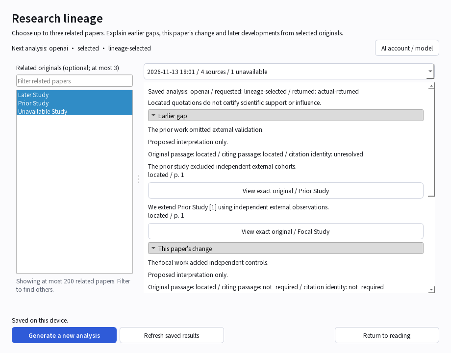
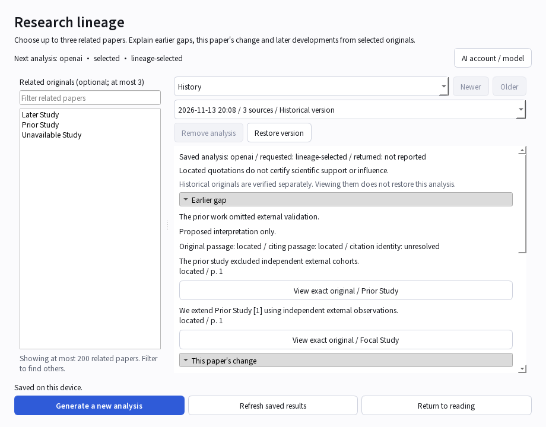

# Explain a paper's research lineage

Status: local v0.5 development implementation, not a released or hosted service.

The example uses generated papers and simulated AI. No real account was called.

## Read or generate

1. Open the focal paper and its original. Choose **Research tasks -> Research
   lineage analysis**. Opening the window reads saved results; it does not call AI.
2. Optionally select up to three related papers from your own library. Enter a
   title fragment and press Enter to search; already selected papers stay above
   matching results. No automatic literature search or PDF download occurs.
3. Check **Next analysis**, which shows the resolved account/model. Use **AI
   account / model** to change this task's choice without changing other tasks.
   Missing access opens the existing task-scoped login flow.
4. Click **Generate a new analysis**. The focal original is required. A missing
   peer original remains explicitly unavailable; it is not silently replaced by
   another file or by model knowledge.
5. Watch preparation, model wait, quotation checking and saving stages. The
   activity area and indeterminate indicator report actual work, not fabricated
   percentages. Stop does not automatically issue another model call.

The resizable left/right divider separates source selection and results. The
window is modeless; the main reader's unsent question and notes remain intact.
Generation disables repeated activation until the worker finishes. Closing waits
for safe worker completion rather than destroying a running thread.

## Interpret results

- **Earlier gap**, **This paper's change**, and **Later development** group the
  statements. An empty stage says no statement was proposed from selected sources.
- Quotations show their location state and page where located. Missing/ambiguous
  text remains missing/ambiguous. Per-statement original/citing passage and
  citation-identity requirements are visible, as is the proposed interpretation.
- Located words do not certify scientific support, reference identity or influence.
  Semantic validation is not performed by these deterministic checks.
- **Saved analysis** names requested and returned models separately. An absent
  returned ID says not reported; the current task choice applies to the next run.
- The result picker uses local display time, selected-source count and unavailable
  count. Its tooltip retains the stored timestamp. Refresh explicitly reads saved
  changes; it does not generate another analysis.

Originals may belong to a locally generated analysis, an imported research package
or a peer-received native report. The app selects the recorded origin automatically;
no manual reader mode is required. Inspection and package re-export use the same
owner/current-row selection boundary, with each origin's independent proof checks.
An absent or damaged receipt never means permission to use another PDF.

**View exact original** opens a separate read-only PDF at the quotation's page.
A worker verifies the actual retained/received version; delivery rechecks the
loaded owner and result. This does not replace the primary PDF. The source window
closes when its loaded context or source proof changes. Missing bytes require an
explicit download through the existing attachment workflow; no current PDF is
substituted.

## Keep or restore a previous version

Choose **History** above the result picker to browse retained versions. **Older**
and **Newer** move through additional pages. This does not call AI or change the
current analysis. Historical reports retain their requested/returned model labels
and quoted text. **View exact original** also works for historical reports when
the actual retained provenance, source ownership and exact bytes still verify.
This opens a separate read-only PDF without restoring the old analysis or
changing the current primary PDF. Missing/retired ownership never falls back to
today's document; a missing file requires explicit download/repair and retry.

**Remove analysis** asks for confirmation and keeps history/originals. It removes
only the observed report. The window then shows that historical version with
**Restore version** available if its corpus slot is empty and recorded provenance
exists. Restore asks again, performs no AI call and rechecks source permissions.
An intervening edit, recreated source/paper or unavailable provenance refuses
instead of replacing newer work. Hover a disabled restore button for its reason.
Stop/close/context changes cancel pending work; completed changes remain saved.

## Saving, retries and offline use

Each explicit generation creates another corpus result; existing analyses are
preserved, with a confirmation before creating another when results are displayed.
One admitted workflow performs one completion. A repeated activation while it is
running cannot create duplicate jobs. An explicit new request after a failed call
may call AI again; there is no hidden model retry.

- **Saved on this device**: unbound research and exact-source associations committed
  locally in one transaction.
- **Queued for synchronization**: the bound workspace committed exact sources,
  scientific content, history and real outboxes. This does not mean the server
  accepted the changes or another device downloaded PDFs.
- **Retained for review**: the context changed; the candidate is preserved without
  overwriting newer research. This does not claim the full reviewed-adoption UI is
  complete.

Native workspaces require a registered existing file store. Explicit analysis
initializes its optional report schema after checking the loaded owner; saved-only
reading and generic enrollment do not create that table. A missing file index is
refused before model work; analysis does not manufacture an empty replacement store. New corpora are bounded to 64 per focal paper. Competing
last-slot operations retain conflicts rather than blocking receive cursors.

Saved results and owned originals can be read offline without AI login. Generating
new analysis needs a supported accessible route. Receiving research invokes no AI.
Hosted continuous sync, Linux operation and real Mac/phone acceptance remain
separate gates; see [the GCP pilot proposal](gcp-sync-pilot-plan.md).

## Shared application boundary

`LineageWorkflow.prepare(owner, peers, *, connections, legacy_root, document=None,
cancelled=..., current=..., route_current=...)` is worker-only and requires the
actual loaded owner and a frozen explicitly declared `lineage` route. Preparation
resolves/validates sources and storage before spending a model call.

`workflow.run(*, cancelled=..., current=..., progress=...) -> Outcome` performs
analysis and transactional publication. `Outcome.state` is `saved_local`,
`queued_sync` or `retained`; `result` preserves report/execution metadata and
`operation_id` is present for queued native publication. Exact retry rechecks
stored evidence without another call. GUI delivery still needs its live view guard.

There is no new public CLI/MCP generation command in this slice. Existing local
research integrations remain separate adapters; importing this module neither
logs in nor starts a server. Reviewed stored-result/package adoption, complete
analysis audit, release validation and installed-device acceptance remain open.

See the [scenario map](testing/lineage-desktop-scenarios.md),
[current status](status-0.5.0.md) and [continuation ledger](testing/continuation-20261112.md).

## Include an existing private result in sync

A current supported private result in an enrolled workspace offers **Verify originals for sync**. Choose the exact source PDFs, review verification, then use the separate **Confirm inclusion in sync** action. No AI or matching research package is needed. See [source selection, safety and limits](lineage-direct-adoption.md).
