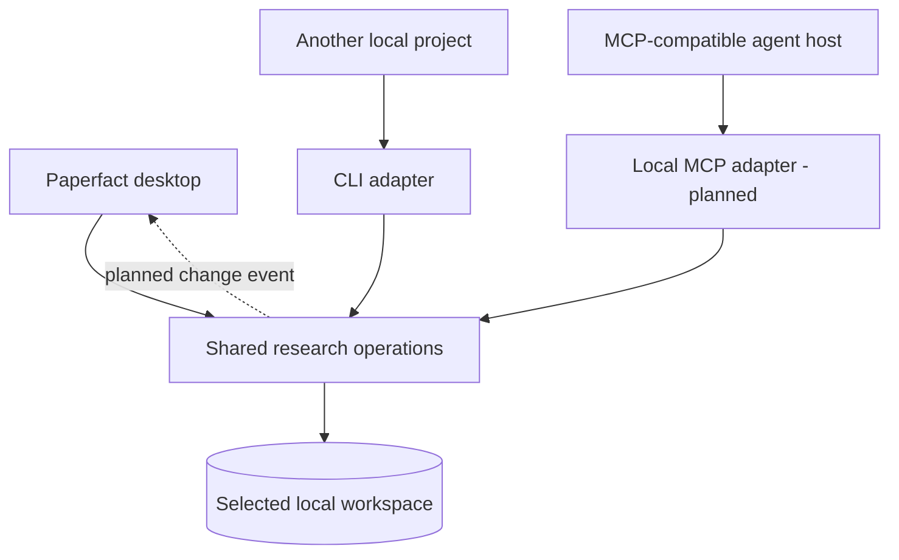
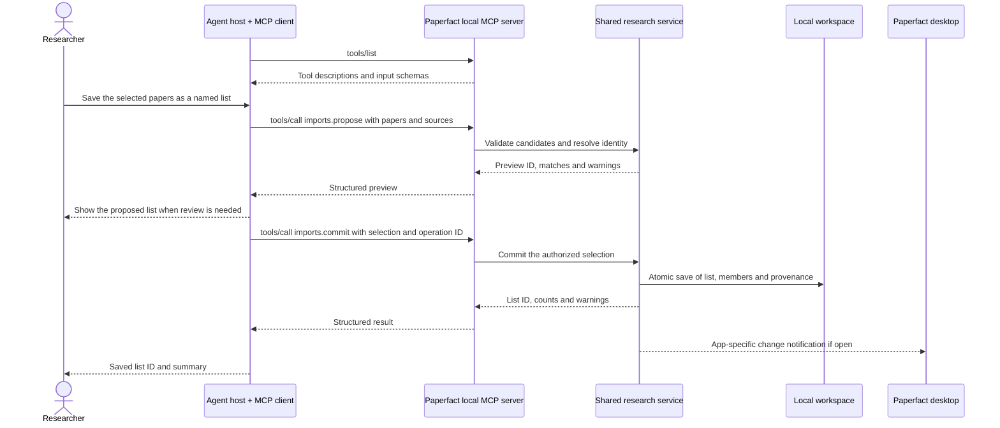

# Connect a local project or agent to Paperfact

**Available in 0.2.0:** CLI commands can create a list from references, add papers,
import research packages and run analysis in a selected workspace.
**Planned:** a local MCP server, a structured import API shared by all entry points,
operation IDs for safe retries, and notifications that refresh an open desktop.
The proposed tool names below are design examples, not installed commands.

## One research operation, three ways to call it

The desktop takes button clicks, the CLI takes command arguments, and an MCP
adapter takes tool requests. Each adapter should validate its transport input and
call the same research service. That service owns paper identity, validation,
transactions, deduplication and the result schema. A fix to list creation then
applies to all three entry points.



This is the target architecture. Today, bundle import/export already share
`research_service.py`; other commands use modules such as `lists.py` directly.
The full structured list-creation boundary still needs to be extracted. Neither
the desktop nor the CLI needs to call through MCP to use an in-process service.
The MCP server can run without the desktop window being open.

## What MCP contributes

MCP defines how an agent application discovers and calls tools. The **host** is
the agent application; its **client** communicates with a **server** that exposes
Paperfact operations. Tool definitions describe inputs using JSON Schema, and
calls can return structured results. The host and model decide when to request
a tool; Paperfact executes and validates the operation.
[Official architecture](https://modelcontextprotocol.io/docs/learn/architecture)
and [tools specification](https://modelcontextprotocol.io/specification/2026-07-28/server/tools).

For this local use case, use **stdio** first: the host starts a Paperfact helper
process and exchanges JSON-RPC messages over its standard input/output. A local
stdio server does not need a public URL or a cloud service. Exact host settings
and supported protocol/SDK versions must be verified during implementation.
[Official transports](https://modelcontextprotocol.io/specification/2026-07-28/basic/transports).

MCP supplies the tool protocol; it does not automatically implement paper search,
list validation, UI refresh, deduplication, model login or billing. Those remain
Paperfact and host responsibilities. A tool result returned to a cloud-backed
agent may enter that agent's model context: local storage is not a promise that
all returned data stays on the computer. Return IDs and bounded summaries by default.

## Example: an agent has already found the papers

You ask an agent working in another project: "Save these selected papers as a new
Paperfact list called Model quantization, and keep my reading order."

The following is a **proposed** flow, including application-level staging and
desktop notifications that MCP itself does not provide:



The host must first be configured with the local helper's executable, arguments
and selected workspace. Compatible hosts can then discover tools with `tools/list`
and invoke one with `tools/call`. Users do not need to type protocol messages.
Host permission settings and the scope of the user's request determine when
additional approval is necessary; a preview need not mean another modal on every call.

Proposed operations:

| Operation | Responsibility | Model use |
|---|---|---|
| `lists.list` | List collection IDs and names in the selected workspace | None |
| `imports.propose` | Validate structured paper candidates; report matches and uncertainty | None by default; metadata lookup may use the network |
| `imports.commit` | Save the chosen candidates and reading order atomically | None |
| `analysis.start` | Start a separate, explicitly requested analysis job | Uses the selected Paperfact connection and budget |
| `jobs.inspect` | Return job state and observable progress | None |

An externally prepared import should **not call another model just to store it**.
The external host pays for its own research/reasoning. Asking Paperfact to perform
additional analysis is a separate action using Paperfact's selected AI connection.
Rough references that still need parsing and topic discovery remain distinct
AI-enabled workflows; the current `import-list` command does use Paperfact's AI.

For safe retries, a proposed commit request includes a caller-generated operation
ID. The same ID and payload return the original result; reusing the ID for a
different payload is an error. Paper matching is a separate concern: detect DOI,
arXiv or other verified identity matches, and surface uncertain title matches.
All adapters must enforce these rules, including concurrent callers targeting
the same workspace. A database transaction alone is not retry deduplication.

## What you can use now

From another Windows project, a source installation can be called by absolute
path. Replace these example paths with the real checkout, workspace and UTF-8 file:

```powershell
$env:PAPERFACT_DATA = "D:\Research\Paperfact-workspace"
& "C:\Projects\Paperfact\.venv\Scripts\python.exe" `
  -m paper_daily import-list "Model quantization" `
  --file "C:\Projects\Experiment\references.txt" `
  --slug "quantization-research"
```

The installed Windows build instead ships
`$env:LOCALAPPDATA\Programs\Paperfact\paperfact-cli.exe`; use it with the same
subcommand and workspace setting. [Cross-platform CLI paths](cli-reference.md).

Important current behavior:

- The desktop and external process must select the **same workspace**. Source
  checkouts and installed builds have different defaults. A source checkout's
  `.env` may set `PAPERFACT_DATA`; an installed build does not read that file.
- `import-list` parses references with Paperfact's configured AI and then resolves
  papers. It is not the proposed no-model structured import operation.
- `--slug` names a list, not an operation ID; it does not provide the planned
  retry contract. Do not use another list's ID unintentionally.
- CLI results are primarily human-readable output. Stable structured results for
  external list creation remain to be implemented.
- Return to the desktop's list overview to reload lists created externally.
  Automatic external-change notification is not implemented yet.
- An external agent with shell access can use these commands today. An agent host
  needs an MCP integration to discover future Paperfact tools; merely opening an
  agent window does not connect it to Paperfact.

The shared service should authorize access to the selected workspace and accept
bounded research operations, rather than exposing arbitrary SQL or shell execution.
Downloaded sources and paper text are data, not instructions to the integration.
For the broader AI/account architecture, see [MCP and execution modes](mcp-and-modes.md).
