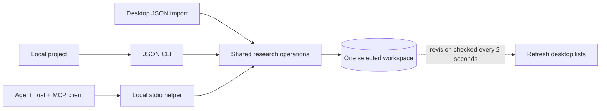
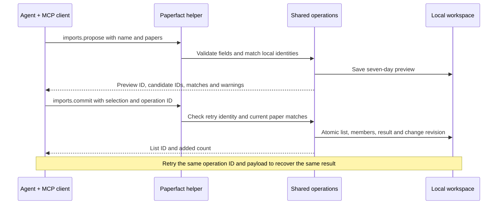

# Connect a local project or agent to Paperfact

**Available in 0.3.0:** local MCP over stdio and a JSON CLI use the same offline
research operations as the desktop's structured import. An external agent can
save a reading list without calling another model. The desktop can be closed.

## Connect once

In Paperfact, open **研究資料 → 本地整合 · 連接 agent… → 連接 agent** and copy the
generated configuration. It contains the executable and **this workspace's data
folder**, with no account keys. Add it to a host supporting `mcpServers` JSON.
For hosts using another configuration format, copy the same `command` and `args`
into that host's MCP settings; the JSON wrapper itself is not universal.

```json
{
  "mcpServers": {
    "paperfact": {
      "command": "C:\\Apps\\Paperfact\\paperfact-cli.exe",
      "args": ["mcp", "--workspace", "D:\\Research\\Paperfact"]
    }
  }
}
```

The example paths are placeholders; prefer the generated settings. A source
checkout generates its Python interpreter with `-m paper_daily`; installed
Windows and macOS builds use the bundled `paperfact-cli` executable. The Linux
AppImage uses its persistent file path with `--cli` rather than a temporary mount path.
The helper works independently of the terminal's current directory. Re-copy
settings after moving the checkout, executable or workspace.

Ask your connected agent: **“Save these papers as a Paperfact list called
Model quantization, in this reading order. Preview uncertain matches first.”**
The host discovers tools and invokes them; you do not type protocol messages.
Host permission prompts still follow that host's settings.

No MCP-capable host? The same dialog's **匯入 agent 整理的清單** tab accepts the
JSON format below. Preview it, check the papers, then save. Full research packages
with PDFs, notes and slides still use **研究資料 → 匯入研究資料包**.

## One operation, three entry points



MCP is a **protocol**, and Paperfact supplies a **server process** implementing
it. With stdio, the host starts that process and exchanges requests through its
standard input/output. There is no HTTP listener, public URL, cloud deployment
or always-running Windows service. The helper stays alive while the host keeps
the connection open, using memory and waiting for requests; it does not load the
desktop, an AI model, or a background analysis loop. The host controls when it exits.
[Official MCP architecture](https://modelcontextprotocol.io/docs/learn/architecture)
and [transport specification](https://modelcontextprotocol.io/specification/2026-07-28/basic/transports).

Refresh is driven by a committed database revision, so legacy CLI commands,
bundle imports and ordinary SQLite writes also update list views. It only observes
the selected workspace: a write to another data folder cannot update this one.
Installed builds default to the platform app-data directory; a source checkout
may select another folder through `.env`. Copy the desktop's generated MCP settings
or explicitly set `PAPERFACT_DATA` for legacy CLI commands.

Desktop list refresh preserves the active list, overview selection, filters and
open reader. A modal dialog defers the refresh until closed. It does not switch
to a new list or reload an in-progress editor. Local bundle import/export also
already share a service; older AI bibliography/topic commands remain separate
workflows and are not converted into MCP calls.

## Preview, select, save



| Tool / CLI operation | Result |
|---|---|
| `lists.list` | IDs, names and paper counts; pagination up to 100 lists |
| `lists.read` | Ordered titles, identifiers and source URLs; up to 100 papers per page |
| `imports.propose` | Validate 1–500 structured papers and save a preview for seven days |
| `imports.commit` | Save selected candidate IDs in their supplied order, atomically |
| `imports.discard` | Cancel a preview, leaving saved research untouched |
| `operations.inspect` | Recover a completed commit by operation ID |

All six operations are **offline and use no AI**. Metadata supplied by an agent
is not publication verification. Sources are stored as data; URLs are not fetched
by these tools. Open the list to use the desktop's existing PDF preparation,
or request AI analysis separately through the app or the existing `analyze` CLI.
MCP analysis/job-control tools are not included in this release.

## JSON CLI from any project

Use `paperfact integration OPERATION --workspace ABSOLUTE_FOLDER --file input.json`.
Omit `--file` to read UTF-8 JSON from stdin (`{}` for operations with no arguments).
Use the same folder the desktop shows in **本地整合**. The explicit argument wins
over inherited environment variables and a source checkout's `.env`.

For a source checkout, replace `paperfact` with its absolute Python executable
and `-m paper_daily`. See [platform-specific executable paths](cli-reference.md).

Create `papers.json`:

```json
{
  "name": "Model quantization",
  "papers": [
    {
      "title": "Example paper title",
      "authors": ["A. Researcher"],
      "year": 2025,
      "doi": "10.1234/example",
      "url": "https://example.org/paper",
      "pdf_url": "https://example.org/paper.pdf",
      "reason": "Read first for the background and notation."
    }
  ]
}
```

Only `name`, `papers`, and each paper's `title` are required. Other accepted paper
fields are `venue` and `arxiv_id`; unknown fields are rejected. Omit unavailable
fields rather than inserting `null`. Input is limited to 2 MB. To append to an
existing list, add `target_list_id` from `lists.list`; its existing name and
members stay unchanged.

Windows PowerShell:

```powershell
& "C:\Projects\Paperfact\.venv\Scripts\python.exe" -m paper_daily integration imports.propose `
  --workspace "D:\Research\Paperfact" --file "C:\Projects\Experiment\papers.json"
```

macOS / Linux source checkout:

```bash
/path/to/Paperfact/.venv/bin/python -m paper_daily integration imports.propose \
  --workspace "$HOME/Research/Paperfact" --file ./papers.json
```

The response is one JSON envelope: `{"ok":true,"result":{...}}`. Copy the returned
`preview_id`, choose candidate IDs (`"0"`, `"1"`, …), and create `commit.json`:

```json
{"preview_id":"COPY_RETURNED_ID","operation_id":"experiment-import-001","selected":["0"]}
```

Run the same command with `imports.commit --file commit.json`. CLI failures return
`{"ok":false,"error":{"code":"...","message":"..."}}` and exit code 2.
MCP domain failures set the tool error flag with the same error object as JSON
text. SDK schema errors are reported by MCP before the operation executes.

To generate the launch configuration without opening the app:

```bash
paperfact integration config --workspace /absolute/path/to/workspace
```

## Retries, matching and boundaries

- Generate an operation ID once per intended commit and keep it across timeouts.
  The same ID and request return the original result; changing selection or
  preview under that ID returns `conflict`. A new ID means a new operation.
- `operations.inspect` returns `committed` plus the saved result, or
  `not_committed`. A concurrent commit may still be finishing; retry with the
  original ID. Success records persist even after preview expiry or cancellation.
- DOI and arXiv matches reuse existing papers. Conflicting identifiers fail the
  entire transaction. Title-only matches are warnings, not automatic merges.
  After checking identity, supply `reuse: {"0":"EXISTING_PAPER_ID"}` to commit.
- Existing notes, explanations, reading order and metadata are preserved. New
  members append in selected order; missing identifiers/URLs may be filled.
  Source URLs and reading reasons remain with the saved research.
- Previews expire after seven days and are cleaned on a later proposal. Use
  `imports.discard` to remove one sooner. Commit receipts persist for retry safety.
  These integration records are local bookkeeping, not shared research-package content.
- Tools cannot switch workspace, run shell/SQL, read arbitrary files, select AI
  accounts, or export credentials. Connecting a host grants access to the tool
  set for that workspace. Titles returned to a cloud-backed host can enter its
  model context; local storage is not a guarantee of local-only model processing.
- No analytics uploader or OpenTelemetry exporter is added by this integration.

The official Python SDK is exercised through real stdio subprocesses in tests;
the frozen-app acceptance check repeats discovery, commit and retry. Host-specific
settings screens and real Claude/Codex/Gemini sessions are separate manual checks.
For future paid execution and external source integrations, see
[MCP and execution modes](mcp-and-modes.md).
