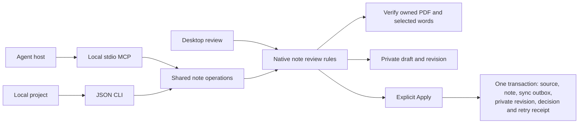

# Continue a recovered note from a local agent

Development candidate for **0.5.0.dev; not a published release feature**.
These operations continue a preserved historical note into an explicitly selected
current note. They are not general note creation, automatic conflict resolution,
AI analysis, remote synchronization, or a replacement for research-package import.

The desktop, JSON CLI and local stdio MCP helper share native review rules. A host
can inspect a draft, save its edits across restarts, inspect the owned original,
and explicitly apply the reviewed result. The currently displayed PDF stays open.

## A short workflow

1. `review.notes.list` finds historical notes. `review.notes.targets` lists current
   receiver notes for one `origin_id`. Choose a `target_id` explicitly; titles do
   not silently merge notes.
2. `review.notes.open` creates a durable private review. Retain its `draft_id`,
   `revision`, and the request's `operation_id`. Opening does not change the
   current note.
3. `review.notes.read` returns current and proposed content. A legacy page/word
   position without saved passage text is labeled `legacy_position_unconfirmed`.
   This is readable historical geometry, not proof that a quotation was checked.
4. `review.notes.sources` declares recorded, reviewed and current source intents.
   Pass an item's `reference` to `review.notes.page` to inspect actual owned PDF
   words. A declared intent has `availability: "not_checked"`; listing one does
   not prove that its bytes are available.
5. Use `review.notes.map` with page/raw word indices from that inspection, or
   `review.notes.clear` to make a plain note. Mapping derives quotation text from
   PDF bytes. A caller cannot supply invented quotation or extractor evidence.
6. `review.notes.save` saves the private body. Every successful private write
   returns a new revision. Use that revision for the next operation.
7. Inspect the saved content and source before `review.notes.decide` with
   `decision: "apply", confirm: true`. `decision: "keep"` keeps current research.
   The host is responsible for how it obtains the researcher's confirmation;
   a tool's boolean is not evidence that a human reviewed a dialog.

Each operation is also available through
`paperfact integration OPERATION --workspace ABSOLUTE_FOLDER`, using the same JSON
arguments. Source checkouts use their interpreter and `-m paper_daily`; see
[local integration setup](local-integration.md). The helper's workspace is fixed
before importing application configuration. Do not mix different workspaces'
drafts, revisions or operation IDs.

## Coordinates and limits

| Input | Meaning |
| --- | --- |
| `source` | Exact `{kind, document_hash}` reference declared for this draft; no path |
| `page_index` | Zero-based PDF page |
| `offset`, `limit` | Word-result pagination; at most 500 words per response |
| `anchor` | `{p0, o0, p1, o1}`; zero-based pages and raw PDF word indices |
| `body` | Valid UTF-8 text, at most 200 KiB |
| `revision` | Positive integer from the last saved private draft; booleans refuse |
| `operation_id` | Stable ID for one intended write; retain it when retrying |

Word indices are neither character offsets nor positions in the paginated array.
Use the returned words' `order` values. The service applies bounded source and
selection checks and caps responses at 2 MB. Inspecting quotation location does
not establish that the paper semantically supports a researcher's claim.

## Saving, retries and recovery

Private saves and their retry receipts commit together. Apply additionally commits
source ownership, the canonical note, synchronization outbox and decision receipt
in the same transaction. A failed receipt write rolls back that transaction.
Publishing a verified private source pair before Apply does not make it the
active PDF or grant permission to write research.

An identical successful request returns its original result after reconnect or
restart. Reusing its operation ID with different arguments returns `conflict`.
`operations.inspect` can recover the local committed outcome. These runtime retry
receipts are not a portable permission to replay actions after backup/adoption.

A competing private revision returns `conflict`; retain unsaved text and read the
new revision. A changed target, source owner, or replaced native database refuses
the delayed result. Do not fix such failures by blindly generating a new operation
ID and overwriting the current research. Review the current workspace first.

Detached recovered workspaces are read-only. Listing through CLI/MCP does not
initialize or migrate their database; writes require an editable managed copy.
Private draft portability, native source choices and supported canonical note
transfer have separate [source-mapping evidence](testing/note-source-mapping-scenarios.md).
Two public-operation journeys now have independent local coverage: private
backup/adoption/recheck/Apply/re-backup, and accepted peer/offline edit/client
restart/sync-back/old-Apply retry/backup. Historical receipts remain archive-only;
an identical old retry cannot overwrite a later peer edit. See the
[exact steps, results and limits](testing/note-continuity-scenarios.md).
Other format and interruption combinations remain unaccepted.

## Privacy and delivery limits

These tools run offline and do not call models, sign into AI services, download
PDFs or switch the current reader. Returned notes and original words are private
research that the external host may include in its model context. No arbitrary
filesystem path, SQL, shell command, credentials or native source capability is
accepted as an operation argument.

Actual subprocess CLI/MCP, synthetic PDFs, SQLite and Qt controls are covered by
local tests. This does not certify packaged binaries, live host configuration,
Apple Silicon Mac, phones, production sync, academic correctness or all other
research formats. See [executed user scenarios](testing/local-note-review-scenarios.md)
and the [remaining release gates](status-0.5.0.md).
