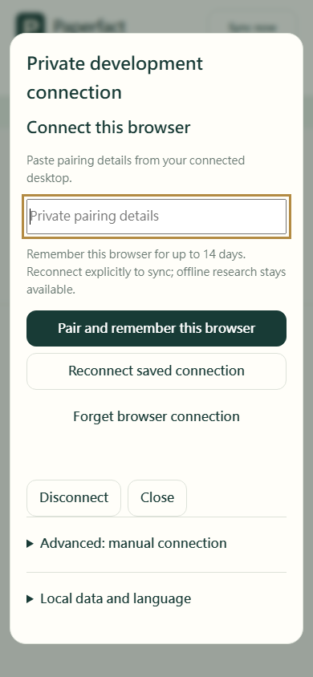
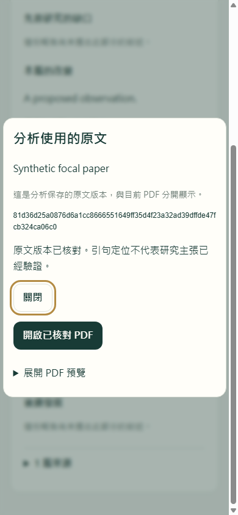
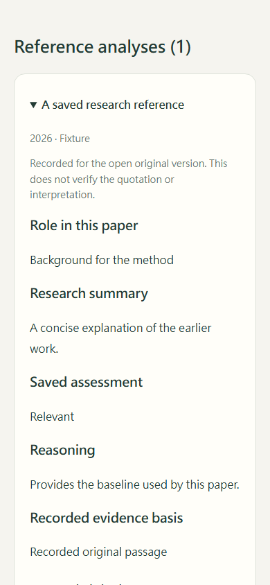
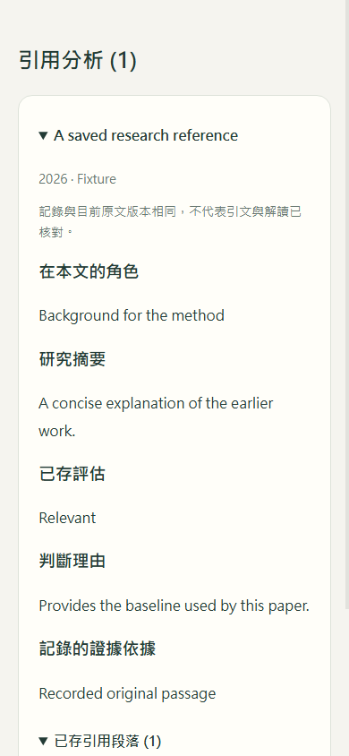
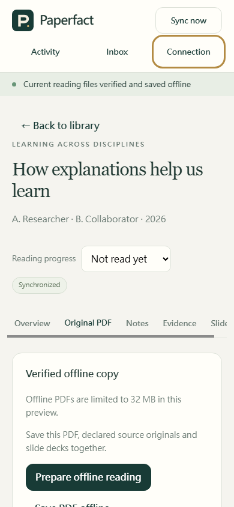
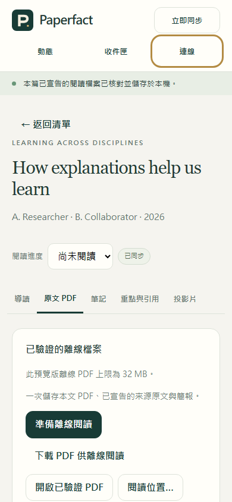
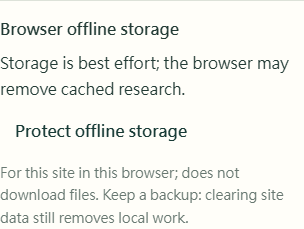
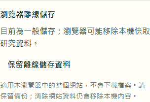

# Mobile reader implementation — v0.5

Status: integrated `0.5.0.dev` development candidate, updated 2026-11-13. This is not
a public release or completed cross-device acceptance. The separately maintained
0.4.x line remains for daily use. See [current status](status-0.5.0.md) for exact
evidence and remaining gates.

## Browser pairing and offline reconnection

The Connection page now presents three main actions, with manual IDs/credentials
under **Advanced: manual connection** and local import/export/language controls
under **Local data and language**. This remains private v0.5 development, requiring
the [same-origin service adapter](sync-http.md#same-origin-browser-adapter-development).
The plain static preview does not enable it. [Operator signing-key loading](sync-service-admin.md#enable-browser-pairing-explicitly)
is now implemented. The [versioned static artifact and HTTPS template](sync-service-admin.md#build-and-verify-the-public-pwa-artifact)
are prepared; actual same-origin deployment remains pending.

1. On a connected desktop choose **Devices > Pair another device > Copy pairing
   details**. Open the PWA on that service's same origin, paste the details and
   choose **Pair and remember this browser** (Enter also works outside IME input).
2. Paperfact creates a separate browser device and opens its scoped local research
   cache. The pre-existing local workspace is preserved; dirty note drafts must
   flush before adoption. If that flush fails, the original workspace stays open.
3. After reopening, cached research/drafts/outbox are available offline. No
   automatic authentication or upload occurs. Choose **Reconnect saved connection**
   to verify the saved cookie and continue synchronization with the same identity.
4. **Forget browser connection** defaults to Keep in its inline confirmation.
   Confirming clears the browser cookie and current cookie session; cached
   research remains. This does not revoke an already enrolled device. Use a
   trusted desktop's device catalog for revocation.



Repeated actions share one job; actual request phases are announced without fake
percentages. Close or Stop cancels delivery; a request already admitted remotely
can be checked with Reconnect. Changed workspace/engine contexts cannot adopt a
late response. Old dialog-close events cannot move focus from a newer dialog.
Manual and local-data actions are disabled during pairing. The dialog scrolls at
phone widths, retains 44px controls and focuses the pairing input. A confirmed
forget leaves Pair available for a new connection.

`browserPairingPanel(el, {language, transport, current, blocked, onConnected,
onForgotten, onPending})` in `mobile/browser-pairing.mjs` owns presentation and
single-flight cancellation only. `onConnected(identity, transport)` is a synchronous
handoff; the app closes the dialog and calls the existing guarded `openWorkspace`
path with the non-secret `COOKIE_SESSION` handle. The panel never stores secrets
or research. Its returned view exposes `controls` plus `run`, `askForget`, `keepConnection`,
`cancel`, `dispose`, `refresh`, `pending` and `disposed` for the thin app shell.

### Focused browser acceptance

Use the existing runner, an explicit browser executable and an isolated profile;
no personal browser, account or research database is used. From the repo root:

```powershell
$env:PAPERFACT_TEST_PAGE = 'browser-pairing-browser-test.html'
$env:PAPERFACT_PAIRING_SERVICE_PYTHON = (Resolve-Path .venv/Scripts/python.exe).Path
$env:PAPERFACT_TEST_SCREENSHOTS = "$PWD/build/pairing-mobile"
node mobile/browser-check.mjs 'C:/Program Files/Google/Chrome/Application/chrome.exe'
```

```sh
PAPERFACT_TEST_PAGE=browser-pairing-browser-test.html \
PAPERFACT_PAIRING_SERVICE_PYTHON="$PWD/.venv/bin/python" \
PAPERFACT_TEST_SCREENSHOTS="$PWD/build/pairing-mobile" \
node mobile/browser-check.mjs /path/to/chromium
```

Successful output is four `PASS` journeys. The fixture starts a temporary Python
authority behind the existing same-origin loopback proxy, forwards actual cookies,
uses real IndexedDB/service-worker storage, dispatches native Enter and actually
switches the browser offline/online. It verifies exactly one enrollment, durable
outbox -> received note, reload without background authentication, identity-preserving
reconnect and cancellation/confirmation of Forget. New view tests separately hold
requests to check close/stop/workspace-switch delivery and errors in both languages.
With `PAPERFACT_TEST_PAIRING_REVOCATION=1`, the same journey also revokes the paired browser from the synthetic desktop. An active reader loses server access, reconnect is denied and the unsent note remains in IndexedDB.
The shell-upgrade scenario evicts old shell code without touching research caches.

Local evidence: the final six affected mobile files passed **45 Node cases in
3.89s under the governor**; all critical selectors plus usage docs passed
**23 Python cases in 10.9s including checks**. **Four actual app journeys passed
in 5.16s**, also at 25% CPU/two logical cores. The first fixtures assumed English and
read canonical notes before acknowledgment; the corrected fixtures use the selected
UI language, open-dialog/readiness state and the durable outbox. Timeouts and user
requirements were retained. Phone-width English/Traditional Chinese screenshots
were inspected. These timings are scoped, not a complete release result.

Real cookies were tested over literal-loopback HTTP (the development exception).
Production HTTPS flags/origin refusal have protocol tests, not live TLS acceptance.
Safari/iOS/Android, installed PWA eviction behavior, installed Mac upgrades,
platform key-permission checks, same-origin hosting and external deployment remain gates.

## Current saved-Lineage read path

Portable schema-v2 snapshots now retain complete Lineage reports and require an
explicit receiver capability. The mobile overview renders bilingual saved-only
cards with proposed roles, original quotations, location states and missing
citation/semantic evidence. Import grants no cursor, graph, model or source-byte
authority. [Closed format and APIs](sync-projection.md#saved-lineage-read-projection).

Native saved Lineage cards now offer exact-original reading and located-page
links. The dialog opens verified cached bytes offline, with an explicit download
action when bytes are absent. It preserves the main PDF and pending notes; close
revokes local URLs and restores the still-current opener. Imported read-only
metadata alone grants no bytes. Changed source/report lifetimes and canceled or
stale views refuse delivery. [Behavior and browser evidence](testing/mobile-lineage-originals-candidate.md).

The integrated mobile Node scope passes **647 cases**. Earlier Python/HTTP and
isolated Chromium evidence are recorded separately, with no combined release
total. Physical phones, installed Mac and the complete full gate remain separate
acceptance requirements.



## Local startup and header

The last successfully opened workspace reopens offline from existing IndexedDB,
with paper selection/drafts/outbox preserved and no cached credential or automatic
authentication. A metadata-only hint remembers workspace/device/origin. Missing or
corrupt cache refuses rather than initializing empty research. Narrow headers use
two rows with complete labels and touch targets. [Contract and exact limits](mobile-workspace-startup.md).

## Implemented slice

- Responsive list overview and paper reader, with English/Traditional Chinese
  controls, keyboard tabs, touch-sized buttons and accessible status announcements.
- Plain-text explanations, citations and highlight reasons render as text, never
  remote HTML. No AI, analytics, URL crawling or automatic PDF fetch is triggered
  by incoming research.
- Editable unanchored text notes and per-membership reading state use actual
  private v2 operation envelopes. Legacy DTO1 is read-only compatibility input.
- IndexedDB commits local content/outbox in one workspace/device transaction;
  failed writes never claim a saved note. Drafts remain separate from canonical
  content, with local recovery export and unsaved-edit close protection.
- An editor captures the note operation/incarnation, paper incarnation, base
  revision and causal predecessor it observed. That observation persists beside
  the draft and is required for existing-note saves/deletes. A remote edit during
  typing or after reload cannot silently rebase the old draft: save/delete rejects,
  both texts remain readable, and the user can save the draft as a separate note.
  Receiving an acknowledgement of the same observed operation is not a stale edit.
- Workspace changes flush dirty text and its observed revision atomically into
  the old scoped store before closing it or resetting the view. This also covers
  switching before the input debounce fires. Failed flushes leave the old workspace
  and editor intact; the next workspace is not opened as a false success.
- Stable operation IDs, causal offline chains, acknowledged receipt gaps,
  contiguous event application/cursor commits and retained conflicts. Explicit
  note resolution can conflict again; delete/restore never silently revives content.
- Session identity is checked against both workspace and device before sync or
  file access. Credentials exist only in memory, travel only in authorization
  headers and are excluded from storage, recovery export and service-worker cache.
- Foreground/reconnect/manual sync deduplicates simultaneous jobs. Disconnect
  cancels the current generation, drops late results, retains local research and
  does not pretend to revoke a server credential or erase downloaded copies.
- Each foreground pass is bounded to 100 outgoing operations and 25 incoming
  pages. Remaining queued work or an unexhausted page budget is reported explicitly;
  it is never labeled fully synchronized. Another foreground/manual pass continues.
- Explicit PDF download uses bounded authenticated blob reads, durable partial
  bytes and complete SHA-256 verification before publication. Corrupt bytes reset
  the failed transfer for explicit retry. Metadata advances independently of files.
  Opening a cached PDF rechecks its bytes and current exact document target.
- Static-only PWA shell caching. Private request responses, PDFs, credentials and
  research endpoints are never placed in the service-worker cache.

## Module boundaries

| Module | Responsibility |
|---|---|
| `store.mjs` | Atomic IndexedDB scope records; fault-injectable memory test adapter |
| `domain.mjs` | Envelopes, receipts, lifecycle graph, outbox, conflicts and projection |
| `content.mjs`, `ids.mjs` | Closed read-only SQL content/rich notes and Python-compatible UUID5 identities |
| `engine.mjs` | Session generations, foreground sync, note/progress operations, exact PDFs |
| `transport.mjs` | Fixed bounded session/push/pull/blob-read HTTP contracts |
| `view.mjs`, `app.mjs`, `i18n.mjs` | Preserved editor/selection state, responsive UI and translated copy |
| `fixture.mjs` | Synthetic authority and valid sample PDF; not production authorization |
| `sw-policy.mjs`, `sw.mjs` | Allowlisted static shell cache only |

The injected transport has `session_info(token, signal)`,
`push(token, operation, signal)`, `pull(token, after, limit, signal)` and
`blob_read(token, sha256, size, offset, limit, signal)`. Extra abort arguments are
browser coordination, not wire fields. HTTP paths exactly match the existing
reference adapter. There are no invented enrollment, login, bootstrap or manifest
HTTP endpoints.

## Bootstrap and version gates

DTO2 explicitly declares `sync_bootstrap=false`. Importing DTO1/DTO2 therefore
does **not** set a synchronization cursor, create writable graph prerequisites,
copy credentials or assume local filesystem attachments exist. Allowlisted
explanations/highlights supplement readable canonical paper metadata; imported
notes remain read-only. Deleted canonical notes cannot reappear from an old DTO.

Authenticated synchronization starts at cursor zero and requires complete retained
service history. Missing/noncontiguous history is an explicit error. New entity
kinds or unsupported operation versions stop the receiving transaction without
advancing its cursor; they are never silently dropped. The later parent SQL
`research_content` and rich notes support closed receipt/projection with historical
source hashes preserved. Canonical unpositioned text notes also support guarded
body edits while retaining their desktop metadata.

The implementation supports the baseline list/paper/membership/note/reading-state/
ordering/primary-document/research-content event kinds. Rich notes preserve
kind/time/page/anchor. Validated `kind=note` rows without page/anchor can be edited
or explicitly deleted; anchored/quotation and unsupported kinds remain read-only,
with their flatten/delete rejection guards unchanged. Singleton analyses, citations and highlights project into the
reader; chat, resource and followup records have read-only cards. Canonical content
tombstones suppress old imported singleton/citation rows. Where legacy highlight
snapshot IDs cannot be matched to portable content IDs, the retained snapshot is
shown separately without enabling coordinates, instead of reviving a deleted
canonical highlight. It does not advertise anchored/quotation note writes,
research-content writes, retirement of every conflict kind, or a complete
server-side validation reimplementation. The actual authority remains responsible
for authorization and canonical graph acceptance. Reading-state conflict history
is retained/exportable; its full resolution editor remains a follow-up UI slice.

## PDF and reader limits

The browser limit is 32 MiB per PDF in this preview, with 256 KiB read chunks. This
is an explicit resource limit, not the authority's larger manifest limit. Bytes
remain private IndexedDB data. Current desired manifests and verified files are
separate; document replacement cannot activate a late old download. Existing
older immutable bytes may remain in local storage for future retention controls.

The reader uses the browser's native PDF presentation. Hash verification plus PDF
header/EOF checks are not a full PDF parser or a security sandbox. Word-range
anchors are not converted into invented rectangle geometry: matching verified
hashes may expose a source-page link, while unknown/mismatched source locations
remain disabled. Accurate in-page highlight rendering and Safari PDF behavior
need a dedicated reader integration. No source-anchor migration is performed.

Deck/file projection is still unsupported by the baseline DTO, so the Slides tab
states that limitation. It does not fabricate synchronized slide previews. Public
identity/signup, hosted HTTPS policy, account recovery, physical install/eviction
and storage pinning remain integration gates. Browser pairing is now implemented
and locally exercised above, not publicly hosted authentication. The app starts in a clearly labeled synthetic workspace.

## Verification and parent handback

Historical whole-mobile entry point for explicit deep diagnosis (Node 22+ and
the project's Python); use focused selections during normal development:

```sh
node mobile/check.mjs --python <project-python>
```

This runs deterministic Node behavior checks, then JavaScript through the actual
Python loopback authority: authenticated identity, six-entity seed history,
offline note chains, reading state, immutable retry receipts, verified PDF reads,
concurrent edit conflict, explicit resolution and immediate edit-then-delete.
The Python authority/database/blob root are temporary synthetic fixtures.
While this isolated worktree remains based on the older core, append
`--core-root <active-Paperfact-checkout>` to run interoperability against the
parent's newer SQL-content schema. After integration, the default relative core
path is correct. This flag only selects importable fixture implementation code;
it never opens that checkout's research database.

`node mobile/browser-check.mjs <chromium-or-edge>` runs actual browser IndexedDB
rollback/reopen, note/outbox durability and retry, scope isolation, UI note save,
draft/focus/selection retention and static-shell service-worker cache checks.
An optional output directory captures desktop and phone-sized screenshots.

Historical isolated-slice handback evidence: **58 Node checks** and actual Python HTTP interoperability passed;
four real headless Edge browser checks passed on Windows. Desktop 1320×900 and
phone-sized 390×844 screenshots were inspected: readable layout, visible actions,
no horizontal clipping. This is browser emulation, not physical iPhone/Android
acceptance. Background delivery, installed standalone mode, operating-system
eviction, private browsing, real offline restart, screen readers and live accounts
were not tested. No deployed service, real research, paid calls or account login
was used. `scripts/check.py` now includes the mobile entry point in its full gate.
The historical slice result does not certify the accumulated current revision;
a matching full repository check remains required.

Current unpositioned text-note behavior and exact limits: [desktop/mobile editing](mobile-note-editing.md).


## Development Lineage event compatibility

The mobile event consumer now validates full typed Lineage updates and projects
them into the existing read-only cards. It checks the complete selected paper
cohort and each available original's file incarnation. Retiring a source hides
the old projection; same-hash restoration needs a new explicit pinned update.
Malformed/obsolete events preserve the stored page, cursor, drafts and outbox
through the engine's atomic store update. No PDF download or model is implied.

The v18 offline shell includes this consumer. Python-generated three-original
frames are checked across the language boundary; the synthetic event tests do
not establish live server acceptance. The authority's Lineage admission and
compound source/content enrollment are still gated. See the
[consumer contract and limits](sync-projection.md#mobile-lineage-event-consumer).
Physical phone/Mac, actual browser layout, native credentials and hosted HTTPS
acceptance remain separate; no installer or deployment was produced here.


## Preserve work when service history changes

Before uploading from a nonempty local history, the foreground sync verifies its
last received event and any newer acknowledged write against the service. A push
that succeeded before a failed pull still requires this proof. Missing or changed history stops the
pass before outbox upload or reading-position reconciliation; drafts, local notes,
receipts and cursor remain intact. The message asks for service-backup review,
not browser storage deletion. Reconnecting cannot bypass that comparison.

The v27 static shell retains mandatory service-execution continuity to the received-plus-acknowledged history guard while retaining
research storage. This is local source/artifact behavior; an installed PWA must
receive the updated shell and service before pilot acceptance. This frontier
check does not replace full authority-generation negotiation, private HTTPS
hosting or Safari/physical-device durability checks.


Execution continuity is pinned by the bearer/cookie transport after identity
validation. A changed listener pauses research delivery without acknowledging or
removing local notes. Reconnect explicitly after checking matching app/service
versions; this clears only the ephemeral pin, and normal history checks still
precede upload. An old in-flight identity response cannot replace the new pin.
The service and current assets must be updated together; an older static client is
refused by the new service. Execution continuity is in native candidate 8bf00f9. New v27 citation-graph
content support is source/artifact-only; no hosted PWA is deployed. See [the HTTP boundary](sync-http.md#execution-continuity-during-a-transfer).


The v27 shell also validates/retains paper-scoped citation-neighbour graph content
without changing its paper owner or normalizing its saved JSON. Shared Python/JS
fixtures enforce byte, shape, duplicate-key and integer boundaries. This reuses
the bounded lexical parser; normal reading-position ingress keeps its prior page
checks. New content clients must update together; no old browser database is reset.
The ordinary saved-research projection retains the graph; a dedicated interactive
mobile graph view and physical-device display/refresh acceptance are not claimed.


## Saved reference analyses

The overview shows synchronized `citation` records as collapsed reference cards:
title (or retained reference key), year/venue, role, summary, saved assessment,
reasoning and evidence basis. Recorded citation passages have a separate native
disclosure control. Open either with the keyboard or touch; no AI call, fetch,
research mutation or automatic external link is attached to expanding a card.
The display remains usable from the existing offline research store.

Source notices distinguish an unrecorded original, an original that is not open,
the same open original hash and a different hash. A matching hash does not verify
the quotation or interpretation. Saved passages remain literal text; missing
passages are stated, never synthesized. This is reference-analysis reading, not
an interactive citation graph or a source-location/semantic audit. v28 refreshes
the shell without clearing research caches. Candidate cb6ca66 includes these cards
and the verified v28 artifact; the web app is built, not deployed.





## Saved list reports

Open a list to read its saved research overview. **Save report offline** downloads
and verifies the report; it does not generate new analysis. Saved cards show the
historical research goal, statements, quotation excerpts and expandable source
records. Original PDFs are downloaded separately. Recorded quotation locations
remain declarations; text occurrence alone does not certify scientific support.

The source now restores the Traditional Chinese report title, download/retry
messages and source states that had been literal question marks. It uses explicit
Unicode escapes and keeps English copy and literal-text rendering unchanged.
Shell cachev34 includes this correction; upgrading the shell does not migrate or
clear research IndexedDB, drafts, outbox or connections. The locally built and
verified v34 artifact is not deployed HTTPS or physical-phone acceptance. Current
0a64ec7 native/mobile downloads remain the independently verified v33 candidate.

## Prepare one paper for offline reading

In **Original PDF**, choose **Prepare offline reading** to verify and save the
current PDF, declared original sources used by native annotations/Lineage, and
that paper's current slide decks and images. **Save PDF offline** remains a
separate smaller download. Research metadata must already be synchronized.

The status reports verified items (for example, 1/3), with actual current-item
transfer percentages when available. It does not estimate elapsed time or the
percentage of the whole workspace. Repeated activation shares one job; changing
paper/workspace, Stop, source revisions and cancellations prevent stale completion.
Verified earlier items survive a failed later download and can be reused on retry.

A partial result means available files were saved but some source declarations
are missing, unavailable or cannot be verified. Read-only snapshots do not grant
original-file access. This does not download arbitrary linked papers, historical
versions or all workspace files. Existing PDF (32 MiB), artifact/cache and bounded
metadata limits still apply. No AI call or research operation is generated.

`Engine.prepareOffline(paperId, {current, signal})` returns readiness, warnings,
verified/total targets and `whole_workspace_offline_verified: false`. Cached-only
verification can run without a connected transport. Source context must still
match at completion; byte equality alone cannot replace source ownership/lifetime.

Shell v29 is built and verified locally, included in the delivered c1cbef2
native/mobile candidate, and has not been hosted. Windows synthetic core/protocol tests pass. Actual isolated
Chrome preparation, repeated activation, EN/ZH phone-width rendering, a fresh
service-worker-controlled offline document and transport-free PDF verification
passed against the exact v29 artifact. Physical Safari/phone durability, quota and
installed-device acceptance remain open.

### Reproduce the focused offline-reading browser journey

This opt-in journey uses the existing runner; it is not added to every development
check. Pass an explicit Chromium executable and optionally an already verified
artifact. A fresh profile contains only synthetic research and is removed after
that browser exits; no personal profile or account is reused.

```powershell
$env:PAPERFACT_TEST_JOURNEY = 'offline-reading'
$env:PAPERFACT_TEST_ARTIFACT = "$PWD/build/candidate-43688772032/mobile-web"
$env:PAPERFACT_TEST_ARTIFACT_ID = '6573854331ecc52eebe3e10d63d3901dc3aa8e2c4fe34bdfebd36755745b41eb'
$env:PAPERFACT_TEST_SCREENSHOTS = "$PWD/build/mobile-offline-reading-acceptance"
node mobile/browser-check.mjs 'C:/Program Files/Google/Chrome/Application/chrome.exe'
```

The example uses the [CI mobile artifact](https://github.com/puddings-world/Paperfact/actions/runs/43688772032/artifacts/14151596876).
Alternatively, first build the optional artifact with `node scripts/build_mobile.mjs --output
NEW_DIRECTORY`, then use its returned directory/ID above. Without `PAPERFACT_TEST_ARTIFACT`, the same journey exercises current source
assets. `PAPERFACT_TEST_ARTIFACT_ID` is the optional expected content hash. On
macOS/Linux set those variables with `export NAME=value` and pass the installed
Chromium executable; this record proves Windows Chrome only. Run under the existing
resource governor on Windows. Clear `PAPERFACT_TEST_JOURNEY` before running another
fixture. `fixture` remains its default; unsupported journey names fail explicitly.
This mode does not combine provider-service fixtures or the positional screenshot
tour. `PAPERFACT_TEST_SCREENSHOTS` optionally writes two screenshots and the bounded
`offline-reading-result.json` containing counts, viewport metrics and artifact ID.

Success prints `PASS actual offline reading UI` followed by the verified boundaries.
The journey checks the actual button twice, one saved PDF, zero research outbox
writes, both languages at 390px with no horizontal overflow and 44px touch targets,
a fresh offline document and cached-only verification with no transport. It is a
representative; native source/deck closure and source-change/cancel cases have
separate engine/protocol evidence. It does not certify physical browser storage
retention, every source, or a deployed host. [Recorded result](testing/mobile-offline-reading-20261115.json).






## Source after the v29 candidate: verified history

Shell v30 requires bounded linked history proofs for actual mobile sync, commits
received content and cursor with their proof, and retains acknowledgments even
when later delivery fails. Unsupported services stop with local work preserved.
Private recovery v3 retains these observations without activating archived devices
or old operations. The prior delivered v29 candidate remains unchanged.
See [migration, API and acceptance limits](sync-http.md#mobile-verified-flow-and-private-recovery).


## Browser offline storage protection

In **Original PDF**, the compact **Browser offline storage** section shows the
browser's current retention status. Opening it only calls the read-only
`navigator.storage.persisted()`. Choose **Protect offline storage** to explicitly
request `navigator.storage.persist()`; repeated activation shares one pending
request, with a disabled button and visible waiting text. No AI login, sync,
download, database mutation or upload is part of this action.

This is origin-wide storage permission for this site in this browser, not a
per-paper offline pin, a verified file closure or a backup. It is separate from
**Prepare offline reading**. Clearing site data, user removal and storage damage
can still lose local work. Keep a research backup and verify the files you need
before disconnecting. The behavior follows the
[WHATWG Storage Standard](https://storage.spec.whatwg.org/#dom-storagemanager-persist).

| State shown | Meaning / available action |
|---|---|
| Persistent | The browser reports persistent storage; the request button is disabled. Reopening re-reads actual browser state rather than trusting a saved grant. |
| Best effort | The browser returnedfalse; cached research can be evicted. The explicit request remains available. This is not a failed PDF verification. |
| Unsupported | Required APIs are unavailable; the request button is disabled, while reading remains independent. |
| Unknown | The API failed or returned invalid data; no grant is inferred, raw errors are not displayed, and explicit retry remains possible. |

An explicit request invokes the browser synchronously from the click, superseding
an older status query. A late old query cannot overwrite a grant. Closing/switching
panels suppresses stale UI updates; an already admitted origin-wide request may
still complete in the browser. It cannot be canceled or revoked through this API,
so no misleading per-paper toggle is offered. It is not an authorization to
connect, upload research or collect analytics.





The [recorded real-browser journey](testing/mobile-storage-protection-20261116.json)
uses a fresh isolated headless browser, actual native persistence methods and real
IndexedDB/service-worker reloads. It observed one explicit request, actualfalse,
`best_effort`, and zero requests after offline reopening. Research metadata hashes,
PDF count and outbox stayed identical. Both languages fit390px with44px request
targets and no console errors. Successful grant, old-query races, unavailable APIs
and denial/retry are additional simulated API/DOM cases. Physical Safari/iOS/
Android approval, installed PWA durability, quota pressure and hosted delivery remain
gates; no physical persistence guarantee is claimed.

Internal APIs: `BrowserStorageProtection(storage?)` provides `snapshot()`,
`inspect()` (read-only shared query), and `request()` (explicit shared request).
`storageProtectionPanel(el, {controller, t, current})` supplies the existing UI shell
and returns `element`, `status`, `button`, `refresh()`, `request()` and `dispose()`.
No credential or remembered grant is written into research or recovery exports.
Raw source/dev shellv36 includes the new module; exported cache identities still
follow content automatically. This UI is newer than the linked1875db5 mobile
artifact and has not been deployed.
