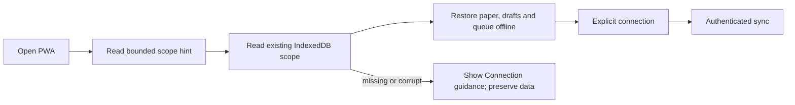

# Reopen an existing mobile workspace offline

0.5.0.dev isolated candidate, 2026-11-02; unreleased.

Opening the PWA again now restores the last successfully opened private workspace,
its selected paper, persisted drafts and pending changes. It remains disconnected
until an explicit connection. First use still opens the synthetic demo.

## Boundaries

- The local hint is closed version 1 metadata: workspace ID, device ID and canonical
  service origin. It contains no token, research text, account or file bytes.
- Only HTTPS and literal-loopback HTTP origins are accepted; credentials, paths,
  queries, fragments, extra fields and oversized/malformed hints refuse.
- `IndexedStore.openExisting` opens only a stored scope. A missing database upgrade
  is aborted; a missing scope returns no store. A retained handle cannot recreate
  an evicted scope. Wrong identity/corrupt content refuses before UI activation.
- Missing, invalid or unavailable cached work produces a clear Connection notice;
  existing research is not overwritten. Choosing the demo explicitly forgets only
  the hint; private research remains cached. Blocked hint storage is reported and
  does not undo a successful research save.
- Restore the saved paper even when no list was selected. Adopt saved selection only
  on the first view refresh; later updates preserve explicit navigation, including
  an empty overview chosen before the initial refresh.
- Restore never connects, pushes, fetches a PDF, invokes AI or reuses a credential.
  Connection fields retain the descriptor, with a blank token field. A resume hint
  is not server trust or device-enrollment authority; production identity/origin
  binding, pairing and recovery remain separate release gates.

## Header usability

On narrow screens the brand and Sync action share the first row; Activity, Inbox
and Connection occupy a second row. All labels remain whole, with 44 px minimum
touch targets. The same DOM order, keyboard focus and Enter/Escape behavior remain.
This is a static layout adjustment using the existing design; no decorative motion
or dependency was added. Internal offline shell cache is v16; app remains 0.5.0.dev.

## Developer verification

The ordinary mobile gate runs unit and Python HTTP scenarios. Browser checks are
explicit, use a new isolated profile and require a Chromium executable. Set
`PAPERFACT_TEST_BROWSER` to its absolute path, then run `node mobile/browser-check.mjs`.

| Mode | Environment settings |
| --- | --- |
| Cached-only IndexedDB and startup groups | `PAPERFACT_TEST_PAGE=workspace-startup-browser-test.html`; leave `PAPERFACT_NOTE_SERVICE_PYTHON` unset |
| Actual PWA/HTTP offline journey | Leave `PAPERFACT_TEST_PAGE` unset; set `PAPERFACT_NOTE_SERVICE_PYTHON` to the project's absolute Python interpreter |

Optional `PAPERFACT_TEST_SCREENSHOTS` selects an owned output folder. These are
environment variable values, independent of shell syntax; interpreter paths are
listed in the [CLI reference](cli-reference.md). Never point a fixture at real
research or reuse a personal browser profile.

## Evidence and limits

Final maintained mobile checks: 535 unit cases and 13 authenticated HTTP scenario
programs pass. Eight real IndexedDB/startup browser groups cover missing database,
missing/corrupt/deleted scope, pending work, automatic activation, explicit demo and
fallback. The actual PWA HTTP journey automatically reloads offline, retains one
note operation, makes zero restored-document research/auth calls, reconnects and
continues editing while preserving real stale drafts.

English/Traditional Chinese header labels were measured at 320/390/600/1100 px,
with no page/label overflow,44 px targets, keyboard dialogs and reduced motion.
The browser test distinguishes one already-started old-document auth completion
from the restored document using a stripped synthetic diagnostic header; it does
not ignore unowned or new-document requests.

This is owned headless Chrome on Windows, not installed Mac/iPhone/Android or
production login/service acceptance. Browser eviction, unavailable storage,
capacity limits and credential entry require their own real-device acceptance.
The whole application check remains red on separate citation policy work; there
is no commit, installer or release here.

[User actions, images and results](testing/workspace-resume-scenarios.md)
· [Mobile contract](mobile-0.5.md) · [Release scope](roadmap-0.5.0.md).
