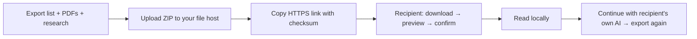

# Share a research list by link

Available in **0.4.0** for source and packaged apps. This transfers a snapshot of
one list into the recipient's local workspace. It does not connect their app to
your database or sign them in to your AI account.



## Sender

1. Select a list in **清單總覽**, or open it, and choose its export button.
2. Decide whether to include personal notes and Q&A. Available PDFs, analyses,
   figures, research routes and editable slide content travel with the package.
   The export result reports missing PDFs; these cannot be included until acquired.
3. Upload the exported ZIP to your chosen file host and choose who can download it.
4. In the export dialog choose **製作並複製分享連結…**, then paste the file's
   direct HTTPS download URL. Paperfact adds the ZIP's SHA-256 checksum and copies
   the link. Send that link privately to your colleague.

Paperfact does not upload files, create hosted storage, or change access permissions.
A checksum detects a changed download; it does not authenticate the sender or grant
access. Anyone who has a bearer download link may be able to download the research,
so use your file host's expiry/access controls. Renew the link after changing the ZIP.

## Recipient

Choose **網址匯入…** on either list page, or **研究資料 → 從分享網址匯入…**.
Paste the link, choose **下載並預覽**, review the list and confirm the import.
You can cancel during download. Failures leave research unchanged and allow retry.

Existing local research is kept by default; the preview provides the explicit
replacement option. Embedded PDFs are restored. A URL import does not fetch
additional missing PDFs from links inside the package. Reading imported research
needs no AI login. To continue analysis, use **目前 AI** to select your own account
and model; per-feature overrides remain your own settings.

The source and installer use the same transfer service. Neither account settings,
login tokens nor usage history are transferred. Importing a package does not
replace the recipient's provider configuration. See [package details](colleague-handoff.md).

## Link requirements and fallback

- A direct HTTPS ZIP download, without browser login cookies, on the normal HTTPS
  port. Signed/expiring query links are supported; their query is not shown in errors.
- A cloud preview or login page (including many default Drive sharing links) is
  not a direct download. Open it in your browser, download the ZIP, and use the
  existing **匯入研究資料包…** file picker instead.
- The app checks the optional link checksum, archive limits, then the existing
  package manifest and content hashes before import. Downloads are limited to
  1 GiB; expanded archives to 4 GiB, 50,000 files and 256 MiB per file.
- Download requests use a separate client without AI credentials, browser cookies
  or environment proxy settings. Local/private network destinations are rejected.
  Corporate networks requiring a proxy can use browser download + local import.
- Expired/revoked links must be renewed by the sender. Import is a snapshot;
  later edits require a new export. There is no automatic database synchronization.

## CLI integration

Activate the source environment, or use `paperfact-cli` next to a packaged app
(`Paperfact.AppImage --cli` on Linux). The same operations are available without AI:

```bash
paperfact list-share-link my-list.paperfact.zip "https://files.example.org/research.zip"
paperfact list-import-url "https://files.example.org/research.zip#paperfact-sha256=..." --preview
paperfact list-import-url "https://files.example.org/research.zip#paperfact-sha256=..."
```

Use the full generated checksum, not the placeholder above. `--preview` only reads
the package; importing preserves existing content unless `--replace` is explicit.
MCP's existing local research operations remain available; these new commands do
not add network tools to the MCP server. See [local integration](local-integration.md).
