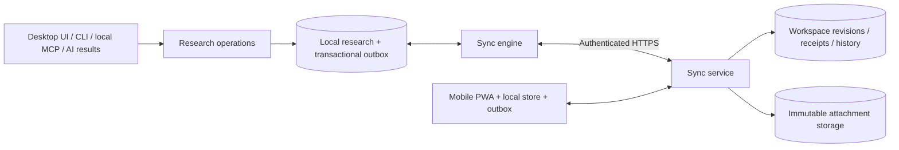

# Private workspace synchronization — proposed architecture

Status: design proposal for [v0.5.0](roadmap-0.5.0.md), not shipped behavior.
Implementation order and decision gates: [work plan](implementation-0.5.0.md).

## Existing seams

| Existing component | Reuse | Missing capability |
|---|---|---|
| `runtime.py`, `config.py` | Explicit workspace paths and platform defaults | User-facing migration/relocation and sync binding |
| `store.py` | Local SQLite research and transactions | Stable sync identities, entity revisions, change journal |
| `workspace_revision.py`, `desktop/workspace_changes.py` | Committed-write invalidation and non-disruptive refresh | Full change payloads, causality, deletion history; the counter is not a sync log |
| `local_operations.py`, `integration_entry.py`, `mcp_server.py` | Bounded operations and retry identities | Coverage of all research mutations |
| `research_service.py`, `bundle.py`, `bundle_files.py`, `bundle_links.py` | Validated research transfers and staged files | Replication semantics, reading-state/deletion propagation, versioned sync bootstrap |
| `pocket.py`, `pocket_reader.html` | Mobile PDF and research presentation | Independent authenticated PWA, durable local writes, sync transport |
| `llm.py`, `ai_profiles.py`, `ai_accounts.py` | Device-local provider routing and credentials | No new AI connection required for synchronization |

Bundle imports deliberately preserve receiver content and do not fully replicate
list renames, order, reading state, or deletions. Keep that sharing contract.
The current pocket reader uses generated pages and host capabilities; it is not
an independent synchronized mobile app.

## Boundaries

- Desktop clients retain SQLite; the PWA uses a browser-local database and file cache.
- Expose versioned domain operations, not raw SQL, arbitrary paths, or a remote shell.
- The service authenticates users/devices and authorizes every workspace operation.
- Shared validation/conflict semantics must be expressed as fixtures usable by Python
  and the browser client; do not assume they share a runtime or database schema.
- The cloud service must operate while the owner's desktop is off.
- Local MCP remains host-launched stdio. It is neither the sync server nor a mobile
  authentication mechanism. Applying remote changes never invokes an AI model.
- Host deployment and operating costs are explicit decisions; this document authorizes
  no deployment, subscription, credential modification, or research upload.

## Local durability and identity

Proposed records, subject to a schema ADR:

| Record | Purpose |
|---|---|
| Workspace binding | Stable workspace ID, service identity, schema/protocol versions |
| Device identity | Locally generated instance ID and server enrollment; never cloned from research backups |
| Entity metadata | Stable entity ID, accepted revision, local pending revision, deletion marker |
| Outbox operation | Operation ID, payload fingerprint, base revision, causal dependency, payload version, action, attachment hashes |
| Applied receipt/cursor | Duplicate suppression and the last transactionally applied remote sequence |
| Conflict/version | Both content versions, common base when available, provenance, resolution state |
| Attachment manifest | Hash, byte size, media type, logical owner and PDF-version dependency |

- Persist a research mutation and its outbox entry in the same local transaction.
- Use server-ordered revisions and explicit causal dependencies; wall-clock timestamps
  are display metadata, not conflict authority.
- Consecutive offline edits must refer to their local predecessor or be safely
  coalesced. Do not submit every edit against the same stale server revision.
- Inventory every writer, including AI workers, imports, legacy CLI, and file writers.
  Adopt the operation boundary or a transactional capture mechanism before enabling sync.
- Ordinary direct SQLite writes currently refresh the UI. They are not automatically
  sync-safe: define supported capture or detect and block an untracked state. Never
  claim coverage based only on the existing revision counter.
- Apply remote research, receipt, and cursor atomically, without echoing it as a new
  local operation. Preserve unrelated unsent edits, active selection, and editor drafts.

## Proposed transport contract

Endpoint names remain provisional; implement these semantics first:

- **Bootstrap:** consistent research snapshot, attachment manifest, and matching stream
  cursor. Download/stage before switching the local workspace.
- **Push:** bounded operation batches. Retry with the same operation ID and fingerprint
  returns the original result; reuse with a different payload is rejected.
- **Pull:** bounded cursor pages, with durable ordering and protocol/schema metadata.
- **Resolve:** an explicit versioned resolution operation, itself retry-safe and rejectable
  if another resolution already changed its base.
- **Attachments:** authorize upload/download; verify bytes and hash before finalization.
  Resume interrupted transfers; never expose arbitrary object keys or filesystem paths.
- **Devices:** enroll, inspect, revoke, and recover access through the sync identity system.

Server transactions bind receipts, accepted revisions, materialized research, and
change-stream entries. A timeout after commit must be recoverable by retry.
Object storage and the database are not one transaction: stage immutable blobs,
verify them, then commit references. Retain unreferenced uploads for a bounded grace
period; collect them only after active references/history no longer need them.

Publish an editor revision and its attachment manifest together. A receiving client
can show metadata while files download, but must not show an incomplete deck or
apply anchors to an unverified PDF. "Synced" and "available offline" are separate states.

## Conflict policy

| Change | Initial policy |
|---|---|
| Different entities | Merge independent changes. |
| Same field, same value | Accept idempotently. |
| Note / analysis / deck changed on both devices | Keep both revisions; choose or explicitly merge. Start with whole-document deck revisions. |
| Delete versus edit | Retain the edit as a conflict/recoverable version; do not silently resurrect or erase it. |
| List membership removal | Remove the membership only; preserve shared paper content and references. |
| Concurrent list ordering / renaming | Use an explicit versioned resolution; do not let each arrival silently reorder the list. |
| Reading position | Store per-device position with paper/PDF version; offer resume without interrupting the active reader. |
| Read/unread state | Treat explicit user changes separately from opening a page; preserve conflicting explicit intent. |

Keep tombstones until the documented offline/retention policy permits compaction.
A device older than that horizon must re-bootstrap; preserve its unsent edits for
review instead of replaying them blindly. Disconnecting a device cannot erase
copies it already downloaded; describe revocation accordingly.

## Selection, copies, and migration

- Allow synchronization of all lists or selected lists with a documented dependency
  closure. Shared papers and their notes belong to the workspace; preview which
  research will leave the device. Do not recursively upload every cited paper.
- Unpinning an offline file or stopping a subscription is not a research deletion.
- Assign stable IDs to legacy records while preserving existing IDs/anchors through
  mappings. Do not use titles or absolute paths as identity.
- First connection offers create a remote workspace or join an existing one.
  A nonempty local workspace requires an explicit merge/new-workspace flow.
- A colleague's imported bundle never enrolls their app into the sender's sync space.
- Backups and cloned folders do not duplicate device identities or reuse private
  service credentials. Re-enroll a restored device and reconcile its unsent work.
- Use consistent snapshots for backup/bootstrap. Ordinary sharing bundles are not
  full account/workspace backups. Test restore before advertising it.
- Preserve existing `PAPERFACT_DATA` overrides. Workspace path changes require
  verified copy, rollback, a deliberate switch, and updates to local integration
  launch settings. Do not silently repoint existing installs at an empty folder.
- Declare minimum client/protocol/schema versions. An incompatible client must not
  overwrite newer data; preserve its local work and show an actionable upgrade state.

## Identity, privacy, and mobile

- Sync login identifies the research owner; AI login selects a generation provider.
  Keep the two independent. No embedded global service key is a user credential.
- Store new sync credentials in OS-supported secure storage on desktop; use a
  reviewed browser session design with CSRF/XSS protections on the PWA.
- Exclude AI credentials, vendor homes, `llm.json`, local paths, device caches,
  telemetry and local usage logs from research payloads.
- Research sync explicitly uploads research content. Analytics remains a separate,
  optional consent and data path; sync logs should not contain document bodies,
  signed URLs, tokens, or raw provider errors.
- Decide the encryption/recovery model before a hosted pilot. TLS and encrypted
  disks do not mean the service operator cannot read research.
- Request browser persistence where supported; detect quota/write failures. Never
  label an in-memory note "saved". Evict reproducible downloads before unsent edits.
- Browser storage can still be cleared or evicted. Show unsent work and offer note
  export; provide retry/re-download recovery. Do not promise permanent offline storage.
- Sync on foreground/reconnect; opportunistic background APIs are optional.
- A PWA cannot directly reuse desktop CLI logins. Mobile AI execution requires a
  separate provider/worker design and is outside the initial sync delivery.

## References and limits

- [SQLite network-use considerations](https://sqlite.org/useovernet.html)
- [SQLite consistent backup API](https://www.sqlite.org/backup.html)
- [SQLite session extension](https://www.sqlite.org/sessionintro.html): a possible
  capture primitive to evaluate, not a complete sync/authentication product and not
  a selected dependency. It does not capture arbitrary research files.
- [Browser background sync support](https://developer.mozilla.org/en-US/docs/Web/API/Background_Synchronization_API)
- [Browser storage quotas and eviction](https://developer.mozilla.org/en-US/docs/Web/API/Storage_API/Storage_quotas_and_eviction_criteria)

These are architecture candidates, not harvested/validated skill rules. Recheck
external API support when selecting implementations and record real-device results.
