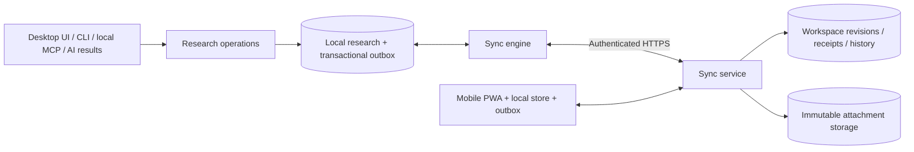

# Private workspace synchronization — proposed architecture

Status: design proposal for [v0.5.0](roadmap-0.5.0.md), not shipped behavior.
Implementation order and decision gates: [work plan](implementation-0.5.0.md).

## Personal Drive first (owner direction, 2026-11-17)

Personal cross-device sync should use the user's own Google Drive as the preferred
storage path. A separately billed Paperfact VM is not a prerequisite. The server
architecture below remains an optional backend/reference, not the desktop Drive
implementation. No paid GCP resources have been created.

Reuse the existing `drive.file` browser grant for app-created private files in a
visible Paperfact folder. Keep colleague exports separate: publish only a reviewed
list package with explicit Drive sharing, never the private workspace container.
The hidden `appDataFolder` cannot be shared and would require a different scope;
it is not needed for this visible-folder approach.

Each device retains its own SQLite workspace, durable changes and verified PDF/
deck cache. Implement a Drive-specific replica adapter for versioned changes and
immutable attachment bytes; do not put the live SQLite file in Drive desktop sync.
Drive change tokens identify file-feed positions, not the existing reference
server's verified authority sequence. Ordering, conflicts, retries and missing/
deleted remote files require explicit adapter semantics and acceptance before
real research upload. Drive is not a drop-in HttpTransport replacement.

Desktop Drive now persists explicit native grants and reconnects only after
local startup opt-in. Account/workspace guards and launch/foreground polling use
the existing session/controller boundaries; physical acceptance remains pending. Existing login alone must not enable
cloud upload. Google credentials remain device-local and absent from packages.
See [Drive scopes](https://developers.google.com/workspace/drive/api/guides/api-specific-auth),
[change retrieval](https://developers.google.com/workspace/drive/api/guides/manage-changes)
and [app-data constraints](https://developers.google.com/workspace/drive/api/guides/appdata).

### Whole-library list selection: required correction (2026-11-18)

The private directory has an optional, independent paper-history head per list.
It uses directory format v3 only after a paper head exists. Older clients reject
the unfamiliar format before writing. Each paper batch carries shared-operation
v2 paper and membership pairs. Both ends validate the selected list, paper UUID
and incarnation, and the local selection revision. Updating a list name leaves
its paper history intact. Retrying an identical acknowledged batch reuses the
same head. The first-publication adapter reads one ordinary reader database in a
read-only transaction. It serializes selected memberships in reading order and
uses the native paper payload. A paper shared by two source lists has one UUID
and separate memberships. The publisher validates the entire bounded baseline
before uploading and resumes only a matching acknowledged prefix. A divergent
history requires reconciliation. These checks have synthetic Drive coverage.
The ordinary reader now writes a received bibliography and its checkpoint in one
transaction, preserving order and previously received local papers. Device-private publication bindings retain the originating
paper ID before upload. When a receiving device includes that paper in a new
list, the original device reuses its paper and notes on the return trip.
Independent lookalikes still require review. Source appends resume from the checkpoint. Pre-existing overlapping bibliographies need review.
Offline edits remain local. Saving the selection receives then publishes new memberships.
After a successful publication each device remembers the verified paper-history head
and a digest of the local member IDs for that list. An unchanged save checks the
cloud head and local membership index without reading past paper batches or
serializing titles and abstracts. This cache is disposable; rollback checks use
the separate receive receipt. Each device keeps
its local order for independently added papers. Existing metadata edits remain local.

The owner expects one logical research database with a complete list directory,
visible on every paired device, and selectable list synchronization. The current
pilot does **not** implement this: login queries the active device's SQL lists,
while creation enrolls a selected-list copy as another workspace. Thus a Mac
containing only one imported list cannot offer the desktop's other lists.

Required behavior, not an implementation claim:

- Keep one stable logical library identity across devices. A selection change
  must not create another database or require abandoning the reader's database.
- After explicit directory-publication consent, discover the library's complete
  list IDs/names through private Drive metadata. Directory visibility is separate
  from permission to publish paper text, notes, analysis or attachment bytes.
- Show each list's selection, availability and sync state in one checklist.
  Remote-only lists must not be presented as absent. An original that has never
  been published requires the source device; login cannot recover nonexistent
  cloud bytes. Expose that waiting state rather than imply completion.
- Apply selection through a versioned subscription contract. The owner confirmed
  independent selection on each device. Unselected research must not be
  uploaded/downloaded merely to fill the picker.
- Preserve shared-paper and exact-source dependencies when a selected list needs
  them, without including unrelated research belonging only to unselected lists.
- Deselecting pauses that selection; it must not delete remote research, erase
  retained local content, discard drafts/outboxes or revoke another device.
  Downloaded-but-unselected content needs an explicit local retention indicator.
- Refresh the directory incrementally when a list is created/renamed/retired.
  Avoid a periodic full scan/export of every paper or repeated whole-library copies.
- Preserve the existing one-list pilot, old IDs, credentials and pending edits
  through an explicit reviewed migration; do not auto-merge same-named libraries.

Implementation constraints: the existing reference pull/history/cursor protocol
replicates an entire workspace. Dropping unselected events in the client would
falsely acknowledge unapplied research and break parent/source closure. Add
proper scoped history/receipts and selection-change catch-up, retaining the
existing conditional Drive publication and conflict engine. A remote list index
alone would fix discovery but would not implement selective replication.

Acceptance should cover desktop lists A/B, Mac initially containing only A,
directory discovery of B, selecting B and its exact originals, offline edits,
new/renamed lists, deselection without deletion, shared-paper dependencies,
duplicate/retry/cancellation and stale account/library delivery. Reuse bounded
fixtures; physical two-device acceptance remains required. Do not silently upload
owner research or create a new public release to test this correction.

#### Implemented local contracts (not yet a cloud subscription)

- `library_directory.inspect_lists(database, library_id, *, generation=0,
  published=(), ticket=None) -> Directory` reads only list IDs/names through one
  bounded read-only query. It reads no paper text, notes, files or credentials.
- `Directory.from_bytes(raw, *, library_id)` validates a closed canonical v1
  directory: library ID, generation, and sorted unique ID/name/published entries.
  `to_bytes()` is the wire representation; `digest` identifies that observation,
  not remote authorization. Generation must eventually come from verified cloud
  publication, not a device timestamp. Bounds are 10,000 lists / 1 MiB.
- `library_directory.checklist(directory, selected, *, local_ids=())` separates
  retained local data, pending download, and waiting for a source to publish.
  Published metadata is never labeled complete file synchronization.
- `DeviceSelection(database, *, owner_id, library_id, device_id,
  current_path=None, root=None)` provides `load() -> Selection` and
  `save(directory, selected, *, expected_revision, ticket=None) -> Selection`.
  SQLite commits selection intent under a revision check. Identical concurrent
  retries return one revision; stale differing choices or directory rollback refuse.
  Cancellation or a late database switch preserves earlier settings.
- Selection stores are outside research: the sibling `Paperfact-settings/library-sync`
  of the platform's default Paperfact data directory. Explicit test stores must also
  be outside the research root. Keys bind owner, library, device and physical
  database lifetime. No provider credentials or account emails are stored.
  Losing this device-local setting means no selection; it grants no startup
  consent and never deletes research. `current()` checks the captured binding.

`tests/test_library_selection.py` contains four bounded behavior journeys:
a desktop A/B directory visible to a Mac with only A; separate device selections
and deselection retaining research; actual concurrent/idempotent saves and stale
revision refusal; cancellation, late workspace switching, retry and replacement.
The desktop sign-in flow reads the private directory and overlays local list
names. Saving the reviewed checklist publishes new local names after confirmation
and stores selection on this device. The existing workspace transfer is a
separate collapsible section. In ordinary databases, the checklist can exchange
list names and descriptions using independent per-list history and device-local
receipts. Divergent edits are retained on their originating devices for review.
The cloud directory carries list history pointers, never list descriptions.
Reading list B does not fetch list A's operations. Both desktops can append papers
to a selected list offline. **Sync saved lists now** exchanges list details and
new paper memberships using the saved selection revision. It never publishes a
new local list name. Concurrent additions converge as a set; each device keeps
its local reading order. Removing a paper, reordering an existing membership,
and editing a paper's existing metadata still need reconciliation.

### Background sync for ordinary lists

- The main window owns a single worker across settings and reader views.
  A pass must use the same saved-selection operation as **Sync saved lists now**.
  Account switches, changing the workspace, and disabling sync must cancel or drain
  the worker before another session takes ownership.
- The session-only opt-in reuses the current Google login while the app is open.
  Reconnecting after restart requires separate device-local consent and a native
  grant bound to the Google owner, library folder, directory head and local database.
  The existing Drive vault requires an enrolled workspace. An ordinary reader needs
  its own binding before it can reconnect unattended.
- On idle, check at a bounded interval. Coalesce local changes, back off offline
  and pause conflicting lists for review. Disabling sync should disarm its timer.
- Verify on two installed devices that a private list created between passes stays
  private, both devices receive independent offline additions after reconnecting,
  and closing settings allows the worker to finish. Verify that revoking the
  grant or switching accounts stops transfers with the old identity.

### Selected paper notes

The transport supports a per-list native note history. A device must explicitly
enable notes for a selected list. Existing bibliography choices carry no note
grant. Deselecting the list removes its local grant in the same transaction.
Turning notes off and back on invalidates previously opened note streams.

Each native note references a portable paper and its incarnation in the list's
verified bibliography. The first published note head upgrades the directory to
v4. Note bodies stay in the scoped history records. Readers retain v1-v3
compatibility; an older app can refuse a v4 directory. Directory updates for
names or papers preserve the other streams.

The ordinary reader exchanges new cards after bibliography exchange. Each device
can opt in for a highlighted saved list. Native card identity survives delivery
and cross-list reuse; body, creation time, kind, page and validated anchor travel
with the card. Receivers install incoming records transactionally against a
verified paper binding. Each device stores its last accepted operation ID for
each list and note. The immutable operation contains the corresponding payload.
An edit identifies its predecessor. A receiver with unchanged local content
applies the edit. A writer publishes against the observed Drive head and
acknowledges the uploaded snapshot without replacing subsequent typing.
Previously issued new-card permissions retain their original scope. Renew the
list's permission on each device to exchange edits.

For notes and saved explanations, an ordinary list sender stores the scoped operation
ID and predecessor locally before upload. After a lost reply the next exchange
verifies the uploaded content hash and chain, then records the common version in
the same transaction as reconciliation. Receipts contain no note or guide text.

When two devices edit the same mapped card from a known common revision, each
retains its version. Other cards continue to upload and download during background
polling. A missing mapping, ambiguous match or invalid history still requires
list-level review. The ordinary reader can compare the common, local and Drive
versions. Applying a choice rechecks the local payload, grant, accepted revision
and observed remote operation. A later competing Drive update uses the usual
conflict rules. Choices are local until exchanged. Deletion,
verified attachments and pilot migration remain open. Outstanding acceptance
includes lost acknowledgements with subsequent offline edits, deletion versus
editing, shared-card changes across lists, live Drive and installed devices.

Directory attachment transport uses verified private-folder chunks. Uploads bound
to an original's SHA-256 and size reject mismatches before allocating Drive
objects. After a full verified download, the receiving device can reuse the
same remote chunks when publishing the same bytes from another list. This is
transport support. Each device can grant or revoke PDF permission for a saved list
independently of notes. Deselecting the list clears that grant. Directory transfer
checks the paper incarnation in the selected bibliography and rechecks the captured
grant during chunk transfer. A revoked and reissued grant invalidates the old
transfer. A selected list now has a private, bounded index of paper incarnations
and verified original manifests. The first publication upgrades the directory
to v5. Its directory entry exposes only an immutable index reference. Discovery
and downloads verify the bibliography and grant, and conditional publication
preserves concurrent catalog changes. Publishing a different digest for an
existing original requires review. Manual and session background exchanges now
transfer ordinary-reader originals for explicitly enabled lists. The receiver
checks the digest and opens the staged PDF before installing it under its local
paper ID. Installation cannot replace an existing file. Ambiguous legacy file
names require review, and enrolled workspaces use their existing document path.

Saved deep explanations have their own per-list device grant and v6 history head.
The exchanged native research-content row carries the guide body, timestamp and
specification. It carries no claim of verified PDF provenance. A receipt identifies
the last accepted operation per device, list and paper. Divergent edits and missing
previously received guides require review. The stream enforces the same bounded
history budget as other selected-list streams. Related figures, source links,
citations and slides still travel separately in research packages.

The Drive directory adapter can now initialize and discover a private directory,
read its current catalog and publish explicit list additions or renames with a
conditional write. A device with a partial library retains all other entries.
The directory contains no paper bodies or attachments. Unchanged publications
allocate no file. Each changed publication currently stores a directory snapshot;
a competing write can leave an unreferenced snapshot. Storage reclamation and
real-device acceptance remain open. Directory folders use a distinct Drive role
so installed pilot readers ignore them.

Scoped byte/history transport, original-library
adoption and pilot migration remain required before a new installer can satisfy
the whole-library selection journey. No owner data were uploaded to test them.

### Desktop Drive pilot (2026-11-18)

The desktop path is implemented in source: Google login/discovery, explicit
create/join, native grant/device-token storage, startup opt-in, the existing
continuous-sync controller, and verified PDF/file transfers. Existing research
first prepares a separate supported copy and backup; unsupported coverage remains
blocked rather than omitted. Joining never merges into the active database.
Public v0.5 release and installed-device acceptance are separate gates.

| Component | Contract |
|---|---|
| `DriveFiles` / `DriveLog` | Account-owned, private app objects; immutable byte/hash references; strong conditional metadata publication. Failures never initialize over existing cloud data. |
| `DriveAuthority(...).invoke(method, *args, control=None, **kwargs)` | Closed existing service methods, known-schema row state, original operation IDs/base revisions and the existing `ReferenceService` conflict/control-history engine. A private derived cache, never the live research database. |
| `DriveObjects(files, folder, workspace, cache).put(path)` / `.get(manifest, store)` | At most 150 MiB per object, 4 MiB immutable chunks, durable preallocated upload IDs, verified retry, partial-download resume, full hash verification before local ownership. |
| `TransportFactory(workspace, ...)` | Lazy native-vault routing for stable Drive origins; ordinary endpoints still use `HttpTransport`. No constructor login or credential read. |
| `DriveSetup(database, ...).sign_in(ticket, progress)` / `.create(name, ticket, progress, pdfs=None, list_ids=None)` / `.join(spec, ticket, progress)` | Explicit account/coverage/target selection, resumable enrollment, native startup consent and reconnect to the same workspace/device. Login alone does not enable uploads. |
| `DriveSyncDialog` | Default footer/workspace entry; background progress, duplicate/cancel/stale-result guards, create/join and automatic-sync toggle. Self-hosted configuration is under Advanced. |

The desktop checklist scopes first enrollment to selected lists, using the existing
offline package exporter/importer in separately bound child processes. Selected
originals, per-list read status and timestamps travel with the selected memberships.
Citation endpoints carry bibliographic metadata. Only selected member papers carry
personal queue entries and reading history. Unrelated catalog rows and
credentials are excluded. Selection creates a separate workspace; it is not a
live filter on the original database. Installed builds remember that workspace
in device-local `active-workspace.json`, pinned to the database file identity.
Explicit data-directory overrides and source-checkout isolation take precedence.

The approved live provider check exposed double decoding of Google gzip replies.
The streaming boundary now retains decoded bytes and strips the original transport
encoding/length headers; a compressed-response regression covers JSON and media.
A completed full-workspace live result is still required separately.

Each accepted state change uploads a row delta, with a full known-schema checkpoint
every 32 publications. Hash-linked immutable commits preserve ordering; a conditional
head update is the cloud commit point. A competing/uncertain write keeps the caller's
outbox intent. The next pass reloads accepted state and applies the original conflict
rules; it never silently rebases a stale edit. Schema is data (known table/column rows),
never SQL from Drive. Anchor and restored cache state commit together. Device grants
are hashed in authority rows; Google refresh tokens and plaintext credentials stay
in the native vault.

The authority proves continuity against its retained local anchor. Verified chain
links are cached during bounded catch-up; fresh receivers load a checkpoint and at
most 31 deltas. The primitive `DriveLog.read_since` retains its 100-commit/8 MiB
bound; the application uses checkpoint reconstruction instead. Missing/rewritten
prefixes pause rather than reset the workspace.

Current bounds: 64 MiB / 100,000 authority metadata rows, 150 MiB per attachment;
first legacy enrollment retains its 256-file / 512 MiB limits. These reject rather
than truncate. Remote orphan/history garbage collection, physical storage/quota
recovery, rehoming an already-bound workspace to another authority, and installed
device/corpus acceptance remain open. Same-owner Drive access is the actual
authorization boundary: app device revocation cannot stop someone who still controls
the Google account from authorizing a fresh device. This is not independent fencing.

One approved live synthetic file probe verified metadata updates (fresh 200,
stale 412, competing [200, 412]) and exact-file deletion (204). Source fixtures
exercise two-device conflict/restart, uncertain acknowledgment, chunked PDFs,
create/copy/join, native-record restore, offline note round trip, checkpoint
rollover and GUI cancellation. These do not certify real accounts or physical
devices. Development tests did not upload real research.

Native builds receive `PAPERFACT_GOOGLE_DESKTOP_CLIENT` from a repository secret.
`scripts/prepare_google_client.py` selects only the developer Desktop client
fields, excluding user grants. Desktop clients are public and cannot keep a client
secret confidential; bundled configuration identifies Paperfact without logging in
as the developer. PKCE and each user's browser consent remain required. See
[Google's native guidance](https://developers.google.com/identity/protocols/oauth2/native-app).

## Existing seams

| Existing component | Reuse | Missing capability |
|---|---|---|
| `runtime.py`, `config.py` | Explicit workspace paths and platform defaults | User-facing migration/relocation and sync binding |
| `store.py` | Local SQLite research and transactions | Stable sync identities, entity revisions, change journal |
| `workspace_revision.py`, `desktop/workspace_changes.py` | Committed-write invalidation and non-disruptive refresh | Full change payloads, causality, deletion history; the counter is not a sync log |
| `local_operations.py`, `integration_entry.py`, `mcp_server.py` | Bounded operations and retry identities | Coverage of all research mutations |
| `research_service.py`, `bundle.py`, `bundle_files.py`, `bundle_links.py` | Validated research transfers and staged files | Replication semantics, reading-state/deletion propagation, versioned sync bootstrap |
| `pocket.py`, `pocket_reader.html` | Mobile PDF and research presentation | Independent authenticated PWA, durable local writes, sync transport |
| `llm.py`, `ai_profiles.py`, `ai_accounts.py` | Device-local provider routing and credentials | No new AI connection required for synchronization |

Bundle imports deliberately preserve receiver content and do not fully replicate
list renames, order, reading state, or deletions. Keep that sharing contract.
The current pocket reader uses generated pages and host capabilities; it is not
an independent synchronized mobile app.

## Boundaries

- Desktop clients retain SQLite; the PWA uses a browser-local database and file cache.
- Expose versioned domain operations, not raw SQL, arbitrary paths, or a remote shell.
- The service authenticates users/devices and authorizes every workspace operation.
- Shared validation/conflict semantics must be expressed as fixtures usable by Python
  and the browser client; do not assume they share a runtime or database schema.
- The cloud service must operate while the owner's desktop is off.
- Local MCP remains host-launched stdio. It is neither the sync server nor a mobile
  authentication mechanism. Applying remote changes never invokes an AI model.
- Host deployment and operating costs are explicit decisions; this document authorizes
  no deployment, subscription, credential modification, or research upload.

## Local durability and identity

Proposed records, subject to a schema ADR:

| Record | Purpose |
|---|---|
| Workspace binding | Stable workspace ID, service identity, schema/protocol versions |
| Device identity | Locally generated instance ID and server enrollment; never cloned from research backups |
| Entity metadata | Stable entity ID, accepted revision, local pending revision, deletion marker |
| Outbox operation | Operation ID, payload fingerprint, base revision, causal dependency, payload version, action, attachment hashes |
| Applied receipt/cursor | Duplicate suppression and the last transactionally applied remote sequence |
| Conflict/version | Both content versions, common base when available, provenance, resolution state |
| Attachment manifest | Hash, byte size, media type, logical owner and PDF-version dependency |

- Persist a research mutation and its outbox entry in the same local transaction.
- Use server-ordered revisions and explicit causal dependencies; wall-clock timestamps
  are display metadata, not conflict authority.
- Consecutive offline edits must refer to their local predecessor or be safely
  coalesced. Do not submit every edit against the same stale server revision.
- Inventory every writer, including AI workers, imports, legacy CLI, and file writers.
  Adopt the operation boundary or a transactional capture mechanism before enabling sync.
- Ordinary direct SQLite writes currently refresh the UI. They are not automatically
  sync-safe: define supported capture or detect and block an untracked state. Never
  claim coverage based only on the existing revision counter.
- Apply remote research, receipt, and cursor atomically, without echoing it as a new
  local operation. Preserve unrelated unsent edits, active selection, and editor drafts.

## Proposed transport contract

Endpoint names remain provisional; implement these semantics first:

- **Bootstrap:** consistent research snapshot, attachment manifest, and matching stream
  cursor. Download/stage before switching the local workspace.
- **Push:** bounded operation batches. Retry with the same operation ID and fingerprint
  returns the original result; reuse with a different payload is rejected.
- **Pull:** bounded cursor pages, with durable ordering and protocol/schema metadata.
- **Resolve:** an explicit versioned resolution operation, itself retry-safe and rejectable
  if another resolution already changed its base.
- **Attachments:** authorize upload/download; verify bytes and hash before finalization.
  Resume interrupted transfers; never expose arbitrary object keys or filesystem paths.
- **Devices:** enroll, inspect, revoke, and recover access through the sync identity system.

Server transactions bind receipts, accepted revisions, materialized research, and
change-stream entries. A timeout after commit must be recoverable by retry.
Object storage and the database are not one transaction: stage immutable blobs,
verify them, then commit references. Retain unreferenced uploads for a bounded grace
period; collect them only after active references/history no longer need them.

Publish an editor revision and its attachment manifest together. A receiving client
can show metadata while files download, but must not show an incomplete deck or
apply anchors to an unverified PDF. "Synced" and "available offline" are separate states.

## Conflict policy

| Change | Initial policy |
|---|---|
| Different entities | Merge independent changes. |
| Same field, same value | Accept idempotently. |
| Note / analysis / deck changed on both devices | Keep both revisions; choose or explicitly merge. Start with whole-document deck revisions. |
| Delete versus edit | Retain the edit as a conflict/recoverable version; do not silently resurrect or erase it. |
| List membership removal | Remove the membership only; preserve shared paper content and references. |
| Concurrent list ordering / renaming | Use an explicit versioned resolution; do not let each arrival silently reorder the list. |
| Reading position | Store per-device position with paper/PDF version; offer resume without interrupting the active reader. |
| Read/unread state | Treat explicit user changes separately from opening a page; preserve conflicting explicit intent. |

Keep tombstones until the documented offline/retention policy permits compaction.
A device older than that horizon must re-bootstrap; preserve its unsent edits for
review instead of replaying them blindly. Disconnecting a device cannot erase
copies it already downloaded; describe revocation accordingly.

## Selection, copies, and migration

- Allow synchronization of all lists or selected lists with a documented dependency
  closure. Shared papers and their notes belong to the workspace; preview which
  research will leave the device. Do not recursively upload every cited paper.
- Unpinning an offline file or stopping a subscription is not a research deletion.
- Assign stable IDs to legacy records while preserving existing IDs/anchors through
  mappings. Do not use titles or absolute paths as identity.
- First connection offers create a remote workspace or join an existing one.
  A nonempty local workspace requires an explicit merge/new-workspace flow.
- A colleague's imported bundle never enrolls their app into the sender's sync space.
- Backups and cloned folders do not duplicate device identities or reuse private
  service credentials. Re-enroll a restored device and reconcile its unsent work.
- Use consistent snapshots for backup/bootstrap. Ordinary sharing bundles are not
  full account/workspace backups. Test restore before advertising it.
- Preserve existing `PAPERFACT_DATA` overrides. Workspace path changes require
  verified copy, rollback, a deliberate switch, and updates to local integration
  launch settings. Do not silently repoint existing installs at an empty folder.
- Declare minimum client/protocol/schema versions. An incompatible client must not
  overwrite newer data; preserve its local work and show an actionable upgrade state.

## Identity, privacy, and mobile

- Sync login identifies the research owner; AI login selects a generation provider.
  Keep the two independent. No embedded global service key is a user credential.
- Store new sync credentials in OS-supported secure storage on desktop; use a
  reviewed browser session design with CSRF/XSS protections on the PWA.
- Exclude AI credentials, vendor homes, `llm.json`, local paths, device caches,
  telemetry and local usage logs from research payloads.
- Research sync explicitly uploads research content. Analytics remains a separate,
  optional consent and data path; sync logs should not contain document bodies,
  signed URLs, tokens, or raw provider errors.
- Decide the encryption/recovery model before a hosted pilot. TLS and encrypted
  disks do not mean the service operator cannot read research.
- Request browser persistence where supported; detect quota/write failures. Never
  label an in-memory note "saved". Evict reproducible downloads before unsent edits.
- Browser storage can still be cleared or evicted. Show unsent work and offer note
  export; provide retry/re-download recovery. Do not promise permanent offline storage.
- Sync on foreground/reconnect; opportunistic background APIs are optional.
- A PWA cannot directly reuse desktop CLI logins. Mobile AI execution requires a
  separate provider/worker design and is outside the initial sync delivery.

## References and limits

- [SQLite network-use considerations](https://sqlite.org/useovernet.html)
- [SQLite consistent backup API](https://www.sqlite.org/backup.html)
- [SQLite session extension](https://www.sqlite.org/sessionintro.html): a possible
  capture primitive to evaluate, not a complete sync/authentication product and not
  a selected dependency. It does not capture arbitrary research files.
- [Browser background sync support](https://developer.mozilla.org/en-US/docs/Web/API/Background_Synchronization_API)
- [Browser storage quotas and eviction](https://developer.mozilla.org/en-US/docs/Web/API/Storage_API/Storage_quotas_and_eviction_criteria)

These are architecture candidates, not harvested/validated skill rules. Recheck
external API support when selecting implementations and record real-device results.

### Selected-list reading progress

The native Drive transport accepts version-2 reading-state puts in a separate
history for each selected list. Each record must match the verified list, paper
and membership incarnations. Each device must grant reading progress separately.
A directory first uses v7 when it publishes a reading head. Directories without
one keep their existing canonical format. Older clients cannot open a v7 directory.

The transport fixture exchanges a read marker for a paper in two lists, checks
the other list stays untouched and revokes the receiving device's grant.
The ordinary reader uses a separate per-list opt-in on each device. The last
accepted operation for each membership is recorded with the applied state in
the local research transaction. Unchanged default markers need no upload.
The sender records the operation ID and its predecessor before upload. After a lost
reply it checks the verified history before comparing newer local edits, including
when the local state has returned to the previous value.
Single-sided edits travel in either direction; divergent edits retain both values
and flag the list. The reader compares the common, local and Drive states and
timestamps. A choice is accepted against the observed versions and device grant.
Installed two-device acceptance remains open.
List recency and PDF page position are separate from this state.

While an account session stays open, unchanged polls reuse verified bibliography
and reading history projections. Reading entries are keyed by the observed
bibliography and reading heads, device context, directory, grant and selection
revision. The session retains at most 16 reading snapshots against a 2 MiB
serialized-operation budget. Polls still verify the account, current heads and
local changes. A cold session reconstructs these projections from Drive.

### Personal Drive PDF resume suggestions

Proposed for ordinary selected lists. Today a full list package can carry a
recorded page with its matching original. Drive exchanges list reading status.
The optional v11 positions head is implemented in the directory codec and Drive
transport. The setup service stores a separate position grant for each selected
list on this device and revokes it on deselection. The desktop does not offer
the switch yet. The transport can exchange source-bound operations for active
list memberships. Selected-list sync caches received peer positions locally for
offline lookup under the same grant. Revoking and renewing the grant prevents
reuse of the previous cache. Automatic capture and the desktop controls for
sharing and opening a suggested page remain open.

1. **Authorize and identify.** Add an explicit page-sharing grant per selected
   list on each device. Publish a versioned optional directory head only on the
   first authorized write. Preserve the existing directory encoding until then.
   Bind every exchange to the account, directory, device, selection revision
   and verified list membership. Carry the portable paper identity, paper
   lifetime and exact PDF SHA-256. Local paths and database row IDs stay local.
2. **Exchange small records.** Keep a latest suggestion per originating device,
   paper lifetime and PDF hash. Use the existing one-based page, timestamp and
   capture method validated by `reading_positions.validate_data`. Retain the
   operation ID and predecessor before upload. A lost reply must be reconciled
   with verified cloud history before publishing a later offline edit. When a
   paper appears in two selected lists, deduplicate received suggestions by
   origin and operation ID. Revoking one list stops exchange through that grant.
3. **Verify and resume.** A received suggestion is separate from the local
   reader's chosen page. Show the source device and page when useful. Enable
   resume only after verifying local ownership of the same paper and original,
   its digest and real page count. Recheck the loaded document before jumping.
   If the original is missing, keep the suggestion pending and respect the
   separate PDF-download preference. Preserve the current view and drafts until
   the reader explicitly chooses a suggestion. Concurrent device suggestions
   remain selectable regardless of clock skew.
4. **Prove the round trip.** Use one PDF in two lists and a different edition
   of the same paper. Record different pages offline on Windows and Mac, then
   reconnect in both orders. Verify both suggestions, zero duplicate entries
   after a lost reply, and no jump on a changed edition. Disable PDF transfer
   on one device, receive metadata, then restore the matching PDF and resume.
   Repeat after removing one membership and after withdrawing the final grant.
   Record the installed build IDs and personal Drive result separately.
