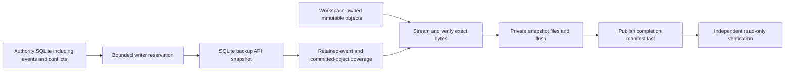

# Private sync-authority backups

Status: local export/inspection implemented in the v0.5 development candidate;
cloud upload, scheduling and isolated restore remain deployment gates. This is
an operator backup of the synchronization service, not a list research package,
client workspace backup, or app installer. No command below contacts GCP.

## Create and inspect a snapshot

Choose a new output directory outside the authority, in a private parent folder.
The parent must exist. Run from the installed command environment:

```sh
paperfact sync-admin backup --state "$HOME/.paperfact-sync/service" --output "$HOME/.paperfact-sync/pilot-authority-backup" --seconds 30
paperfact sync-admin verify-backup --output "$HOME/.paperfact-sync/pilot-authority-backup" --seconds 30
```

Success is bounded JSON: `state=backed_up`, followed by `state=verified`, file and
byte counts, and `live_restore=false` for verification. Counts are actual stored
files/bytes, not a percentage or estimated runtime. No research text or device
token is printed. Reusing an existing output fails without overwriting it; use a
new pathname for another snapshot or retry. Incomplete output has no completed
manifest and must not be uploaded as a successful backup.

`--state` is required only for `backup`; both commands require `--output` and
accept `--seconds` (default 30, positive and at most 300). Each supports `--help`.
Invalid paths, damaged bytes, incomplete snapshots or exceeded budgets return
exit code 2 with a bounded explanation. Ctrl-C interrupts capture; inspect any
output rather than assuming the backup completed. Once the final manifest is
published, a subsequent interruption/error cannot retract that completed state;
verify it before deciding what to retain.

## Captured data and consistency



- SQLite's backup API includes committed WAL state; raw live-database copying is
  not used. A writer reservation prevents authority changes during capture.
- The snapshot keeps the entire authority database: accepted edits, conflicts,
  tombstones, device records, current heads and upload metadata. Event prefixes,
  operation receipts and attachment ownership are checked. This is not a complete
  semantic audit of every research claim or database application invariant.
- Every committed workspace-owned object is copied and SHA-256 checked, including
  bytes retained only for history/conflicts. Missing/damaged bytes or an event
  referencing absent ownership prevents completion. Distinct workspace storage
  namespaces stay separate; no ownership grant is inferred from a shared digest.
- Incomplete upload bytes, temporary files and BlobStore cache indexes are omitted.
  Their database metadata is retained for forensic completeness. A future recovery
  workflow must discard/restart unfinished uploads and reconstruct derived indexes;
  this directory is deliberately not a directly runnable authority.
- Capture is bounded by the time budget, 100,000 committed object entries and a
  24 MiB manifest. Deadline checks run between SQLite backup steps and file chunks.
  Filesystem calls, SQLite lock waits (up to one second) and OS flushes are not
  interruptible hard real-time operations. Large stores may exceed the budget.
- Authority writes pause while capture holds its reservation. Schedule during low
  activity; a request may time out and retry from its retained client outbox.
  This is not a zero-downtime online backup claim or a performance capacity result.

On failure, only the new output may contain partial data; existing output is never
reused or cleaned recursively. The final manifest is staged and published last.
Files are flushed; POSIX directory entries are also flushed. Windows file flush
behavior is tested locally; Windows directory/power-loss durability and Linux
filesystem behavior still require platform acceptance. Hash verification detects
missing/torn bytes; checksums are not a signature or protection against an operator
replacing the whole backup and its manifest.

## Inspection and privacy

`verify-backup` opens SQLite read-only, validates its schema/integrity, validates
manifest shape/paths/bounds, hashes every listed file, rejects extra files/links,
checks committed-object/event coverage, and refuses files changed during inspection.
It does not initialize a BlobStore or authority, connect a client, migrate research,
rotate/reissue credentials, restore data, upload files, or invoke AI.

Backups contain private research and device token hashes. They are not diagnostics
or safe public issue attachments. Keep them outside Git, installers, shared-list
packages and public buckets. POSIX output is owner-only; Windows inherits parent
ACLs, so choose a private directory. Same-user malicious filesystem replacement
is outside the local trust boundary. Application-level end-to-end encryption is
not provided by these commands.

## Recovery and GCP gates

The backup has no live-service marker. Neither `serve` nor `authority()` accepts
it as initialized service state. Do not copy an old authority database over a
running service or reuse its sequence history with ahead-of-backup clients.

The [fresh-identity recovery command](sync-authority-restore.md) now reconstructs
one selected workspace into a separate local authority and requires new device
issuance. Its isolated fixture journeys do not certify hosted restore, automatic
old-client migration or installed-device acceptance. The [GCP proposal](gcp-sync-pilot-plan.md)
still requires those operational gates before personal cloud use.
Next deployment work must independently upload verified immutable sets to private
GCS, publish the remote completion manifest last, implement retention without
breaking referenced history, monitor failures, and prove a separate restore.
No cloud backup, achieved RPO, disaster-recovery success or unattended scheduling
is claimed by a local `verified` receipt.

## Python API

- `sync_authority_backup.export(state, output, *, seconds=30, cancelled=lambda: False) -> dict`
- `sync_authority_backup.verify(output, *, seconds=30, cancelled=lambda: False) -> dict`
- `sync_authority_backup.BackupCancelled`: `ValueError` for cancellation/deadline.

Paths are explicit and never default to the desktop research database. Cancellation
is cooperative. The CLI shares these operations; there is no new public HTTP or
MCP administration endpoint. [Behavior scenarios](testing/authority-backup-scenarios.md)
record fixture coverage and platform limits.


## Optional private GCS publication

The development [GCS operator command](gcp-backup-publication.md) now publishes
verified snapshots with shared content objects and a completion manifest last.
It is explicitly invoked, not automatic backup scheduling. Its cloud behavior is
simulated locally; actual GCS upload/fetch/restore and operational acceptance
remain unverified. Ordinary desktop use does not require the operator SDK.
