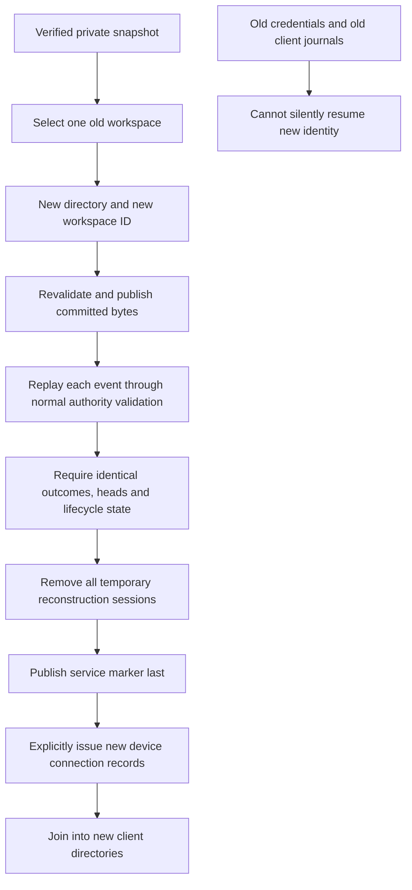

# Restore one authority workspace into a fresh service

Status: isolated local recovery implementation in the v0.5 development candidate.
This is a trusted operator action. It does not provision GCP, start a listener,
replace a running authority, alter desktop research, or automatically reconnect
devices. Hosted/installed-device acceptance remains required.

## Explicit recovery command

Choose an existing workspace from a verified private authority backup, a fresh
workspace ID, and a new output directory whose parent already exists:

```sh
paperfact sync-admin restore-backup --input "$HOME/.paperfact-sync/pilot-authority-backup" --state "$HOME/.paperfact-sync/recovered-service" --workspace demo-workspace --as-workspace recovered-demo-workspace --seconds 60
```

Success returns `state=restored`, the new `workspace_id`, actual event/object/byte
counts, discarded unfinished-upload/device counts and `requires_enrollment=true`.
It never returns a token or research body. Only the explicitly selected workspace
is restored; other workspaces stay in the original backup. `--input`, `--state`,
`--workspace` and `--as-workspace` are required. `--seconds` is a shared cooperative
budget (default30, positive and at most300). `--help` is available without writes.
Identifiers use the existing bounded protocol format. Prefer a new UUID-based ID
for real recovery; the new ID must differ from every workspace in this backup.
There is no global registry proving uniqueness across unrelated services.

The input is the [operator backup directory](sync-authority-backup.md), not a list
ZIP or desktop SQLite file. Existing output, ancestor/descendant destinations,
unknown source workspace, reused backup workspace ID, invalid/corrupt backup or
unsupported authority tables are refused. Ordinary failures return exit2 with a
bounded explanation. A failed/interrupted attempt may retain private incomplete
state, but has no live-service marker before successful publication. Do not edit
it into a service manually; retain it for private diagnosis and retry to another
new path. No existing directory is overwritten or recursively removed.

## Why a fresh identity is required



- Committed originals/assets are uploaded through the same verified local blob
  operations. Blob indexes and integrity records are reconstructed for the new
  files; cached native file identities from the backup are not trusted.
- Events are replayed in original sequence. Operation IDs, device provenance,
  incarnations, references, science text, immutable research-file bytes, accepted
  versus conflict outcomes and current head revisions are retained. The workspace
  ID changes, so operation fingerprints are recomputed by normal admission.
- Ordering observed-set hashes also include workspace identity. A proof matching
  its supplied observed membership set is re-keyed using that exact set. Opaque
  invalid/stale hashes stay opaque. Replay must still produce the original
  outcome; no conflict is promoted to accepted and no current set is substituted
  for a stale observed set. A disagreement refuses the entire completed restore.
- Replayed heads and graph lifecycle metadata are compared with the original.
  This detects unsupported semantics or inconsistent snapshot state rather than
  silently repairing/dropping research. Older schemas with different behavior may
  need an explicit migration instead; this command is not universal migration.
- Old device hashes, labels and sessions are not copied into active service state.
  Temporary reconstruction credentials are removed before publication. Original
  device IDs still appear in event provenance. New devices require new records.
- Incomplete upload bytes/reservations/sessions are not restored. Clients must
  explicitly resend required missing work after recovery. All committed objects,
  including objects needed only by retained history/conflicts, remain available.
- The verifier carries the file identities it actually hashed into reconstruction.
  A changed manifest/database/object is refused, including the gap between
  verification return and opening the recovery input. Files are checked again
  before publication. This is local mutation protection, not a hostile same-user
  filesystem sandbox, cryptographic signature, or end-to-end encryption.

The backup's `no-live-restore` policy forbids swapping it into a live service.
This command instead reconstructs a separate authority under an explicit fresh
workspace identity. It preserves the snapshot, original service, desktop research
and post-backup local pending work. State newer than the backup is not magically
recovered; keep old client folders/backups until reviewing their additional work.

## Re-enroll devices and retain newer local work

The service is not started automatically. After privately reviewing the recovery
receipt, issue each device its own new record using the existing command:

```sh
paperfact sync-admin issue --state "$HOME/.paperfact-sync/recovered-service" --endpoint http://127.0.0.1:8765 --workspace recovered-demo-workspace --device recovered-mac --output "$HOME/.paperfact-sync/recovered-mac-connection.json"
paperfact sync-admin serve --state "$HOME/.paperfact-sync/recovered-service" --port 8765
```

These examples are loopback-only development. Use the separately reviewed HTTPS
endpoint/mount guard for any approved hosted pilot. Do not run two authorities
with the same endpoint or alter the existing service in this step.

Review the new record in the desktop and explicitly join into a new local data
directory. Do not reset the old cursor, rewrite the old workspace ID, copy a
second device's credentials, or delete the old outbox to make it connect. Old
tokens are rejected, a newer cursor is refused, and the desktop refuses pushing
an old-bound journal into the fresh identity without changing its stored work.

After joining, explicitly download required attachments and verify availability.
An absent primary-PDF selection can still correctly show partial availability
while historical originals or slide assets are fully downloaded. Keep separate
scientific/source verification results. Inspect notes, ordering, conflict history,
editable decks and exact originals before using the new service daily.

Preserve newer/unsent old-client work separately and review a research-package
import where supported. Automatic reconciliation of post-backup device journals
into a fresh recovery identity is not implemented or implied. The recovery UI,
full user journey and old-device installed acceptance remain open gates.

## API and operational limits

`sync_authority_restore.restore(snapshot, state, workspace, replacement, *,
seconds=30, cancelled=lambda: False, progress=lambda value: None) -> dict`

Progress reports actual verification/object/event stages and counts, not estimated
time or made-up percentages. Cancellation/deadline checks occur between bounded
operations; SQLite/file flushes are not hard real-time. The reference authority's
configured default blob limits still apply; large/custom stores require explicit
capacity work. The new service uses the current reference schema, so unknown
extra authority tables are rejected rather than silently omitted.

Recovery output is private research. POSIX owner-only files/directories and
Windows inherited directory ACL rules match backup handling. Files and POSIX
directory entries are flushed before marker publication; power-loss and actual
Linux/GCP filesystem behavior require separate platform tests. A failure after
final marker publication cannot retract the completed state; inspect its receipt
and directory before retrying.

[Scenario evidence](testing/authority-restore-scenarios.md) covers synthetic
reconstruction and real sync/bootstrap/download paths. It does not establish cloud
backup scheduling, HTTPS availability, operational restore time/RPO, actual Mac/
phone acceptance, automatic client migration, or a coherent full release gate.

### Read-only old-device review

A local [device recovery comparison](device-recovery-review.md) now distinguishes exact backed-up journal entries, unconfirmed/acknowledged entries absent from the backup and received later events. It preserves the old database and never replays or rebinds it. Use the result to plan preservation; automatic/guided per-change reconciliation remains pending.
