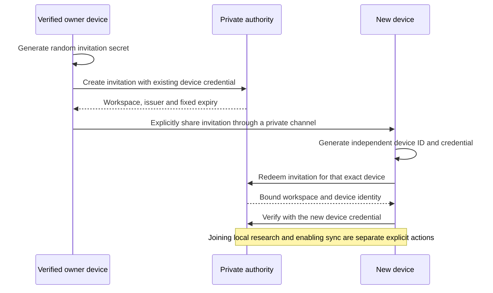

# Sync device management

`DeviceManagementMixin` (`src/paper_daily/sync_device_management.py`) gives the
local `ReferenceService` authority a bounded, single-owner device catalog,
owner-entered labels and peer revocation. The reference HTTP transport and bounded
desktop Devices dialog expose those existing authenticated actions. Production
account identity and end-user pairing screens remain separate gates. The local
one-time pairing core is described below; administrative enrollment/revocation
remain private seams.

## Ownership model

Every device token enrolled in a workspace belongs to the same research owner.
Any active (non-revoked) device in a workspace may therefore list, label and
revoke its peers. The trusted administrative seams `enroll(workspace_id,
device_id)` and `revoke(token)` are unchanged and remain non-public.

## API

```python
service.device_catalog(token, *, after=None, limit=50)
# {"workspace_id", "current_device_id",
#  "devices": [{"device_id", "label", "revoked"}], "next_cursor"}

service.rename_device(token, device_id, label)
# {"device_id", "label", "changed"}

service.revoke_peer(token, device_id)
# {"device_id", "revoked": True, "changed"}
```

- `device_catalog` orders devices by device ID. `limit` must be an `int` (not
  `bool`) from 1 to 100; at most `limit + 1` rows are read. `after` is `None`
  or a sync identifier and is strict (`device_id > after`); it need not name an
  existing device. `next_cursor` is the last returned ID when more remain,
  otherwise `None`.
- `rename_device` sets or clears (`None`) a label on the caller or a peer,
  including revoked peers. Repeating the same label reports `changed: False`.
- `revoke_peer` refuses the caller's own device (`CurrentDeviceError`); stopping
  this device remains a local Disconnect. Revoking an already-revoked peer
  succeeds with `changed: False`.
- Unknown targets raise `UnknownDeviceError` (a `ValueError`) with the same
  message whether the device is missing or belongs to another workspace.
- Invalid, unknown or revoked caller tokens raise `PermissionError` before any
  input is validated.

## Labels

Labels are optional, nullable plain text of 1–64 Unicode code points with no
leading/trailing whitespace. C0/DEL/C1 controls (including tab, CR, LF, NEL),
surrogates, line/paragraph separators and bidirectional override/isolate
controls are rejected. Emoji ZWJ sequences and non-Latin scripts are accepted.
Labels are never inferred: the authority does not derive hostnames, accounts,
emails, IP addresses or activity, and none are stored or returned.

## Invariants

- Each method authenticates with the existing `_authenticate` inside the same
  `_transaction` that reads or writes, and scopes every query by the caller's
  workspace. Writes use `BEGIN IMMEDIATE`; any failure rolls back.
- Token values and token hashes are never selected or returned.
- Peer revocation only sets `revoked=1` on that workspace/device row. Events,
  heads, graph metadata, blob ownership, uploads and all pull cursors are
  untouched; a replacement device sees the full history. Revoked device IDs
  stay reserved, as with admin revocation.
- `session_info`, `push`, `pull` and blob contracts are unchanged.

## HTTP and current-workspace client

The exact authenticated POST routes are `/v1/devices/list` (`after`, `limit`),
`/v1/devices/rename` (`device_id`, nullable `label`) and `/v1/devices/revoke`
(`device_id`). They use the existing bounded JSON framing, bearer handling,
no-store responses and HTTPS/literal-loopback policy. Both request and response
fields are closed. Catalog responses validate identity, sorted unique IDs,
single-line labels, exact booleans, page size and strict continuation cursors.
Unknown/missing/revoked callers receive the same 401 response. Absent and foreign
targets receive the same 404 response. These claims concern response shape/status,
not timing indistinguishability or production abuse controls.

`HttpTransport` exposes `device_catalog`, `rename_device` and `revoke_peer`.
`DeviceClient` captures the current connection epoch and identity without copying
or exposing its token. Each action shares the session job lock, reauthenticates
the workspace/device, requires the current local binding, and checks cancellation,
database identity, active workspace and connection generation before/after work.
Revoked authorization invalidates the session and requires reconnecting. Device
actions do not consume the research outbox, reset a cursor or change local data.

## Desktop Devices dialog

The connection window enables **Devices** only for its current authenticated,
enrolled local binding. The dialog retains one page of at most 50 rows and offers
Refresh, Next page, optional label editing/clearing, and confirmed peer revocation.
The current device is identified and cannot revoke itself; use the connection
window's Disconnect action. Revoked rows remain visible. Labels, workspace/device
IDs and revoked state are the only displayed device data; no activity, IP, account,
token or token hash is inferred or exposed. New copy is English/Traditional Chinese.

Duplicate activation starts one worker. Empty selection, cancelled confirmation
and invalid labels send no action. Stop/close discards late results and waits for
the active worker; a changed connection/workspace cannot repaint or mutate another
view. A cancellation cannot retract a remote change already committed, so the
dialog asks the owner to Refresh to check sent changes. Label/revoke retries are
idempotent. Existing GUI credential-lifetime checks remain in place. No native
credential-store or AI operation is needed for these controls.

## Schema upgrade

Ordinary `ReferenceService` initialization adds a nullable `label TEXT` column
to `sync_devices` when it is missing. The check runs inside the existing
initialization write transaction, so it is idempotent and serialized across
concurrent openers. Existing device IDs, token hashes and revocations are
preserved; pre-existing devices have `label = NULL`.

## Limitations and follow-ons

- No mobile device-management UI.
- No multi-owner roles, per-device permissions, audit log or rate limiting.
- No production identity, account, pairing or recovery flow; `enroll` remains a
  trusted admin seam.
- No device activity, last-seen or network metadata, by design.

Tests: `tests/test_sync_device_management.py`, `tests/test_sync_devices_http.py`,
`tests/test_workspace_devices.py` and `tests/test_devices_dialog.py`. These use
synthetic authorities/workspaces, actual loopback HTTP and simulated credentials.
They do not prove hosted deployment, real accounts, native vault access or
physical-device acceptance. The combined candidate still requires the full gate.

The production pairing gap is unchanged: a trusted operator must issue the initial
workspace/device credential outside the public reference HTTP adapter. Listing
or revoking peers does not implement account login, prove who should receive a new
device credential, recover an owner's lost access or authorize remote enrollment.


## One-time device pairing core

Status: local authority, Python SDK and mobile transport implemented; **desktop
and mobile pairing screens and durable receiver credential storage are pending**.
No service was deployed and no real device was enrolled. The first trusted device
still requires operator-issued credentials. AI/Google Slides login is separate.



```python
service.create_pairing(device_token, code)
# {"workspace_id", "issuer_device_id", "expires_at"}
service.redeem_pairing(code, workspace_id, device_id, credential, label=None)
# {"workspace_id", "device_id"}

transport.create_pairing(device_token, code)
transport.redeem_pairing(code, workspace_id, device_id, credential, label=None)
client.create_pairing(code, ticket)  # DeviceClient, exact current enrolled session
```

Generate `code` and the independent `credential` with `secrets.token_urlsafe(32)`
in Python or 32 cryptographically random bytes encoded as base64url on a browser.
They must be distinct. An invitation may never become a device credential; the
service rejects collision with any invitation hash or existing device credential.
Use a fresh device identifier and preserve the same pending credential/label for
an exact retry. Lost-response retry is supported during the invitation lifetime;
restart-safe receiver storage and cancellation-after-send UX remain pending.

The existing authenticated framing exposes:

| Route | Bearer | Closed request body | Closed success body |
|---|---|---|---|
| `/v1/devices/pairing/create` | Existing active device credential | `code` | `workspace_id`, `issuer_device_id`, `expires_at` |
| `/v1/devices/pairing/redeem` | One-time invitation code | `workspace_id`, `device_id`, `credential`, nullable `label` | `workspace_id`, `device_id` |

The mobile `HttpTransport` exposes the same names with an optional final
`AbortSignal`; create is `(token, code, signal)` and redeem is
`(code, workspace_id, device_id, credential, label = null, signal)`.
No secret is put in URLs. Responses use no-store; bodies/authorization must not
be logged by production infrastructure. TLS and literal-loopback rules are unchanged.

- Any active device may grant its own workspace only, following the existing
  single-owner trust model. Revoking the issuer prevents outstanding invitations
  from admitting a new device. It does not revoke independently paired devices.
- A grant expires after 600 seconds by server time. Exact create retries keep the
  original expiry; used or expired secrets cannot be renewed. Expired hash
  tombstones remain in the authority to reject reuse. Up to 100 unexpired grants
  (including consumed ones) may exist per workspace; this is not an abuse-rate limit.
- Claim and enrollment share one immediate SQLite transaction. Repeating the
  same device/credential/original-label returns its identity without overwriting
  a later label. A second claimant, changed request, wrong workspace, revoked
  device or invalid invitation is refused. Cancellation cannot retract a grant
  or device already committed remotely.
- Only secret hashes are stored; neither the old credential nor the invitation
  becomes the new device credential. Labels are explicit user metadata.
- Authorities created before pairing upgrade idempotently. Recovery accepts old
  backups without the new table, validates the optional table's exact columns,
  and creates a fresh authority with no previous devices or invitation grants.

Local evidence (2026-11-14): nine core/loopback cases passed in 4.9s including
checks; after wiring the guarded-session method, twelve core/context/old-new
backup cases passed in 6.6s. Mobile transport passed nine cases in 3.5s, followed
by the actual JavaScript-to-Python protocol program in 1.8s. The latter now covers
pair creation, exact retry, independent credential verification, second-claim
refusal and revocation as well as its existing research/file scenarios. These are
isolated synthetic fixtures under the Windows CPU governor, not real browser,
Keychain, hosted identity or installed Windows/Mac/phone acceptance.


### Pairing behavior map

| Selector | Observable requirement |
|---|---|
| `test_pairing_creates_independent_device_once_and_stores_no_raw_secrets` | A new device has its own credential; create retry retains expiry; claim retry preserves later labels; existing IDs and invitation-as-device-secret collisions make no writes |
| `test_pairing_refuses_changed_authority_without_creating_another_device` | Expiry, revoked issuer, wrong workspace and a different second claimant cannot enroll; a revoked receiver cannot be reactivated by retry |
| `test_pairing_claim_rolls_back_device_and_consumption_together` | A failure after device insertion rolls back both that device and invitation consumption; the original request can retry |
| `test_concurrent_claims_enroll_only_one_device` | Two different claimants race; exactly one new device is saved |
| `test_pairing_quota_and_restart_are_bounded` | Active invitation quota is enforced, expiry frees a slot, and reinitialization retains existing credentials |
| `test_actual_http_pairing_retries_and_revocation_keep_credentials_private` | Real loopback create/redeem/authenticate/revoke works; a second identity cannot reuse the grant |
| `test_pairing_uses_the_guarded_device_context_without_changing_local_research` | Desktop SDK shares the verified session fence; a disconnected context cannot issue a new grant; local research/outbox remain unchanged |
| `test_recovery_accepts_pre_pairing_backups_and_never_carries_device_grants` | Both old backups and active-grant backups restore without carrying previous devices or invitations |

The first six selectors are in `tests/test_sync_pairing.py`; the last two are in
`test_workspace_devices.py` and `test_sync_authority_restore.py`. The existing
mobile protocol program now includes pairing alongside research/file transfer;
one program is not one behavior or a completion percentage. No expanded stress
matrix or live login was used. The final core/compatibility/docs selection passed
**32 cases in 25.85s**, **29.2s including checks**. Selections overlap earlier
results; neither the historical full suite nor the complete release profile ran.

Next integration: explicit create/copy and receive/verify screens, a retained
receiver attempt for lost-response retry, and native-vault opt-in bound to the
joined destination. Mobile persistent authentication needs a separately reviewed
browser/session boundary; this transport does not put credentials in IndexedDB or
localStorage. Revise the PWA shell cache when those UI modules are connected.
