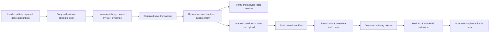

# Versioned editable decks

The first `research_file` feature is `deck`, with independent `notes` and `guide`
slots. Other research-file features remain unsupported. This is an explicitly
configured workspace capability, not automatic enrollment of existing research.

## Wire contract

An ordinary version-2 `research_file` graph operation has one exact paper parent.
Its stable UUID is UUID5(URL namespace, `paperfact:research-file:` + Python compact
ASCII JSON of `[paper_id, "deck", slot]`). A put has exactly `paper_id`, `feature`,
`slot`, `format_version`, `source_document_hash`, `input_versions`, `body`, `assets`.
A delete has an empty payload and detaches the active slot without deleting history.
Restoring a tombstoned incarnation requires an explicit graph restore decision.

`body` is `{sha256,size,media_type}`; each asset adds `id` and `role`. Body JSON is
canonical UTF-8, sorted keys, compact separators, no NaN, duplicate keys or nesting
beyond 32 levels. Bounds: body 8 MiB; 256 assets; assets combined 64 MiB; PNG
8,000,000 bytes; evidence JSON 8 MiB. PNGs need complete CRC-valid chunks and a
successful bounded decode (16,384 per axis, 40 million pixels). Logical IDs never
become paths. Unsupported fields, MIME types and file features fail closed.

The body is `{version:1,deck,evidence_asset}`. The deck retains editable geometry,
slide order, speaker notes, citation sources and historical document hashes.
Figure records replace device paths with `asset_id`; only figures actually used
by the layout are included. Unused picker choices remain local/rebuildable. All
body references must match the declared closure exactly. An evidence snapshot is
typed `{version:1,sources,coverage,source_hash}`. Its hash is not a PDF hash.

Portable generation metadata permits only `inputs`, `backend`, `model`. Account
profiles, CLI/request IDs, credentials and arbitrary execution receipts are omitted.
Citation URLs are inert HTTP(S) references, never automatic download instructions.

`input_versions` accepts closed observation schemas 1 and 2: `complete`, bounded
`entities`, `documents`, and nullable `inputs_sha256`. Entity references contain
`kind,id,incarnation,revision,depends_on`; document references contain
`paper_id,operation_id,incarnation,parent_incarnation,sha256`. Limits are 256 entity
refs, 128 document refs and 64 KiB total. `complete` describes captured-reference
coverage, not freshness. Deck producers conservatively emit `complete:false`.
Manual edits retain the loaded artifact's PDF/input provenance; generation uses
the actual original/figure hashes captured in its evidence, never the latest PDF
metadata as a substitute.

New native observations emit schema 2 with an explicit `workspace_id`. Entity and
document references belong to that recorded workspace, not the destination of a
copy or recovery. Already loaded schema-1 or schema-2 provenance remains exact
through manual edits; existing schema-2 scope is never rebased. Legacy schema 1
remains readable. These observations describe historical inputs, not permission
to publish or proof that a quotation supports a scientific claim.

## Actual save, receive and recovery

`presentations.save_deck` routes explicitly bound workspaces through
`sync_deck_publication.publish_deck`. Unbound workspaces retain their legacy save
behavior. Managed storage must first be registered by `FileTransfers`; saving does
not silently create a sync enrollment or choose a remote service.

- `observe_deck(local_id, mode)` captures the database path/file identity,
  workspace/device, graph base/predecessor/parent, document targets and a bounded
  research-input snapshot before editing or generation. Each input table is capped
  at 1,000 rows / 4 MiB; total serialized snapshot is capped at 8 MiB. Excess input
  fails explicitly rather than being silently truncated.
- Staging and validation happen before the research write transaction. The commit
  atomically rechecks the observation and stores the manifest/outbox, version and
  materialization intent. Exact request-ID retries return the original revision.
- A stale save stores a recoverable candidate manifest and leaves the latest deck
  unchanged. A workspace switch retains a bounded raw draft in the original
  database after verifying its file/device binding; nothing is staged in the new
  workspace. Open invalid/oversized drafts remain the editor's responsibility.
- Materialization writes an immutable operation-derived version directory. A
  process-local sealed snapshot covers **deck.json and every installed asset**.
  Activation rechecks that snapshot and the desired target/parent in the commit.
  Crash recovery reuses verified files and the durable intent; it does not erase a
  newer applied revision. Interrupted staging repairs corrupt partials on retry.
- Incoming metadata advances the cursor even without bytes. Until a new complete
  closure is verified, the previous applied deck remains readable. That old deck
  cannot use the newer desired revision as a fresh editing base.
- Managed reads use the applied version and owned blobs; legacy `<mode>.json` is
  not authoritative. History restore and pane undo/redo publish new revisions.
  Recovery filenames are keyed to the loaded operation, so a new deck cannot
  automatically absorb an earlier revision's unfinished draft.

Local SQL tables `research_file_desired`, `research_file_applied`,
`research_file_versions`, `research_file_intents`, `research_file_candidates`,
`research_file_drafts`, `research_file_paths`, `research_file_transfers` are private
bookkeeping. Versions/candidates retain manifests; drafts are local raw content,
not sync operations. Credentials never enter these tables. No garbage collection
is implemented: old/current/conflicted/draft-dependent blobs stay retained.

## Explicit transfer integration

`FileTransfers(client, store, transport, origin=..., token=..., version_root=...)`
uses the existing authenticated session discovery and five blob endpoints.
`upload(operation)` and `download(entity_id)` do at most one data chunk per step;
`ready_to_push` plugs into `SyncClient.sync_once(prepare_push=...)`. Metadata pull
does not wait for uploads. Combine this predicate with the PDF predicate when
both coordinators are used. The existing bounded outbox window is not a fair
scheduler; callers must schedule continuation explicitly.

Closure verification is cached against exact operation/source identities for a
session, with cached per-block digests checked on each uploaded range. Session
switch/close/cancel invalidate activation. Every remote phase still authenticates;
the final download activation reauthenticates after closure validation. Partial
bytes can remain for resume; cancellation does not pretend to retract bytes already
sent. Exceptions contain no persisted provider error text or tokens.

`sync_files.referenced_blobs(operation)` is the pure backup/retention closure seam.
`validate_closure(payload, read_blob)` validates all bytes and typed references.
`sync_artifacts.materialize` returns a sealed pathlike `MaterializedVersion`;
`activate` accepts only that verified snapshot. Loose directory existence is not
proof of a complete revision.

## Evidence and limits

Fixture tests exercise wire rejection, used-figure closure, actual save/upload/
receive/reopen/HTML export, stale candidates, request retry, crash intent recovery,
wrong-workspace isolation, pending bytes, cancellation, corrupt partial repair,
history restore, bounded validation and real desktop save/undo/recovery paths.
The parent full check remains the release gate. No cloud deployment, real user
enrollment, physical-phone test, Google Slides publication or paid AI invocation
is implied by these fixtures. Populated-workspace backup/migration, other file
producers and a user-facing retained-work review UI remain separate acceptance
work; this slice does not claim they are complete.

### Reviewed original-source restoration

`sync_source_files.publish_source_in(conn, client, prepared, *, restore=False)`
continues to refuse implicit restoration. An explicitly observed caller may use
`restore=True` with a fresh request to create a new file incarnation after
retirement/reparenting; the caller still owns the transaction, current-parent
proof and retry receipt. Existing analysis/publication callers keep the default.
The [native recovery review](device-recovery-review.md#explicit-original-source-use-and-retirement)
provides the concrete use/retire confirmation adapter. Restoration retains exact
bytes and never switches the active primary PDF or revives old scientific pins.
