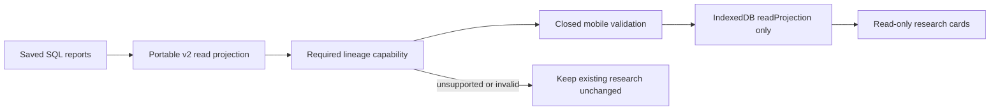

# Local database read projection

Status: v0.5 experimental read boundary. This is **not a sync bootstrap** or a
public/mobile HTTP endpoint. Database content and its local received-event cursor
are read from one SQLite snapshot; that does not mean all projected data has been
replicated or that unsent content may be discarded.

## API and bounds

`read_manifest(path, workspace_id=..., max_records=10000, max_bytes=8*1024*1024)`
opens an existing SQLite database in read-only mode and starts one read transaction.
The enrolled `research_sync_binding` must match. No database or identity mapping is
created. No files other than the selected SQLite database are followed; no source
PDFs, deck JSON, account directories, environment files or AI/network services are read.

The record limit counts source lists, papers, memberships, notes, analysis rows,
citations and highlights, including hidden highlights. Both a conservative source
text-size preflight and exact serialized UTF-8 output limit are enforced. Limits
are errors, never partial success/truncation. Supported upper configuration bounds
are 100,000 records and 64 MiB. Large workspaces need a later paginated snapshot API.

## DTO version 1

| Field | Exact content |
|---|---|
| `schema_version`, `workspace_id`, `cursor` | Version 1, enrolled workspace ID, stored received cursor (0 if not initialized) |
| `capabilities` | `database_read_projection: true`; `sync_bootstrap`, `assets`, `decks`: false |
| `local_state` | Counts `pending_operations`, `awaiting_receipts` and `deferred_entities` |
| `lists[]` | `id`, `name`, nullable `note`, `revision`, `sync_state`, ordered `members`, `analysis_sections` |
| `members[]` | `paper_id`, original integer `position`, `state`; sorted by position then paper ID |
| `papers[]` | `id`, `title`, string-array `authors`, `year`, nullable `doi`/`url`, `pdf_asset_id: null`, `analysis_sections`, `citations` |
| `analysis_sections[]` | `kind` (deep_reading/close_reading/context/survey), nullable `body`, `written_at` |
| `citations[]` | Nullable text `ref_key`, `title`, `doi`, `purpose`, `gist`, `verdict`, `why`, `basis`; nullable integer `year` |
| `notes[]` | Portable mapped `id`, `paper_id`, `body`, `kind`, legacy nullable `page`, `editable`, `revision`, `sync_state`, nullable `anchor`/`pdf_hash`, `anchor_status` |
| `highlights[]` | Stable derived `id`, `paper_id`, `origin` (manual/ai), `quote`, `reason`, `hidden`, nullable `pdf_hash`/`anchor`, `anchor_status` |
| `decks[]`, `assets[]` | Empty: file-backed attachment/deck projection is unsupported here |

Lists are ordered by creation timestamp and ID, not the device's `kv` preference.
Paper and note text is untrusted text; consumers must not insert it as HTML.
Authors are reduced to names; arbitrary author metadata is omitted. URLs are
optional HTTPS metadata hyperlinks without credentials, query/fragment, local
hosts or custom ports. They are not authorized attachment-fetch instructions.
No credential/configuration keys, raw `kv`, telemetry, local paths or arbitrary
anchor fields are serialized. Research text itself is not automatically redacted.

`revision` is the last nonnegative applied entity revision when known, otherwise
null. `sync_state` is `local`, `pending`, `awaiting`, `deferred` or `synced`.
Pending operations take precedence, then acknowledged edits whose receipt sequence
is beyond the local cursor, then deferred remote content; an internal deferred sentinel is never exported as revision -1.
Legacy/direct-writer data may be local even with a nonzero workspace cursor.
The caller cannot supply a replacement cursor. This projection must not be used
to skip outbox delivery or infer canonical server bootstrap completeness.

## Anchors, identity and missing data

Supported anchors are closed objects with `schema_version: 1`, `kind: word_range`,
and nonnegative `p0`, `o0`, `p1`, `o1`. Page indexes are zero-based; offsets are
inclusive source word indexes. Current storage does not supply rectangle geometry;
the projector does not invent rectangles or convert word offsets into PDF points.
Unknown/malformed anchor shapes become null with `anchor_status: unsupported`;
their note/highlight text remains available and read-only where appropriate.
Absent anchors use `anchor_status: absent`.

Highlight PDF hashes come from their stored document hash. A note has a PDF hash
only when its anchor explicitly contains a valid SHA-256 `document_hash`; no hash
is guessed from another highlight or the currently downloaded PDF. Consumers must
verify matching PDF bytes before placing any anchor, including `available` anchors.
Hidden AI highlights retain `hidden: true` so an importer cannot revive them silently.

Notes without portable mappings, changed mapping identities and missing paper/list
references cause errors instead of silently losing research. Anchored notes and
non-note records are readable, but `editable` is false because the write contract
cannot represent them. A true editable flag means the text-note shape is supported,
not that a browser is authenticated or the workspace has completed bootstrap.
Orphan list surveys left by legacy deletion require explicit recovery/reconciliation;
the projection does not discard them or mutate the database to repair them.

## Verification and gaps

`tests/test_sync_projection.py` uses the actual research schema and checks ordering,
content/anchors/reasons, portable identities, secret-field exclusion, safe URL
filtering, limits, missing references, read-only/no-create behavior, pending/deferred
states, and snapshot/cursor coherence during a concurrent WAL commit.

Remaining: authorized read-manifest delivery, canonical server bootstrap, non-PDF
file/deck manifests, reader activation, private mobile session integration,
all-entity revisions and complete runtime writer coverage. No mobile/cloud/live
research tests or actual attachment reads are claimed by this module.

## Explicit DTO version 2

Request `read_manifest(..., schema_version=2)` explicitly. The default remains
version 1, including its local paper IDs and existing editable-shape behavior.
Unknown versions fail; there is no automatic consumer upgrade or cursor override.

Version 2 requires a canonical UUID mapping in `research_paper_identity` for every
paper. It rewrites `papers[].id` and every structured `paper_id` in membership,
notes and highlights to that portable identity. Missing/invalid mappings fail
without generating IDs or modifying the database. Note IDs remain unchanged.
`members[].id` uses `sync_schema_v2.membership_id(list_id, portable_paper_id)`.
Highlight IDs are rederived using the same source identity and the portable paper,
so different local paper names do not produce different read-highlight identities.
Papers, notes and highlights sort by portable ID; membership position/state remain
unchanged, with portable paper ID as the deterministic tie-breaker.

`capabilities.note_contract_version` is 2; `sync_bootstrap` and `decks` remain
false. Primary-PDF asset manifests are now exposed as described below. Version 2 adds `revision`/`sync_state` to papers and memberships
and a `graph` field to papers, lists, memberships and notes. Graph is null unless
the entity is fully received/applied, active, and has recorded v2 graph metadata.
Known graph objects contain `incarnation`, `parents` and `structure_revision` from
the stored graph, not guessed values or the stale structure revision of an earlier
operation. Missing, pending, awaiting or deferred prerequisites never imply readiness.

Version-2 notes have `editable: true` only when their text shape is supported and
both note and matching paper-parent graph states are ready. Otherwise their full
text remains visible and `read_only_reason` is `unsupported_note_contract`,
`graph_unavailable` or `paper_graph_unavailable`; ready notes use null. This does
not authorize a browser session or establish a complete canonical bootstrap.
New-note creation likewise requires known paper graph prerequisites in a later
authorized writer workflow. Locally unsent content is not hidden or discarded.

No local paper identity or path is copied into structured DTO2 identity fields.
As in DTO1, user-authored research text is not automatically redacted. Primary-PDF
manifest projection is supported; deck and other file projection remain unsupported.

`tests/test_sync_projection_v2.py` checks two databases with different local paper
IDs and equivalent portable references, strict mapping failures, default DTO1
compatibility, no database writes, applied graph/readiness states and mapping/cursor
coherence during a concurrent commit. The original DTO1 tests remain unchanged.

### Reading progress in DTO2

Each `lists[].members[]` additionally includes `reading_state` with these fields:
`id`, `state`, `delivered_at`, `read_at`, `revision`, `sync_state`, `graph`,
`editable`, and `read_only_reason`. Its ID equals the containing membership ID
under a separate entity kind. The original member `state` remains as a display
field and always matches this object's state. Timestamps are null or bounded,
timezone-aware ISO strings; invalid stored values fail explicitly rather than
claiming a valid write contract. DTO1 does not read or expose these timestamps.

`capabilities.reading_state_contract_version` is 2. A missing canonical state is
still displayed from local membership data with local/pending status, null graph,
and `editable: false`. Graph and edit readiness require a fully applied active
state and matching membership/list/paper parent incarnations. Missing state graph
uses `graph_unavailable`; unavailable or replaced parent graph uses
`parent_graph_unavailable`. The graph is null in both cases. Pending, awaiting,
deferred and archived content never claims write readiness. Ready state has null
reason; authentication and authorization remain separate requirements.

A matching adapter-owned membership incarnation marker is also required. Missing
or mismatched markers use `membership_projection_unavailable` with null graph and
false editability; read projection never repairs or enrolls these legacy rows.

This does not advertise state creation readiness for memberships without state
history, change DTO1, or establish canonical bootstrap completeness.
`tests/test_sync_reading_state_projection.py` covers missing/local state, pending
and acknowledged writes, received progress, parent deferral/replacement, bounded
timestamps, no database writes and unchanged DTO1 fields.

### Ordering metadata in DTO2

Each list has `order`; the manifest has `list_order` for the workspace list order.
Both closed objects contain `revision`, `sync_state`, `graph`, `editable`, and
`read_only_reason`. `capabilities.ordering_contract_version` is 2. The displayed
list/member arrays remain the actual local projection; pending content is visible.
Missing canonical order history does not imply readiness to create an order.

Known active, applied order graph plus exact parent/item graphs and adapter
incarnation markers are required for `editable: true`. Otherwise graph is null and
the reason is `graph_unavailable`, `parent_graph_unavailable`,
`item_graph_unavailable`, or `projection_unavailable`. Unsupported/unmapped local
rows never silently disappear to make an order look writable. This remains a
read projection, not an authenticated write grant or canonical bootstrap.

DTO2 reads exactly one allowlisted preference: `kv['lists.order']`, a bounded
JSON array of unique IDs. Removed IDs are ignored when sorting the display;
current lists absent from the preference remain visible in creation order.
Malformed or oversized preferences fail without repair. Other settings are never
read or exported. DTO1 retains its existing shape and ordering behavior.

`tests/test_sync_ordering_projection.py` verifies visible local/received order,
pending and deferred readiness, missing projection markers, bounded preference
handling, unrelated-setting exclusion, unchanged DTO1, and order/cursor consistency
under a concurrent WAL commit.

### Primary PDF manifests in DTO2

`capabilities.document_contract_version=2`, `document_manifests=true` and `assets=true`
describe manifest support only. `reader_activation=false` remains explicit. Each
paper has `document` containing `desired`, `applied_sha256`, `availability`,
`revision` and `sync_state`; `pdf_asset_id` references the deduplicated `assets[]`
manifest by SHA256. Default availability is `unchecked`, even when a prior applied
binding exists. Pass explicit process-local `VerifiedDocument` snapshots to
`read_manifest(..., verified_documents=...)` to report currently matching bytes.
Projection does no hashing, PDF parsing, downloading or activation. See
[exact document contract](sync-documents.md); DTO1 is unchanged.

## Saved Lineage read projection

Development `read_manifest(..., schema_version=2)` now includes every current
`paper_lineage_sets` row in its focal paper's nonempty `lineage` array. Each item
has exactly `body`, `source_hash`, `document_hash`, `written_at`. The full validated
body preserves the original report, quotes, locations, proposed judgments,
unresolved requirements and portable selected-paper bindings. Existing registered
identities are required; reads never mint identities, invoke AI or read PDF files.
Each corpus counts toward the existing record/byte budgets; at most 64 per paper.

A nonempty array requires `lineage` in sorted, unique `required_capabilities`.
An unused/missing capability, empty corpus array, duplicate corpus/paper owner,
nonportable or missing selected paper, changed digest or unsupported evidence
refuses import before changing storage. Schema version 1 refuses nonempty saved
Lineage instead of silently omitting it. Older receivers reject the new required
capability. Existing snapshots without Lineage remain compatible.

Mobile `validateLineageBody(body)` and
`validateLineageProjection(rows, paperId, paperIds, validateTimestamp)` mirror the
closed saved metadata contract. Import persists a read-only projection, not sync
history, cursor advancement, graph/outbox work or active original-source grants.
An available original in the report means it was captured for that analysis;
it does not certify this device has those bytes or that a research claim is true.

`renderLineage(panel, paper, el, language='en')` renders bilingual overview cards
with native disclosure controls, plain-text quotations, proposed relationships,
missing-evidence explanations and recorded original versions. It offers no
unchecked PDF link or model action. Source inspection remains a separate desktop
path. The v18 offline shell includes the saved cards and event consumer and removes stale
shells while retaining research caches. Physical-phone, actual browser layout /
keyboard and full shared-operation Lineage acceptance remain separate gates.

The shared `validateEvidenceLocation(value, pages)` and
`validateEvidenceText(value, maximum, nullable=false)` exports from `claims.mjs`
provide the same closed primitives for claims and Lineage. These metadata checks
supply neither PDF-byte verification nor scientific semantic validation.

The Lineage storage object must be an actual research table. A same-named view
is refused rather than read outside the table-based record/byte preflight.

## Mobile Lineage event consumer

The development mobile consumer now recognizes dependency-complete typed v2
Lineage events in its normal `validateOperation` / `Engine.sync` path. This is a
consumer integration; the Python service/journal still refuses live Lineage
admission until compound publication, enrollment and receiver closure are complete.
Native staged frames are used only as explicit synthetic events in integration
tests, not claimed as accepted events from the live authority.

`lineage-ops.mjs` supplies the Lineage-specific checks beneath the common closed
operation envelope. A put requires its exact `content_address` and ordered
`source_dependencies`, full portable scientific body, focal/corpus identity,
source/document hashes and timezone-bearing timestamp. One to four distinct
ordered paper parents must match the report bindings. Every available original
has its exact paper/hash file ID and incarnation pin; unavailable peers have no
invented file pin. An empty typed deletion keeps the corpus/parent address and
has no source dependencies. Unknown fields, partial declarations and foreign or
reordered pins refuse.

Before an accepted event is recorded, `lineageReceived(state, operation, active)`
checks known immutable corpus/parent identities and exact current paper/file
lifetimes. An untyped generic deletion cannot strip a known one-parent Lineage
address. An active scientific incarnation cannot be silently replaced; stale
retirement refuses. Deletion remains possible after original retirement. Common
server authorization, CAS/conflict decisions and blob verification remain distinct.
The same known-address checks protect local enqueue; there is no new mobile
Lineage editor or provider/model action.

The domain functions transform a draft state. The engine must call them inside
one store update so receipts, content, outbox removal and cursor commit together;
a late failed dependency must not commit an earlier event from that page. Both
MemoryStore and IndexedStore retain the existing atomic record boundary. A closed
or superseded foreground job cannot install a late result. Duplicate foreground
sync calls share the existing job and repeated accepted receipts are idempotent.

`lineageActive` checks original file lifetimes as well as paper parents. Source
retirement hides its old scientific projection; restoring equal bytes under a
new file incarnation does not revive the old pin. Raw scientific receipts/history
remain retained. A fresh explicit research update with the current exact pins
can project again. `projectLineage` replaces only the known corpus in a saved
snapshot and leaves that snapshot and unrelated corpora intact; typed tombstones
cannot make old snapshot content reappear.

The existing read-only overview cards display the complete scientific body and
its unresolved judgments. File metadata is not downloaded PDF bytes: acceptance
creates no local file/activation grant, model call, primary-document change or
implicit download. Original-source inspection and independent scientific
validation remain separate. The v18 static offline shell includes the new
consumer; unsupported older clients reject its typed envelope instead of dropping
scientific fields. Actual hosted service, browser/device and complete release
acceptance remain open.
