# Explicit document transfer coordinator

Status: private v0.5.0 library implementation. No desktop enrollment, background
timer, hosted deployment, reader activation or automatic AI calls are enabled.

## Boundaries

```mermaid
flowchart LR
    Source[Explicit local PDF selection] --> Stage[Owned immutable byte store]
    Stage --> Action[Validated document action]
    Action --> Local[(Research manifest + outbox + retry receipt)]
    Local --> Upload[Bounded authenticated upload]
    Upload --> Owned[(Workspace-owned server bytes)]
    Owned --> Push[Manifest acceptance]
    Push --> Receive[(Peer metadata + cursor + desired document)]
    Receive --> Download[Independent resumable download]
    Download --> Verify[Hash + size + readable PDF]
    Verify --> Bind[Current target + session check]
    Bind --> Applied[(Applied document binding)]
```

- `sync_document_actions.stage_file(store, path)` copies a selected local file;
  it never discovers or downloads a URL. A source may change between passes, but
  mismatching bytes cannot finalize under the old digest. Retrying a long partial
  keeps the source cursor separate from the store's durable end offset.
- `ResearchOperations.attach_document(paper_id, manifest, store=..., request_id=...)`
  checks PDF readability outside the database write transaction, rebuilds the
  same target inside it, then commits research, outbox and the action receipt
  together. An exact retry returns its original receipt without reverting a newer
  document. A changed retry fails. Existing PDF aliases and caches are untouched.
- `DocumentTransfers` binds one research database, workspace, device, explicitly
  owned byte directory and service origin. Tokens remain in memory. A verified
  `/v1/session/info` identity must match both workspace and device **before any
  blob request**. An opaque token that merely works is insufficient.

## Worker API

1. Construct the coordinator with explicit `client`, `store`, `transport`, `origin`
   and an in-memory `token`. Production origins must use HTTPS; HTTP is loopback only.
2. Call `upload(operation)` for a pending document put. One step transmits at most
   256 KiB, returns a state and byte offset, and can resume after process restart.
   The server's authenticated offset is authoritative; persisted UI progress is not.
3. Run the ordinary metadata pass with `prepare_push=coordinator.ready_to_push`.
   Unfinished documents and their dependent operations are deferred; unrelated
   eligible operations and received metadata continue. For a metadata-only pass,
   first call `authenticate()` to verify the session without sending any PDF.
4. Use `list_desired_documents(...)` to enumerate bounded download candidates and
   call `download(paper_id)`. Receiving a manifest never waits for its file. A
   missing PDF does not stop notes, list data or the receive cursor.
5. Publish progress to the future UI from the returned state. Do not call these
   methods on the UI thread; PDF verification and network requests can take time.

States include `uploading`, `uploaded`, `downloading`, `bound`, `absent`, `busy`,
`signed_out`, `cancelled`, `interrupted`, `stale` and `failed`. Offsets measure bytes,
not an invented percentage for metadata work, PDF verification or AI generation.
Raw transport/provider exception messages are never persisted. `invalid_partial`
permits an explicit retry to discard only unfinished corrupt bytes; `repair_required`
never deletes a finalized object. Other failures use a bounded generic code.

## Cancellation, retries and availability

- `cancel(paper_id)` stops local scheduling/publication for that paper, including
  an uploaded document whose manifest has not been sent. `retry=True` explicitly
  resumes. Cancellation does not erase finished research or immutable bytes.
- `close()` and `set_session(...)` invalidate in-flight completion. Each new
  session must authenticate its workspace/device again before an uploaded receipt
  can be reused. A started network request cannot be retracted; later phases check
  invalidation again before sending. Server authorization still runs per request.
- Cancellation is coordinator-local. It retains partials for retry and does not
  silently invoke remote cleanup. Explicit authenticated server cancellation can
  release an unfinished reservation; expiration/cleanup scheduling remains pending.
- Same-instance repeated activation returns `busy`. Store transactions and retry
  identities preserve bytes across multiple instances; this is not a global job
  scheduler or cross-process UI cancellation bus.
- Download completion rechecks the exact desired operation, document incarnation,
  paper incarnation and current session. A late old result can remain private cached
  bytes, but cannot replace a newer binding. The previous applied binding survives
  a failed replacement. A stored applied flag is not proof that the file still exists.
- Availability DTOs require an explicit in-process verification snapshot. Reading
  a list does not hash files, parse PDFs or contact the service. Reader activation,
  version-aware anchors and derived caches are the next independent gate.

## Remaining delivery gates

- Fair scheduling beyond a bounded blocked outbox window, offline pinning, progress
  UI, cancellation ownership across workers and managed cache eviction.
- Server reads now use verified block digests with bounded content reads; see
  [ADR0006](adr/0006-bounded-blob-integrity.md). Production storage/throughput and
  multi-process admission still require acceptance beyond local instrumentation.
- Trusted repair of missing/corrupt finalized objects, retention and bootstrap.
- Full capture of existing app writers, anchored research, decks and other assets.
- Production login, hosting, HTTPS, mobile/browser storage and real-device acceptance.

Evidence: `tests/test_sync_transfers.py` exercises two fixture workspaces and an
actual loopback HTTP round trip, restart/resume, lost replies, corrupt-partial
repair, wrong-session denial, cancellation, repeated activation, action rollback,
binding rollback and stale completion. It does not test an installed app or use
real research, AI accounts or a public server.

The coordinator registers its explicit local blob/reader/legacy paths in a
device-local table. Recreating it without path overrides retains the current
registration; explicit path changes invalidate old reader context. These paths
are not synchronized. Registered managed documents now use the background desktop
resolver and explicit version-switch controls; full app-writer enrollment remains
separate from this library constructor.
