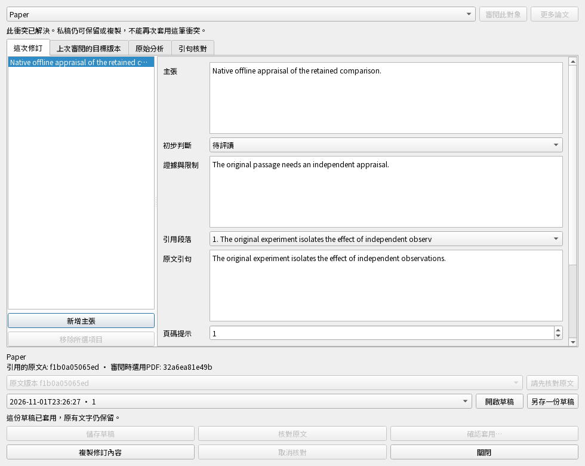

# 主張修訂真的能離線往返與恢復嗎？

## 最新：真正桌面入口與重開狀態

同一候選的focused檢查 **58項通過，8項新增，整輪256.09秒**；隱私／Ruff通過，
零失敗／錯誤／跳過／執行中變動。包含真正Qt按鈕、確認視窗、來源檢視器與測試同步服務。
[本輪精確範圍與耗時](claim-native-origin-results.json)。不是整版、實機或正式服務通過。

| 桌面操作 | 實際保存／顯示結果 | 案例 |
| --- | --- | --- |
| 遠端衝突 → 修訂研究主張 → 改字／核對 → 取消或確認 → 同步／重開 | 取消不改正式研究；確認只存一筆解決要求，兩端原衝突結束；A引句不移到B；重開仍有文字 | `test_native_remote_entry_edit_source_cancel_apply_sync_and_reopen`，中英文2組 |
| 取消後已完成結果 → 修訂 → 確認／重開 | 完整人工修訂保留，不再呼叫AI；重開已套用稿會提示先重新審閱 | `test_native_cancelled_result_entry_keeps_completed_work_and_edited_words`，中英文2組 |
| 核對期間另一台先解決 | 晚到核對不能啟用套用；最新正式研究與私稿文字保留 | `test_native_remote_result_changed_during_verification_keeps_private_fields`，1組 |
| 核對途中取消或關閉父視窗 | 原正式研究不動，已保存文字保留；父視窗等工作收尾再關閉 | `test_native_remote_cancel_or_parent_close_drains_held_work_without_apply`，2組 |
| 舊遠端私稿重新選擇 | 先顯示原字；重新審閱後保留同樣文字，再核對新觀察 | `test_native_legacy_remote_draft_requires_review_then_keeps_text_when_upgraded`，1組 |

以上8項在 `tests/test_claim_remote_ui.py`；同輪也執行既有主張欄位、審閱父視窗與原文視窗案例。
後端／同步程式未修改；先前111項後端旅程是歷史證據，不與本輪相加。

### 這些停用按鈕代表什麼

- **需要重新審閱：** 舊比較或已套用稿仍可編輯、私存和複製；按「審閱此對象」取得新比較後，再核對／套用。
- **本機已有衝突決定：** 顯示等待同步確認，避免為同一衝突再次產生決定。
- **衝突已解決：** 明確停用再次審閱／核對／套用，但私人文字可繼續保存及複製，不改正式研究。

[窄版實際Qt畫面](images/claim-remote-reviewed-narrow.png)。測試在980／620px檢查提示與主要按鈕可用，
並確認重開後繼續改字、複製、私存，正式內容及同步佇列都不受影響。圖片全為合成研究。

測試先重現已套用／舊稿仍開放核對的問題；修正後8項通過，再驗證同輪既有互動。
新測試一處元件名稱先寫錯，已改為真正的文字控制項；未改動既有測試或降低文字／來源要求。
按鈕狀態只呈現已知的私稿／決定狀態，不取代後端的即時來源、目標、工作區與交易檢查。

## 先前後端離線往返的證據

下方111項與524.53秒屬於前一個後端候選；本輪只修改桌面狀態提示與控制。
Windows／Mac／手機安裝版、正式同步與其他資料格式仍未驗收，整版檢查仍未通過。

2026-11-02，隔離 `0.5.0.dev`，未發布；日常Windows／Mac安裝版沒有替換。

**本輪同一候選：111項相關檢查通過，10項新增，整輪524.53秒。**
正式focused檢查的隱私掃描、Ruff及指定案例均通過；零失敗／錯誤／跳過／執行中
程式變動。[精確選取、階段耗時與結果](claim-continuity-results.json)。這不是整版或實機通過。

## 完整旅程實際怎麼走

| 你要做的事 | 測試真的做了什麼 | 必須留下的結果 |
| --- | --- | --- |
| 取消後繼續整理AI已完成的內容 | 用模擬回覆完成分析後取消 → 找到保留結果 → 開私稿 → 改主張 → 保存 → 確認套用 | 完整新文字與人工修訂標示保存；保留原結果；沒有再呼叫一次AI |
| 在另一台裝置離線處理主張衝突 | 兩個真正本地資料庫各自修改 → 經本機同步服務形成衝突 → 禁止服務呼叫 → 私存／核對／套用 → 重開客戶端 → 重連 → 桌機接收 | 離線私稿與一筆待同步解決要求都在；回桌機內容一致，兩端原衝突都結束 |
| 帶回內容再備份恢復 | 接續上一旅程 → 備份 → 移開原端資料夾 → 獨立恢復 → 建立可編輯副本 | 新主張文字、A版引用及目前閱讀的B版PDF保留；檔案來自新副本自己的路徑，沒有舊執行權限 |

前兩個測試函式位於 `tests/test_claim_review_continuity.py`：
`test_cancelled_completed_claim_sidecar_can_be_privately_edited_and_applied`、
`test_remote_claim_review_offline_restart_return_resolution_and_backup`。
第三列是第二個函式的後半段，不另算一個案例。

## 出錯時保存什麼

| 情境 | 操作與預期結果 | 對應測試 |
| --- | --- | --- |
| 最後的收據寫不進去 | 故意失敗；主張、私稿版本、同步佇列與衝突解決意圖全部撤回；原要求可重試一次 | `test_remote_receipt_failure_rolls_back_resolution_intent_outbox_and_private_revision` |
| 桌機已先解決同一衝突 | 原文核對後另一端解決並同步進來；舊套用拒絕，新正式研究與私人文字保留 | `test_another_device_resolution_after_verification_preserves_new_research_and_private_text` |
| 舊版私稿沒有完整衝突觀察 | 文字能讀；不能直接套用；明確重新選擇後才能核對與保存新的解決要求 | `test_legacy_remote_claim_draft_is_readable_but_requires_explicit_reselection` |
| 存檔觀察被改成不一致 | 六種未知欄位、已解決／待提交狀態、錯誤事件與head／graph內容都拒絕，資料庫位元組不變 | `test_remote_private_codec_rejects_contradictory_or_unknown_observations_without_io`，1案例內6個輸入 |
| 不小心選到另一篇論文 | 選單只提供衝突原本那篇；直接傳另一篇ID也拒絕，不改正式主張 | `test_live_remote_target_choices_do_not_offer_a_different_paper` |

以上5個案例位於 `tests/test_claim_conflict_intent.py`。
另3個真正閱讀器案例位於 `tests/test_review_document_observation.py`：缺檔／尚未設定
但狀態未變時不誤擋，關閉閱讀器或真正出現新PDF時仍拒絕沿用舊觀察。

## 本輪抓到並修正的問題

1. 取消後保留結果沒有清單摘要欄位，入口直接例外；現在有預設顯示文字。
2. 主張內容雖保存，卻沒有指明解決原衝突，會讓衝突一直留著；現在同一交易保存解決意圖。
3. 沒有目前PDF時，把「已解析的缺檔／未設定」與「只看metadata的尚未檢查」混相比較，
   誤報PDF變更；現在比較同一層級，真正換檔仍拒絕。
4. 即時衝突選單提供不相干論文，選了才失敗；現在只列出它自己的論文。

上述入口例外、缺少衝突解決意圖、缺檔誤報與錯誤選單均有修正前失敗的紀錄。
新情境中也修正了測試環境的錯誤假設：sidecar使用回傳ID，唯讀恢復副本先做可編輯
採用才使用managed閱讀器；檢查真正同步操作ID，並保留精確文字／PDF與來源路徑要求。
既有測試內容未更動。

## 本輪範圍與限制

同輪也執行既有私稿保存、正式主張套用、Qt編輯、CLI／MCP、筆記來源選擇及保留原文
檢視案例，因為這些共用的來源／私稿邏輯有修改。使用真正SQLite、測試PDF、Qt與本機
reference service；AI為固定回覆，離線階段服務呼叫直接禁止。沒有讀寫日常研究庫。

沒有驗收實體Mac／手機、正式同步服務、各host登入、安裝包或學術品質。
此旅程不代表手機能編輯主張，也不等於所有資料格式都已能同步／恢復。
此後已補上方專用桌面按鈕旅程；本節原輪Qt案例只涵蓋當時的既有編輯流程。
整版引用分析的行為差異尚未解決，仍沒有完整檢查通過、提交或發布。

[精簡功能現況](current-status.zh-TW.md) · [圖像總覽](acceptance-overview.html) ·
[英文契約](../claim-conflict-continuity.md) · [前輪agent操作](claim-review-operation-scenarios.md)
