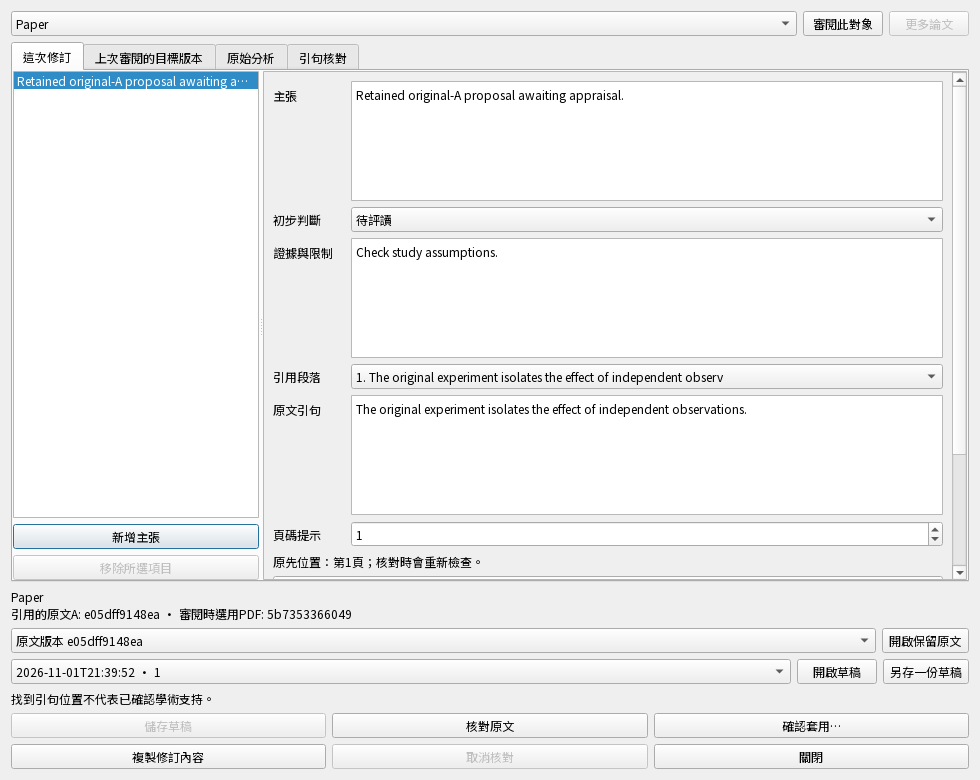

# 研究主張修訂：實際介面與操作驗收

後續進展：[遠端衝突離線修訂、回傳及獨立恢復](claim-continuity-scenarios.md)已有共用操作證據；下方保留原介面輪次的範圍。

## 先前介面輪次：App 內的主張修訂介面

隔離整合程式的「審閱保留內容」現在有「修訂研究主張…」。先明確選擇論文，
再用欄位編輯主張、初步判斷、理由、引句、頁碼提示及選填引用文獻。
可增加／移除主張與引句、保存不同私稿、重開草稿及載入較早的草稿頁。
目前支援受管理的可編輯工作區；唯讀恢復副本須先建立可編輯副本。
**你的日常安裝版沒有被替換；這不是已發布功能。**

| 你按的操作 | 實際會發生什麼 | 這輪驗證的結果 |
| --- | --- | --- |
| 儲存草稿／Ctrl+S | 在背景保存私人版本，尚未改正式研究 | 連按只存一次；保存期間可繼續打字，後打的文字會接續保存 |
| 另存一份／開啟草稿 | 保留不同解讀，不偷偷改成較新的研究基準 | 兩份各自保留；較早草稿能分頁找到；未保存的稿不假列為已存稿 |
| 核對原文／取消核對 | 在背景對A版PDF重新定位引句 | 沒有SQL或PDF解析跑在GUI；取消不留下可套用狀態；不把定位當成學術支持 |
| 開啟保留原文 | 用既有唯讀檢視器開啟A | 恢復副本也能打開自己的A，目前選用的B不變 |
| 確認套用 | 比對後跳出明確確認；取消則保持原狀 | 確認只儲存一次；正式主張保存欄位中的完整文字與A的來源 |
| 關閉 | 先完成已開始的保存；核對工作取消後才收尾 | 保存失敗保持視窗及文字；未填完的稿可修好重試；父視窗等待子視窗收尾 |
| 審閱途中研究庫被換掉 | 保留畫面文字，拒絕晚到結果套用 | 新研究庫不被舊工作修改；套用維持停用 |

目前版本比較標為「上次審閱的目標版本」，避免把保存的舊比較當成即時最新內容。
需要新的比較時，明確按「審閱此對象」。不使用原始JSON作為一般編輯介面。

[窄版實際畫面](images/claim-editor-zh-TW-narrow.png)。兩個畫面皆來自真正Qt元件與測試PDF，沒有私人論文或真實AI帳號。

**本輪同一候選程式：60項通過，20項新增、40項既有；整輪263.97秒。**
零失敗／錯誤／跳過／程式變動。包含中英文實際操作、980／620px畫面、
文字／筆記恢復及共用原文檢視器的相互影響檢查。不是整版或實機通過。
[本輪機器可讀結果](claim-draft-editor-results.json)。

另有2項按鈕資料補測通過：新增／移除後的完整私稿與選填引用文獻確實保存；
空白選取和連按不會超過16項主張／48段引句，也不能誤刪最後一項主張。
補測只新增案例，產品程式與先前案例內容保持原樣，因此沒有重跑未變動的既有群組。

測試先重現了取消訊號連著舊工作、背景保存鎖住輸入、未保存稿被列成已存版本，
入口直接顯示JSON、及計時器在清單刷新時到期卻未接續保存的問題；修正後同輪檢查通過。
計時器案例修正前真正失敗，修正後後續文字會接續存成第二個revision。
新增案例的一處中文標籤比對寫錯，
已改成實際標籤並加上完整引句比對；所有先前既有測試保持原樣。

**本輪後續：主張CLI／MCP已有[獨立操作結果](claim-review-operation-scenarios.md)。仍缺sidecar／遠端衝突的完整修訂旅程、離線端修改主張後的往返，
及其他內容格式、完整檢查、正式整合、安裝包與Windows／Mac／手機實機驗收。**

## 先前後端核對與套用的證據

以下231項是前一個後端候選的結果，不與本輪相加。它證明自己的列出流程，
不代表本輪重新跑過整個App。

2026-11-02，隔離 `0.5.0.dev`。這節記錄先前共用後端驗證；後續介面見上方。
目前相互影響的同輪檢查 **231 項通過，含22項新增**，整輪 392.92 秒；
零失敗、錯誤、跳過與程式變動。它不是整版、Mac／手機安裝版或學術品質驗收。

| 使用者情境 | 測試真正做了什麼 | 檢查保存／顯示的結果 |
| --- | --- | --- |
| 目前讀 B，修訂引用 A | 核對 A 的原句、明確確認後套用，再重送要求 | 主張保存 A 的引句定位與人工修訂標示，原文仍是 B，不再呼叫 AI |
| 核對後又改字 | 修改已核對稿，再按套用 | 拒絕沿用舊核對；重新核對新稿後才可套用 |
| 重新核對失敗／取消 | 先成功核對，再送錯誤稿或取消重查 | 舊權限撤回，正式主張不變 |
| 連按、同時送出或回覆遺失 | 同一要求並行重送八次；另模擬已提交但回覆丟失 | 只有一個正式變更與收據；重試回原結果 |
| 保存到一半出錯 | 在寫入來源及主張後故意令收據保存失敗 | 來源歸屬、主張與同步佇列全部撤回；重試一次成功 |
| 核對後原文被動手腳或移除 | 修改相同大小的原文並還原修改時間；另真正移除已發布來源 | 都不能沿用舊核對，不能靠舊收據復活來源 |
| 其他地方已更新 | 分別更換正式主張、PDF目標、論文生命週期或資料庫檔案 | 拒絕舊套用，保留變更後的內容與佇列；無關筆記則不阻止套用 |
| 明確恢復刪掉的主張 | 先刪除，再分別不確認／確認恢復 | 未確認拒絕；確認後建立新的生命週期，不假裝舊資料未被刪除 |
| 關閉、重開或工作途中換庫 | 核對途中關閉／替換庫；另保存後重開私稿 | 不把晚到結果送入錯誤庫；私稿文字保留，重開必須重新核對 |
| 同一路徑換了研究庫 | 原生替換資料庫，分別保留／改變論文身分 | 舊 reader 結果失效，新讀取能辨認正確論文；兩項案例修正前均失敗 |
| 真正備份恢復及離線往返 | 兩份私稿 → 備份 → 移開原資料夾 → 獨立恢復 → 核對A／套用 → 第二個本機端收取 → 離線筆記 → 重開 → 同步回來 → 再備份恢復 | 兩份私稿、正式主張、A與B的實體PDF及新筆記仍在；重送舊套用不改掉回傳的研究。私稿與執行期收據不傳給同步端 |

22項新增案例位於 `tests/test_claim_draft_application.py`（20項）與
`tests/test_document_reader_rebinding.py`（2項）。其他同輪案例檢查既有的
主張產生、私稿保存、引句定位、原文閱讀、來源歸屬、文字／筆記恢復及PDF遷移。
這些是在測試資料夾內使用真正 SQLite、測試 PDF 與本機 reference service；AI回覆由fixture提供。

測試抓到並修正兩個實際漏洞：同路徑換庫仍用舊論文快取；來源已移除卻被舊發布收據略過檢查。
中途測試環境錯誤亦保留紀錄，包括快取缺少正式綁定、錯用已移開的資料夾、
以及對不存在的收據表直接查詢。修正環境後，原本的保存／拒絕要求保持不變。

該輪未驗收的介面已由上方後續證據補上；主張CLI／MCP入口已有後續結果；sidecar／遠端衝突的完整修訂旅程仍待完成，
以及離線端直接修改主張後的往返（本輪離線端新增的是筆記）。沒有驗收實體Mac、手機、正式雲端或AI學術答案品質。
整版檢查仍未通過；未提交、發布或製作新版安裝包。

[機器可讀結果](claim-draft-application-results.json) · [英文操作契約](../claim-draft-application.md) ·
[整體功能進度](current-status.zh-TW.md) · [逐項測試入口](README.md)
