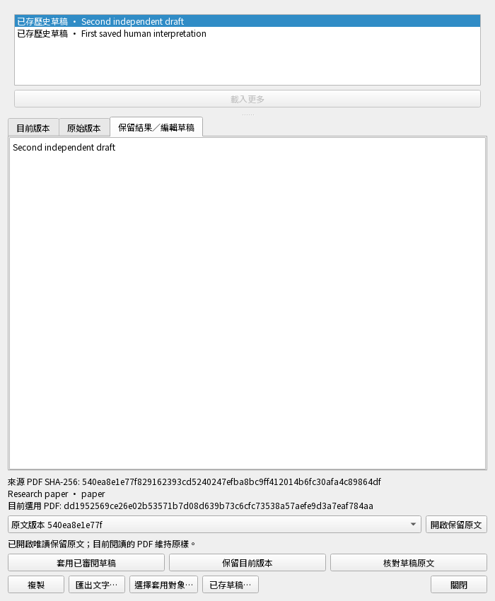
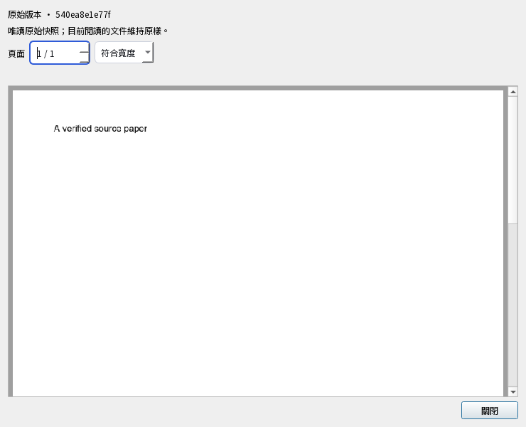

# Inspect the exact original while resuming a draft

Updated 2026-11-01. Isolated `0.5.0.dev`, unreleased. After selecting/verifying a
text-draft target, **Open retained original** shows its recorded PDF A read-only.
The current reader keeps B and the edit buffer remains usable. Reading publishes
no research and invokes no AI. Drafts use their own sealed read capability, not a
deck, material or claim grant.

現行原文讀取／視窗／失敗重試 **18 項通過**（60.90 秒 pytest／62.52 秒整輪），949 個輸入執行中零變動。既有來源與審閱共用 **208 項通過**（1029.55／1031.19 秒）是最後 SQL 錯誤轉換補強前的快照；後續只改草稿原文入口的例外轉換，並新增原樣的失敗重試測試。兩批不相加，也不是整版通過。

| 情境 | 真正操作 | 必須看到或保存的結果 |
| --- | --- | --- |
| 唯讀檢視 A，不發布研究 | 核對草稿、私存編輯並準備 A，比對前後的原文、研究、待同步資料與 B。 | 讀出正確 A，使用草稿自己的唯讀憑證；私存文字、研究與 B 保留，不新增決策或待同步資料。 |
| 畫面快速核對不做慢工作或呼叫 AI | 禁止資料庫查詢、PDF 解析、內容雜湊與 AI 帳號查詢，連做二十次畫面核對後關閉審閱。 | 核對正常通過且沒有禁用呼叫；關閉後立即撤銷讀取資格。 |
| 私存編輯後重新核對同一份 A | 準備 A 後私存新編輯，再於背景核對原本的來源。 | 資料變動先要求重新核對；新憑證仍對應原預覽及相同 A，保留編輯且不發布研究。 |
| 研究、A、B 或資料庫被換掉時拒絕舊結果 | 分別接受新研究、改動 A／B，或真正替換 SQLite 檔，再要求核對原文。 | 研究變動要求核對，檔案或資料庫身分變動立即失效；背景核對拒絕舊預覽，不自動改用新版本。 |
| 只允許已核對草稿所記錄的 A | 分別使用唯讀歷史預覽、未核對草稿，以及目前 B 代替記錄中的 A。 | 三種操作都被拒絕，待同步研究資料保持相同。 |
| 開始前取消，不讀取資料 | 準備原文前取消，並禁止建立任何 SQLite 連線。 | 不產生原文快照，也不開啟資料庫。 |
| 最後核對失敗，不遺留半套讀取資格 | 來源暫存後讓最後的目前文件核對失敗，檢查憑證與待同步資料，再恢復核對並重試。 | 失敗不留下來源或文件憑證，不發布研究；重試能讀出正確 A。 |
| 中英文原文視窗開啟後，仍可繼續編輯 | 連按開啟原文二十五次，檢視真正的 A 視窗，私存編輯後重新核對，再連按十次。 | 最初只開啟一次，PDF 解析不占畫面執行緒；A 仍可讀，編輯、B 與研究保留，沒有新增待同步操作。 |
| 原文準備中關閉或切換，不晚開錯視窗 | 讓已啟動的原文準備暫停，關閉實際視窗或切到另一草稿，再放行並等待同一工作。 | 不會晚開原文；關閉維持關閉，或另一草稿保留原文字，也不發布研究。 |
| 關閉會等真正的繪圖工作收尾 | 使用備用 PDF 顯示器，暫停實際繪圖執行緒，要求關閉審閱，再放行。 | 父視窗先等待工作收尾，之後兩個視窗關閉；私存文字保留且不新增待同步操作。 |
| 讀取錯誤後恢復按鈕，能真正重試 | 先讓來源準備回傳一次模擬 SQLite 錯誤，再點同一按鈕，第二次使用真正的讀取流程。 | 第一次保留文字、顯示原因並恢復按鈕；第二次能讀出正確 A，不發布研究。 |

## Actual fixture windows

These are synthetic research and PDF fixtures, captured from the real Qt windows.
The 700×850 review and 740×600 original were visually inspected: controls remain
reachable, both version identities are visible, and A renders its fixture text.
This is not a screenshot of the owner's research or an installed Mac/phone.

## Evidence and limits

The first actual audit failed because no draft-original adapter existed. New
backend controls passed12 and native controls5 before shared integration. An
independent actual-button audit then found that a synthetic SQLite failure left
the source button disabled. That exact audit now passes: the adapter normalizes
read failures, delivery clears pending state and a real second attempt opens A.

The 208-case shared gate completed before this last adapter-only correction.
Guarded integration changed only `prepare_resumed_draft` and added its native
audit; all earlier test functions stayed AST-identical. A copied candidate passed18
and the final authoritative source passed18, zero failures/errors/skips/drift.
An orchestration beforeimage-directory collision prevented an earlier promotion;
its redundant old-source run was stopped and is not a pass. Beforeimages and all
receipts remain in ignored build/. No existing assertion was weakened.

The source-stage registry is published only after its final document check, so a
failed verification leaves no orphan capability. GUI admission uses native file/
database fences only; metadata interference schedules a worker recheck against
the same displayed base. Changed sources, owners or actual database replacement
revoke. Read-only SQLite connections close explicitly and do not checkpoint the
guarded metadata during inspection.

This does not finish typed note/claim/highlight/deck draft resumption, detached
editable adoption, all private history/source formats or a new-format peer journey.
The [typed-note contract](../review-note-resumption.md) is planned, not implemented.
Full check, production identity/service, installers, installed Apple Silicon Mac/
phone and expert scientific evaluation remain required. No release is claimed.
