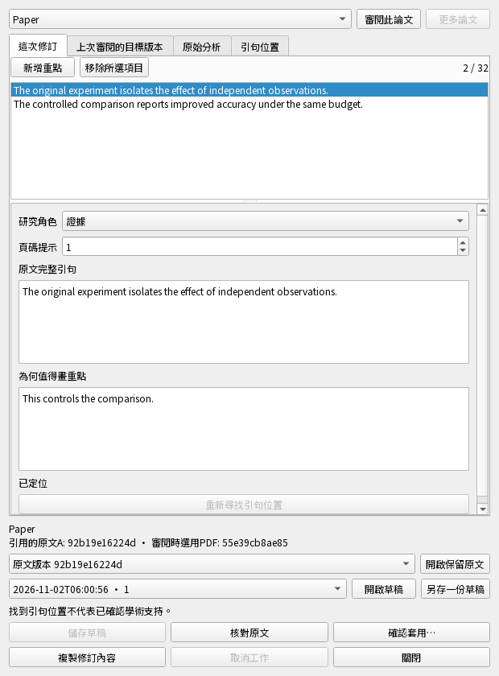

# 螢光筆修訂介面：這輪究竟在測什麼

2026-11-02 · `0.5.0.dev` · 隔離整合候選，未發布。

這輪把原句、重點理由與研究角色變成可編輯的真正桌面欄位。
**130項相關檢查通過，含24項新增，整輪706.7秒；不是整個App或安裝包通過。**

## 先看四種使用操作

| 要保護的操作 | 測試實際怎麼做 | 必須看到或保存的結果 |
| --- | --- | --- |
| 改好重點，重開還在 | 在真正欄位改原句、理由與研究角色，保存、關閉再重開。另暫停儲存後繼續打字。 | 最後輸入的文字完整保存；舊儲存回覆不會蓋掉新字；空白未完成項目不破壞上一份私稿。 |
| 看對原文，確認後才改研究 | 先讀A、核對全部原句、取消一次確認，再明確套用。另測不存在的句子及刪除標記恢復選擇。 | 閱讀A不取得套用資格；目前B保留；未定位時不套用；取消不改研究；確認後完整儲存且可繼續編輯。 |
| 出錯、取消、離開都不丟稿 | 暫停核對／套用／讀原文，分別取消、改稿或關閉；故意讓保存或決策失敗，再修復重試。 | 舊結果不套錯；視窗等待自身工作；失敗保留文字及正式研究；修復後可重試且只存一次。 |
| 鍵盤與版面真的能用 | 用Ctrl+A/C/V/Z/Y及Delete修改文字；在中英文、620／980寬度操作；關閉父子視窗後再查狀態。 | 選取、複製貼上與復原重做有效；按鈕在視窗內；關閉後不可見且重複關閉安全，原生資源在GUI釋放。 |

這些操作在合成PDF與隔離資料庫執行，使用真正Qt控制項與本地儲存。
人工修訂不呼叫AI；定位正確也不代表學術解讀正確。
本輪主要入口是保留的生成結果，尚未證明恢復／遠端來源的完整原生入口旅程。

## 實際畫面

合成論文畫面：每則重點分開編輯原句與理由，下方是私稿、原文及核對／確認操作。
不是Mac安裝包或實體手機截圖。[英文寬版畫面](images/highlight-editor-en-980.png)。

## 為何這輪還會跑既有測試

螢光筆與研究主張共用視窗生命週期及原文檢視；只測新按鈕會漏掉舊流程回歸。
因此本輪只選直接受影響的下列檔案。時間包括PDF、測試資料庫準備與清理，
不是使用者每次按鈕等待時間；案例比例不是剩餘時間或版本完成度。

| 群組 | 案例數 | 案例累計秒數 | 保護什麼 |
| --- | ---: | ---: | --- |
| 新增：真正螢光筆編輯操作 | 22 | 103.19 | 中英文欄位、鍵盤、私存／重開、原文A、確認／恢復、取消／關閉、失敗重試及版號 |
| 新增：關閉與原生資源釋放 | 2 | 7.86 | 獨立／父子視窗由GUI釋放；關閉後仍可查不可見與重複關閉 |
| 既有：研究主張編輯與原文 | 33 | 370.94 | 共用生命週期及原文讀取不破壞主張欄位、私稿、核對及套用 |
| 既有：恢復稿與保留原文 | 18 | 128.42 | 讀A時保留B、取消／切換／關閉／失敗重試，不晚開舊視窗 |
| 既有：PDF版本與本地來源 | 29 | 56.23 | 原生PDF與備援讀取器的來源版本及關閉邊界 |
| 既有：審閱清單與決策 | 26 | 28.74 | 原清單決策、私稿及父子視窗關閉相容 |

隱私掃描／Ruff通過；1155個程式／測試／前端輸入零變動；零失敗／錯誤／跳過。
案例時間包含setup/call/teardown，與整輪時間可有啟動／工具開銷差異。
[24項新增案例逐項說明：操作、結果、參數與未涵蓋範圍](../../build/highlight-ui-explanations.html)。
收集名稱或產生HTML不執行測試；不同快照或重疊輪次不可相加。

## 這輪真的抓到了什麼

- 未定位的原句回報曾顯示空白；現在保留每句問題，並禁止套用。
- 已保存的套用結果曾依賴提交後再讀私稿版號；現在從同一交易回覆版號，後續輸入能繼續存。
- 兩次較早UI檢查曾原生中止，沒有完整JUnit結果，不能當通過。
  另有確定重現的缺陷：關閉後原生視窗仍留給之後的Python回收；現在於GUI事件迴圈退役。
  這證明資源釋放契約，不單獨認定每次舊中止的唯一原因。
- 前次相關檢查59通過／1失敗：關閉後既有呼叫端查`isVisible()`遇到已釋放物件。
  新測試先重現，程式保留關閉後不可見及重複關閉行為；既有測試完全未改。
- 後一次64項通過後在清理階段出錯：既有呼叫端重複`deleteLater()`。
  新測試先重現，程式再保留安全重複清理；原生釋放仍發生在GUI執行緒。

## 還不能說完成的事

恢復／遠端來源的完整原生操作與中斷旅程、螢光筆CLI／MCP、舊引用連結的完整失效檢查、
簡報等剩餘格式、正式分支整合、完整檢查、安裝包、正式服務及登入配對，
以及Windows→離線Apple Silicon Mac→手機→桌機實機驗收均待完成。
沒有使用私人研究資料或付費模型，沒有提交、發布或替換日常App。

[介面與生命週期契約](../highlight-draft-native-editor.md) · [版本功能地圖](current-status.zh-TW.md)
