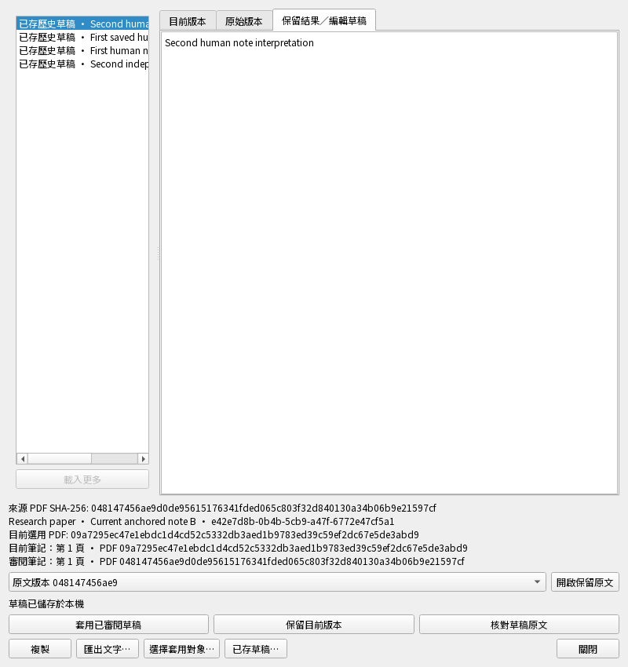
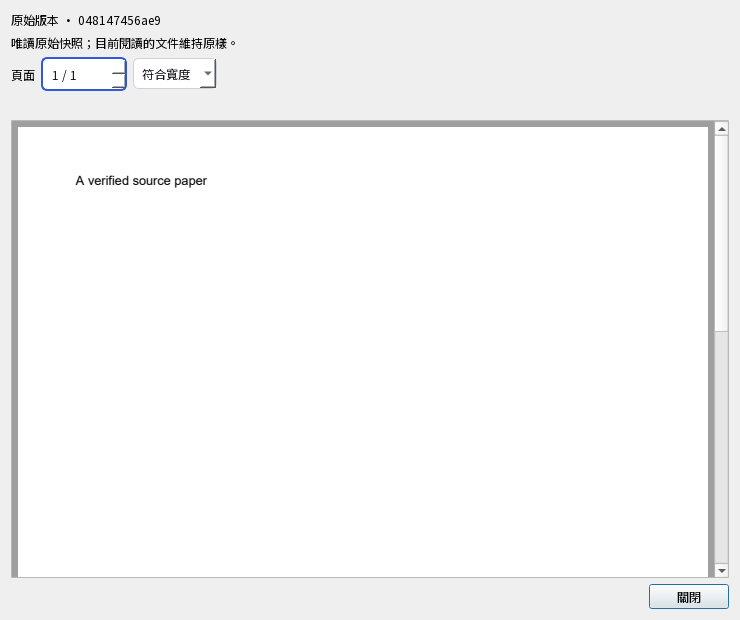

# 恢復筆記後繼續研究：逐項驗收

2026-11-01，隔離 `0.5.0.dev`，尚未發布。這份文件解釋新測試的操作與預期結果；
新筆記／報表預設 **24 項通過**（474.38 秒整輪）；既有文字／原文／草稿恢復互動 **100 項通過**（422.83 秒）。兩輪使用相同 957 個程式與測試輸入，執行中零變動、零失敗／錯誤／跳過。這是指定範圍驗證，不是整版通過。
不能從這張情境表推論整版通過。

使用流程：恢復研究 → 按「繼續編輯」→ 明確選接收端既有筆記 → 核對來源 →
私存編輯 → 確認套用。筆記的身分、所屬論文與建立時間保留；內文、種類、頁碼和
引用位置來自審閱稿。目前選用 B 時，讀取舊來源 A 不會替換 B。

| 操作情境 | 實際演練 | 預期保存的結果 |
| --- | --- | --- |
| 恢復後重開筆記草稿，核對原文並只套用一次 | 製造兩裝置筆記衝突，私存兩份人工稿，備份後恢復成可編輯副本；選目前筆記、儲存、重開、核對及重試套用。 | 保留原稿與目標筆記身分；內文及來源改為審閱稿，待同步變更只產生一次。 |
| 恢復副本能讀兩份筆記草稿，不依賴舊資料夾 | 禁止存取原資料夾與原資料庫，讀取恢復副本中的兩份人工稿，再比較保存的歷史資料。 | 兩份人工稿皆可匯出；歷史不變，也不重新啟動舊草稿工作表。 |
| 未選或不存在的筆記不會被套用 | 分別傳入空目標及不存在的筆記 UUID，之後比較筆記、來源、決策與待同步資料。 | 兩次均拒絕，原稿、研究與待同步資料皆維持。 |
| 筆記儲存中途失敗不留下半套資料 | 私存人工編輯，讓決策儲存故意失敗，檢查筆記、來源與佇列；恢復後重試同一請求。 | 失敗全部撤回但私稿仍在；重試只新增一組來源與筆記變更。 |
| 八次同時套用只建立一份已審閱筆記 | 四個工作執行緒送出八次相同請求，再以相同請求編號送另一段內文。 | 相同請求只提交一次並保留目標身分；換內文的重試被拒絕。 |
| 兩視窗編輯不會互蓋私存筆記 | 第二視窗先存新稿，再讓第一視窗用舊版號儲存；嘗試匯出未存成功的文字。 | 較新私稿與版號保留，舊版儲存被拒絕，失敗的文字仍能匯出，正式筆記未改。 |
| 筆記、論文或筆記生命週期改變時拒絕舊預覽 | 私存草稿後，分別以正式儲存流程改筆記、改論文名稱、刪除再重建筆記，然後核對舊預覽。 | 核對被拒絕，不覆蓋新的研究；私存文字仍可讀取。 |
| 恢復檔案庫身分不符或原文損壞時保留草稿 | 分別改錯檔案庫工作區、裝置、資料庫路徑、完整標記或原文字節，核對失敗後修回並重試。 | 失敗不發布來源或研究且私稿保留；修復後核對正確舊版 A，不能拿目前 B 替代。 |
| 未綁來源的筆記維持未綁來源 | 從真正未綁原文的遠端筆記衝突恢復草稿；目前已有 B，仍核對並套用人工稿。 | 筆記無頁碼或錨點，不冒用 B；只新增筆記變更，不發布假來源。 |
| 接受的筆記與原文能傳另一裝置，再次備份恢復 | 接受人工筆記後透過本機參考服務傳到獨立裝置，下載來源，再將接收端備份並獨立恢復。 | 另一裝置有相同筆記與 A，仍選 B；第二次恢復保留全部筆記、兩份原稿及私存資料。 |
| 格式損壞不能偷偷改目標身分與來源 | 在私存稿副本中分別竄改未知欄位、型別、目標、建立時間、來源及觀察資訊，重算完整性指紋再驗證。 | 每種不合法格式均被拒絕，真正私存文字仍在；不是只靠舊指紋擋住。 |
| 中英文桌面介面可核對、取消、套用及重開筆記 | 在真正 Qt 視窗選歷史筆記與目標，連按接續與開原文；編輯後先取消，再確認並連按套用，關閉後重開。 | 看得到兩份筆記來源與 A 原文；取消不寫入，確認只存一次，重開保留編輯並要求重新核對。 |
| 核對途中關閉或改選，不晚送結果到錯的草稿 | 暫停真正筆記來源核對，關閉視窗或改選另一份人工稿，再放行同一工作。 | 不晚開原文或寫研究；關閉維持關閉，另一份草稿保留自己的文字與唯讀狀態。 |
| 報表預設先顯示人工說明，完整清冊仍可查 | 使用中英文小型案例清冊產生 HTML，檢查預設篩選、情境說明與保留的未說明案例資料。 | 預設勾選只看說明；操作、結果、限制均在，未說明案例仍保留並可搜尋。 |

## 範圍與限制

- 恢復副本的完整歷史需先驗證；不會重新啟動舊工作或存取原電腦路徑。
- 私有檔案快取只在完整備份確實包含該稿時使用，並核對目前裝置／資料庫綁定、
  完整索引與檔案雜湊；快取檔名不是來源權限。
- 套用同時保存來源、筆記、待同步變更與決策；其中一步失敗就全部撤回。
- 這是測試 PDF、隔離 SQLite、原生 Qt 及本機參考服務，不是你的研究庫。
- 未驗收：Mac／手機安裝版、正式雲端、學術品質；其餘論點／螢光筆／簡報專用恢復、
  全內容同步與整版檢查仍須完成。
- 報表預設顯示人工說明；取消勾選可查完整清冊，但未說明案例不會假裝已有解說。

[功能現況](current-status.zh-TW.md) · [其他操作驗收](README.md)

## 實際合成資料視窗

下圖擷取自真正 Qt 中文視窗，已檢視：800×850 審閱畫面的來源與控制項可見；
740×620 原文畫面已等待測試文字繪出。這是測試稿，不是你的論文內容。

新 UI 測試會明確選名稱對應的筆記並核對身分；不依賴隨機 UUID 排序的第一列。
