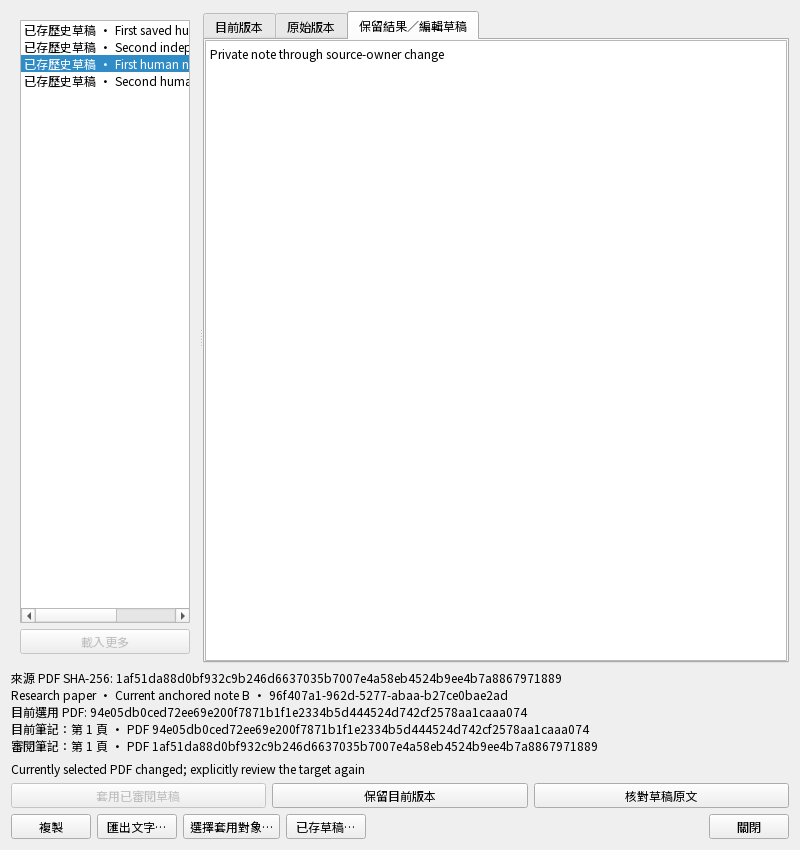

# 筆記原文位置與來源變動：操作驗收

2026-11-01，隔離 `0.5.0.dev`，尚未發布。這張表說明每個案例的操作與預期結果，
實際結果與各項耗時見[本輪驗收結果](note-source-check-results.md)；不代表整版或實機通過。

這輪補上三個缺口：原文詞索引越界仍通過、核對後檔案庫換綁仍可用舊資格套用、
以及重新核對失敗後畫面仍顯示可套用。修正後保留人工稿，要求正確來源重新核對。

| 操作情境 | 真正演練 | 預期結果 |
| --- | --- | --- |
| 引用不存在的詞時，保留人工稿並拒絕套用 | 真實衝突稿指定四詞原文的第九個詞，私存編輯後核對。 | 拒絕越界位置，不發布來源或研究；原稿、私稿與待同步資料保留。 |
| 核對後換綁或替換檔案庫，不能沿用舊資格 | 先核對並準備原文，再分別換裝置綁定、改不完整、刪綁定或真正替換索引檔；要求套用及原文重核對，最後補回原資料重試。 | 舊套用與原文重核對被拒絕，筆記和佇列不變；私稿保留，修回後能重新核對。 |
| 歷史缺件或遭改動時拒絕，補回後讀得到兩份稿 | 在隔離資料中移除完整歷史的 manifest 或改動保存列，再要求讀取；測試補回原始資料後重開。 | 不展示未驗證歷史，不動研究與佇列；補回後兩份人工稿與原字串一致。 |
| 有位置卻沒有 PDF 版本的草稿，不冒用目前原文 | 分別恢復沒有來源版本的選取位置與純頁碼筆記，私存後核對。 | 提示需要記錄中的 PDF 版本，保留私稿，不把位置直接套到目前 B。 |
| 草稿頁碼超過其原文時不套用 | 恢復引用單頁 A 第二頁的真實衝突稿，目前另選 B，再核對。 | 拒絕 A 的越界頁碼，來源資格、研究與待同步資料不增加。 |
| 新增無關快取，不會被誤當成換綁 | 核對並開啟 A，另存一份無關快取，背景重核對同一原文後套用筆記。 | 只要求重新核對；仍讀相同 A，並能成功套用人工文字。 |
| 重新核對失敗，舊的套用資格立即失效 | 先核對及私存，故意讓最後來源身分檢查失敗，再嘗試舊預覽套用；恢復檢查後重試。 | 不留下半套或舊的套用資格，私稿保留；恢復後能核對相同來源。 |
| 指定另一筆筆記，保留接收端身分與建立時間 | 明確選同篇論文的另一筆較早筆記作為目標，核對並確認套用。 | 只改選定筆記的內容與來源；其身分和建立時間保留，未選筆記完全相同。 |
| 真正存在的單詞與跨頁位置可通過 | 製作含一般詞與旋轉標籤的兩頁 PDF，驗證單詞及跨頁選取端點。 | 一般詞端點通過；選取詞流維持原文索引，旋轉標籤不混進可選取文字。 |
| 旋轉標籤、缺字位置與倒置範圍不算有效引用 | 對真正含旋轉文字的 PDF，分別指定旋轉詞、越界詞、缺頁與倒置端點。 | 每種無法對應原文選取的座標均被拒絕。 |
| 同頁的兩個端點只解析一次 | 記錄真實 PDF 詞流讀取，先核對兩頁端點，再核對同一頁的兩個端點。 | 兩頁各讀一次；同頁只讀一次，不為起點與終點重複解析。 |
| 原文失效後關閉視窗、停用套用，修復後可重試 | 在中英文實際 Qt 視窗編輯並開 A，改來源裝置綁定，重核對失敗後再補回原綁定重試。 | 關閉失效原文並清除快照，私稿保留、套用與開原文停用；重新核對成功才恢復按鈕，研究未被改動。 |

## 如何理解「來源已核對」

- 頁碼與詞索引必須存在於記錄的 PDF，且使用閱讀器同一份可選取詞流。
- 私有恢復快取的核對資格還記住檔案庫身分、裝置／資料庫綁定及完整來源紀錄；
  到套用與原文重核對時再檢查。核對一次不代表永久有效。
- 沒有位置的手動筆記可以未綁來源；帶位置卻沒有 PDF 版本的稿會保留，但須先確認來源。
- 換裝置綁定與新增無關快取是不同情況：後者可以背景核對同一 A，不應誤丟編輯。
- 這些檢查只證明位置與檔案／工作區連續性，不證明人工筆記或 AI 論點獲學術支持。

沒有使用你的研究庫、真實登入或付費 AI。損壞資料的補回是測試安排，不是 App 已有
自動修復功能；位置來源對應介面、其他恢復類型、整版與實機驗收仍未完成。

[功能現況](current-status.zh-TW.md) · [筆記接續與截圖](note-resumption-scenarios.md) · [驗收入口](README.md)

## 真正的中文核對失敗畫面

800×850 合成資料 Qt 視窗，已檢視：編輯保留、套用停用，原文已撤銷；
「核對草稿原文」仍可重試。原文／工作區不可核對不代表已改動 PDF 位元組。

