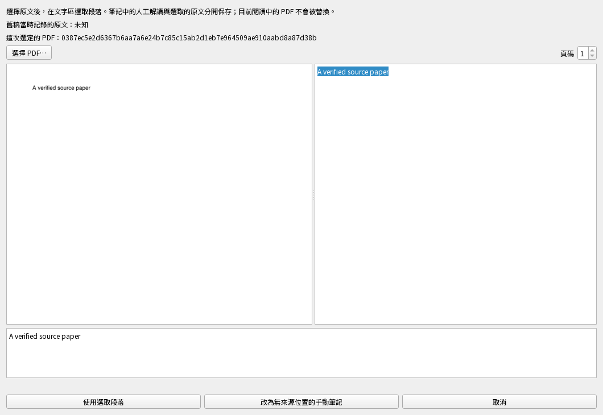
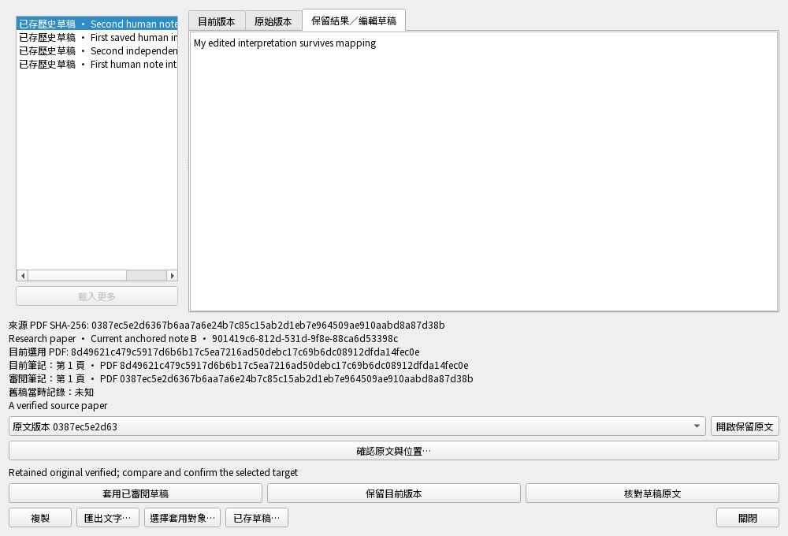

# 恢復筆記的來源對應：操作與實際結果

2026-11-01，隔離 `0.5.0.dev`，尚未發布。這份文件對照**實際做了什麼、保存了什麼**。

恢復的筆記若沒記下 PDF 版本，或位置失效，現在可以：

1. 按「繼續編輯」，選接收端的筆記。
2. 按「確認原文與位置…」，選 PDF，在文字區選取段落。
3. 核對顯示的原文；也可以改為無來源位置的手動筆記。
4. 私稿先保存，再核對來源；最後確認視窗列出目標、PDF 與段落才套用。

舊稿當時沒記錄來源，歷史就保持「未知」；這次人工選定的來源另外保存。
目前閱讀的 B 不會被選取的 A 替換，人工解讀也不會被當成原文引句。

## 本輪實際執行結果

**22 個案例通過，0 失敗／錯誤／跳過，170.55 秒測試時間；整輪 172.06 秒。**
使用相同 969 個程式／測試輸入，執行中零變動。下面 12 項演練合計就是這 22 個案例，不能再相加。

| 實際演練 | 結果 | 案例合計耗時 |
| --- | --- | --- |
| 來源未知的筆記：選原文、私存、重開、套用、傳遞與再恢復 | 通過 1/1 | 41.54 秒 |
| 移除不存在的頁碼，舊來源與位置仍留在歷史 | 通過 1/1 | 15.92 秒 |
| 取消、變更／損壞檔案及關閉服務，不寫入研究 | 通過 1/1 | 15.02 秒 |
| 來源收據／檔案庫變動、決策失敗與修復重試 | 通過 1/1 | 16.61 秒 |
| 兩視窗私稿互蓋與正式筆記並行修改 | 通過 1/1 | 13.82 秒 |
| 中英文 Qt：選原文與段落、取消、確認、保留人工編輯 | 通過 2/2 | 32.59 秒 |
| 關閉正在檢查來源的視窗，重複點擊不增加工作 | 通過 1/1 | 14.58 秒 |
| 中文／emoji 的 UTF-16 選取與 PDF 原始詞號對應 | 通過 1/1 | 0.00 秒 |
| 引文、解析器、跨頁、取消與八種格式錯誤 | 通過 10/10 | 0.11 秒 |
| 既有研究查核接受新筆記格式，不宣稱語意已驗證 | 通過 1/1 | 1.09 秒 |
| 不完整簡報拒絕備份，舊備份檔案不被覆蓋 | 通過 1/1 | 0.69 秒 |
| 立即開原文時，先存完待存私稿再擷取來源證據 | 通過 1/1 | 15.59 秒 |

時間包含建立隔離資料庫、衝突、備份恢復與桌面背景工作收尾，**不是 App 按一次按鈕的延遲**。
使用測試 PDF、SQLite、真正 Qt 及本機參考服務，沒有呼叫真實 AI 或使用你的研究資料庫。

## 回歸中找到並修正的問題

較早的相關檢查是 85 個案例中 82 通過、3 失敗：原文開啟與私稿自動儲存競爭、關閉後的錯誤被誤當來源修復、備份回傳錯誤類型。
三項原有失敗案例已經對應重測通過；另補「先保存人工稿再開原文」與「保護舊備份」回歸案例。
**沒有把原有測試改鬆，也沒有把這些分輪結果說成整組 85 個案例重新通過。**

最早的新測試也有資料準備錯誤：第 99 頁與錨點不一致、把摘要當完整歷史，以及在既有檔名保護之前就期待移轉錯誤；已修正新測試的準備與讀取方式。

## 還不能從本輪結果推論什麼

- 整版檢查仍未通過；這不是發布或安裝包驗收。
- 沒有驗收 Apple Silicon Mac、手機、正式同步服務、真實 AI 或學術語意品質。
- 來源選擇目前使用原生檔案選擇器；CLI／MCP 的受限來源參照仍待接入。
- 畫面目前在單頁文字區選段落；後端有受限跨頁位置，尚未提供跨頁拖選介面。
- 舊錨點仍可讀，沒有原文文字證據的舊位置不能宣稱解析器詞序已獲驗證。
- 其餘論點／螢光筆／簡報恢復、全內容同步及正式服務仍須完成。

可讀情境說明在 `catalog.json` 追蹤；本機執行輸入、JUnit、日誌與結果在 ignored `build/note-source-mapping-accepted*`。
案例清冊有 8,214 種條件，人工說明只涵蓋 178 個函式／369 個案例；清冊數字不是功能完成率。

[功能現況](current-status.zh-TW.md) · [圖示總覽](acceptance-overview.html) · [其他操作驗收](README.md)
