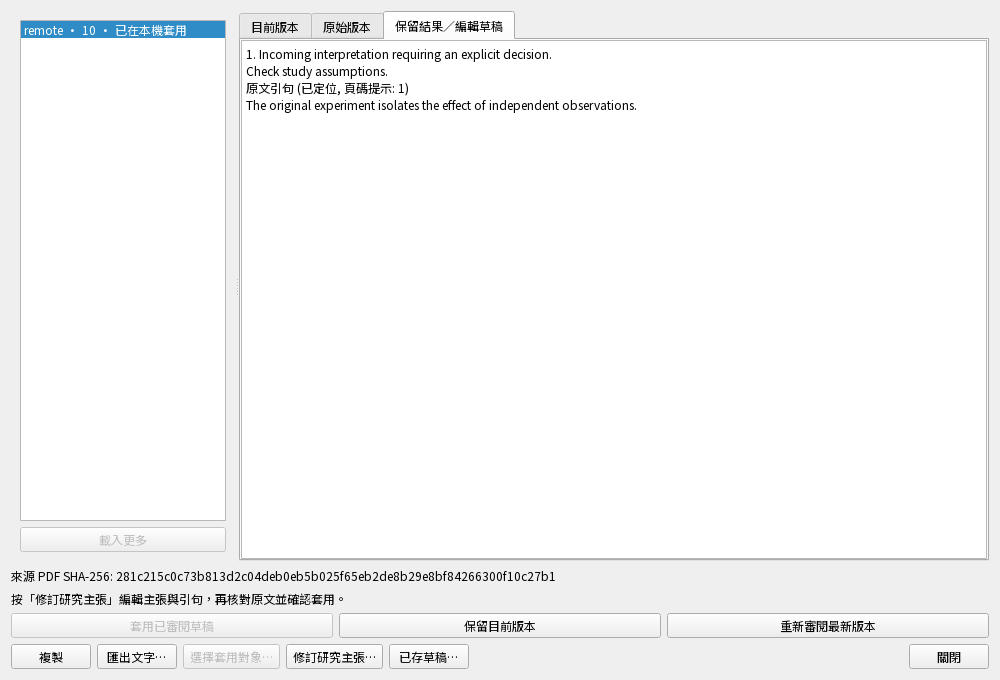

# 修訂後，父層清單狀態有跟上嗎？

2026-11-02 · `0.5.0.dev` · 隔離整合候選，未發布。

## 使用問題與本輪結果

以前在子視窗修訂研究主張並套用後，父層清單仍像沒處理；重開也讀不到專用流程的決定。
現在清單會對應到已保存的本機決定，子視窗關閉後在背景更新原列。
顯示「已在本機套用」，**不代表已完成雲端同步**。

| 你做的事 | 必須保留的結果 |
| --- | --- |
| 中英文修訂視窗套用後關閉 | 原列更新，選項與顯示內文不被重載 |
| 沒套用就關閉 | 不產生已處理標籤，也不修改正式研究 |
| 狀態讀取中切去另一筆並打字 | 未存文字、焦點、游標、兩處非零捲動與選項完整保留 |
| 暫時讀不到狀態 | 不假裝完成；提示可重新審閱，修好後能重試 |
| 資料庫已替換或視窗已關閉 | 晚到結果不回填，也不寫入另一個工作區 |
| 途中另有保存 | 至多自動重讀一次狀態，不重做研究決定 |

## 實際測試地圖與耗時

最後凍結候選：**114項通過，含25項新增／89項既有，482.22秒**。
隱私掃描、Ruff通過；零失敗／錯誤／跳過與執行中程式變動。這是focused檢查。

| 測試群組 | 案例 | 案例累計秒數 | 在保護什麼 |
| --- | ---: | ---: | --- |
| 本輪狀態讀取 | 16 | 10.73 | 決定對應、來源身分、關閉、換檔及空／非空WAL |
| 本輪真正父子視窗 | 9 | 135.63 | 修訂後刷新、取消、未存導覽、讀取失敗與晚到結果 |
| 既有審閱與草稿 | 50 | 70.53 | 原有保存、草稿、確認、複製及群組審閱保持 |
| 既有主張與工具 | 30 | 219.61 | 原衝突修訂、CLI／MCP與重啟／重試保持 |
| 既有恢復與簡報 | 9 | 39.2 | 歷史草稿、可攜與本機簡報的清單入口保持 |

案例秒數來自本輪JUnit，包含準備／執行／清理；整輪另有掃描、收集開銷。
[25個新案例逐項人話說明](../../build/parent-review-explanations.html)列出操作、結果及限制，
不把案例說明或收集名稱當成通過證據。[精確執行結果](parent-review-results.json)。
前輪151項與本輪有重疊且程式快照不同，不相加，也不當成整版通過。

## 修正前後與限制

最初3項案例確實失敗：清單未讀到專用收據，中英文關閉子視窗後都沒有更新。
新增邊界檢查也發現一般工作區的空WAL初始化誤判，以及新測試重用工作編號。
依實際檔案版本／雜湊定位後，僅讓**本機顯示狀態**把零位元組WAL視為無資料；
主資料庫與所有非空WAL仍使用完整檔案版本。真實提交仍在WAL、主檔位元組不變的案例也已通過。
這個顯示規則沒有套用到原文雜湊證明、套用權限或同步驗證。

測試準備錯誤已修正，原有測試與新測試的保存／隔離／導覽斷言未放寬。
未驗收安裝版Mac／手機、正式雲端或真實AI，沒有替換日常研究或安裝程式。
目前比較內容仍是該預覽的快照；更新清單標籤不會默默重建編輯區。
剩餘格式接續、整版檢查、正式服務與跨裝置旅程仍是0.5發布條件。

[功能現況](current-status.zh-TW.md) · [版本範圍](../roadmap-0.5.0.md)
