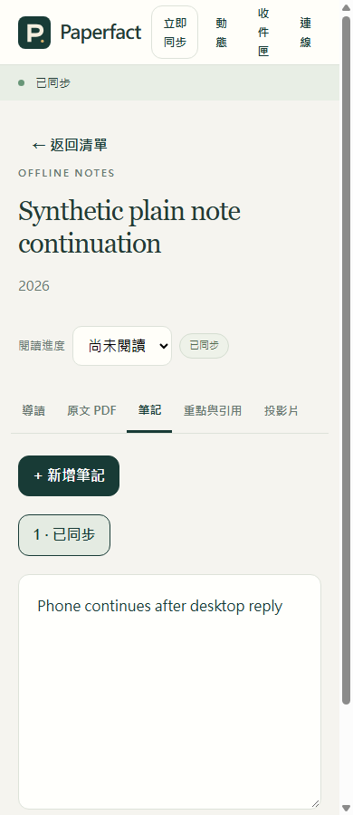

# 純文字筆記：桌面與手機如何接著改

2026-11-02，隔離 `0.5.0.dev`，尚未發布。這輪修正兩個實際問題：

1. 純文字筆記有桌面建立時間等欄位時，手機原先會誤列為唯讀。
2. 沒有未存修改的筆記收到新版時，畫面原先也會誤顯示草稿衝突。

## 實際操作與保存結果

| 操作 | 必須看到／保存的結果 | 實際證據 |
| --- | --- | --- |
| 真正桌面編輯器連按保存，再傳到獨立研究庫 | 只保存一次；建立時間不變；晚到修改留下草稿與一份候選，不蓋掉新文字 | 新增 1 條 Qt 同儕旅程；包含於 22 項桌面檢查，全部通過 |
| 桌面純文字 → 手機離線改 → 重載 → 選回既有工作區 → 重連 → 桌面修改 → 手機再保存 | IndexedDB 文字與單一佇列保留；桌面／手機真正收到新文字；原建立時間等欄位不被剝掉 | 實際 PWA 按鈕與 HTTP／Data 保存流程通過 |
| 收到桌面新版時，分別測「沒有私稿」與「已輸入未存文字」 | 前者可以立即接著改並送回；後者保留自己的文字及舊基準，阻止覆蓋新版 | 真正畫面兩種狀態均通過；不只檢查文字框是否啟用 |
| 刪除無位置純文字筆記 | 明確刪除同步回桌面；不把六欄筆記偷偷改成兩欄 | 新 HTTP 情境與單元檢查通過 |
| 嘗試改建立時間／來源位置，或寫入帶引文筆記 | 非本文欄位改動被拒絕；帶位置與引文的舊唯讀保護保留 | 既有斷言保留，新負向案例通過 |

桌面 22 項：8.88 秒測試／10.17 秒整輪。手機完整維護檢查：**512 個單元案例全部通過，13 份 HTTP 情境程式全部通過**，41.78 秒整輪。
實際瀏覽器另有 6 組既有檢查及本輪 2 種畫面情境。這些範圍不能相加當成功能數或整版通過。
本輪手機檢查凍結 1100 個程式／測試輸入，執行中零變動；沒有真實 AI 或日常研究資料。

## 真正 PWA 畫面（合成資料）

[較寬視窗截圖](images/plain-note-1100.png)。截圖來自同一台 Windows 的獨立隱藏 Chrome，並非實體手機。

## 驗收過程找到什麼

最初的真正 HTTP 檢查在「桌面無位置筆記可於手機編輯」失敗，修正後通過。
查看實際截圖又發現乾淨編輯器誤判衝突；已補「再從手機保存並傳回桌面」的驗證，並保留真正未存稿的拒絕覆蓋檢查。
測試工具也修正了清單資料格式、可見連線按鈕定位、新文件重載等待及同步按鈕啟用等待；沒有刪除原本的草稿、焦點或游標斷言。
離線快取明確版本由 v13 更新為 v14，App 仍為 `0.5.0.dev`；原有快取與完整維護檢查的斷言保留並擴充。

## 還沒完成什麼

上述純文字修正檢查點當時仍需手選工作區、頁首標籤也會擠壓；後續已加入[離線自動恢復與頁首改版](workspace-resume-scenarios.md)。本頁較早的執行結果與截圖保留原範圍。
帶頁碼、引文位置或其他筆記種類維持唯讀；沒有在這輪把它們剝成純文字。
沒有實機 Mac／iPhone／Android、正式帳號或雲端服務驗收。整版檢查仍有另一項引用完成判定差異，沒有提交、安裝包或發布。

[圖示現況](acceptance-overview.html) · [英文操作契約](../mobile-note-editing.md) · [先前備份／接續旅程](note-continuity-scenarios.md)
