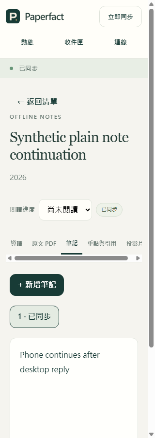

# PWA 重開：回到原工作區，保留離線修改

2026-11-02，`0.5.0.dev`，尚未發布。這輪改善兩個實際使用障礙：重載後必須手選工作區，以及窄螢幕頁首文字直向擠壓。

## 現在怎麼用

1. 成功開啟自己的工作區一次。
2. 離線閱讀或修改筆記，再關閉／重載頁面。
3. App 自動開啟該工作區和原先選取的論文，保留草稿與待同步資料。
4. 此時仍未登入服務；按「連線」明確連線後才同步。欄位已帶入工作區、裝置及服務位置，token 保持空白。

只記住上述連線描述，不保存 token 或研究內容。第一次使用仍開啟示範；明確選示範會忘記上次選擇，不刪研究資料。

## 實際做了什麼

| 操作情境 | 測試動作 | 必須看到／保存的結果 |
| --- | --- | --- |
| 沒有資料庫／沒有該工作區 | 用真正 IndexedDB 請求開啟不存在的快取 | 不建立資料庫或空工作區，不假裝成功 |
| 草稿與同步佇列已存在 | 保存資料、重開既有 scope，再啟動真正 App | 本文、草稿、基準、佇列與游標保持相同 |
| 工作區被刪除或內容錯誤 | 持有舊 handle 後刪記錄；或放入錯誤身分／損壞內容 | 拒絕讀寫，不以空資料重建，不蓋掉舊資料 |
| 重載時仍離線 | 真正按鈕保存一次 → 離線重載 → 自動回到筆記 → 明確重連 | 保留單一待送項目；新頁面沒有研究／登入請求；重連後桌面收到正確內容 |
| 明確切回示範 | 從連線視窗按「開啟示範工作區」 | 只移除選擇提示，私有快取不變 |
| 設定儲存不可用／格式錯誤 | 模擬存取失敗，並以真頁面測試壞提示 | 顯示原因，不洩漏內容，不清除研究或憑證 |
| 中英文窄螢幕操作 | 在320、390、600、1100px量測並用 Enter／Escape操作 | 四個頁首動作文字完整、至少44px高、無整頁水平溢出；連線視窗可開關 |

**最終手機維護檢查：535 個單元案例、13 份 HTTP 情境程式全部通過。**
另有8組真正 IndexedDB／啟動情境、6組既有瀏覽器檢查，以及延伸的實際 PWA 往返／未存稿保護；不能相加當作功能完成率。
同一份 1105 個程式／測試輸入，執行中零變動，相關整輪 48.50 秒。沒有真實 AI 或日常研究資料庫。

## 本次續讀修正與可追查案例

修正前新增的兩個案例失敗：沒有清單的論文無法恢復；後續刷新會把總覽切回舊清單。
目前僅在初次載入採用保存的選擇，明確選擇（包含空總覽）不會被刷新覆蓋。

| 操作 | 對應驗證 | 本次結果 |
| --- | --- | --- |
| 從論文庫直接讀，沒有選清單，離線重開 | `mobile/tests/workspace-startup.test.mjs` 的 library-paper 案例；真正 App 的 Library paper 瀏覽器情境 | 原論文與草稿恢復；保存狀態完全相同 |
| 恢復後選別篇或總覽，再刷新 | 同檔 resume-a-library-paper 與 clean-initial-overview 案例 | 保持新的選擇，不跳回舊位置 |
| 初次刷新前明確選總覽 | 同檔 explicit-empty-selection 案例 | 明確空選擇保留 |

離線介面快取由v15更新為v16，另有服務工作程序生命週期案例確認舊介面被替換、研究快取保留、研究或帶憑證的請求不被靜態快取攔截。

啟動單元檢查共22項全部通過；它們已包含於535項，不另外相加。
[本次機器可讀摘要](latest-results.json) 記錄每個階段的範圍與耗時。

## 畫面

[390px英文截圖](images/workspace-resume-en-390.png)。這些截圖是測試流程重連後的畫面；離線自動恢復與零新頁面請求另由實際操作及記錄驗證。
320px下分頁列保留自己的橫向捲動，整頁沒有水平溢出。

## 請求與版本怎麼看

重載時有一筆舊頁面已開始的登入檢查完成；測試用頁面生命週期標記確認來源，新頁面的研究／登入請求是0。
這個標記只在隔離測試工具中存在，代理不會轉送到服務，也沒有記錄 token 或本文。
離線靜態快取序號更新為v16，App仍是`0.5.0.dev`；不是新release版號。

還沒有實機 Mac／iPhone／Android、正式登入服務或整版驗收。快取容量、瀏覽器清除資料和裝置授權／撤銷仍需完整旅程驗收。
完整 App 檢查仍有先前引用完成判定差異；這輪未提交、未打安裝包、未發布。

[圖示現況](acceptance-overview.html) · [英文架構與邊界](../mobile-workspace-startup.md) · [先前純文字編輯修正](plain-note-editing-scenarios.md)
