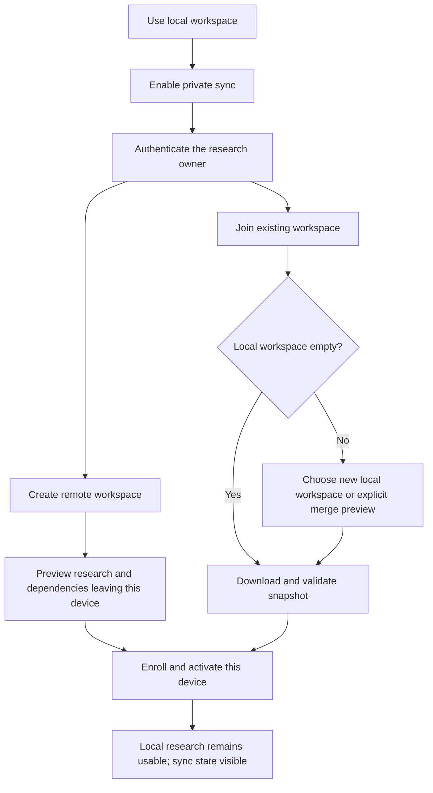

# v0.5.0 workspace and storage experience

Status: **UX specification, not implemented UI**, 2026-10-26. Local sync and blob
primitives exist for isolated development, but app enrollment, full research sync,
pinning, backup/restore and the screens below are still integration work. v0.4.1
continues to provide local research and snapshot sharing.

## Entry and information hierarchy

Use one **Workspace / 工作區** entry near the active workspace name. Keep the main
reader focused on research; a compact persistent status opens details on demand.

| Section | Main information | Primary actions |
|---|---|---|
| Overview | Workspace name, active path, local save/sync summary, last successful sync | Open folder; sync details; continue reading |
| Offline files | Verified bytes, pinned size, missing/failed assets and available space | Prepare selected research for offline use; retry; manage downloads |
| Devices | This device, enrolled devices, last contact and access state | Add device; reconnect; revoke another device |
| Recovery | Backup location/time, retained versions, recoverable deletions and conflicts | Create backup; restore preview; review conflicts |
| Advanced | Explicit path override and supported compatibility information | Validated relocation flow; diagnostics without research content |

AI accounts/models remain in the existing AI settings. Sync credentials, AI
credentials and analytics consent are separate controls, not one "account" switch.
Do not copy provider homes, `llm.json`, OAuth tokens, usage logs or telemetry into
research sync, sharing or portable research backups.

## Local location is visible before sync

Display the resolved active path and whether it came from an override or a default.
Current defaults in `runtime.py` are:

| Installation | Current default when no override is set |
|---|---|
| Windows installed app | `%APPDATA%\Paperfact` |
| macOS installed app | `~/Library/Application Support/Paperfact` |
| Linux installed app | `$XDG_DATA_HOME/Paperfact`, otherwise `~/.local/share/Paperfact` |
| Source checkout | Repository `data/` |

`PAPERFACT_DATA` takes precedence, then legacy `PAPER_DAILY_DATA`. Preserve these
existing locations. A future default-location policy requires an explicit migration,
not silently changing `runtime.py` and treating the user's library as empty.

Relocation must check destination and space, stop new writers, take a consistent
snapshot, copy and verify, then deliberately switch configuration and local CLI/MCP
bindings. Keep the original until verification and successful reopen. Cancel/failure
before switching leaves the original active; failure after switching offers rollback.
Do not support synchronizing a live SQLite file by placing it in a cloud-drive folder.

## Enrollment and independence

The service/auth flow is not implemented by this diagram. Every private download
requires authenticated workspace authorization; "stage" describes the local
data-switch boundary, not an anonymous read endpoint. Cancel at any review/login step keeps
the current research usable and does not upload it or grant analytics consent.
An imported colleague bundle never enrolls the recipient into the sender's workspace.

A nonempty join cannot silently overwrite or deduplicate by paper/list titles.
Show proposed additions, identity collisions and conflicts. Require a deliberate
merge choice or use a separate workspace; retain unsent content for review.

## State and action model

| State | Suggested English / zh-TW label | Action and interaction rule |
|---|---|---|
| Local save committed | Saved on this device / 已儲存於此裝置 | Show after durable transaction; does not imply upload |
| Pending work | Waiting to sync: N changes / 待同步 N 項變更 | View details; background retry when eligible |
| Running | Syncing / 同步中 | One job per workspace/session; show actual phase/count/bytes |
| Complete | Up to date / 已同步 | Last successful time; offline availability remains separate |
| Offline | Offline; changes saved locally / 離線，變更已儲存於本機 | Continue editing; no forced login modal |
| Failure | Sync failed; local changes kept / 同步失敗，本機變更已保留 | Concise actionable reason; retry without duplicate work |
| Conflict | Review N conflicting changes / 檢視 N 項內容衝突 | Compare preserved versions and resolve explicitly |
| Revoked/expired | Reconnect this device / 重新連接此裝置 | Stop requests; preserve research and unsent edits |
| Incompatible | Update required for sync / 更新後才能同步 | Prevent incompatible remote writes; preserve local work/export |

Do not invent percentage completion for an unknown phase. Use determinate progress
for known file bytes or bounded operations; otherwise show activity and a truthful
phase. Keep error summaries free of tokens, signed URLs and research bodies.

Remote updates never steal keyboard focus, change the open paper or overwrite an
unsaved editor. Surface a quiet "New changes available" action; apply a pending
view refresh when safe. Reading positions are per-device resume suggestions.
Close/cancel invalidates callbacks for the old workspace/session; late results
must not appear in the next account or current paper. Cancellation stops transfer
at a safe boundary and retains recoverable local work.

## Offline preparation and storage

Select lists or papers, then preview the dependency closure: requested PDFs,
extracted reading content, figures, highlight anchors, deck manifests and required
deck assets. Shared assets count once by hash. Do not recursively acquire every
cited paper or run analysis to manufacture missing content.

Show verified/downloaded bytes separately from reserved pending bytes, reclaimable
cache, pinned content and required additional space. Present per-item reasons such
as "PDF missing", "Download failed" or "Deck asset missing". Only verified complete
dependencies earn "Available offline / 可離線使用".

Unpinning makes eligible bytes reclaimable; it does not delete a paper, remove its
list membership, erase notes or emit a research tombstone. Active transfers,
unsent edits, pinned dependencies and retained history block unsafe eviction.
Wrong hash/PDF version remains unavailable and offers explicit repair/retry.
Cancel does not discard already verified shared assets needed elsewhere.

## Backup, restore and recovery

- A research backup is a consistent database snapshot plus verified attachment
  manifests/bytes, retained versions and enough pending-work metadata for recovery.
  A selected-list sharing ZIP is not a full workspace backup.
- Exclude service/AI credentials and reusable device identity from portable backups.
  Explain the scope before export; a raw private filesystem backup is a different
  operator action and must not be presented as a safe shareable research package.
- Restore into a new isolated directory, validate schema and all expected hashes,
  then show counts, missing assets and recoverable pending edits before activation.
  Do not overwrite the current workspace as the default restore action.
- Re-enroll the restored installation with a new device identity. Reconcile old
  pending operations against retained server receipts and current heads; do not
  blindly replay copied operations under a new identity or silently drop them.
- If the backup/device exceeds the retention horizon, require a fresh bootstrap
  while retaining unsent edits for review. Restoring an old snapshot cannot silently
  resurrect tombstoned research or undo a newer conflict resolution.
- Conflict comparison shows both versions, origin and revision. Choosing or merging
  creates a versioned operation; stale resolutions can conflict again. Keep history
  until the documented retention policy permits removal.
- Revoking a device stops future authorized access; it cannot erase copies the
  device already downloaded. Show that limit in device-removal copy.

## Keyboard, touch and accessibility

- Tab order follows visible section order; Enter activates the focused primary
  action, Space toggles selection, Escape cancels the current dialog without data loss.
- Lists have a clear initial focus and arrow navigation; editable text retains its
  native caret/selection keys. Do not intercept document editing shortcuts globally.
- Label toggles with text plus selected state; never rely on color alone. Use touch
  targets of at least 44 CSS pixels in new mobile flows and a layout without horizontal
  scrolling at narrow widths.
- Announce meaningful state transitions through accessible status text without
  repeatedly reading every progress tick. Keep retry and conflict actions reachable
  by keyboard and visible at larger text sizes.
- Use text resources for English/Traditional Chinese; timestamps, counts and storage
  units are formatted values rather than concatenated sentence fragments.

## Acceptance evidence required before implementation is called complete

Test empty/nonempty enrollment, every cancel boundary, out-of-space/corrupt snapshots,
repeated activation, interrupted transfer, wrong-document anchors, unsafe eviction,
failed restore/rollback, stale session callbacks and close while workers run. Assert
saved content and visible state, not merely handler invocation. Verify focus/draft
preservation and keyboard/touch navigation separately from storage unit tests.
Record real Windows/Mac/mobile checks in the
[release matrix](release-readiness-0.5.md); this specification supplies no such passes.
