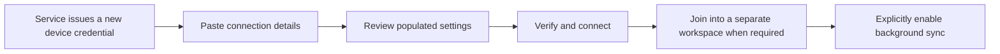

# Explicit workspace connections

The workspace dialog now opens a separate **Sync connection** page. Opening the
page reads local status only. Connecting authenticates the administrator-issued
workspace ID, device ID and credential through `session_info`; it sends no
research. The credential is held in session memory and cleared on disconnect.
Restart requires reconnecting, or a separate explicit device-local startup opt-in.
An already trusted desktop can now issue [pairing details](sync-device-management.md#desktop-pairing-and-retry);
the receiver saves its independent credential in the native store before admission.
Join and Open created workspace are on the main path after verification; Advanced
contains manual connection details. This is reference/self-hosted sync, not AI login
or a public signup flow.

## Available actions

- **Sync now** operates only on an already capture-bound database whose journal,
  research and capture identities exactly match the authenticated session.
  Existing unbound data is never enrolled or uploaded as a side effect of login.
- **Join into a new workspace** replays the full retained event stream into a
  separate staged database using a newly issued device identity. Local active
  identity reuse and identities already represented as authors in replayed
  history are rejected. Completed metadata is published by atomic no-replace
  directory rename. An existing unrelated directory is never overwritten.
- **Open created workspace** starts a separate app process with an explicit
  data directory. The existing per-workspace single-instance protocol raises an
  already open destination. The original window and drafts remain open. Sync
  credentials and provider environment secrets are not forwarded. Startup checks
  the selected database identity before migrations; no in-process global path
  rebinding occurs. Restored backups remain detached, and opening does not enroll
  them. The opening contract accepts exact paper/deck focus; creation of editable
  recovered copies remains a separate unfinished layer. A build without that
  capability rejects deck focus before launching, without changing either workspace.

The connection dialog disables duplicate actions and exposes cancellation.
Closing during work requests cancellation and waits for the worker to finish.
Changing the endpoint/identity disconnects the previous session immediately.
Late responses cannot acknowledge into a replaced database or a changed session.
An already accepted remote request may finish before cancellation; retry uses the
same operation identity, so this does not create another research version.

## Progress, files and retry

Pending uploads, acknowledged-but-not-received receipts, conflicts and received
metadata are separate counts. A manual pass is bounded by pages, elapsed work
budget and attachment steps. Network requests have the existing transport timeout;
cancellation is cooperative at safe boundaries. No percentage or completion time
is invented for unknown remaining history.

Only an **empty pull** exhausts the observed stream prefix. HTTP may shorten a page
because of event/byte caps; a nonempty short page is not completion. The current
server does not provide a frozen bootstrap high-water token, so later changes
arrive on the next manual sync rather than being implied by a completed join.

PDF and editable-deck manifests upload through the existing verified blob
coordinators before publication. Desired files download independently and become
readable only after verified binding. Unavailable files, missing local storage
registration and transfer failures remain visible pending work. Metadata readiness
is never labelled complete offline availability. Joining registers new local file
paths; the user reconnects in the new window and syncs to download its attachments.

Interrupted joins keep a private deterministic sibling stage and durable cursor.
Reconnect with the same endpoint, workspace/device and destination to resume.
Initialization and final publication use separate atomic directories. Cancellation
after path registration and publication failures are retryable. An unsupported
event fails the batch without advancing past it. Stage metadata contains no token.
Stages are retained for explicit retry; automatic stage expiration/cleanup is not
implemented.

## Remaining release gates

This provides an actual connection, manual sync, new-device join and new-window
journey. The following remain required development work:

- Complete first enrollment of existing research, with the full writer/file
  inventory, consistent baseline capture and independent recovery prerequisites.
- Native-store and installed-device acceptance for remembered credentials and
  desktop pairing/revocation. First-device issuance remains the trusted
  administrator API; there is no public signup or third-party OAuth.
- Compatibility/version negotiation, authority rollback/generation protection,
  retention policy and production service deployment/security review.
- Live packaged Windows/macOS/Linux launch and authenticated deployment checks.
  Fixtures cover source/frozen launch commands, cancellation and data isolation;
  they do not prove every packaged platform or external service.

Newer annotation contracts must be present in the receiving build. Unknown kinds
or feature payloads are rejected, never skipped to make the cursor appear current.

## Advanced manual connection setup (development candidate)

Paste a credential-bearing connection record into **Paste connection details
from your service**, then choose **Use connection details**. The record is parsed
in a guarded background worker using the existing closed `Connection` format;
this neither contacts the service nor authorizes research synchronization.
Review the populated endpoint/workspace/device, then explicitly verify and
connect. Automatic synchronization is a separate opt-in. Manual fields remain
available, including credentials too large for the native-vault record format.



The closed JSON format is version 1, with exactly `format`, `endpoint`,
`workspace_id`, `device_id` and `token`. It uses the existing vault record's size,
identifier, credential and HTTPS/literal-loopback URL validation; duplicate JSON
fields are rejected. An example shape, with deliberately unusable placeholders:

```json
{"format":1,"endpoint":"https://sync.example.org","workspace_id":"example-workspace","device_id":"new-mac-device","token":"REPLACE_WITH_NEW_DEVICE_TOKEN"}
```

This is private connection material, not a public share link or a signed pairing
code. Receive it only from the operator of the intended service. Do not put it in
issues, research packages or documentation. Each device requires its own issued
identity/credential; copying the desktop's identity is not enrollment. This UI
adds no issuance, OAuth, remote HTTPS deployment or account recovery endpoint.
No actual service configuration or credential is created by reading this guide.

The input is masked and cleared once parsing starts; accepted credentials remain
masked in the manual form until explicit verification clears them. Pending parse
blocks repeated activation, and cancel/close/workspace changes reject late
results. Invalid records preserve existing fields and do not disconnect a
verified route. A successful load stops the old route before replacing fields.


## Explicit review of legacy acknowledgments

Source after candidate355382c adds this desktop flow. That delivered native
candidate has not been rebuilt for these controls.

1. A history refusal reveals **Review saved sync history** below **Sync now**.
   Normal connections keep this action hidden. It needs a verified connection to
   this database's own capture-bound device; no AI or extra account is involved.
2. Review reads bounded linked history and compares exact retained inbox events,
   operation envelopes and acknowledgment sequences. Real per-page sequence and
   receipt counts are shown, not an estimated time or completion percentage.
   **Continue history check** resumes an incomplete in-memory scan.
3. A completed review reveals **Use verified history**. Its confirmation defaults
   to **No**. Acceptance rechecks the service prefix and current local evidence in
   the guarded transaction, saving only proof metadata. It does not move/reset the
   received cursor, clear queued edits, apply research, transfer files or start sync.
4. Choose **Sync now** explicitly to receive the verified history and continue.
   A different/missing history, damaged proof row, changed retained evidence or
   unsupported protocol stays refused. Keep the old workspace; do not delete its
   outbox or fabricate a fresh identity to bypass the warning.

Stop/close/disconnect preserve committed research. Stop allows another explicit
review; closing or a changed connection cannot deliver a stale adoption result.
Partial reviews keep canonical-content fingerprints rather than raw note bodies.
They are device-session memory, never exported, logged or persisted as
research. Closing/reconnecting starts the read-only comparison again. New pending
edits do not themselves authorize adoption or become part of the proof scan.

| Internal API | Contract |
|---|---|
| `SyncClient.review_legacy_history(transport, token, review=None, *, limit=100, max_pages=25, seconds=20, check=..., progress=...) -> SyncHistoryReview` | Resumable bounded read-only observation; at most100,000 records per family and16 MiB of retained fingerprints; cancellation/deadline checks during capture and pages |
| `SyncHistoryReview.summary() -> dict` | Counts/completeness only; the private in-memory evidence object is not a wire packet or diagnostic export |
| `SyncClient.adopt_legacy_history(review) -> dict` | Explicit completed-review adoption; exact local evidence/native-file binding and atomic proof save, idempotent core retry |
| `SyncSession.review_history(ticket, progress=..., *, max_pages=25) -> dict` | Existing single-job admission and identity checks; retains only this connection generation's partial review |
| `SyncSession.history_review_summary() -> dict or None` | Credential/content-free current-generation progress |
| `SyncSession.adopt_history_review(ticket) -> dict` | Explicit adoption with a fresh authenticated prefix check and guarded local commit |

The deadline is cooperative: an admitted OS/network call is not hard real-time.
Oversized/corrupt retained inputs stop rather than truncate into success. Matching
an old receipt proves its operation/sequence, not an outcome the old device never
recorded, full research completeness, durable authority control history or
anti-rollback/distributed fencing. A normal fresh sync still performs the actual
receive/conflict projection. No hosted, installed-Mac or physical-device result is
implied by the Windows Qt/native fixtures.


## Device-local authority knowledge (development)

Current official-v4 source connections retain a small authenticated control-history
point in private workspace metadata. Reconnect verifies it before private research
requests. Joining keeps it in the staging and final workspace too; a rejected
rollback leaves the old workspace, staged research and outbox available. This is
not a credential and grants no automatic connection/upload permission. Sharing a
list does not share device-control metadata. Mobile uses a separate IndexedDB
metadata record rather than copying the PDF cache per request.

See [wire/API details and remaining recovery limits](sync-http.md#device-retained-authority-control-checkpoints).
Windows/Mac1875db5 candidates include these changes and pass the frozen control
handshake/refusal/restart checks. Durable storage and recovery-dialog coverage
remains source/Qt/HTTP evidence. Independent external anchors, coordinated HTTPS
deployment and physical cross-device acceptance remain release gates.
